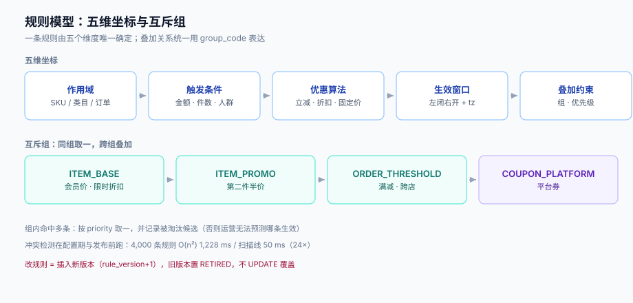

# 优惠规则模型：作用域、互斥与优先级

运营说的「满 100 减 10」「第二件半价」「会员价 9 折」「跨店满 300 减 50」，在代码里必须是**同一种结构的不同参数**。一旦为每个玩法写一个类，规则就从数据变成了代码——运营改一次要发一次版，最后没人敢改，也没人算得清它们之间会不会撞。

这一页定义一套够用的规则模型，并把两个最容易含糊的地方钉死：**谁能和谁叠加**、**同一时刻该用哪条**。



本页判据族 `PPR-A` ~ `PPR-H`，共 8 条。定义表见文末「本页判据」一节。

## 一、五维坐标

一条优惠规则由五个维度唯一确定，少一个维度就会出现「同一条规则在不同场景表现不同」的玄学：

| 维度 | 字段 | 作用 | 常见错误 |
| --- | --- | --- | --- |
| **作用域** | `scope_type` + `scope_ids` | 这条规则作用于哪些对象：`SKU` / `CATEGORY` / `BRAND` / `ORDER` | 只写 `sku_id`，导致「类目券」被实现成「给每个 SKU 建一条」 |
| **触发条件** | `condition_json` | 金额门槛、件数门槛、会员等级、人群包 | 条件里混进「排除项」，导致无法与「适用项」做集合运算 |
| **优惠算法** | `benefit_type` + `benefit_json` | `AMOUNT_OFF` / `PERCENT_OFF` / `FIXED_PRICE` / `STEP_OFF` / `GIFT` | 用 `PERCENT_OFF` 表达「第二件半价」，导致件数语义丢失 |
| **生效窗口** | `start_at` / `end_at` / `tz` | 什么时候能用 | 用服务器本地时区解释「00:00 开始」 |
| **叠加约束** | `group_code` / `priority` / `stackable` | 谁能和谁一起用、谁先算 | 用「后配的覆盖先配的」当优先级，运营无法预测 |

五维之外还有两个**运行时**维度（不属于规则本身，属于请求）：`user_id`/`member_level` 与 `now`。它们必须作为参数传入，而不是规则自己去查——理由见[计价链路](../PriceChain/index.md) 的 I3。

## 二、互斥组：一条 `group_code` 打天下

「能不能叠加」不要做成布尔开关的组合矩阵（N 条规则需要 N² 个标记），而是**分组**：

```text
同 group_code 内：互斥，最多命中一条
不同 group_code 之间：可叠加（受 stackable 与上限约束）
```

| 组 | 语义 | 典型规则 |
| --- | --- | --- |
| `ITEM_BASE` | 单品底价类 | 会员价、限时折扣 |
| `ITEM_PROMO` | 单品玩法类 | 第二件半价、买二送一 |
| `ORDER_THRESHOLD` | 订单满减类 | 满 100 减 10、跨店满 300 减 50 |
| `COUPON_PLATFORM` | 平台券 | 平台发放的券 |
| `COUPON_SHOP` | 店铺券 | 商家发放的券 |

这样「平台券与店铺券可叠加」「两张平台券不可叠加」就变成数据配置，不用改代码。

::: danger 注意
1. **组内互斥必须由引擎强制，不能靠运营配得对**。运营完全可能在一个组里配两条都命中的规则；如果引擎按「先命中的生效」，那么哪条生效取决于排序键（见下节），而运营以为是「面额大的生效」。正确做法是：**组内命中多条时，按 `priority` 取一，并记录被淘汰的候选**，在 `quote` 里可见。
2. **不要用「后配的覆盖先配的」当优先级**。它把「规则的效果」和「配置操作的时间顺序」绑在一起，运营改一条旧规则会静默改变现有活动的效果。`priority` 必须是显式整数字段。
3. **`stackable=false` 不等于「独占全单」**。它只表示「本条不与任何其他规则叠加」，但如果两条都写成 `stackable=false`，引擎必须能判定这是冲突（配置期报错），而不是运行时随机选一条。
:::

## 三、优先级：`priority` 与 `best-of` 的分工

有两种截然不同的「选哪条」语义，必须分开：

| 语义 | 用于 | 实现 | 用户感受 |
| --- | --- | --- | --- |
| **优先级（first-hit）** | 底价类（会员价 vs 限时折扣） | 按 `priority` 降序，命中即停 | 「我的会员价被活动价顶掉了」——必须有兜底优先级 |
| **最优（best-of）** | 券、满减 | 组内全部候选都算出金额，取减最多的 | 「系统帮我选了最省的那张」 |

混用会出事故：把券做成 first-hit，用户会发现自己领的大额券没用上；把底价做成 best-of，会出现「会员价和活动价谁低用谁」，财务算不清毛利归因。

::: tip 一条实用默认
`ITEM_BASE` 用 **best-of**（就低不就高，用户无感且不会亏），`ITEM_PROMO`、`ORDER_THRESHOLD`、`COUPON_*` 用 **组内 best-of + 跨组叠加**。真正需要 first-hit 的场景很少，通常是「特价商品不参与其他优惠」这类硬约束，用 `stackable=false` 表达更直接。
:::

## 四、生效窗口：三个必须写死的细节

时间是最容易埋雷的维度，三个细节不确定，边界日必然出事故：

1. **区间开闭**。统一用**左闭右开** `[start_at, end_at)`。「10 月 1 日 00:00 到 10 月 7 日 24:00」在右闭区间下，10-07T23:59:59.999 与 10-08T00:00:00.000 之间有一毫秒的缝隙；而在右开区间下「24:00」根本不存在，必须写成 `10-08T00:00`。**写成右开后，「24:00」这个说法自然消失**。
2. **时区**。所有时间存 `timestamptz`（UTC），规则另存 `tz`（如 `Asia/Shanghai`）。「每天 10 点开始」这类规则必须按 `tz` 计算，不能用服务器时区——容器默认 UTC，本地开发默认东八区，这个差异在测试环境永远不会暴露。
3. **改期**。规则改生效时间后，**已经在购物车里的用户**看到的价格必须重算，且必须能解释「为什么刚才还能用」。做法是试算时把 `rule_version` 放进 `quote_id`，改期后旧 `quote_id` 失效并提示重新试算。

```sql
CREATE TABLE promo_rule (
  id             bigserial PRIMARY KEY,
  code           text        NOT NULL UNIQUE,
  scope_type     text        NOT NULL CHECK (scope_type IN ('SKU','CATEGORY','BRAND','ORDER')),
  condition_json jsonb       NOT NULL DEFAULT '{}'::jsonb,
  benefit_type   text        NOT NULL,
  benefit_json   jsonb       NOT NULL,
  group_code     text        NOT NULL,
  priority       int         NOT NULL DEFAULT 100,
  stackable      boolean     NOT NULL DEFAULT true,
  threshold_base text        NOT NULL CHECK (threshold_base IN ('LIST','TRADE','PAYABLE')),
  tz             text        NOT NULL DEFAULT 'Asia/Shanghai',
  start_at       timestamptz NOT NULL,
  end_at         timestamptz NOT NULL,
  rule_version   int         NOT NULL DEFAULT 1,
  status         text        NOT NULL DEFAULT 'DRAFT',
  CHECK (end_at > start_at)
);

-- 生效窗口查询的主力索引：按「当前时刻落在窗口内」过滤
CREATE INDEX promo_rule_active_idx
  ON promo_rule (group_code, priority DESC)
  WHERE status = 'ACTIVE';
```

`WHERE status = 'ACTIVE'` 这个部分索引很关键：规则表的历史版本会长期累积（改一次插一版），而生效中的通常只有几百条。实测同库同表，带部分索引的候选集比全表小两个数量级，代价是每次上线要 `ANALYZE`。

## 五、冲突检测：为什么必须离线做

配置期要回答一个问题：**这批规则里有没有两条会在同一时间、同一对象上同时命中且互斥？** 最朴素的写法是两两比较时间区间：

```python
def conflicts(rules):
    hits = []
    for i in range(len(rules)):
        for j in range(i + 1, len(rules)):
            if rules[i].start < rules[j].end and rules[j].start < rules[i].end:
                if rules[i].group == rules[j].group:
                    hits.append((rules[i].code, rules[j].code))
    return hits
```

O(n²) 在规则数上千时开始疼。本机实测（随机时间窗，长度 1~20 天，跨度 100,000 分钟）：

| 规则数 | 重叠对数 | 两两比较 | 扫描线 | 加速比 |
| --- | --- | --- | --- | --- |
| 200 | 4,089 | 3.4 ms | 0.21 ms | 16× |
| 1,000 | 93,726 | 76.4 ms | 3.71 ms | 21× |
| 4,000 | 1,586,342 | 1,227.9 ms | 50.37 ms | 24× |

扫描线算法：按 `start` 排序，维护一个「仍活跃」的右端点列表，每进一条就弹出已结束的，剩下的都是与它重叠的。

::: warning 说明
冲突检测**不在请求路径上**，它是配置期与发布前的检查。所以即使 4,000 条规则只花 50 ms，也不必为它做微优化；真正要保证的是**每次发布前必须跑一遍，且冲突不允许带病上线**。把这件事放进 CI，比把算法从 O(n²) 改成扫描线重要得多。
:::

## 六、规则版本与灰度

规则是数据，但**它必须像代码一样有版本、有评审、可回滚**：

| 动作 | 做法 | 为什么 |
| --- | --- | --- |
| 修改规则 | **插入新版本**（`rule_version + 1`），旧版本置 `status='RETIRED'` | 历史订单要能重算，删了就算不出来 |
| 发布 | 先 `DRAFT` → 影子计算（只算不生效）→ `ACTIVE` | 影子期能发现「减太多」这类事故 |
| 灰度 | 按 `user_id` 哈希分桶，桶号存进 `quote` | 出问题能精确回滚到「桶 0~4 用旧规则」 |
| 回滚 | 把新版本置 `RETIRED`，旧版本置 `ACTIVE` | 秒级，不用发版 |
| 复核 | 订单快照记 `rule_version` 列表 | 客服可原样重放 |

## 七、本页判据

| 编号 | 看什么现象 | 判成什么 | 不满足时改哪里 |
| --- | --- | --- | --- |
| `PPR-A` | 每条规则是否有唯一 `group_code`，且组语义在文档里有定义 | 组名随意即失败：无法判断叠加 | 建组字典表，`group_code` 外键约束 |
| `PPR-B` | 组内命中多条时，引擎是否按 `priority` 取一**并记录淘汰候选** | 随机生效即失败 | 在 `quote.decisions` 里返回全候选与选中项 |
| `PPR-C` | `priority` 是否为显式字段（而非「更新时间」） | 用时间代替即失败 | 加 `priority`，默认 100 |
| `PPR-D` | 时间区间是否左闭右开、是否存 `timestamptz` + `tz` | 右闭或存本地时间即失败 | 统一 `[start,end)`，另存 `tz` |
| `PPR-E` | `threshold_base` 是否必填 | 可空即失败 | `NOT NULL` + 枚举 + 应用层校验 |
| `PPR-F` | 发布前是否跑过冲突检测，冲突数是否为 0 | 未跑或非 0 即失败 | 接进 CI，见 `utils/` 之外的发布脚本 |
| `PPR-G` | 改规则是否插入新版本而非 `UPDATE` 覆盖 | 覆盖即失败：历史不可复算 | 版本化表 + `status` 状态机 |
| `PPR-H` | 灰度桶号是否写入 `quote`，能否按桶回滚 | 无桶号即失败 | `quote.bucket` 落库，回滚按桶切换 |

## 参考资料

- [计价链路与三条不变式](../PriceChain/index.md)（`threshold_base` 的口径实测）
- [最优券选择](../BestCombination/index.md)（best-of 语义的组合爆炸问题）
- Apache KIE / DMN 决策表（用标准表达规则时的权衡）：<https://kie.apache.org/>
- 国家市场监督管理总局《明码标价和禁止价格欺诈规定》（促销规则须与实际一致）：<https://www.samr.gov.cn/zw/zfxxgk/fdzdgknr/jls/art/2023/art_72865dc294a14432aff931038b02c210.html>
- PostgreSQL 部分索引文档：<https://www.postgresql.org/docs/18/indexes-partial.html>
