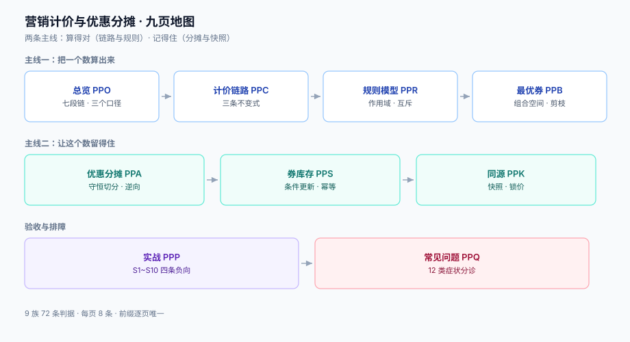

# 营销计价与优惠分摊

计价这件事听起来像一道算术题，实际是一个**一致性问题**：同一个「应付 87.30 元」会在商品详情页、购物车、结算页、订单快照、支付单、退款单、发票、对账单这八个地方被算出来，而它们分别由不同的代码、不同的时刻、不同的数据版本算出。任何一处算法不同源，用户看到的价、你收到的钱、财务记的账就会各说一套。

本专题只讲**从标价到应付这一段链路的工程实现**：优惠怎么建模、最优券怎么选、优惠金额怎么摊到每一行、券怎么防超发、试算与结算怎么保证同源。营销玩法怎么策划、活动怎么排期，不在范围内。

::: tip 一句话理解
计价引擎的成本不在「算出一个数」，而在**同一个数被算八次之后还能对齐**——所以它的核心不是公式，是**规则版本、金额精度、分摊账、快照**四件事。
:::

::: info 本专题与相邻专题的分工
- **购物车的行金额与试算骨架** → [电商系统设计](../Ecommerce/Cart/index.md)：那页给的是「行金额 + 优惠分摊」的骨架并明确「省略了促销引擎的细节」，本专题补的正是被省略的那部分：叠加模型、最优选择、券库存、逆向分摊。
- **订单状态机与取消退券** → [订单状态机](../Ecommerce/OrderStateMachine/index.md)：那页管「取消要把券还回去」这个动作属于哪个迁移，本专题管「还多少、还给谁、还几次」。
- **复式记账与清结算** → [账务与清结算](../Ledger/index.md)：会计分录与结算周期在那边，本专题只保证「交给记账的金额分得清、加得回」。
- **支付金额与回调** → [支付与回调](../Ecommerce/Payment/index.md)：通道只认一个 `total_amount`，本专题负责让这个数与订单快照逐分相等。
- **幂等键与重放** → [幂等与状态机工程](../IdempotencyStateMachine/index.md)：`Idempotency-Key` 的形状与去重窗口在那边，本专题只讲「券核销为什么要它」。
- **促销效果的实验判定** → [实验设计与分桶](../../Tools/ObservabilityDriven/Experiments/index.md)：那页判「这次促销有没有效」，本专题判「这次促销算得对不对」——**一个问收益，一个问正确性，混在一起会两边都测不准**。
- **秒杀场景的库存护栏** → [电商系统设计](../Ecommerce/FlashSale/index.md)：超卖防护在那边，券库存的超发防护在这里，两者是同构问题、不同资源。
- **项目侧的退款链路** → [EventOrderHub · 退款与部分退款](../../../project/Complete/EventOrderHub/Refund/index.md)：项目页是落地实现，本专题提供它依赖的分摊与逆向算法。
:::

## 目录

- [总览：从标价到应付的七段链](Overview/index.md)
- [计价链路与三条不变式](PriceChain/index.md)
- [优惠规则模型：作用域、互斥与优先级](RuleModel/index.md)
- [最优券选择：组合空间、剪枝与贪心的误差](BestCombination/index.md)
- [优惠分摊：最大余数法与逆向退款](Allocation/index.md)
- [券库存与核销：超发、幂等与退券](CouponStock/index.md)
- [试算与结算同源：快照、锁价与漂移](Consistency/index.md)
- [实战：一个能跑起来的最小计价服务](Practice/index.md)
- [常见问题与分诊](FAQ/index.md)

## 专题地图

## 判据纪律

沿用全库写法：**每页 8 条，编号形如 `PPO-A`**，逐页前缀唯一，可被 `utils/audit` 下的判据类巡检机械核对。每条判据回答四件事：**看什么现象、判成什么、不满足时改哪里**。

| 页 | 判据族 | 这一族管什么 | 条数 |
| --- | --- | --- | --- |
| 总览 | `PPO-A` ~ `PPO-H` | 七段链、三个金额口径、五个必失点 | 8 |
| 计价链路 | `PPC-A` ~ `PPC-H` | 三条不变式、顺序敏感、精度、舍入 | 8 |
| 优惠规则 | `PPR-A` ~ `PPR-H` | 作用域、互斥组、优先级、生效窗口、冲突检测 | 8 |
| 最优券选择 | `PPB-A` ~ `PPB-H` | 组合空间、剪枝、两种贪心、封顶与兜底 | 8 |
| 优惠分摊 | `PPA-A` ~ `PPA-H` | 分摊算法、合计守恒、逆向退款、分账承担 | 8 |
| 券库存与核销 | `PPS-A` ~ `PPS-H` | 三层库存、条件更新、幂等、退券、状态机 | 8 |
| 试算与结算 | `PPK-A` ~ `PPK-H` | 快照、锁价、漂移、改价灰度、对账 | 8 |
| 实战 | `PPP-A` ~ `PPP-H` | 表结构、接口契约、验收序列、负向断言 | 8 |
| 常见问题 | `PPQ-A` ~ `PPQ-H` | 分诊表、误判、止血顺序、自查 | 8 |

合计 **9 族 72 条**。

## 事实与规格速览（2026-10 口径）

计价没有「版本升级」这种说法，但下面这些事实会直接决定实现细节，写清楚以免被旧文误导：

| 事项 | 现状 | 对计价链路的影响 |
| --- | --- | --- |
| 金额的最小单位 | 支付通道普遍以**整数「分」**传输（微信支付、支付宝的 `total` / `total_amount` 都是分） | 引擎内部**一律用整数分**运算；`decimal` 只用于展示与报表，不用来累加 |
| 币种小数位 | ISO 4217 定义各币种 minor unit：人民币/美元 **2** 位、日元 **0** 位、科威特第纳尔 **3** 位 | 「乘 100 存整数」不是通解；跨币种时必须读币种表，不能写死 2 |
| 浮点表示 | IEEE 754 binary64 无法精确表示 `0.1` | `0.1 + 0.2 != 0.3` 恒成立；**任何「金额相等」的比较都不能用浮点** |
| 默认舍入模式 | IEEE 754 默认 **round half to even**（银行家舍入） | Java `BigDecimal` 的 `RoundingMode.HALF_EVEN` 与之对应；而多数业务文档写的是 `HALF_UP`——**两者在 `.xx5` 边界上结果不同**，必须明确选一个并写进契约 |
| 促销规则一致性 | 《明码标价和禁止价格欺诈规定》（市场监管总局令第 56 号，2022-04-14 公布、**2022-07-01 施行**）明确：公布的促销活动范围、规则与实际不一致，属价格欺诈；以积分、礼券、兑换券等折抵价款时拒不按约定折抵，同样属价格欺诈 | 计价引擎的规则版本必须**与前台展示同源**，且「说了能抵就必须抵」——这不是体验问题，是合规问题 |
| 价格变动 | 同规定要求「商品或者服务的价格发生变动时，应当及时调整相应标价」 | 改价与计价之间必须有**生效时间**与**锁价窗口**，见[试算与结算同源](Consistency/index.md) |

## 为什么这里没有版本目录

本专题**不建 `v1/` `v2/` 这类版本目录**，理由三条：

1. **换代的是玩法，不是判据**。从「满减」到「第二件半价」到「跨店满减 + 店铺券 + 平台券」叠加，变的是运营配置出来的规则形状；而「合计必须等于订单额」「券不能超发」「退款不能多退」这三类问题一字未变。判据跟着问题走，不跟着玩法走。
2. **并存差异是选型，不是代际**。同一时期里，有人把规则写成 DRL、有人写成 YAML 决策表、有人直接写 Java 分支——它们是**三种表达**，不是新旧版本。按版本建目录会把「表达方式对照」拆成「历史存档」，读者反而要跨目录才能比较。
3. **可验证的差异已收敛进表格**。凡是有「两种做法」的地方（`HALF_UP` vs `HALF_EVEN`、枚举最优 vs 贪心、行级分摊 vs 订单级分摊），都用同一张表写清「什么时候用哪个、差多少」，并附本机读数。

作为对照，本库确实存在需要版本目录的主题：[Spring 5 / Spring 6](../Java/Frame/Spring/index.md)、[Vue 2 / Vue 3](../../Frontend/Frame/Vue/index.md)、[MySQL 版本演进](../../DB/SchemaEvolution/index.md)——它们的共同点是**同一个产品的两代 API 不兼容且旧版仍在跑**，与本题不同。

## 三条底线

::: danger 三条不可让步的底线
1. **行金额之和必须等于订单金额，一分不差**。这不是「差不多就行」的展示问题：分摊表是所有后续动作的输入——退款按它算、分账按它分、开票按它开。本机实测：按比例各自四舍五入，**29.43% 的订单**分摊合计与总额不等（偏差 ±1~2 分）；换成最大余数法后**偏差 0 单**。见[优惠分摊](Allocation/index.md)。
2. **券的核销必须是条件更新，不能「先查再改」**。20 并发抢 100 张库存，先查再改的写法让 **200 次核销全部成功**，而计数器只记到 **28**——超发 100 张，且账面与事实彻底脱节。见[券库存与核销](CouponStock/index.md)。
3. **试算与结算必须是同一份实现、同一个快照**。改价 5% 之后，500 单里 **100%** 出现「结算价 ≠ 试算价」，平均差 **10.75 元**。用户看到的价格和你收的钱不一致，无论解释成「以结算为准」还是「以展示为准」，都是错的——正确做法是**下单时锁价**。见[试算与结算同源](Consistency/index.md)。
:::

## 阅读顺序

先读[总览](Overview/index.md)拿到七段链的全局图，然后按手上的问题选主线：

- **用户投诉「优惠没减够 / 减多了」** → [优惠分摊](Allocation/index.md) → [计价链路](PriceChain/index.md)
- **结算价与详情页不一致** → [试算与结算同源](Consistency/index.md)
- **券被超领 / 核销数对不上** → [券库存与核销](CouponStock/index.md)
- **运营说「这张券怎么没生效」** → [优惠规则模型](RuleModel/index.md) 的生效窗口与互斥组
- **想知道「为什么不用最简单的贪心」** → [最优券选择](BestCombination/index.md)，那里有两种贪心的实测误差
- **要从零搭一个能验收的最小系统** → [实战](Practice/index.md)，按 S1~S10 走
- **线上正在多减钱，先止血** → [常见问题与分诊](FAQ/index.md) 的分诊表

## 参考资料

- 国家市场监督管理总局《明码标价和禁止价格欺诈规定》（第 56 号令，2022-07-01 施行）：<https://www.samr.gov.cn/zw/zfxxgk/fdzdgknr/jls/art/2023/art_72865dc294a14432aff931038b02c210.html>
- ISO 4217 货币代码与最小单位（minor unit）表：<https://www.iso.org/iso-4217-currency-codes.html>
- IEEE 754-2019《浮点运算标准》（默认舍入模式 roundTiesToEven）：<https://ieeexplore.ieee.org/document/8766229>
- Oracle Java SE 文档 `BigDecimal` 与 `RoundingMode`：<https://docs.oracle.com/en/java/javase/25/docs/api/java.base/java/math/BigDecimal.html>
- 微信支付 APIv3 开发文档（下单接口 `amount.total` 单位为**分**）：<https://pay.weixin.qq.com/wiki/doc/apiv3/index.shtml>
- 支付宝开放平台文档（`total_amount` 单位为**元**、两位小数）：<https://opendocs.alipay.com/>
- PostgreSQL 文档 `numeric` 类型与舍入行为：<https://www.postgresql.org/docs/18/datatype-numeric.html>
- Fowler, *Patterns of Enterprise Application Architecture*（Money 模式与 Currency 分离）
