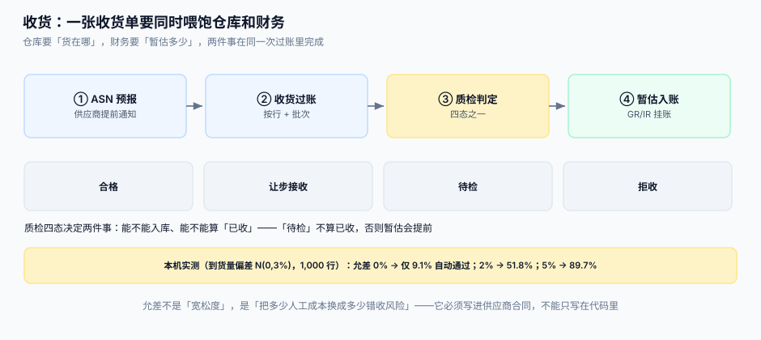

# 收货、质检与暂估

收货是这条链上唯一「有实物在场」的环节。它要同时满足两个部门的口径：仓库问「货在哪、能不能上架」，财务问「这批货该暂估多少钱」。**一张收货单必须一次把两件事都做完**，否则就会出现「仓库收了、财务不知道」的月末大对账。

::: tip 一句话定位
**「已收」不是一个数，是两个数**：`received_qty`（进了厂门）与 `putaway_qty`（判定可用）。财务要的是后者，仓库记的是前者；把两者混成一个「已到货」状态，暂估要么提前、要么永久挂着。
:::



本页判据族 `PTG-A` ~ `PTG-H`，共 8 条。定义表在第七节。

## 一、ASN 不是可选项

ASN（Advance Shipping Notice，预先发货通知）让收货从「盲收」变成「核对」。没有 ASN 的收货，本质上是「供应商送什么就收什么」，差异只能事后发现。

| 单据 | 谁发起 | 装什么 | 与下一跳的关系 |
| --- | --- | --- | --- |
| `asn` | 供应商 | 预计到货日、箱数、每箱明细 | 收货时按 ASN 核对，差异当场记录 |
| `gr_head` | 仓库 | 收货单号、供应商、到货时间、承运人 | 暂估的凭证头 |
| `gr_line` | 仓库 | `po_no` + `po_version` + `line_no` + 批次 + 数量 + 质检态 | 匹配与暂估的**唯一粒度** |

```sql
CREATE TABLE asn (
  asn_no       TEXT PRIMARY KEY,
  po_no        TEXT NOT NULL,
  supplier_id  TEXT NOT NULL,
  eta_date     TEXT NOT NULL,
  carton_count INTEGER NOT NULL,
  shipped_at   TEXT NOT NULL
);

CREATE TABLE gr_head (
  gr_no        TEXT PRIMARY KEY,
  supplier_id  TEXT NOT NULL,
  received_at  TEXT NOT NULL,          -- 实物时点（只写一次）
  carrier      TEXT,
  asn_no       TEXT REFERENCES asn(asn_no)   -- 可为空：无 ASN 的盲收
);

CREATE TABLE gr_line (
  gr_no      TEXT NOT NULL REFERENCES gr_head(gr_no),
  line_no    INTEGER NOT NULL,          -- 收货行号（不是订单行号）
  po_no      TEXT NOT NULL,
  po_version INTEGER NOT NULL,          -- 接缝②的关键列
  po_line_no INTEGER NOT NULL,          -- 订单行号
  sku        TEXT NOT NULL,
  batch_no   TEXT,
  qty        INTEGER NOT NULL CHECK (qty > 0),
  qc_state   TEXT NOT NULL DEFAULT 'PENDING'
             CHECK (qc_state IN ('PENDING','PASS','CONCESSION','REJECT')),
  unit_price INTEGER NOT NULL,          -- 收货时点的版本价（分）
  PRIMARY KEY (gr_no, line_no)
);
```

::: danger 注意
1. **`po_version` 必须落在收货行上，不能只在收货头上**。一张收货单可能同时收两个版本的订单行（先按 v2 收一部分，改版后按 v3 收剩余），头上一列根本装不下。
2. **`unit_price` 要在收货时冻结**。暂估用「收货时点的版本价」；如果暂估时再去订单表取价，改版之后所有历史暂估都会被重算，月末冲销差额会莫名其妙地变大。
3. **不要用订单行号当收货行号**。一张订单行可以分多次到货（10 次），收货行必须有自己的行号，否则第二次收货会覆盖第一次。
:::

## 二、质检四态：决定「能不能算已收」

| 状态 | 含义 | 能入库 | 算「已收」（可匹配） | 典型后续 |
| --- | --- | --- | --- | --- |
| `PENDING` | 待检 | 只能进待检区 | **否** | 超期未判要告警（建议 3 天） |
| `PASS` | 合格 | 是 | 是 | 正常匹配与付款 |
| `CONCESSION` | 让步接收（有瑕疵但可用） | 是 | 是 | 需记录瑕疵项，扣绩效 |
| `REJECT` | 拒收 | 否 | 否 | 退货单或换货单 |

```sql
-- 「可匹配数量」是匹配引擎唯一该看的数
CREATE VIEW v_receivable AS
SELECT po_no, po_version, po_line_no,
       SUM(CASE WHEN qc_state IN ('PASS','CONCESSION') THEN qty ELSE 0 END) AS matchable_qty,
       SUM(qty) AS received_qty
  FROM gr_line
 GROUP BY po_no, po_version, po_line_no;
```

::: danger 注意
1. **不要把 `PENDING` 算进「可匹配」**。它会让发票先入账、货后判不合格，然后你要做一笔反向冲销——而冲销在审计眼里就是「先记后改」。正确做法：待检不算，超期未判升级到质量负责人。
2. **不要让 `REJECT` 的货留在库存里**。拒收必须生成退货单并扣减库存，否则「账面有货、货架没有」的差额会一直存在。
3. **不要让质检结论可以被静默修改**。`qc_state` 的每次变更都要写审计行（谁、何时、从什么改成什么、理由），因为它是「能不能付款」的前置条件。
:::

## 三、超收与短装：允差在这里生效

订单侧定义了允收上限，收货侧负责执行。执行的核心不是「拦」，而是**把例外变成一条有归属的记录**。

| 情况 | 判定 | 系统动作 | 谁跟进 |
| --- | --- | --- | --- |
| 累计 ≤ 上限 | 正常 | 过账、暂估 | — |
| 累计 > 上限，超出 ≤ 1 件 | 边界 | 过账并打标 `OVER_TOLERANCE` | 采购复核 |
| 累计 > 上限，超出 > 1 件 | 超收 | **挂起**，需审批后过账 | 采购 + 财务 |
| 到期未交 | 欠交 | 保持 `PARTIAL`，记绩效 | 采购催货 |

允差取值是成本问题，不是技术问题。本机实测（到货量偏差 N(0,3%)，1,000 行）：

| 允差 | 自动通过 | 转人工 | 每月 10,000 行的近似人工量 |
| --- | --- | --- | --- |
| 0% | 9.1% | 90.9% | 9,090 行 |
| 2% | 51.8% | 48.2% | 4,820 行 |
| 5% | 89.7% | 10.3% | 1,030 行 |

::: warning 允差要写进合同
代码里 5%、合同里 0%，超收的那部分在对账时就是争议货款。**允差是商务条款，不是配置项**——配置只是它的技术实现。
:::

## 四、暂估：GR/IR 的借贷与时点

收货过账在财务上要产生一笔分录（金额 = 可匹配数量 × 版本价）：

```text
借：库存商品 / 原材料        不含税金额
借：应交税费—待认证进项税额   税额（取得专票后转入抵扣）
  贷：GR/IR 暂估应付款          含税金额
```

发票到达并匹配通过后，冲销暂估、确认应付：

```text
借：GR/IR 暂估应付款          含税金额
  贷：应付账款—供应商           含税金额
```

| 时点 | 触发 | 金额来源 | 常见错误 |
| --- | --- | --- | --- |
| 收货过账 | `gr_head` 创建 | 可匹配数量 × 收货时点版本价 | 用订单最新价，改版后差额变大 |
| 发票匹配 | `match_result` 通过 | 发票金额 | 只冲金额不冲数量，GR/IR 残留 |
| 月末重估 | 月末结账 | 未开票部分按最新价重估 | 重估未留痕，下月无法回滚 |

::: danger 注意
1. **「暂估」必须有数量维度**。只按金额冲销，会在「部分开票」时留下一个永远清不掉的余额；正确做法是 `GR/IR` 余额按 `(po_no, po_line_no)` 维护。
2. **月末重估要能回滚**。重估分录带 `period` 与 `reversal_flag`，下月自动反向；手工改分录会让审计无法追溯。
3. **不要用「发票到了才暂估」**。这等于放弃了权责发生制：货到了、票没到，成本仍然要进当期。暂估的意义正是补这个时间差。
:::

## 五、退货与换货：反向单，不改原单

退货不是「把收货数量改小」，而是**生成一张反向收货单**（负数量或独立类型），原收货单永远不变。

| 场景 | 单据 | 对 GR/IR 的影响 | 对库存的影响 |
| --- | --- | --- | --- |
| 质检不合格退货 | 退货单 `RET` | 冲减暂估 | 扣减（若已入库） |
| 换货 | 退货单 + 新收货单 | 先冲后增 | 先扣后加 |
| 事后发现短装 | 补收货单 | 增加暂估 | 增加 |
| 发票已匹配后退货 | 退货单 + 红字发票 | 冲应付 | 扣减 |

::: danger 注意
1. **不要直接删除收货行**。「删除」会让审计无法回答「这批货到底收过没有」；正确做法是反向单，原单保留并标记 `reversed_by`。
2. **已匹配的收货不能单独退**。必须先让财务开红字发票、冲销应付，再退货；否则会出现「货退了、钱还欠着」。
3. **换货要成对生成**。只生成退货单不生成新收货单，供应商发来的替换品会变成「无单收货」，最终进不了暂估。
:::

## 六、收货侧的三条不变量

```sql
-- ① 累计收货不得超过允收上限（按当前版本）
SELECT l.po_no, l.line_no
  FROM po_line l
  JOIN purchase_order p ON p.po_no = l.po_no
 WHERE l.qty * (1 + 0.05) < (SELECT COALESCE(SUM(qty),0) FROM gr_line g
                              WHERE g.po_no = l.po_no AND g.po_line_no = l.line_no);
-- 期望：0 行

-- ② 每条收货行都能指回一个存在的订单版本
SELECT g.gr_no, g.line_no FROM gr_line g
 WHERE NOT EXISTS (SELECT 1 FROM po_version v WHERE v.po_no = g.po_no AND v.version = g.po_version);
-- 期望：0 行

-- ③ 待检超过 3 天未判的数量为 0
SELECT count(*) FROM gr_line
 WHERE qc_state = 'PENDING' AND julianday('now') - julianday((SELECT received_at FROM gr_head h WHERE h.gr_no = gr_line.gr_no)) > 3;
-- 期望：0
```

## 七、判据

| 判据 | 看什么现象 | 判成什么 | 不满足时改哪里 |
| --- | --- | --- | --- |
| `PTG-A` | 收货行是否同时存 `po_no` / `po_version` / `po_line_no` | 缺 `po_version` 即判「无法判定超收基准」 | `gr_line` 增列并回填，收货接口必传 |
| `PTG-B` | `gr_line` 是否有独立行号（非订单行号） | 复用订单行号即判「多次到货互相覆盖」 | 增 `line_no` 主键，历史数据按收货时间重排 |
| `PTG-C` | 暂估是否使用收货时点冻结的 `unit_price` | 取订单最新价即判「历史暂估被重算」 | 收货写入时冻结单价，暂估只读该列 |
| `PTG-D` | 「可匹配数量」是否排除 `PENDING` / `REJECT` | 全部计入即判「暂估提前」 | 建 `v_receivable` 视图，匹配只读它 |
| `PTG-E` | 超过允收上限的收货是否被挂起或打标 | 静默过账即判「超收无记录」 | 超上限写 `OVER_TOLERANCE`，超 1 件以上挂起 |
| `PTG-F` | 退货是否用反向单而非删行/改行 | 删改原单即判「审计断链」 | 反向单 + `reversed_by`，原单不可变 |
| `PTG-G` | `qc_state` 变更是否留审计行 | 直接覆盖即判「结论可篡改」 | 建 `qc_log`，每次变更写前后值与理由 |
| `PTG-H` | 待检超期（> 3 天）是否有告警 | 无告警即判「待检堆积」 | 日任务扫描 `PENDING` 超期行，升级质量负责人 |

## 八、如何验证

```shell
# 1. 收货行结构正确
sqlite3 /tmp/p2p.db "SELECT name FROM pragma_table_info('gr_line') WHERE name IN ('po_version','po_line_no','qc_state');"
# 期望：三行都在

# 2. 可匹配数量排除待检（负向：插入一行 PENDING，视图不应计入）
sqlite3 /tmp/p2p.db "INSERT INTO gr_line(gr_no,line_no,po_no,po_version,po_line_no,sku,qty,qc_state,unit_price) VALUES('GR1',1,'PO-1001',3,1,'SKU001',10,'PENDING',1280);"
sqlite3 /tmp/p2p.db "SELECT coalesce(sum(matchable_qty),0) FROM v_receivable WHERE po_no='PO-1001';"
# 期望：0（待检不计入可匹配）

# 3. 改为合格后可匹配
sqlite3 /tmp/p2p.db "UPDATE gr_line SET qc_state='PASS' WHERE gr_no='GR1' AND line_no=1;"
sqlite3 /tmp/p2p.db "SELECT coalesce(sum(matchable_qty),0) FROM v_receivable WHERE po_no='PO-1001';"
# 期望：10

# 4. 三条不变量均为 0 行（正常情况下）
sqlite3 /tmp/p2p.db "SELECT count(*) FROM gr_line g WHERE g.qc_state='PENDING';"
# 期望：0（刚把唯一一行改成 PASS 了）
```

## 参考资料

- [采购订单与变更](../PurchaseOrder/index.md)：允收上限与版本价的来源
- [三单匹配与容差](../InvoiceMatch/index.md)：可匹配数量在匹配里的作用
- [库存与预占](../../Ecommerce/Inventory/index.md)：入库之后与可售库存的衔接
- [账务与分录](../../Ledger/index.md)：GR/IR 分录与结算的下一跳
- OASIS UBL 2.x `DespatchAdvice`：ASN 的字段对照
