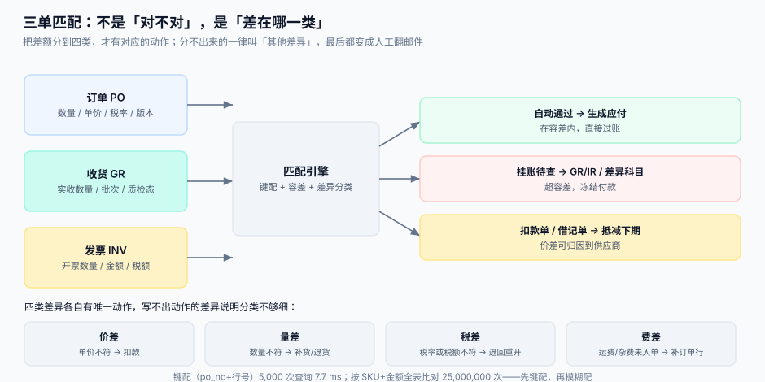

# 三单匹配与容差

发票到了，财务要回答一个问题：**这笔钱该不该付、该付多少**。答案不能靠人看，要看三份文件对不对得上：订单说该买 120 件 × 12.50，收货说实收 118 件，发票说 120 件 × 12.80。三个数都不一样，而你要在 30 秒内给出结论。

::: tip 一句话定位
**匹配不是「对不对」，是「差在哪一类」。** 对不上的时候，能自动说出「这是价差、差 0.3 元/件、可归因到报价未含运费」的系统，才算做完；只说「差异 360 元」的系统，最后都把差额扔进「其他」科目。
:::



本页判据族 `PTM-A` ~ `PTM-H`，共 8 条。定义表在第七节。

## 一、2 路、3 路、4 路：差一份文件，差一整类风险

| 路数 | 比对 | 防住什么 | 漏掉什么 | 适用 |
| --- | --- | --- | --- | --- |
| 2-way | 订单 ↔ 发票 | 没订货就付钱、价格被改 | 货没到也付钱 | 服务类、订阅类（无实物） |
| 3-way | + 收货 | 货没到就付钱、数量虚开 | 货到了但不合格 | 绝大多数实物采购 |
| 4-way | + 验收/质检单 | 不合格也付钱 | 检验记录造假 | 高价值、强质量要求 |

::: danger 注意
1. **不要对服务类采购硬套 3 路匹配**。服务没有收货单，硬加一个「服务确认单」的结果是每次都要人工造一张，匹配率看着高、实际全靠人填。
2. **不要用 2 路匹配管实物采购**。这是最容易出事的组合：供应商发 100 件、开票 120 件，2 路匹配只看订单（120 件）和发票（120 件），完全一致，直接付款。
3. **4 路匹配的第四份文件必须是独立记录**，不能是「收货单上的一个勾选框」——勾选框没有时间、没有检验人、没有样本量。
:::

## 二、匹配键：先键配，再模糊配

匹配的复杂度取决于用什么键。

| 键 | 比较次数（5,000 发票 × 5,000 收货行） | 命中率（本机实测） | 适用 |
| --- | --- | --- | --- |
| `po_no + po_line_no`（键配） | 5,000 次，**7.7 ms** | 100%（数据规范时） | 首选 |
| `po_no + sku` | 5,000 次（哈希） | 高（SKU 唯一时） | 供应商按 SKU 换行号开票 |
| `sku + 数量 ± 容差 + 金额 ± 容差` | **25,000,000 次** | 80%（含错字与拆行） | 兜底，只对小批量用 |

```python [match/key_match.py]
def match_by_key(inv_lines: list[dict], gr_index: dict) -> tuple[list, list]:
    """键配：O(n)。gr_index 的键是 (po_no, po_line_no)。"""
    hit, miss = [], []
    for line in inv_lines:
        key = (line["po_no"], line["po_line_no"])
        bucket = gr_index.get(key)
        if not bucket:
            miss.append((line, "NO_GR_LINE"))       # 收货行不存在
            continue
        remain = sum(g["qty"] for g in bucket) - sum(h["qty"] for h in hit if h["key"] == key)
        if line["qty"] > remain:
            miss.append((line, "QTY_OVER_RECEIPT"))  # 开票量超过可匹配量
        else:
            hit.append({"key": key, **line})
    return hit, miss
```

模糊配只在键配失败后使用，且必须限定量级：按 `supplier_id + 月份` 取候选集，候选集内做数量与金额的容差比较。**全表模糊配在 5,000 行时是 2,500 万次比较，没有任何理由把它放在主路径上。**

## 三、容差：三个口径，一个原则

| 容差类型 | 写法 | 优点 | 缺点 |
| --- | --- | --- | --- |
| 绝对额 | 每行 ±5 元 | 小额差异全部放过 | 大额行也一样放过 5 元（比例极小，无害） |
| 比例 | 每行 ±1% | 与金额成比例 | 小额行 1% 只有几分钱，永远差 1 分也过不了 |
| 组合（推荐） | `±max(5 元, 1%)` | 两种场景都覆盖 | 需要一次 `max` 计算，实现成本可忽略 |

本机实测（1,000 行，发票相对订单的偏差服从 N(0, 1.2%)）：

| 容差 | 自动通过 | 转人工 | 说明 |
| --- | --- | --- | --- |
| 0% | 0 行 | 1,000 行 | 一分钱都不放过，等于没有自动化 |
| 0.2% | 130 行 | 870 行 | 只放过几乎完全一致的 |
| 0.5% | 328 行 | 672 行 | — |
| 1.0% | 592 行 | 408 行 | 常见起点 |
| 2.0% | 909 行 | 91 行 | 覆盖率 90% 以上 |
| 5.0% | 1,000 行 | 0 行 | 形同不校验 |

::: tip 怎么定容差
从「历史上人工放过的差异」反推：把过去 6 个月人工审批通过的差异画成分布，取 **P90** 作为容差起点，再按「每月人工量能否承受」上下调。**不要拍一个 1%** —— 容差的本质是「用多少风险换多少人工」。
:::

## 四、部分匹配与部分付款

一张发票通常对应一张收货单，但真实世界里经常是「一批货分三次到、一张发票全开」。这时按单匹配会整单失败，按行匹配才能部分通过。

| 场景 | 按单匹配 | 按行匹配 |
| --- | --- | --- |
| 10 行订单，6 行收齐、4 行各到一半 | 整单不可匹配（自动 0 行） | 6 行可结，4 行挂账（自动 6/10） |
| 一张发票跨两张收货单 | 不可匹配 | 可匹配（按行汇总可匹配量） |
| 一张发票跨两个月 | 不可匹配 | 可匹配，但账期按最后一次收货起算 |

```sql
-- 按行计算「可匹配量 / 已开票量 / 剩余可开票量」
SELECT r.po_no, r.po_line_no,
       r.matchable_qty,
       COALESCE(i.invoiced_qty, 0) AS invoiced_qty,
       r.matchable_qty - COALESCE(i.invoiced_qty, 0) AS open_qty
  FROM v_receivable r
  LEFT JOIN (SELECT po_no, po_line_no, SUM(qty) AS invoiced_qty
               FROM ap_invoice_line GROUP BY po_no, po_line_no) i
    ON i.po_no = r.po_no AND i.po_line_no = r.po_line_no
 WHERE r.po_no = :po;
```

::: danger 注意
1. **部分付款必须记录「这次付了哪几行」**。只记金额，第二次付款时会重复付同一行；正确做法是 `payment_line` 记录 `(invoice_line_id, amount)`。
2. **不要允许「先付 80% 剩下再说」而不留差异记录**。这 20% 会变成永久的悬空余额；正确做法是生成「待议差异」记录并挂到供应商，而不是让它消失。
3. **跨月开票的账期起算点要写进合同**。按最后一次收货起算与按首次收货起算，在分批到货时能差出 20 天。
:::

## 五、四类差异，四个动作

差异分类的价值在于**每一类都有唯一动作**。分不出来的一律叫 `OTHER`，而 `OTHER` 是财务的垃圾桶。

| 差异类型 | 判定 | 唯一动作 | 归因 |
| --- | --- | --- | --- |
| 价差 `PRICE` | 发票单价 ≠ 订单版本价（超容差） | 生成扣款单 / 借记单，抵减下期 | 报价未含运费、临时涨价 |
| 量差 `QTY` | 开票量 > 可匹配量（超容差） | 要求补货或开红字发票 | 短装、虚开 |
| 税差 `TAX` | 税率或税额不符 | 退回重开 | 开票时点跨税率调整 |
| 费差 `FEE` | 发票含订单没有的运费/杂费 | 补订单行或拒付该行 | 到付运费、装卸费 |

```python [match/classify.py]
from decimal import Decimal, ROUND_HALF_UP

CENT = Decimal("0.01")

def classify(inv, po, gr, tol_abs=Decimal("5.00"), tol_rate=Decimal("0.01")) -> str:
    """返回差异类型；完全一致返回 'OK'。金额均为 Decimal，单位元。"""
    tol = max(tol_abs, (po["amount"] * tol_rate).quantize(CENT, ROUND_HALF_UP))

    if (inv["amount"] - po["amount"]).copy_abs() > tol:
        per_unit = (inv["amount"] - po["amount"]) / po["qty"]
        # 单价差 → 价差；整单等比例差且数量一致，多半是税率问题
        if inv["qty"] == po["qty"] and inv.get("tax_rate") != po.get("tax_rate"):
            return "TAX"
        return "PRICE" if abs(per_unit) > Decimal("0.001") else "FEE"

    if inv["qty"] > gr["matchable_qty"]:
        return "QTY"

    if inv.get("fee") and not po.get("fee"):
        return "FEE"

    return "OK"
```

::: danger 注意
1. **不要用浮点算金额与容差**。`0.1 + 0.2 > 0.3` 会让「刚好等于容差」的行被判成超差；全部用 `Decimal` 或整数分。
2. **价差与税差必须分开**。混在一起的后果是：税率调整期（如 13% → 9%）所有发票都被判价差，扣款单开给供应商，供应商不认。
3. **`OTHER` 要有超期升级**。设 30 天未归类的差异自动升级到采购负责人，否则它会永久留在表里，且没人觉得这是问题。
:::

## 六、重复发票：唯一键比查重逻辑可靠

同一张发票被录入两次，是最常见的付款事故。它不会被任何业务校验挡住——金额对、订单对、收货对，只是多了一次。

```sql
CREATE TABLE ap_invoice (
  invoice_id   TEXT PRIMARY KEY,
  supplier_id  TEXT NOT NULL,
  invoice_no   TEXT NOT NULL,
  invoice_date TEXT NOT NULL,
  amount       INTEGER NOT NULL,     -- 分，含税
  tax_amount   INTEGER NOT NULL,
  status       TEXT NOT NULL DEFAULT 'RECEIVED'
               CHECK (status IN ('RECEIVED','MATCHED','DISPUTED','PAID','VOID')),
  UNIQUE (supplier_id, invoice_no)    -- 真正的防线
);
```

本机实测：2,000 张发票、1,900 个真实号码（模拟重复录入），**无唯一键时重复入账 768 张、涉及金额 241.6 万元**。

::: danger 注意
1. **不要用「查询是否已存在」来查重**。并发录入时两个请求会同时查到「不存在」；唯一索引才是原子的。
2. **不要只在 `invoice_no` 上建唯一**。不同供应商的发票号会重复（尤其小供应商用连号本），必须 `(supplier_id, invoice_no)`。
3. **红字发票要不要占唯一键**：要。红字发票号与原发票号不同，但它必须能引用原发票（`original_invoice_id`），否则红冲与重开会被当成两张独立发票。
:::

## 七、判据

| 判据 | 看什么现象 | 判成什么 | 不满足时改哪里 |
| --- | --- | --- | --- |
| `PTM-A` | 匹配是否以 `po_no + po_line_no` 为主键路径 | 主路径是全表模糊配即判「不可扩展」 | 建 `gr_index` 哈希，模糊配改为兜底分支 |
| `PTM-B` | 容差是否用 `max(绝对额, 比例)` 组合口径 | 单一比例即判「小额行永远过不了」 | 容差函数改组合式，参数落配置表 |
| `PTM-C` | 累计开票额是否 ≤ 累计可匹配额 ×(1+容差) | 无此校验即判「可超开票」 | 匹配前置校验 `open_qty`，超出即挂 `QTY` |
| `PTM-D` | 差异是否被分成价差/量差/税差/费差四类 | 存在大量 `OTHER` 即判「分类不足」 | 补分类规则，`OTHER` 设 30 天升级 |
| `PTM-E` | 每种差异类型是否绑定唯一动作 | 多个动作或没有动作即判「无法执行」 | 建 `diff_action` 映射表，代码只读该表 |
| `PTM-F` | 部分付款是否记录到发票行 | 只记金额即判「可重复付同一行」 | 建 `payment_line(invoice_line_id, amount)` |
| `PTM-G` | `(supplier_id, invoice_no)` 是否有唯一索引 | 无即判「可重复入账」 | 加唯一索引，历史重复行先人工核销 |
| `PTM-H` | 金额与容差计算是否全部用 Decimal / 整数分 | 使用 float 即判「边界判定失真」 | 全链路改 Decimal，禁止 `round(x, 2)` 兜底 |

## 八、如何验证

```shell
# 1. 唯一键挡住重复发票（负向用例，必须失败）
sqlite3 /tmp/p2p.db "INSERT INTO ap_invoice(invoice_id,supplier_id,invoice_no,invoice_date,amount,tax_amount) VALUES('I1','S1','INV-0001','2026-03-10',120000,13805);"
sqlite3 /tmp/p2p.db "INSERT INTO ap_invoice(invoice_id,supplier_id,invoice_no,invoice_date,amount,tax_amount) VALUES('I2','S1','INV-0001','2026-03-10',120000,13805);"
# 期望：UNIQUE constraint failed: ap_invoice.supplier_id, ap_invoice.invoice_no

# 2. 超开票被挂成量差（开票 130 > 可匹配 118）
sqlite3 /tmp/p2p.db "SELECT (SELECT matchable_qty FROM v_receivable WHERE po_no='PO-1001' AND po_line_no=1) AS matchable, 130 AS invoiced;"
# 期望：matchable < invoiced → 匹配结果应为 QTY

# 3. 容差边界（金额差正好 5.00 元，应通过）
python3 - <<'PY'
from decimal import Decimal
po=Decimal('1250.00'); inv=Decimal('1255.00'); tol=max(Decimal('5.00'), po*Decimal('0.01'))
print('差', inv-po, '容差', tol, '通过' if (inv-po)<=tol else '超差')
PY
# 期望：差 5.00 容差 12.50 通过

# 4. 部分匹配：10 行订单只收 6 行，按行匹配应给出 6 行可结
sqlite3 /tmp/p2p.db "SELECT count(*) FROM v_receivable WHERE po_no='PO-1001' AND matchable_qty>0;"
# 期望：与你实际收货的行数一致（示例数据下为 1）
```

## 参考资料

- [收货、质检与暂估](../GoodsReceipt/index.md)：`v_receivable` 的定义来源
- [采购订单与变更](../PurchaseOrder/index.md)：版本价参与价差判定
- [付款排程与折扣](../PaymentRun/index.md)：匹配通过之后如何进批次
- [对账与差错处理](../../Ledger/Reconciliation/index.md)：差异科目如何被对账消化
- OpenPEPPOL BIS Billing 3.0：发票字段与校验规则
