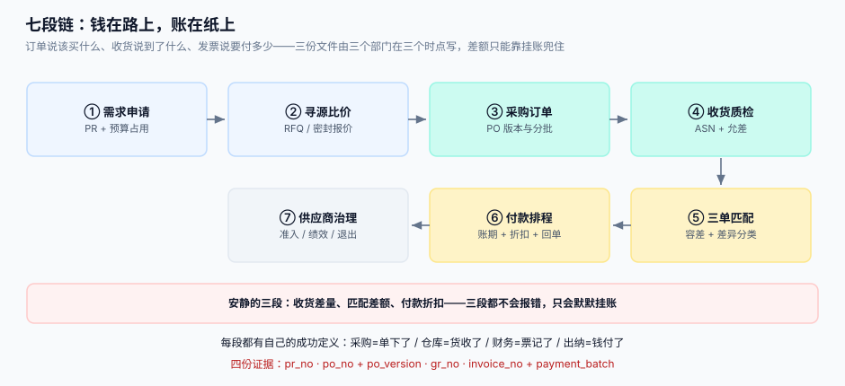
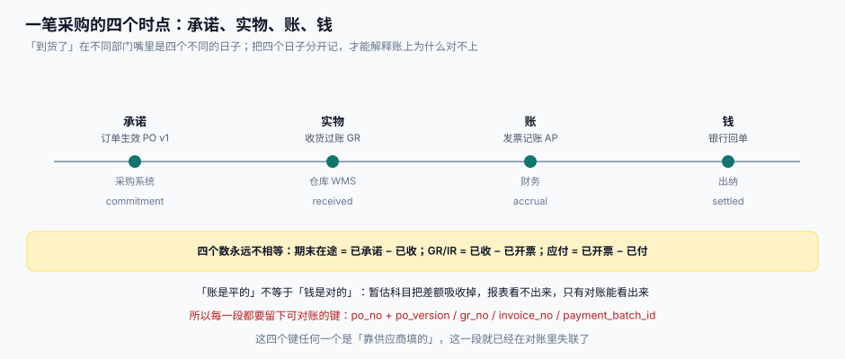

# 总览：七段链与四个时点

这一页回答的是「**一笔采购到底经过哪几段、每段留下什么证据、哪几段会悄悄失败**」。它不教怎么用某个 ERP，讲的是这条链的形状：七段、四个时点、三份主数据、四个必失接缝。

::: tip 一句话定位
采购系统的失败分两种：**会报错的**（预算不足、供应商被拉黑、发票号重复）和**不会报错的**（收货少 3 件、价差 0.8%、折扣没拿到）。第一种有异常栈，第二种只有一张平账的报表。**本专题 80% 的篇幅在对付第二种。**
:::



本页判据族 `PTO-A` ~ `PTO-H`，共 8 条。定义表在第七节。

## 一、七段链：每段一个动词、一份证据

| 段 | 谁在做 | 动词 | 落库的证据 | 失败形态 |
| --- | --- | --- | --- | --- |
| ① 需求申请 | 需求部门 | 提 | `pr_no` + 预算占用流水 | 预算被占了但单没下（占而不用） |
| ② 寻源比价 | 采购 | 比 | `rfq_no` + 报价密封记录 + 定标理由 | 提前看到别人报价；口径不可比 |
| ③ 采购订单 | 采购 | 下 | `po_no` + `po_version` | 改了三次，收货按旧版 |
| ④ 收货质检 | 仓库 / 质检 | 收 | `gr_no` + 收货行（批次、质检态） | 超收、短装、待检长期不判 |
| ⑤ 三单匹配 | 财务 | 对 | `match_id` + 差异分类 | 差额进了「其他」，永久挂账 |
| ⑥ 付款排程 | 出纳 | 付 | `payment_batch_id` + `payment_no` | 重跑重付；折扣过期 |
| ⑦ 供应商治理 | 采购管理 | 评 | 准入记录、绩效分、退出记录 | 资质过期仍在供货 |

**这七段的顺序不能重排**，原因不是流程洁癖，是**证据依赖**：⑤ 要匹配，必须先有 ③ 和 ④；⑥ 要付款，必须先有 ⑤ 的「可付」结论。任何跨段跳步（比如「先付款后补发票」）都会在月末变成一张无法解释的暂估表。

## 二、四个时点：同一笔采购的四个日期

「到货了」在不同部门嘴里是四个不同的日子。**把四个日子分开记，是 P2P 系统设计的第一条纪律**。



| 时点 | 事件 | 记账含义 | 典型滞后 | 谁最关心 |
| --- | --- | --- | --- | --- |
| **承诺** | 订单生效（某版本） | 已承诺未交付（在途） | 0 | 采购、预算 |
| **实物** | 收货过账 | 已收未开票（GR/IR 暂估） | 天 ~ 周 | 仓库、生产 |
| **账** | 发票记账 | 已记未付（应付账款） | 周 ~ 月 | 财务 |
| **钱** | 银行回单 | 已付（应付减少、现金减少） | 天 | 出纳、供应商 |

四个数永远不相等，差额各有名字：

```text
在途         = 已承诺 − 已收
GR/IR 暂估   = 已收   − 已开票
应付账款     = 已开票 − 已付
```

::: danger 注意
1. **不要用「状态字段」代替四个时点**。把订单状态写成 `已到货` 这种复合状态，等于把四个日期压成一个——一旦要回答「上月在途多少」，只能去翻日志。做法：四个时点各存一个时间戳，状态由时间戳推导。
2. **不要用「最后修改时间」当业务时间**。`updated_at` 会被任何无关更新刷新（改备注、改联系人），拿它算账期会莫名多出几天。做法：业务时点单独一列，只在对应动作发生时写一次，之后不可变。
3. **不要在没有收货记录的情况下允许开票入账**。看似「先记应付后补收货」很灵活，实际会造成同一批货被暂估一次、又被发票记一次，GR/IR 永远清不掉。做法：允许无 PO 的发票，但必须走「无单发票」流程并单独科目，不能混进正常匹配。
:::

## 三、三份文件、三套口径

三份文件对同一件事的描述**天然不同**，差异不是错误，是口径。

| 字段 | 订单口径 | 收货口径 | 发票口径 | 谁说了算 |
| --- | --- | --- | --- | --- |
| 数量 | 订购量（可分批） | 实收量（可超短装） | 开票量（常按送货单） | 收货，因为实物只有一个 |
| 单价 | 合约定价（含/不含税） | 按收货时点版本价暂估 | 供应商开票价（可能含运费） | 订单，但价差要能归因 |
| 金额 | 数量 × 单价 | 实收 × 版本价 | 开票金额（含税/不含税两种写法） | 发票决定「该付多少」，不决定「该记多少」 |
| 时间 | 下单日 | 到货日 | 开票日 | 各自记录，不互相覆盖 |

::: tip 一句话记住
**数量听仓库的，价格听订单的，金额听发票的，但三者的差必须能被分类。** 谁的口径被拿去覆盖别人，哪个字段就开始说谎。
:::

## 四、四个必失接缝

接缝指「两个系统/两个部门交接的地方」。这四处**一定**会出问题，区别只是你有没有提前埋好对账键。

| 接缝 | 现象 | 根因 | 埋什么 |
| --- | --- | --- | --- |
| ① 预算 ↔ 订单 | 预算没超，实际超了 | 占用是查询而非原子扣减 | 条件更新 + 占用流水（见[需求申请](../Requisition/index.md)） |
| ② 订单 ↔ 收货 | 超收 / 欠收算不出来 | 收货只存 `po_no`，没存 `po_version` | 收货行带版本号（见[采购订单](../PurchaseOrder/index.md)） |
| ③ 收货 ↔ 发票 | 暂估永远清不掉 | 「已收」的口径里混进了「待检」 | 质检四态 + 可匹配量（见[收货质检](../GoodsReceipt/index.md)） |
| ④ 付款 ↔ 回单 | 已付未付说不清 | 批次重跑产生两笔付款 | 批次幂等 + 回单回写（见[付款排程](../PaymentRun/index.md)） |

## 五、三张主数据：谁在链上改它

P2P 链上所有单据都引用三张主数据。它们的「修改权」必须唯一，否则同一笔采购在不同系统里会指向不同的供应商和不同的价格。

| 主数据 | 关键字段 | 谁能改 | 改了会影响什么 |
| --- | --- | --- | --- |
| 供应商 | `supplier_id`、统一社会信用代码、银行账户、资质有效期 | 采购管理（唯一入口） | 付款账户、发票抬头、黑名单 |
| 料号 | `sku`、单位、税率分类、是否批次管理 | 物料管理 | 单位换算、暂估金额、库存 |
| 价格 | `supplier_id + sku + 生效区间` | 采购（合同价）/ 财务（标准价） | 价差判定、暂估口径 |

::: warning 一条容易被忽略的规则
**供应商的银行账户变更必须走独立审批并留痕**，不能和「改联系电话」共用一个表单。P2P 领域最经典的资金风险就是「改了收款账户」，而它在系统里长得和一次普通的资料维护一模一样。
:::

## 六、四个必失点的本机读数

下面四个数来自本机实测（Python 3.13 + SQLite，种子 `20261031`），复现脚本见[实战](../Practice/index.md)。它们的用途不是「证明某个方案更好」，而是**给量级**：让你知道这些差额在真实规模下值多少钱。

| 场景 | 做法 A | 做法 B | 读数 |
| --- | --- | --- | --- |
| 预算并发占用（8 线程 ×25 笔 ×10 万，预算 500 万） | 先查后写 | 条件更新 | 56 笔 / 超占 6,000 元 **vs** 50 笔 / 超占 0 |
| 匹配键（5,000 发票 ×5,000 收货行） | 按 SKU + 金额全表比 | 按 `po_no + 行号` 键配 | 25,000,000 次比较 **vs** 5,000 次、7.7 ms |
| 收货允差（到货量偏差 N(0,3%)，1,000 行） | 允差 0% | 允差 5% | 自动通过 9.1% **vs** 89.7% |
| 重复发票（2,000 张 / 1,900 个号码，无唯一键） | 不设约束 | `supplier_id + invoice_no` 唯一 | 重复 768 张、涉及 241.6 万元 |

## 七、判据

| 判据 | 看什么现象 | 判成什么 | 不满足时改哪里 |
| --- | --- | --- | --- |
| `PTO-A` | 订单、收货、发票、付款各自有没有独立的时间戳列 | 缺任一列即判「时点被压缩」 | 在四张主表各加 `*_at` 业务时间列，禁止用 `updated_at` 代替 |
| `PTO-B` | 是否能用一条 SQL 同时算出「在途 / GR-IR / 应付」三个差额 | 算不出即判「口径缺失」 | 建 3 个视图：`v_in_transit`、`v_gr_ir`、`v_ap_open` |
| `PTO-C` | 收货行里有没有 `po_version` | 没有即判「接缝②失守」 | `gr_line` 增列 `po_version`，历史数据按收货日回填 |
| `PTO-D` | 「已收」的判定是否排除了 `待检` | 未排除即判「暂估提前」 | 在 `v_received_qty` 视图里加 `qc_state IN ('PASS','CONCESSION')` |
| `PTO-E` | 匹配结果里是否存在差异分类为 `OTHER` 且超过 30 天的记录 | 存在即判「差额无人认领」 | 给 `OTHER` 设 30 天强制复核，超期升级到采购负责人 |
| `PTO-F` | 付款批次重跑时，`payment_no` 是否由批次号派生且唯一 | 不是即判「重付风险」 | 改为 `payment_no = f(batch_id, invoice_id)` 并加唯一索引 |
| `PTO-G` | 供应商银行账户变更是否有独立审批记录 | 与普通资料维护共用入口即判「资金风险」 | 拆出 `supplier_bank_change` 表，含审批人与生效时间 |
| `PTO-H` | 是否存在「无 PO 的发票」与「有 PO 的发票」混用同一科目 | 混用即判「GR/IR 永不结清」 | 无单发票单独科目 + 单独报表，不参与三单匹配 |

## 八、如何验证

```shell
# 1. 四个时点在库结构里各自存在（读者在自己库里建好表后执行）
sqlite3 /tmp/p2p.db "SELECT name FROM pragma_table_info('purchase_order') WHERE name LIKE '%_at';"
# 期望：created_at 与 committed_at 两行都存在，且 committed_at 只写一次

# 2. 三个差额视图都能返回一行（哪怕是 0）
sqlite3 /tmp/p2p.db "SELECT (SELECT count(*) FROM v_in_transit),(SELECT count(*) FROM v_gr_ir),(SELECT count(*) FROM v_ap_open);"
# 期望：0|0|1（刚建完库只有应付视图可能有行）

# 3. 重复发票会被唯一键挡住（负向用例，必须失败）
sqlite3 /tmp/p2p.db "INSERT INTO ap_invoice(supplier_id,invoice_no,amount) VALUES('S1','INV-0001',100); INSERT INTO ap_invoice(supplier_id,invoice_no,amount) VALUES('S1','INV-0001',100);"
# 期望：UNIQUE constraint failed: ap_invoice.supplier_id, ap_invoice.invoice_no

# 4. 差异分类里不再出现长期 OTHER
sqlite3 /tmp/p2p.db "SELECT count(*) FROM match_result WHERE diff_type='OTHER' AND julianday('now')-julianday(created_at)>30;"
# 期望：0
```

## 与「供应商协同与价格主数据工程」的分工（第 225 天补充）

| 维度 | 本页（P2P 内部链） | [供应商协同](../../SupplierCollaboration/index.md) |
| --- | --- | --- |
| 组织边界 | 全部角色在一家公司内 | 每一步都要跨出公司，对方有自己的账 |
| 七段链 / 六段链 | 预算 → 寻源 → 订单 → 收货 → 匹配 → 付款 | 协议 → 订单 → 发货 → 消耗 → 复核 → 对账 |
| 失败形态 | 卡在流程里，有人催 | 四段失败是**安静**的，月结才发现 |
| 关键证据 | 审批流与状态机 | 对方**可复核**的单据（ASN、对账单、确认记录） |

**一页一坑**：本页把「四个时点」写成订单生效日 / 收货过账日 / 发票记账日 / 银行回单日，实现在同一家公司里靠**状态机**推进即可；一旦跨组织，对方根本不共享你的状态机——他的「已发货」在你的系统里可能只是邮件里的一句话。所以跨组织时不能用「状态」表达进度，只能用**双方各自时间戳 + 一个共同的业务键**（如 `asn_no`）。把内部状态机直接复用到门户，是这类系统最常见的设计错误。

## 参考资料

- [采购订单与变更](../PurchaseOrder/index.md)：接缝②的完整设计与版本链
- [三单匹配与容差](../InvoiceMatch/index.md)：接缝③的差异分类与容差取值
- [付款排程与折扣](../PaymentRun/index.md)：接缝④的批次幂等与回单回写
- [账务与分录](../../Ledger/index.md)：本专题的「下一跳」，讲分录与结算
- OASIS UBL 2.x：`Order` / `DespatchAdvice` / `Invoice` 三类报文的字段对照
