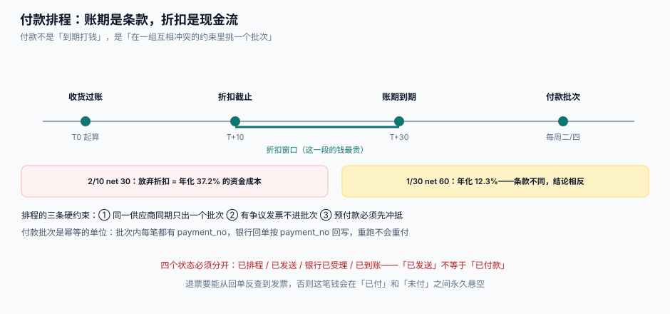

# 付款排程与折扣

匹配通过的发票只是「该付」，不是「现在付」。付款环节要做的是在一组互相冲突的约束里排出一个批次：账期、折扣窗口、现金余额、同一供应商合并、争议发票排除。**这是一道排程题，不是一次转账。**

::: tip 一句话定位
**付款的幂等单位是批次，不是单据。** 重跑一次付款任务，错的不是某一笔，而是整批——所以批次号、批次明细、银行回单三者必须一一对应，且「重跑」要能被识别为同一批而不是新的一批。
:::



本页判据族 `PTY-A` ~ `PTY-H`，共 8 条。定义表在第七节。

## 一、四个互相冲突的约束

| 约束 | 方向 | 违反后果 |
| --- | --- | --- |
| 账期（net days） | 不能早于到期日（除非拿折扣） | 提前付款占压现金；合同也可能不允许 |
| 折扣窗口（discount period） | 必须早于 `T + d` | 错过折扣 = 隐性涨价 |
| 现金余额 | 批次总额 ≤ 可用余额 | 银行退票、供应商投诉 |
| 争议冻结 | 有争议的发票不得进批次 | 付了不该付的钱 |

排程的输出不是「付款清单」，而是**一张带理由的排程表**：每笔钱为什么在这一批、为什么不在。

## 二、现金折扣：算年化，不要看绝对值

`2/10 net 30` 的意思是：10 天内付折 2%，否则 30 天内付全额。放弃折扣的代价是「用 20 天的资金占用换 2%」——换算成年化，高得吓人。

| 条款 | 折扣 | 窗口 | 账期 | 放弃折扣的年化成本 |
| --- | --- | --- | --- | --- |
| 2/10 net 30 | 2% | 10 天 | 30 天 | **37.2%** |
| 1/10 net 30 | 1% | 10 天 | 30 天 | 18.4% |
| 2/15 net 45 | 2% | 15 天 | 45 天 | 24.8% |
| 1/30 net 60 | 1% | 30 天 | 60 天 | 12.3% |
| 无折扣 net 30 | 0 | — | 30 天 | 0（免费占用供应商资金） |

```text
放弃折扣的年化成本 = 折扣率 / (1 − 折扣率) × 365 / (账期 − 折扣窗口)
```

::: tip 判据：拿不拿折扣
拿折扣的条件是 **年化成本 > 公司的资金成本（或短期借款利率）**。37.2% 远高于绝大多数企业的资金成本，所以 2/10 net 30 几乎总该拿；12.3% 就要看公司现金状况了。**这个判断必须由系统算出来并写进排程理由**，不能靠出纳的记忆。
:::

## 三、批次：幂等的基本单位

```sql
CREATE TABLE payment_batch (
  batch_id     TEXT PRIMARY KEY,          -- PB-20260317-01
  run_date     TEXT NOT NULL,
  total_amount INTEGER NOT NULL,          -- 分
  state        TEXT NOT NULL DEFAULT 'DRAFT'
               CHECK (state IN ('DRAFT','SENT','ACCEPTED','SETTLED','FAILED')),
  file_ref     TEXT,                      -- 银行文件编号
  UNIQUE (run_date)                        -- 同一天只允许一个正式批次（可按付款方式拆）
);

CREATE TABLE payment_item (
  batch_id     TEXT NOT NULL REFERENCES payment_batch(batch_id),
  payment_no   TEXT NOT NULL,             -- 由批次号 + 发票号派生，天然幂等
  supplier_id  TEXT NOT NULL,
  invoice_id   TEXT NOT NULL,
  amount       INTEGER NOT NULL CHECK (amount > 0),
  discount     INTEGER NOT NULL DEFAULT 0,
  state        TEXT NOT NULL DEFAULT 'PENDING'
               CHECK (state IN ('PENDING','SENT','ACCEPTED','SETTLED','RETURNED')),
  PRIMARY KEY (batch_id, payment_no),
  UNIQUE (invoice_id)                      -- 一张发票只能进一个批次
);
```

`UNIQUE (invoice_id)` 是这套设计里最重要的一行：**它让「同一张发票被排进两个批次」在数据库层就不成立**，而这是重付最常见的形态（旧批次没关、新批次又扫了一遍）。

::: danger 注意
1. **`payment_no` 必须可推导**。用 `uuid()` 生成的话，重跑会产生新的编号，银行侧看到两笔不同的付款；用 `f(batch_id, invoice_id)` 生成，重跑得到同一编号，银行侧可以直接去重。
2. **批次状态机不能跳步**。`DRAFT → SENT → ACCEPTED → SETTLED`。`SENT` 只代表「文件已发出」，`ACCEPTED` 才是「银行受理」，`SETTLED` 才是「已到账」——把这三个合成一个「已付款」，退票时就无法定位。
3. **不要允许跨批次修改金额**。金额只能在 `DRAFT` 状态改，一旦 `SENT` 就冻结；修改只能通过「红冲 + 新批次」。
:::

## 四、银行文件与回单：两个方向，一个键

| 方向 | 报文 | 用途 | 关键字段 |
| --- | --- | --- | --- |
| 出（付款指令） | ISO 20022 `pain.001` | 告诉银行付给谁、付多少 | `InstrId`（= `payment_no`）、`EndToEndId`（= `invoice_id`） |
| 入（状态回执） | `pain.002` | 银行受理/拒绝 | `OrgnlInstrId`、`Status` |
| 入（对账单） | `camt.053` | 到账明细、退票 | `Ntry`、`AcctSvcrRef`、`RtrInf` |

```python [payment/reconcile.py]
def apply_statement(items: dict[str, dict], entries: list[dict]) -> dict:
    """用 camt.053 的对账条目回写批次明细；返回 {'settled': n, 'returned': n, 'unknown': [..]}"""
    result = {"settled": 0, "returned": 0, "unknown": []}
    for e in entries:
        item = items.get(e["end_to_end_id"])       # 用 EndToEndId 回查，不用金额+日期
        if item is None:
            result["unknown"].append(e["end_to_end_id"])
            continue
        if e.get("return_reason"):
            item["state"] = "RETURNED"
            result["returned"] += 1
        else:
            item["state"] = "SETTLED"
            result["settled"] += 1
    return result
```

::: danger 注意
1. **不要用「金额 + 日期」去匹配回单**。同一供应商同一天付两笔相同金额时必然错配；用 `EndToEndId` 或 `payment_no`。
2. **回单里的退票原因要落库**。只把状态改成「失败」，三个月后没人知道为什么失败（账户错误？户名不符？），只能重新问银行。
3. **对账单要能重放**。同一份 `camt.053` 被导入两次不应产生双倍结果——导入前按 `file_hash` 去重。
:::

## 五、预付款：先冲抵，再付款

预付款在账上是一笔资产（预付账款），不是费用。付款排程必须先看「这个供应商有没有未冲抵的预付款」。

```text
本次应付 = 匹配通过的发票金额 − 未冲抵预付款 − 已开扣款单金额
```

| 场景 | 处理 | 常见错误 |
| --- | --- | --- |
| 有预付、发票已到 | 发票入账时冲抵预付，尾款进批次 | 直接全额付款，预付账款永久挂账 |
| 有预付、货未到 | 不动，继续挂预付 | 提前冲抵，造成虚假入库 |
| 扣款单未执行 | 从本次应付中扣除 | 扣款单只在 Excel 里，付款照全额 |

::: danger 注意
**预付款冲抵必须与原付款单关联**。只写「冲抵 5 万」而不写「冲的是哪一笔预付」，审计时无法证明这 5 万没有重复冲抵。正确做法：`prepay_id` 作为外键，且一笔预付的累计冲抵额不得超过其金额。
:::

## 六、退票与重付：一条完整的闭环

退票是付款环节唯一的「反向事件」，它必须能一路回溯到发票。

```text
银行退票（camt.053 的 RtrInf）
  → payment_item.state = RETURNED，记录原因码
  → 批次状态降为 FAILED（部分失败则保持 ACCEPTED 并标记）
  → 发票状态从 PAID 退回 MATCHED
  → 生成「重付任务」，修正账户后进新批次（新 payment_no）
```

| 检查 | SQL 判据 | 期望 |
| --- | --- | --- |
| 已付金额不超发票金额 | `SUM(item.amount) ≤ invoice.amount` | 0 行违反 |
| 无「批次已结但明细未结」 | 明细状态与批次状态一致 | 0 行 |
| 无超过 7 天未回写的批次 | `SENT` 且 `run_date < now-7d` | 0 行 |
| 退票都有原因码 | `RETURNED` 且 `return_reason IS NULL` | 0 行 |

## 七、对账四问：每天回答一次

出纳每天早上只需要回答四个问题，全部可以用一条 SQL 得出：

```sql
-- ① 昨天发了多少、成了多少
SELECT state, count(*), sum(amount)/100.0 AS 金额元 FROM payment_item
 WHERE batch_id IN (SELECT batch_id FROM payment_batch WHERE run_date = date('now','-1 day'))
 GROUP BY state;

-- ② 有没有「已付但账上没减」的（回单未回写）
SELECT count(*) FROM payment_item WHERE state='SENT' AND batch_id IN
  (SELECT batch_id FROM payment_batch WHERE run_date < date('now','-3 day'));

-- ③ 折扣窗口 3 天内到期、还没进批次的发票
SELECT i.invoice_id, s.name, i.amount/100.0 AS 金额元
  FROM ap_invoice i JOIN supplier s ON s.supplier_id=i.supplier_id
 WHERE i.status='MATCHED'
   AND date(i.invoice_date, '+10 day') <= date('now','+3 day');

-- ④ 退票未处理的
SELECT payment_no, return_reason FROM payment_item WHERE state='RETURNED' AND handled_at IS NULL;
```

## 八、判据

| 判据 | 看什么现象 | 判成什么 | 不满足时改哪里 |
| --- | --- | --- | --- |
| `PTY-A` | `payment_no` 是否由 `(batch_id, invoice_id)` 派生且唯一 | 随机生成即判「重跑产生新编号」 | 改为确定性派生，加唯一索引 |
| `PTY-B` | `payment_item` 是否有 `UNIQUE(invoice_id)` | 无即判「一票多批」 | 加唯一约束，历史重复先核销 |
| `PTY-C` | 批次状态是否区分 `SENT` / `ACCEPTED` / `SETTLED` | 合并成「已付款」即判「退票无法定位」 | 拆四态，回单回写驱动状态 |
| `PTY-D` | 折扣是否被算成年化并与资金成本比较 | 只看折扣金额即判「决策无依据」 | 排程输出年化成本与结论，落 `discount_decision` |
| `PTY-E` | 回单回写是否用 `EndToEndId` / `payment_no` | 用金额+日期即判「错配」 | 改键，历史数据按金额唯一时回填 |
| `PTY-F` | 预付款冲抵是否关联 `prepay_id` 且不超原额 | 只写金额即判「可重复冲抵」 | 加外键与累计校验 |
| `PTY-G` | `camt.053` 导入是否按 `file_hash` 去重 | 无去重即判「重放双记」 | 建 `statement_file` 表存哈希 |
| `PTY-H` | 退票是否回退发票状态并生成重付任务 | 只改付款状态即判「闭环断在银行」 | 退票处理器同时改发票状态、建重付单 |

## 九、如何验证

```shell
# 1. 一张发票进两个批次必须失败（负向用例）
sqlite3 /tmp/p2p.db "INSERT INTO payment_batch(batch_id,run_date,total_amount,state) VALUES('PB-1','2026-03-17',100000,'DRAFT');"
sqlite3 /tmp/p2p.db "INSERT INTO payment_item(batch_id,payment_no,supplier_id,invoice_id,amount) VALUES('PB-1','PB-1-I1','S1','I1',100000);"
sqlite3 /tmp/p2p.db "INSERT INTO payment_batch(batch_id,run_date,total_amount,state) VALUES('PB-2','2026-03-18',100000,'DRAFT');"
sqlite3 /tmp/p2p.db "INSERT INTO payment_item(batch_id,payment_no,supplier_id,invoice_id,amount) VALUES('PB-2','PB-2-I1','S1','I1',100000);"
# 期望：UNIQUE constraint failed: payment_item.invoice_id

# 2. 折扣年化成本
python3 -c "print(round(0.02/0.98*365/20*100,1), round(0.01/0.99*365/30*100,1))"
# 期望：37.2 12.3

# 3. 已付不超发票额（不变量）
sqlite3 /tmp/p2p.db "SELECT invoice_id, SUM(amount) FROM payment_item GROUP BY invoice_id HAVING SUM(amount) > (SELECT amount FROM ap_invoice i WHERE i.invoice_id=payment_item.invoice_id);"
# 期望：0 行

# 4. 超过 3 天仍为 SENT 的批次（回单未回写）
sqlite3 /tmp/p2p.db "SELECT count(*) FROM payment_batch WHERE state='SENT' AND run_date < date('now','-3 day');"
# 期望：0
```

## 参考资料

- [三单匹配与容差](../InvoiceMatch/index.md)：哪些发票有资格进批次
- [账务与分录](../../Ledger/index.md)：付款分录与应付减少
- [对账与差错处理](../../Ledger/Reconciliation/index.md)：银行对账单与账面差异的定位方法
- ISO 20022 `pain.001` / `pain.002` / `camt.053`：付款指令、状态回执与对账单的字段定义
