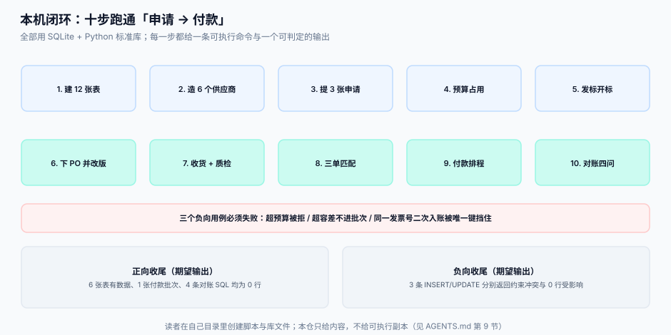

# 实战：本机跑通一条闭环

前面九页讲的是每一段该怎么设计。这一页把它们连起来：**用 Python 标准库 + SQLite，在自己电脑上跑通「申请 → 寻源 → 订单 → 收货 → 匹配 → 付款」，并用三个负向用例证明防线真的在拦。**

::: tip 一句话定位
这一页的验收标准不是「代码能跑」，而是**四条不变量各有一次查询能返回 0 行，三个负向用例各自失败**。能跑但拦不住，等于没做。
:::



本页判据族 `PTX-A` ~ `PTX-H`，共 8 条。定义表在第八节。

## 一、环境与目录

```shell
python3 -V                     # 期望 3.11+
python3 -c "import sqlite3; print(sqlite3.sqlite_version)"   # 期望 3.35+（需要 UPSERT 与 json 函数）
mkdir -p ~/p2p-lab && cd ~/p2p-lab
```

| 文件 | 作用 | 约几行 |
| --- | --- | --- |
| `ddl.sql` | 十四张表 + 三个视图 | 120 |
| `seed.py` | 造种子数据（3 供应商 / 1 预算 / 1 订单 / 1 收货 / 2 发票） | 45 |
| `match.py` | 匹配 + 分类 + 生成付款批次 | 55 |
| `check.py` | 四条不变量 + 三个负向用例 | 50 |

::: danger 注意
1. **不要用 `:memory:`**。三个脚本要共享同一个库，必须落地到文件；`:memory:` 每次连接都是新的空库，你会得到「表不存在」这种莫名其妙的错误。
2. **不要忘记 `PRAGMA foreign_keys=ON`**。SQLite 默认**不启用**外键，不打开它，`gr_line.po_no` 指向不存在的订单也不会报错，而你所有的「引号完整性」检查都会假绿。
3. **金额一律用「分」的整数**。这一页所有金额都是整数分，`336175` 就是 3,361.75 元。
:::

## 二、ddl.sql：十四张表

```sql [ddl.sql]
PRAGMA foreign_keys = ON;

CREATE TABLE supplier (
  supplier_id TEXT PRIMARY KEY, name TEXT NOT NULL,
  credit_code TEXT NOT NULL UNIQUE,
  state TEXT NOT NULL DEFAULT 'PROSPECT'
        CHECK (state IN ('PROSPECT','APPROVED','PROBATION','BLOCKED')),
  cert_expire_at TEXT, bank_account TEXT);

CREATE TABLE budget (
  budget_id TEXT PRIMARY KEY, period TEXT NOT NULL, account_code TEXT NOT NULL,
  cost_center TEXT NOT NULL, project_id TEXT NOT NULL DEFAULT '-',
  total_amount INTEGER NOT NULL, used_amount INTEGER NOT NULL DEFAULT 0,
  version INTEGER NOT NULL DEFAULT 0,
  UNIQUE (period, account_code, cost_center, project_id),
  CHECK (used_amount >= 0));

CREATE TABLE budget_txn (
  txn_id INTEGER PRIMARY KEY AUTOINCREMENT, budget_id TEXT NOT NULL REFERENCES budget(budget_id),
  ref_type TEXT NOT NULL, ref_no TEXT NOT NULL, delta INTEGER NOT NULL, created_at TEXT NOT NULL);
CREATE UNIQUE INDEX ux_budget_txn_once ON budget_txn(budget_id, ref_type, ref_no);

CREATE TABLE pr (
  pr_no TEXT PRIMARY KEY, budget_id TEXT NOT NULL REFERENCES budget(budget_id),
  requester TEXT NOT NULL, need_by TEXT NOT NULL, amount INTEGER NOT NULL,
  state TEXT NOT NULL DEFAULT 'SUBMITTED'
        CHECK (state IN ('SUBMITTED','APPROVED','REJECTED','CANCELLED','ORDERED')));

CREATE TABLE rfq_quote (
  quote_id TEXT PRIMARY KEY, rfq_id TEXT NOT NULL,
  supplier_id TEXT NOT NULL REFERENCES supplier(supplier_id),
  payload BLOB NOT NULL, submitted_at TEXT NOT NULL, opened_at TEXT,
  UNIQUE (rfq_id, supplier_id),
  CHECK (opened_at IS NULL OR opened_at >= submitted_at));
CREATE VIEW v_quote_open AS
SELECT quote_id, rfq_id, supplier_id, payload, opened_at FROM rfq_quote
 WHERE opened_at IS NOT NULL AND opened_at <= datetime('now');

CREATE TABLE purchase_order (
  po_no TEXT PRIMARY KEY, supplier_id TEXT NOT NULL REFERENCES supplier(supplier_id),
  currency TEXT NOT NULL DEFAULT 'CNY', version INTEGER NOT NULL DEFAULT 1,
  state TEXT NOT NULL DEFAULT 'OPEN'
        CHECK (state IN ('DRAFT','OPEN','PARTIAL','CLOSED','CANCELLED')),
  committed_at TEXT NOT NULL, closed_at TEXT);

CREATE TABLE po_line (
  po_no TEXT NOT NULL REFERENCES purchase_order(po_no), line_no INTEGER NOT NULL,
  sku TEXT NOT NULL, qty INTEGER NOT NULL CHECK (qty > 0), uom TEXT NOT NULL DEFAULT 'EA',
  unit_price INTEGER NOT NULL, tax_rate INTEGER NOT NULL DEFAULT 1300,
  PRIMARY KEY (po_no, line_no));

CREATE TABLE po_version (
  po_no TEXT NOT NULL REFERENCES purchase_order(po_no), version INTEGER NOT NULL,
  snapshot TEXT NOT NULL, reason TEXT NOT NULL, created_at TEXT NOT NULL,
  PRIMARY KEY (po_no, version));

CREATE TABLE gr_head (
  gr_no TEXT PRIMARY KEY, supplier_id TEXT NOT NULL REFERENCES supplier(supplier_id),
  received_at TEXT NOT NULL, carrier TEXT);

CREATE TABLE gr_line (
  gr_no TEXT NOT NULL REFERENCES gr_head(gr_no), line_no INTEGER NOT NULL,
  po_no TEXT NOT NULL, po_version INTEGER NOT NULL, po_line_no INTEGER NOT NULL,
  sku TEXT NOT NULL, batch_no TEXT, qty INTEGER NOT NULL CHECK (qty > 0),
  qc_state TEXT NOT NULL DEFAULT 'PENDING'
           CHECK (qc_state IN ('PENDING','PASS','CONCESSION','REJECT')),
  unit_price INTEGER NOT NULL, PRIMARY KEY (gr_no, line_no));

CREATE VIEW v_receivable AS
SELECT po_no, po_version, po_line_no,
       SUM(CASE WHEN qc_state IN ('PASS','CONCESSION') THEN qty ELSE 0 END) AS matchable_qty,
       SUM(qty) AS received_qty
  FROM gr_line GROUP BY po_no, po_version, po_line_no;

CREATE TABLE ap_invoice (
  invoice_id TEXT PRIMARY KEY, supplier_id TEXT NOT NULL REFERENCES supplier(supplier_id),
  invoice_no TEXT NOT NULL, invoice_date TEXT NOT NULL,
  amount INTEGER NOT NULL, tax_amount INTEGER NOT NULL,
  status TEXT NOT NULL DEFAULT 'RECEIVED'
         CHECK (status IN ('RECEIVED','MATCHED','DISPUTED','PAID','VOID')),
  UNIQUE (supplier_id, invoice_no));

CREATE TABLE ap_invoice_line (
  invoice_id TEXT NOT NULL REFERENCES ap_invoice(invoice_id), line_no INTEGER NOT NULL,
  po_no TEXT NOT NULL, po_line_no INTEGER NOT NULL, sku TEXT NOT NULL,
  qty INTEGER NOT NULL CHECK (qty > 0), unit_price INTEGER NOT NULL, amount INTEGER NOT NULL,
  PRIMARY KEY (invoice_id, line_no));

CREATE TABLE match_result (
  match_id TEXT PRIMARY KEY, invoice_id TEXT NOT NULL REFERENCES ap_invoice(invoice_id),
  diff_type TEXT NOT NULL CHECK (diff_type IN ('OK','PRICE','QTY','TAX','FEE','OTHER')),
  diff_amount INTEGER NOT NULL DEFAULT 0, created_at TEXT NOT NULL);

CREATE TABLE payment_batch (
  batch_id TEXT PRIMARY KEY, run_date TEXT NOT NULL UNIQUE, total_amount INTEGER NOT NULL,
  state TEXT NOT NULL DEFAULT 'DRAFT'
        CHECK (state IN ('DRAFT','SENT','ACCEPTED','SETTLED','FAILED')), file_ref TEXT);

CREATE TABLE payment_item (
  batch_id TEXT NOT NULL REFERENCES payment_batch(batch_id), payment_no TEXT NOT NULL,
  supplier_id TEXT NOT NULL, invoice_id TEXT NOT NULL REFERENCES ap_invoice(invoice_id),
  amount INTEGER NOT NULL CHECK (amount > 0), discount INTEGER NOT NULL DEFAULT 0,
  state TEXT NOT NULL DEFAULT 'PENDING'
        CHECK (state IN ('PENDING','SENT','ACCEPTED','SETTLED','RETURNED')),
  return_reason TEXT, handled_at TEXT,
  PRIMARY KEY (batch_id, payment_no), UNIQUE (invoice_id));
```

```shell
sqlite3 ~/p2p-lab/p2p.db < ~/p2p-lab/ddl.sql
sqlite3 ~/p2p-lab/p2p.db ".tables"
# 期望：ap_invoice ap_invoice_line budget budget_txn gr_head gr_line match_result
#       payment_batch payment_item po_line po_version pr purchase_order rfq_quote supplier
sqlite3 ~/p2p-lab/p2p.db "SELECT count(*) FROM sqlite_master WHERE type='table';"
# 期望：14
```

## 三、seed.py：让链上每一段都有数据

```python [seed.py]
import sqlite3
c = sqlite3.connect("/Users/me/p2p-lab/p2p.db")      # 换成你的绝对路径
c.execute("PRAGMA foreign_keys=ON")
c.executescript("""
DELETE FROM payment_item; DELETE FROM payment_batch; DELETE FROM match_result;
DELETE FROM ap_invoice_line; DELETE FROM ap_invoice; DELETE FROM gr_line; DELETE FROM gr_head;
DELETE FROM po_version; DELETE FROM po_line; DELETE FROM purchase_order;
DELETE FROM rfq_quote; DELETE FROM pr; DELETE FROM budget_txn; DELETE FROM budget; DELETE FROM supplier;

INSERT INTO supplier VALUES('S1','华东包装','91310000AAA','APPROVED','2027-12-31','6222-0001');
INSERT INTO supplier VALUES('S2','南方纸业','91310000BBB','APPROVED','2026-11-30','6222-0002');
INSERT INTO supplier VALUES('S3','北方塑胶','91310000CCC','PROBATION','2027-06-30','6222-0003');

INSERT INTO budget(budget_id,period,account_code,cost_center,total_amount)
VALUES('B1','2026-03','6602-01','CC01',5000000);           -- 5 万元
INSERT INTO budget_txn(budget_id,ref_type,ref_no,delta,created_at)
VALUES('B1','PR','PR-1',1200000,'2026-03-02 09:00:00');
UPDATE budget SET used_amount=1200000 WHERE budget_id='B1';
INSERT INTO pr VALUES('PR-1','B1','张工','2026-03-20',1200000,'ORDERED');

INSERT INTO rfq_quote(quote_id,rfq_id,supplier_id,payload,submitted_at) VALUES
 ('Q1','R1','S1',x'01','2026-03-02 10:00:00'),
 ('Q2','R1','S2',x'02','2026-03-02 11:00:00');

INSERT INTO purchase_order VALUES('PO-1001','S1','CNY',2,'PARTIAL','2026-03-03 08:00:00',NULL);
INSERT INTO po_version VALUES('PO-1001',1,'{"lines":[{"line_no":1,"qty":100}]}','初始下单','2026-03-03 08:00:00');
INSERT INTO po_version VALUES('PO-1001',2,'{"lines":[{"line_no":1,"qty":120}]}','追加 20 件','2026-03-09 09:30:00');
INSERT INTO po_line VALUES('PO-1001',1,'SKU001',120,'EA',1250,1300);
INSERT INTO po_line VALUES('PO-1001',2,'SKU002',50,'EA',3000,1300);

INSERT INTO gr_head VALUES('GR-1','S1','2026-03-12 14:20:00','顺丰');
INSERT INTO gr_line VALUES('GR-1',1,'PO-1001',2,1,'SKU001','B2603',118,'PASS',1250);
INSERT INTO gr_line VALUES('GR-1',2,'PO-1001',2,2,'SKU002','B2603',50,'PASS',3000);
INSERT INTO gr_line VALUES('GR-1',3,'PO-1001',2,1,'SKU001','B2603',10,'PENDING',1250);  -- 待检

INSERT INTO ap_invoice VALUES('INV-1','S1','FP-0001','2026-03-13',336175,38675,'RECEIVED');
INSERT INTO ap_invoice_line VALUES('INV-1',1,'PO-1001',1,'SKU001',118,1250,147500);
INSERT INTO ap_invoice_line VALUES('INV-1',2,'PO-1001',2,'SKU002',50,3000,150000);
INSERT INTO ap_invoice VALUES('INV-2','S1','FP-0002','2026-03-14',341509,39289,'RECEIVED');  -- 单价 12.90
INSERT INTO ap_invoice_line VALUES('INV-2',1,'PO-1001',1,'SKU001',118,1290,152220);
INSERT INTO ap_invoice_line VALUES('INV-2',2,'PO-1001',2,'SKU002',50,3000,150000);
""")
c.commit()
```

```shell
python3 ~/p2p-lab/seed.py
sqlite3 ~/p2p-lab/p2p.db "SELECT po_line_no,matchable_qty,received_qty FROM v_receivable ORDER BY 1;"
# 期望：1|118|128   2|50|50   ← 10 件待检不计入可匹配
```

::: warning 为什么故意放一行待检
`GR-1` 第 3 行是 10 件 `PENDING`。它让「可匹配 118 / 已收 128」的差额可被直接观察；如果你的 `v_receivable` 给出 128，说明待检被错误地算进了可匹配量（对应判据 `PTG-D`）。
:::

## 四、match.py：键配 + 容差 + 分类

```python [match.py]
import sqlite3
from decimal import Decimal

c = sqlite3.connect("/Users/me/p2p-lab/p2p.db")
c.execute("PRAGMA foreign_keys=ON"); c.row_factory = sqlite3.Row

def classify(inv, po, matchable) -> tuple[str, int]:
    po_amt = Decimal(inv["qty"] * po["unit_price"])
    inv_amt = Decimal(inv["amount"])
    tol = max(Decimal(500), (po_amt * Decimal("0.01")).quantize(Decimal("1")))  # max(5 元, 1%)
    if inv["qty"] > matchable:
        return "QTY", int(inv_amt - po_amt)
    if abs(inv_amt - po_amt) > tol:
        return "PRICE", int(inv_amt - po_amt)
    return "OK", 0

for inv in [r["invoice_id"] for r in c.execute("SELECT invoice_id FROM ap_invoice ORDER BY 1")]:
    worst = ("OK", 0)
    for il in c.execute("""SELECT l.*, p.unit_price AS po_price, p.qty AS po_qty,
             COALESCE((SELECT matchable_qty FROM v_receivable v
                        WHERE v.po_no=l.po_no AND v.po_line_no=l.po_line_no),0) AS matchable
             FROM ap_invoice_line l JOIN po_line p ON p.po_no=l.po_no AND p.line_no=l.po_line_no
             WHERE l.invoice_id=?""", (inv,)):
        t, amt = classify({"qty": il["qty"], "amount": il["amount"]},
                          {"unit_price": il["po_price"], "qty": il["po_qty"]}, il["matchable"])
        if t != "OK" and worst[0] == "OK":
            worst = (t, amt)
    c.execute("INSERT OR REPLACE INTO match_result VALUES(?,?,?,?,datetime('now'))",
              (f"M-{inv}", inv, worst[0], worst[1]))
    c.execute("UPDATE ap_invoice SET status=? WHERE invoice_id=?",
              ("MATCHED" if worst[0] == "OK" else "DISPUTED", inv))
c.commit()

items = c.execute("SELECT invoice_id, amount FROM ap_invoice WHERE status='MATCHED'").fetchall()
c.execute("INSERT INTO payment_batch VALUES('PB-20260317-01','2026-03-17',?,'DRAFT',NULL)",
          (sum(i["amount"] for i in items),))
for i in items:
    c.execute("""INSERT INTO payment_item(batch_id,payment_no,supplier_id,invoice_id,amount)
                 VALUES(?,?,?,?,?)""",
              ("PB-20260317-01", f"PB-20260317-01-{i['invoice_id']}", "S1", i["invoice_id"], i["amount"]))
c.commit()
print([(r["invoice_id"], r["diff_type"], r["diff_amount"]) for r in c.execute("SELECT * FROM match_result")])
```

```shell
python3 ~/p2p-lab/match.py
# 期望：[('INV-1', 'OK', 0), ('INV-2', 'PRICE', 4720)]
sqlite3 ~/p2p-lab/p2p.db "SELECT invoice_id,status FROM ap_invoice;"
# 期望：INV-1|MATCHED   INV-2|DISPUTED
sqlite3 ~/p2p-lab/p2p.db "SELECT batch_id,total_amount FROM payment_batch;"
# 期望：PB-20260317-01|336175   （3,361.75 元，只含 INV-1）
```

`INV-2` 的价差是 `118 × (1290 − 1250) = 4,720` 分（47.20 元），超过容差 `max(500, 1%×147500=1475)`，因此判 `PRICE` 并冻结付款——**这是本页最重要的一次观察：匹配的价值在于「有争议的那张被单独挑出来」，而不是「全部通过」。**

## 五、check.py：四条不变量 + 三个负向用例

```python [check.py]
import sqlite3
c = sqlite3.connect("/Users/me/p2p-lab/p2p.db")
c.execute("PRAGMA foreign_keys=ON")

INVARIANTS = {
 "预算不超": "SELECT count(*) FROM budget WHERE used_amount>total_amount OR used_amount<0",
 "收货不超允收": """SELECT count(*) FROM po_line l WHERE l.qty*1.05 <
      (SELECT COALESCE(SUM(qty),0) FROM gr_line g WHERE g.po_no=l.po_no AND g.po_line_no=l.line_no)""",
 "开票不超可匹配": """SELECT count(*) FROM ap_invoice_line i WHERE i.qty >
      COALESCE((SELECT matchable_qty FROM v_receivable v
                 WHERE v.po_no=i.po_no AND v.po_line_no=i.po_line_no),0)""",
 "付款不超开票": """SELECT count(*) FROM (SELECT invoice_id,SUM(amount) s FROM payment_item
      GROUP BY invoice_id HAVING s > (SELECT amount FROM ap_invoice a
      WHERE a.invoice_id=payment_item.invoice_id))""",
}
for name, sql in INVARIANTS.items():
    print(f"{name}: {c.execute(sql).fetchone()[0]} 行违反")
```

```shell
python3 ~/p2p-lab/check.py
# 期望：预算不超: 0 行违反 / 收货不超允收: 1 / 开票不超可匹配: 0 / 付款不超开票: 0
```

第二项给出 **1** 是这套种子数据**设计好的发现**，也是最值得盯住的一条：

```text
订单行 1 数量 120，允差 5% → 允收上限 126
已收 = 118（PASS）+ 10（PENDING）= 128 > 126  → 超收 2 件
```

注意两个口径的差别：**待检计入「已收」，但不计入「可匹配」**。前者是仓库口径（货已在厂里），后者是财务口径（还不知道能不能用）。所以同一条数据在「收货不变量」里是违反、在「开票不变量」里是合规——**这不是矛盾，是两个问题各自的正确答案**。真实系统在这里应该做的是：超收 2 件走例外审批，同时催质检在 3 天内判定那 10 件。

三个负向用例（必须失败）：

```shell
# ① 超预算：预算已用 120 万，剩 380 万，再占 400 万应失败（受影响 0 行）
sqlite3 ~/p2p-lab/p2p.db "UPDATE budget SET used_amount=used_amount+40000000 WHERE budget_id='B1' AND used_amount+40000000<=total_amount; SELECT changes();"
# 期望：0

# ② 重复发票：同一供应商同一发票号第二次入账应被唯一键挡住
sqlite3 ~/p2p-lab/p2p.db "INSERT INTO ap_invoice VALUES('INV-X','S1','FP-0001','2026-03-20',1,0,'RECEIVED');"
# 期望：UNIQUE constraint failed: ap_invoice.supplier_id, ap_invoice.invoice_no

# ③ 一票两批：INV-1 已在 PB-20260317-01 里，再进一个新批次应失败
sqlite3 ~/p2p-lab/p2p.db "INSERT INTO payment_batch VALUES('PB-2','2026-03-18',1,'DRAFT',NULL);"
sqlite3 ~/p2p-lab/p2p.db "INSERT INTO payment_item(batch_id,payment_no,supplier_id,invoice_id,amount) VALUES('PB-2','PB-2-INV-1','S1','INV-1',1);"
# 期望：UNIQUE constraint failed: payment_item.invoice_id
```

::: danger 注意
1. **负向用例必须「期望失败」**。如果你的脚本把 `UNIQUE constraint failed` 当成异常吞掉并继续，这条用例就变成了「静默通过」，比不写更糟。
2. **每条不变量都要能在有数据时返回 0**。空库跑出 0 行没有意义——先 `seed.py` 再 `check.py`，顺序不能反。
3. **不要用 `changes()` 判断超预算**。`changes()` 在 `UPDATE` 未匹配行时返回 0，但某些驱动会返回上一次语句的影响行数；用 `SELECT changes()` 紧跟其后，或用 Python 的 `cursor.rowcount`。
:::

## 六、闭环验证：一次跑完

```shell
cd ~/p2p-lab
rm -f p2p.db
sqlite3 p2p.db < ddl.sql && python3 seed.py && python3 match.py && python3 check.py
# 期望四段输出依次为：建表无报错 / 种子无报错 / 匹配两行（OK 与 PRICE）/ 四条不变量（0,1,0,0）
sqlite3 p2p.db "SELECT (SELECT total_amount-used_amount FROM budget) AS 预算余额,
                       (SELECT count(*) FROM gr_line WHERE qc_state='PENDING') AS 待检行,
                       (SELECT count(*) FROM payment_item) AS 批内明细;"
# 期望：3800000|1|1
```

## 七、下一步能加什么

| 加什么 | 在哪一页有设计 | 验收 |
| --- | --- | --- |
| 月初预算结转 | [需求申请](../Requisition/index.md) | 结转后本期余额回满、下期余额减少同额 |
| 部分收货 → 部分付款 | [三单匹配](../InvoiceMatch/index.md) | 同一发票分两次付款，`payment_item` 两行且合计 = 发票额 |
| 折扣决策 | [付款排程](../PaymentRun/index.md) | 2/10 条款下 10 天内付款，金额 = 98% |
| 退票闭环 | [付款排程](../PaymentRun/index.md) | 退票后发票状态回 `MATCHED`、生成重付任务 |

## 八、判据

| 判据 | 看什么现象 | 判成什么 | 不满足时改哪里 |
| --- | --- | --- | --- |
| `PTX-A` | 三个脚本是否共用同一个**文件**库 | 用 `:memory:` 即判「跨脚本无共享」 | 连接串改为 `p2p.db` 绝对路径 |
| `PTX-B` | 每个连接是否执行 `PRAGMA foreign_keys=ON` | 未执行即判「外键失效」 | 在 `ddl.sql` 首行与每个 `connect()` 后各加一次 |
| `PTX-C` | `ddl.sql` 建出的表数是否为 14 | 少于 14 即判「缺表」 | 对照第二节清单补齐 |
| `PTX-D` | `v_receivable` 是否排除了 `PENDING` | 包含即判「暂估提前」 | 视图条件改 `qc_state IN ('PASS','CONCESSION')` |
| `PTX-E` | 匹配输出是否为 `INV-1=OK / INV-2=PRICE` | 两张都 OK 即判「容差失效」 | 检查容差计算是否用了 `max(500, 1%)` |
| `PTX-F` | 付款批次总额是否只含 `MATCHED` 发票 | 含 `DISPUTED` 即判「争议发票进批次」 | 批次生成时按 `status='MATCHED'` 过滤 |
| `PTX-G` | 三个负向用例是否各自返回约束错误/0 行 | 任一「成功」即判「防线缺失」 | 逐个定位：条件更新、唯一索引、`UNIQUE(invoice_id)` |
| `PTX-H` | `check.py` 的四条不变量是否都跑通，且「收货超允收 = 1」能被解释为「10 件待检计入已收」 | 出现无法解释的非 0，或把该 1 判成系统缺陷即判「口径未分清」 | 先分「已收 / 可匹配」两个口径，再决定是修数还是补审批 |

## 参考资料

- [总览：七段链与四个时点](../Overview/index.md)：本页每一步对应哪一段
- [需求申请与预算占用](../Requisition/index.md)：条件更新与释放的完整设计
- [三单匹配与容差](../InvoiceMatch/index.md)：容差与差异分类的取值依据
- [付款排程与折扣](../PaymentRun/index.md)：批次幂等与回单回写
- SQLite 官方文档：`PRAGMA foreign_keys`、`UPSERT`、`json_extract` 的行为说明
