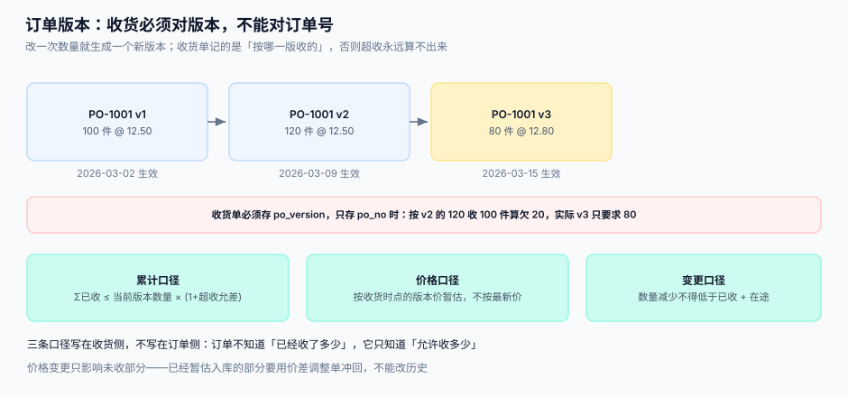

# 采购订单与变更

订单是这条链上唯一被反复修改的单据。一张跑满三个月的订单，改过五六次数量与交期是常态。**问题不在改，而在「改完之后，谁按哪一版在收」**——收货只记订单号不记版本时，超收永远算不出来。

::: tip 一句话定位
**订单号是身份，版本号是事实。** 所有下游（收货、匹配、暂估）都必须引用「订单号 + 版本号」这一对，只引用订单号的地方，就是接缝②的缺口。
:::



本页判据族 `PTP-A` ~ `PTP-H`，共 8 条。定义表在第七节。

## 一、四张表：头、行、交货计划、版本

| 表 | 主键 | 装什么 | 为什么必须拆开 |
| --- | --- | --- | --- |
| `purchase_order` | `po_no` | 供应商、币种、条款、当前版本号 | 头信息一变就是新版本 |
| `po_line` | `po_no + line_no` | 料号、数量、单价、税率 | 行是收货与匹配的**对齐单位** |
| `po_schedule` | `po_no + line_no + seq` | 分批交期与数量 | 分批不能用多个行表达（会打乱行号对齐） |
| `po_version` | `po_no + version` | 每次变更的快照 | 事后要能还原「当时那一版长什么样」 |

```sql
CREATE TABLE purchase_order (
  po_no        TEXT PRIMARY KEY,
  supplier_id  TEXT NOT NULL,
  currency     TEXT NOT NULL DEFAULT 'CNY',
  version      INTEGER NOT NULL DEFAULT 1,     -- 当前生效版本
  state        TEXT NOT NULL DEFAULT 'OPEN'
               CHECK (state IN ('DRAFT','OPEN','PARTIAL','CLOSED','CANCELLED')),
  committed_at TEXT NOT NULL,                  -- 承诺时点（第一个时点）
  closed_at    TEXT
);

CREATE TABLE po_line (
  po_no     TEXT NOT NULL REFERENCES purchase_order(po_no),
  line_no   INTEGER NOT NULL,
  sku       TEXT NOT NULL,
  qty       INTEGER NOT NULL CHECK (qty > 0),
  uom       TEXT NOT NULL,
  unit_price INTEGER NOT NULL,                 -- 分，不含税
  tax_rate  INTEGER NOT NULL,                  -- 1300 = 13%
  PRIMARY KEY (po_no, line_no)
);

CREATE TABLE po_schedule (
  po_no    TEXT NOT NULL,
  line_no  INTEGER NOT NULL,
  seq      INTEGER NOT NULL,
  due_date TEXT NOT NULL,
  qty      INTEGER NOT NULL CHECK (qty > 0),
  PRIMARY KEY (po_no, line_no, seq)
);
```

::: danger 注意
1. **不要用「多行同料号」表达分批**。行号是收货与匹配的对齐键，拆成两行后，发票按一行开、收货按两行收，匹配就会变成「一行对两行」，差异分类直接失效。分批用 `po_schedule`。
2. **不要在 `po_line` 上直接改数量**。改完就没有「改之前是多少」的证据，超收判定失去基准；每次变更写入 `po_version` 快照，`po_line` 只保留当前值。
3. **不要用浮点存单价**。`12.50 × 3` 在二进制浮点里是 `37.499999999999996`，累计一万行就是几毛钱的差，而财务会为一个永远对不平的几毛钱查两周。金额一律用「分」的整数。
:::

## 二、版本链：什么变更要升版

不是所有修改都要升版。判据是：**这次修改是否改变了「允许收多少」「该付多少」中的任一项**。

| 变更 | 升版 | 影响 | 备注 |
| --- | --- | --- | --- |
| 数量 | 是 | 允收上限、暂估金额 | 减少时不得低于「已收 + 在途」 |
| 单价 | 是 | 暂估口径、价差判定 | 只影响未收部分 |
| 交期 | 是 | 准时率统计 | 不影响金额 |
| 税率 | 是 | 发票校验 | 必须与发票税率一致才自动过账 |
| 收货地址 / 联系人 | 否 | 无 | 记审计日志即可 |
| 备注 | 否 | 无 | 同上 |

```sql
-- 升版：先快照，再改当前值，同一事务内完成
BEGIN;
INSERT INTO po_version(po_no, version, snapshot, created_at, reason)
SELECT po_no, version, json_object('lines', (SELECT json_group_array(json_object(
         'line_no', line_no, 'sku', sku, 'qty', qty, 'unit_price', unit_price))
       FROM po_line WHERE po_no = :po), 'schedule', (
       SELECT json_group_array(json_object('line_no', line_no, 'seq', seq, 'qty', qty, 'due_date', due_date))
       FROM po_schedule WHERE po_no = :po)), datetime('now'), :reason
  FROM purchase_order WHERE po_no = :po;

UPDATE purchase_order SET version = version + 1 WHERE po_no = :po;
UPDATE po_line SET qty = :new_qty WHERE po_no = :po AND line_no = :line;
COMMIT;
```

::: danger 注意
1. **减少数量时没有下限校验，是最常见的事故**。订单 120 件、已收 100 件、在途 30 件，采购把数量改成 80——系统答应了，收货侧却还有 30 件在路上，最终累计收货 130 > 80。正确做法：`新数量 ≥ 已收 + 在途`，否则先取消在途。
2. **不要允许「同一时刻两个版本都生效」**。`version` 必须是单指针，切换是原子的；用「生效区间」表达版本，会在边界日出现两个版本都可用的窗口。
3. **快照要能还原金额，不只是数量**。只存数量与单价，税率变了就还原不出当时的暂估额；快照里把税率、币种、条款一起存。
:::

## 三、分批交货：累计口径写在收货侧

分批的关键不是「计划了几批」，而是**累计到第 N 批时，允许多收多少**。这个判断只能由「订单当前版本 + 已收累计」共同决定。

```text
该行允收上限 = 当前版本数量 × (1 + 超收允差)
该行剩余可收 = 允收上限 − 已收累计（含待检）
```

| 场景 | 版本数量 | 已收 | 允差 5% | 剩余可收 | 结论 |
| --- | --- | --- | --- | --- | --- |
| 首批 | 100 | 0 | 105 | 105 | 正常 |
| 收 100 后 | 100 | 100 | 105 | 5 | 再来 10 件需审批 |
| 收 105 后 | 100 | 105 | 105 | 0 | 再收即超收，拒收或走例外 |

::: warning 「待检」要不要计入已收
计入：允收上限用得更保守，避免「待检 50 + 再收 100 = 150」的失控；不计入：供应商可以靠「一直待检」绕过上限。**结论是计入**，但「已收」与「已入库」必须是两个数（见[收货与质检](../GoodsReceipt/index.md)）。
:::

## 四、允差：三个方向、三种动作

| 方向 | 定义 | 常见允差 | 动作 |
| --- | --- | --- | --- |
| 超收（over-receipt） | 实收 > 订单量 | 0 ~ 5% | 允差内自动过账；超出需审批或拒收 |
| 短装（under-shipment） | 实收 < 订单量 | 0 ~ 2%（整批） | 允差内视同完成；超出保持 `PARTIAL` |
| 欠交（short-close） | 到期仍未交 | — | 关闭剩余量并记入供应商绩效 |

允差必须**写在合同里**，不能只写在代码里。代码里的允差是「系统允许」，合同里的允差是「双方同意」；两者不一致时，超收的那部分货会在对账时变成争议。

```sql
-- 超收判定：一条 SQL 给出「是否超收」与「超了多少」
SELECT l.line_no, l.qty AS ordered,
       COALESCE(SUM(g.qty), 0) AS received,
       l.qty * (1 + :tolerance) AS limit_qty,
       COALESCE(SUM(g.qty), 0) - l.qty * (1 + :tolerance) AS over_qty
  FROM po_line l
  LEFT JOIN gr_line g ON g.po_no = l.po_no AND g.line_no = l.line_no
 WHERE l.po_no = :po
 GROUP BY l.line_no, l.qty;
```

## 五、价格与税率：四个必须写死的口径

| 口径 | 取值 | 写错会怎样 |
| --- | --- | --- |
| 价内 / 价外税 | 单价默认**不含税**，税额单列 | 含税当不含税，暂估多 13%，月末一次性冲回一大笔 |
| 税率精度 | 存整数基点（1300 = 13%） | 存 `0.13` 浮点，累计后税额差几分 |
| 币种与汇率 | 订单币种 + 记账币种 + 汇率日 | 用付款日汇率记暂估，汇率一波动就产生「汇兑差异」混进价差 |
| 运费 | 单独行或单独字段 | 塞进单价，退货时按含运费单价退，供应商不认 |

```text
不含税金额 = 数量 × 不含税单价
税额       = 不含税金额 × 税率（四舍五入到分，按行计算）
含税金额   = 不含税金额 + 税额
```

::: danger 注意
1. **税额按行算，不要按总额算**。总额算税再按行拆，会出现「行金额之和 ≠ 总额」的 1 分钱差；发票是按行开的，这个差会让匹配永远差 1 分。本机实测（200 张单据 × 25 行、税率 13%）：**63.5% 的单据**逐行算税与总额算税不相等，最大差 3 分。
2. **不要允许「单价改了但税率没改」**。税率属于订单版本的一部分，改单价时必须一起确认税率，否则暂估与发票税额对不上。
3. **汇率必须在订单上冻结**。订单成交时确定记账汇率，付款时的汇率差进「汇兑损益」，不要混进采购价差。
:::

## 六、状态机：五态，两个终态

```text
DRAFT ──提交──> OPEN ──首批收货──> PARTIAL ──全部收完──> CLOSED
  │               │                    │
  └──取消──> CANCELLED <──关闭─────────┘
```

| 状态 | 含义 | 允许收货 | 允许改版 |
| --- | --- | --- | --- |
| `DRAFT` | 草稿，可自由改 | 否 | 是（不升版） |
| `OPEN` | 已承诺，未收 | 是 | 是（升版） |
| `PARTIAL` | 部分收货 | 是 | 是（受下限约束） |
| `CLOSED` | 全部收完或人工关闭 | 否 | 否 |
| `CANCELLED` | 取消 | 否 | 否 |

::: tip 关闭规则
`CLOSED` 只能由两种情况触发：**累计收货达到允收下限**（含短装允差），或**人工关闭并填写原因**。禁止用「订单到期自动关闭」——到期日只是计划，货可能还在路上，自动关闭会让在途货物无处可收。
:::

## 七、判据

| 判据 | 看什么现象 | 判成什么 | 不满足时改哪里 |
| --- | --- | --- | --- |
| `PTP-A` | 收货行是否存 `po_version` | 只有 `po_no` 即判「接缝②失守」 | `gr_line` 增列并回填，收货接口必传版本 |
| `PTP-B` | 每次数量/价格/税率变更是否写入 `po_version` 快照 | 直接改当前值即判「无变更证据」 | 变更走「快照 → 改值 → 升版」三步事务 |
| `PTP-C` | 数量减少时是否校验 `新数量 ≥ 已收 + 在途` | 未校验即判「可改到已收以下」 | 变更前置校验，违反则先取消在途 |
| `PTP-D` | 分批是否用 `po_schedule` 而非多行 | 多行同料号即判「行号对齐失效」 | 迁移为计划行，历史订单按交期拆 |
| `PTP-E` | 超收允差是否同时存在于合同与配置 | 只在代码里即判「无合同依据」 | 允差落 `supplier_term` 表，缺省取合同值 |
| `PTP-F` | 税额是否按行计算并四舍五入到分 | 按总额算即判「1 分钱差」 | 行级算税，总额 = 行税额之和 |
| `PTP-G` | 币种与记账汇率是否在订单上冻结 | 用付款日汇率即判「汇兑混入价差」 | 订单存 `fx_rate` 与 `fx_date`，差额走汇兑损益 |
| `PTP-H` | 状态机是否存在「到期自动关闭」 | 存在即判「在途货物无处可收」 | 改为「到期提醒 + 人工关闭」，关闭需填原因 |

## 八、如何验证

```shell
# 1. 版本快照可还原（升版后旧版仍可查）
sqlite3 /tmp/p2p.db "SELECT version, json_extract(snapshot,'$.lines[0].qty') FROM po_version WHERE po_no='PO-1001' ORDER BY version;"
# 期望：1|100  2|120  3|80（三行都在）

# 2. 超收判定（负向：收 90 件对 80 件订单，允差 5% 应判超收）
sqlite3 /tmp/p2p.db "SELECT over_qty FROM (SELECT COALESCE(SUM(qty),0)-80*1.05 AS over_qty FROM gr_line WHERE po_no='PO-1001' AND line_no=1);"
# 期望：正数（约 6），说明已超允收上限

# 3. 减少数量到已收以下必须被拒
sqlite3 /tmp/p2p.db "UPDATE po_line SET qty=50 WHERE po_no='PO-1001' AND line_no=1;"  # 应用层应先行拒绝
sqlite3 /tmp/p2p.db "SELECT count(*) FROM po_line l WHERE l.qty < (SELECT COALESCE(SUM(qty),0) FROM gr_line g WHERE g.po_no=l.po_no AND g.line_no=l.line_no);"
# 期望：0（不变量：订单量不得低于已收）

# 4. 逐行算税与总额算税不等价（不需要建表，纯计算）
python3 - <<'PY'
import random
random.seed(20261031)
diff=0
for _ in range(200):
    lines=[random.randint(1,500)*random.randint(100,900) for _ in range(25)]
    diff += sum(round(a*0.13) for a in lines) != round(sum(lines)*0.13)
print('不一致的单据数', diff, '/200')
PY
# 期望：约 127/200（63.5%），最大差 3 分——所以税率与税额必须固定按行算
```

## 参考资料

- [总览：七段链与四个时点](../Overview/index.md)：承诺时点在四个时点中的位置
- [收货、质检与暂估](../GoodsReceipt/index.md)：允收上限在收货侧怎么用
- [三单匹配与容差](../InvoiceMatch/index.md)：版本价如何参与价差判定
- [合同演进](../../ContractEvolution/index.md)：合同条款变更与订单变更的边界
- OASIS UBL 2.x `Order`：订单头/行/交货计划的字段对照
