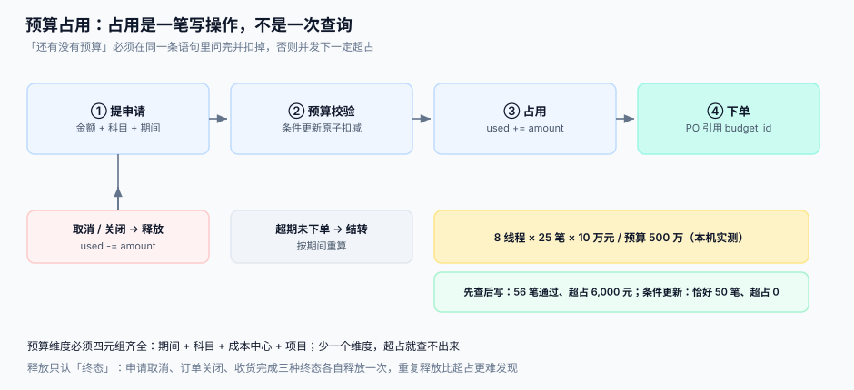

# 需求申请与预算占用

采购的第一张单不是订单，是**申请**。它要回答三个问题：要买什么（料号 + 数量 + 需求日期）、给谁用（成本中心 / 项目）、钱从哪出（预算）。第三个问题最容易被做成「查一下余额」——而查询不是占用，并发下一定超支。

::: tip 一句话定位
**预算占用是一笔写操作，不是一次查询。** 「还有没有预算」必须在同一条语句里问完并扣掉；先 `SELECT` 再 `UPDATE` 的写法，在两个人同时提申请的那一刻就已经错了。
:::



本页判据族 `PTR-A` ~ `PTR-H`，共 8 条。定义表在第七节。

## 一、申请单的四个必填维度

| 维度 | 字段 | 为什么必须结构化 | 自由文本的后果 |
| --- | --- | --- | --- |
| 买什么 | `sku` + `qty` + `uom` | 后续要能合并、能比价、能对库存 | 「一批办公用品」无法合并，只能单独立项 |
| 给谁用 | `cost_center` / `project_id` | 决定预算归属与费用分摊 | 月底分摊靠 Excel |
| 什么时候要 | `need_by` | 决定寻源方式（急采 vs 招标） | 全部变成急采，价格失去议价空间 |
| 钱从哪出 | `budget_id`（四维定位） | 占用、释放、结转都要落到同一行 | 超支无法归因到部门 |

::: danger 注意
1. **不要让 `need_by` 允许「尽快」**。字符串型需求日期会让所有急采判据失效；要么给日期，要么给「标准 / 加急」两个枚举，加急必须填理由并计入绩效。
2. **不要把「规格描述」当成料号**。没有料号的申请可以走「一次性采购」流程，但**不能参与合并、比价与库存**，必须打标，否则半年后你会看到同一件东西有 47 种写法。
3. **不要在一张申请里混多个预算维度**。一张申请只能落一个 `budget_id`；混合会让「部分取消」时的释放金额算不清。
:::

## 二、预算：四维定位 + 一行余额 + 流水

预算不是「一个部门的年度额度」，而是**四个维度定位到的一行余额**：期间 × 科目 × 成本中心 × 项目。少一个维度，超支就查不出来。

```sql
CREATE TABLE budget (
  budget_id     TEXT PRIMARY KEY,
  period        TEXT NOT NULL,          -- 2026-03
  account_code  TEXT NOT NULL,          -- 6602-01 办公费
  cost_center   TEXT NOT NULL,
  project_id    TEXT NOT NULL DEFAULT '-',
  total_amount  INTEGER NOT NULL,       -- 分
  used_amount   INTEGER NOT NULL DEFAULT 0,
  version       INTEGER NOT NULL DEFAULT 0,
  UNIQUE (period, account_code, cost_center, project_id),
  CHECK (used_amount >= 0)
);

CREATE TABLE budget_txn (                -- 流水：每一次占用/释放都被记下
  txn_id     INTEGER PRIMARY KEY AUTOINCREMENT,
  budget_id  TEXT NOT NULL REFERENCES budget(budget_id),
  ref_type   TEXT NOT NULL,              -- PR / PO / RELEASE / CARRYOVER
  ref_no     TEXT NOT NULL,
  delta      INTEGER NOT NULL,           -- 占用为正，释放为负
  created_at TEXT NOT NULL
);

CREATE UNIQUE INDEX ux_budget_txn_once
  ON budget_txn(budget_id, ref_type, ref_no);   -- 同一单号同一动作只允许一次
```

**余额与流水必须同时存在**：余额回答「还剩多少」（一次查询），流水回答「为什么剩这么多」（可审计）。只有余额，对不上时无从下手；只有流水，每次都要全表求和。

## 三、占用：一条带条件的 UPDATE

```sql
-- 占用：要么扣成功，要么一行都不改
UPDATE budget
   SET used_amount = used_amount + :amount,
       version     = version + 1
 WHERE budget_id   = :budget_id
   AND used_amount + :amount <= total_amount;
-- 受影响行数 = 0 即代表「预算不足」，不要再去查一次余额判断原因
```

这条语句同时做了三件事：**校验、扣减、乐观锁版本推进**。受影响行数为 0 时，只有两种情况——预算不存在，或余额不足；两种都要给出不同的用户提示，所以调用方应当先用 `budget_id` 的存在性做一次只读校验（这次只读**不参与**占用判定，只用于文案）。

::: danger 注意
1. **不要在应用层「先查余额，再判断，再更新」**。本机实测（8 线程 × 25 笔 × 10 万元，预算 500 万元）：先查后写通过 56 笔、超占 6,000 元；条件更新恰好 50 笔、超占 0。差额不大是因为金额小——真实场景里这一笔就是「预算外支出」。
2. **不要用 `SELECT ... FOR UPDATE` 之后再判断**。它在单库可行，但在「预算服务 + 采购服务」分开部署时会退化成分布式锁，锁的粒度和超时都极难调。条件更新在两种部署下都成立。
3. **不要允许 `used_amount` 出现负数**。释放金额大于占用金额一定是重复释放，`CHECK (used_amount >= 0)` 会让它在写入时就报错，而不是在月末报表上变成一个看不懂的负数。
:::

## 四、审批矩阵：金额 × 品类 × 组织

「一条审批流走到底」在两百人以内可行，再大就会出现两种病：小额单卡在总监那里三天，大额单没人真正看。矩阵的本质是**把审批成本按风险分配**。

| 金额区间（元） | 常规品类 | 高风险品类（危化、IT 资产、外包服务） |
| --- | --- | --- |
| < 5,000 | 直属主管 | 直属主管 + 品类负责人 |
| 5,000 ~ 50,000 | 部门负责人 | 部门负责人 + 采购 + 财务 |
| 50,000 ~ 500,000 | 分管副总 | 分管副总 + 采购总监 + 财务总监 |
| > 500,000 | 总经理 | 总经理 + 采购委员会（≥ 3 人） |

三条实现要求：

1. **矩阵是配置，不是代码分支**。写成 `if amount > 500000` 的代码，改一次阈值要发一次版；写成 `approval_matrix` 表，改阈值是数据变更。
2. **审批节点要能「跳过但留痕」**。同一个人既是部门负责人又是分管副总时，不能让他点两次；正确做法是节点合并，并在审批记录里写明「因同一审批人合并」。
3. **加签与转授权要有有效期**。转授权必须带 `start_at` / `end_at`，否则离职交接时会出现「三个月前转出去的权限还在生效」。

## 五、合并需求：省的是订单数，不是流程

同料号、同需求周、同预算维度的申请可以合并成一张订单。合并的收益是**订单数**（每张订单都有寻源、收货、匹配、付款四道成本），风险是**责任模糊**（谁的需求被延后了）。

| 合并口径 | 合并后 | 收益 | 代价 |
| --- | --- | --- | --- |
| 同料号 + 同周 | 1 张订单 | 订单数下降最多 | 需求日期被拉平到最晚的那个 |
| 同料号 + 同供应商 | 1 张订单 | 减少运费与匹配次数 | 供应商交期成为瓶颈 |
| 同品类 + 同预算 | 1 次寻源 | 议价能力最强 | 需求粒度丢失，退换货更难 |

::: tip 一句话建议
**合并只做「同料号 + 同周」这一种**，其余交给寻源环节用「框架协议」解决。把合并做成万能规则，最后一定会出现「因为要合并，所以你的急件等了六天」。
:::

## 六、释放与结转：只认终态

占用容易，释放难。释放的难点不是减法，是**「什么时候算结束」**。

| 终态 | 触发 | 释放金额 | 常见错误 |
| --- | --- | --- | --- |
| 申请取消 | 申请人撤回 / 审批驳回 | 全额 | 驳回时忘了释放，预算被永久占用 |
| 订单关闭 | 全部收货完成 / 手动关闭 | 订单金额 − 已收货金额 | 分批订单只收了一半就关闭 |
| 超期结转 | 期间结束仍未下单 | 全额，转到下一期间 | 结转与释放同时执行，双减 |

```sql
-- 释放：幂等靠唯一索引，而不是靠「先查有没有释放过」
INSERT INTO budget_txn(budget_id, ref_type, ref_no, delta, created_at)
VALUES (:budget_id, 'RELEASE', :ref_no, -:amount, datetime('now'));
-- 若已释放过，本语句因 ux_budget_txn_once 冲突而失败 → 整个事务回滚，余额不变
UPDATE budget SET used_amount = used_amount - :amount WHERE budget_id = :budget_id;
```

::: danger 注意
1. **不要用「如果没释放过就释放」这种先查后写**。它和占用是同一个并发问题，只是方向相反：重复释放会让余额虚高，比超支更难发现（因为没人会怀疑「预算怎么还有」）。
2. **结转不是释放**。结转是「本期释放 + 下期占用」两笔流水，必须成对出现；只写一笔，跨期报表就会对不上。
3. **已下单的申请不能整单释放**。释放金额必须是 `申请金额 − 已下单单据金额`，否则会把已经在路上的钱释放掉。
:::

## 七、判据

| 判据 | 看什么现象 | 判成什么 | 不满足时改哪里 |
| --- | --- | --- | --- |
| `PTR-A` | 占用是否由一条带 `WHERE used + amount <= total` 的 UPDATE 完成 | 存在「先 SELECT 再 UPDATE」即判「并发超占」 | 改为条件更新，受影响行数 = 0 视为预算不足 |
| `PTR-B` | `budget` 表是否有 `UNIQUE(period, account_code, cost_center, project_id)` | 无唯一约束即判「四维不闭合」 | 加唯一索引，历史重复行先合并 |
| `PTR-C` | `budget_txn` 是否有 `(budget_id, ref_type, ref_no)` 唯一索引 | 无即判「可重复释放」 | 加唯一索引，重复流水按 `created_at` 保留最早一条 |
| `PTR-D` | 申请取消 / 驳回时是否写入 `RELEASE` 流水 | 只改状态不写流水即判「占而不用」 | 在状态机终态回调里统一触发释放 |
| `PTR-E` | 订单关闭时的释放金额是否等于「订单金额 − 已收金额」 | 等于订单金额即判「释放过量」 | 释放逻辑改为差额，分批订单按累计收货计算 |
| `PTR-F` | 审批矩阵是否写在表里（`approval_matrix`）而非代码常量 | 代码常量即判「阈值不可运营」 | 抽表，按 `amount_min/amount_max/category/org` 索引 |
| `PTR-G` | 转授权记录是否带 `start_at` / `end_at` | 缺有效期即判「权限悬空」 | 加两列 + 到期任务，过期自动失效 |
| `PTR-H` | 合并需求后，被延后的需求是否有「延期说明」 | 无说明即判「责任模糊」 | 合并时写 `merged_from` 列表与最晚需求日，通知各申请人 |

## 八、如何验证

```shell
# 1. 建表并插入一条 500 万预算
sqlite3 /tmp/p2p.db < /tmp/ddl.sql
sqlite3 /tmp/p2p.db "INSERT INTO budget(budget_id,period,account_code,cost_center,total_amount) VALUES('B1','2026-03','6602-01','CC01',500000000);"

# 2. 连续占用 60 次（每次 10 万元），应只有 50 次成功
python3 - <<'PY'
import sqlite3
c=sqlite3.connect('/tmp/p2p.db'); ok=0
for _ in range(60):
    ok+=c.execute("UPDATE budget SET used_amount=used_amount+10000000 WHERE budget_id='B1' AND used_amount+10000000<=total_amount").rowcount
c.commit(); print('通过',ok,'余额',c.execute("SELECT used_amount FROM budget WHERE budget_id='B1'").fetchone()[0])
PY
# 期望：通过 50 余额 500000000（不超一分）

# 3. 重复释放必须失败（负向用例）
sqlite3 /tmp/p2p.db "INSERT INTO budget_txn(budget_id,ref_type,ref_no,delta,created_at) VALUES('B1','RELEASE','PR-1',-100,datetime('now'));"
sqlite3 /tmp/p2p.db "INSERT INTO budget_txn(budget_id,ref_type,ref_no,delta,created_at) VALUES('B1','RELEASE','PR-1',-100,datetime('now'));"
# 期望：第二次 UNIQUE constraint failed: budget_txn.budget_id, budget_txn.ref_type, budget_txn.ref_no

# 4. 余额永不为负
sqlite3 /tmp/p2p.db "SELECT count(*) FROM budget WHERE used_amount<0 OR used_amount>total_amount;"
# 期望：0
```

## 参考资料

- [总览：七段链与四个时点](../Overview/index.md)：接缝①「预算 ↔ 订单」在整条链上的位置
- [寻源、密封报价与供应商准入](../Sourcing/index.md)：申请合并后如何进入寻源
- [采购订单与变更](../PurchaseOrder/index.md)：订单金额与申请金额的差怎么处理
- 本机实测脚本口径见[实战](../Practice/index.md)第一节，种子 `20261031`
