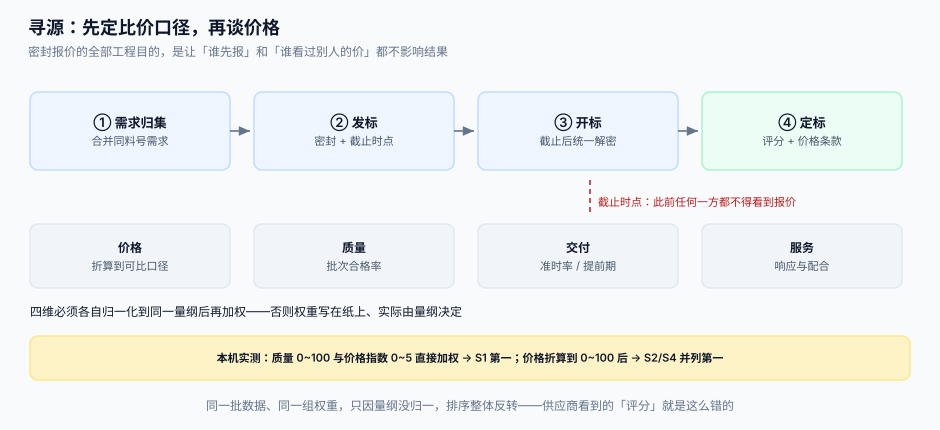

# 寻源、密封报价与供应商准入

申请说「要买 120 箱」，寻源要回答的却是另一个问题：**在什么口径下比，才算公平**。价格看起来是最好比的数字，实际上最容易比错——含税与不含税、含运费与不含运费、账期 30 与 60、最小起订量 10 与 100，都能让「最低价」变成最贵的那个。

::: tip 一句话定位
**密封报价的全部工程目的，是让「谁先报」和「谁看过别人的价」都不影响结果。** 只要有一条路径能让后报者看到先报者的价格，这场比价在事后就永远无法自证清白——而采购最怕的正是「无法自证」。
:::



本页判据族 `PTS-A` ~ `PTS-H`，共 8 条。定义表在第七节。

## 一、四种寻源方式：按「金额 × 可描述性」选

| 方式 | 适用 | 供应商数 | 周期 | 系统要支持什么 |
| --- | --- | --- | --- | --- |
| 直采（目录价） | 框架协议内的标准品 | 1 | 分钟 | 目录价 + 协议余量校验 |
| 询价（RFQ） | 规格清楚、金额中等 | 3 ~ 5 | 3 ~ 7 天 | 密封报价 + 统一截止 + 比价表 |
| 招标（RFP/RFT） | 金额大、方案有差异 | ≥ 3 | 3 ~ 8 周 | 技术标/商务标分离 + 评审记录 |
| 单一来源 | 独家、专利、紧急抢修 | 1 | 小时 | 单一来源审批 + 理由留档 |

::: danger 注意
1. **不要把「紧急」当单一来源的通行证**。急采必须填「原供应商为什么来不及」，且计入部门绩效；否则半年后 80% 的采购都是急采，「询价」形同虚设。
2. **不要在同一轮里混「技术标」与「商务标」**。技术评审看到价格，就会不自觉地按价格调技术分；正确做法是技术分先封存，开商务标时才解封。
3. **不要让供应商数量少于 3 还叫「招标」**。两家报价的「最低价」没有任何竞争含义，应降级为询价并说明原因。
:::

## 二、密封：三个容易漏的泄露路径

「密封」不是把文件放在一个没人看的文件夹里，而是**在截止时点之前，任何角色都无法读出报价内容**。

| 泄露路径 | 具体表现 | 正确做法 |
| --- | --- | --- |
| 应用层 | 列表页直接返回 `price` 字段，只是前端不展示 | 截止前接口**不返回报价字段**（不是前端隐藏） |
| 排序/统计 | 按价格排序的接口可被调用，或「当前最低价」提示 | 截止前禁用一切基于价格的排序与聚合 |
| 运维/导出 | 数据库导出、报表平台可查 | 报价表在截止前只对「开标服务」的只读账号可见 |

```sql
-- 报价表：解密时间由数据库约束保证，而不是由代码自觉保证
CREATE TABLE rfq_quote (
  quote_id     TEXT PRIMARY KEY,
  rfq_id       TEXT NOT NULL,
  supplier_id  TEXT NOT NULL,
  payload      BLOB NOT NULL,          -- 加密后的报价明细
  submitted_at TEXT NOT NULL,
  opened_at    TEXT,                   -- 开标时才写入
  UNIQUE (rfq_id, supplier_id),
  CHECK (opened_at IS NULL OR opened_at >= submitted_at)
);
```

读报价的视图必须带时点条件，让「提前看到」在 SQL 层就不成立：

```sql
CREATE VIEW v_quote_open AS
SELECT quote_id, rfq_id, supplier_id, payload, opened_at
  FROM rfq_quote
 WHERE opened_at IS NOT NULL
   AND opened_at <= datetime('now');   -- 开标动作发生后才可读
```

## 三、比价口径：落地成本（TCO）而不是单价

同一个料号，三家报价 12.50 / 12.20 / 12.80，谁最便宜？把四个因素摊进去以后，答案经常反过来。

| 因素 | 影响方向 | 折算方法 |
| --- | --- | --- |
| 税率 | 专票可抵扣，普票不可 | 用**不含税价**比较；不可抵扣的按含税价 |
| 运费与装卸 | 到厂价 vs 出厂价 | 加到单价：`运费 / 批量` |
| 账期 | 60 天账期相当于一笔无息贷款 | 按资金成本折现：`单价 × 年化 × 账期/365` |
| 最小起订量 / 包装倍数 | 买 120 却只能按 100 的倍数买 | 按**实际采购量**重算总价，不是单价 × 数量 |
| 质量成本 | 不合格率高的便宜货更贵 | 加 `不合格率 × 返工成本` |

```text
落地单价 = 不含税单价 + 运费/批量 + 单价 × 资金成本年化 × 账期/365 + 不合格率 × 单件返工成本
```

::: tip 一个可执行的简化
不必追求完整 TCO。**把「税、运费、账期」三项摊进去就能拦住 90% 的误判**，质量成本单独作为「准入/绩效」维度扣分，不混进单价——混进去之后，采购就无法向供应商解释「为什么你的报价没中标」。
:::

## 四、评分：先归一，再加权

评分表最常见的错误不是权重不合理，而是**量纲没归一**：质量分是 0~100，价格指数是 0~5，直接加权，实际权重由量纲决定，纸面上的 50/50 根本不成立。

本机实测（同一批数据、同一组 50/50 权重）：

| 供应商 | 质量分（0~100） | 价格指数（0~5，越低越好） | 直接加权 | 价格折算到 0~100 后 |
| --- | --- | --- | --- | --- |
| S1 | 96 | 4.8 | **50.4（第一）** | 50.0（第三） |
| S2 | 72 | 1.2 | 36.6（第三） | **74.0（并列第一）** |
| S3 | 90 | 4.6 | 47.3（第二） | 49.0（第四） |
| S4 | 68 | 1.0 | 34.5（第四） | **74.0（并列第一）** |

排序整体反转。供应商拿到的「评分」就是这个数，而它其实只反映了一件事：价格的量纲比质量小 20 倍。

归一化三选一，各有代价：

| 方法 | 公式 | 优点 | 陷阱 |
| --- | --- | --- | --- |
| 极差归一 | `(x − min)/(max − min)` | 简单、可比 | 样本极值一变，历史分数全部失效 |
| 目标值归一 | `min(x/target, 1)` | 与历史可比 | 目标值难定，定低了全员满分 |
| 排名归一 | `1 − (rank−1)/(n−1)` | 不受极值影响 | 样本少时区分度差（n=3 时只有 0/0.5/1） |

```python [scoring/normalize.py]
from dataclasses import dataclass

@dataclass
class Dim:
    name: str
    weight: float          # 权重之和必须为 1
    higher_is_better: bool

def minmax(values: list[float], higher_is_better: bool) -> list[float]:
    lo, hi = min(values), max(values)
    if hi == lo:                       # 全部相同：给满分，不要除零
        return [1.0 for _ in values]
    span = hi - lo
    return [((v - lo) / span if higher_is_better else (hi - v) / span) for v in values]

def score(dims: list[Dim], rows: list[dict]) -> list[tuple[str, float]]:
    assert abs(sum(d.weight for d in dims) - 1) < 1e-9, "权重之和必须为 1"
    norm = {d.name: minmax([r[d.name] for r in rows], d.higher_is_better) for d in dims}
    out = []
    for i, r in enumerate(rows):
        total = sum(d.weight * norm[d.name][i] for d in dims)
        out.append((r["supplier_id"], round(total * 100, 2)))
    return sorted(out, key=lambda x: -x[1])
```

::: danger 注意
1. **权重之和必须断言为 1**。少了 5%，所有人的分都低 5 分，看起来「都很差」，实际只是漏了一项。
2. **不要把「价格」换算成「省了多少钱」再与质量分相加**。一个是金额、一个是分数，加出来没有物理意义；正确做法是各自归一后加权，或做「价格上限 + 质量门槛」的过滤式评审。
3. **不要在样本量小于 3 时用极差归一**。两家比价时极差归一必然给出 0 和 1，看起来「差距巨大」，实际只是「一个贵一点」。
:::

## 五、供应商准入：四态 + 一条有效期

准入不是一个「是否合格」的布尔值，而是**四种状态 + 一个到期时间**。

| 状态 | 含义 | 能否下单 | 进入方式 |
| --- | --- | --- | --- |
| `PROSPECT` | 潜在，资料未齐 | 否 | 主动登记 |
| `APPROVED` | 已准入，资质在有效期内 | 是 | 资质审核通过 |
| `PROBATION` | 观察期（新供应商或绩效下滑） | 是，但需二次审批 | 绩效低于阈值自动降级 |
| `BLOCKED` | 黑名单 / 资质过期 | 否 | 人工拉黑或到期任务 |

```sql
CREATE TABLE supplier (
  supplier_id   TEXT PRIMARY KEY,
  name          TEXT NOT NULL,
  credit_code   TEXT NOT NULL UNIQUE,     -- 统一社会信用代码，去重的第一键
  state         TEXT NOT NULL DEFAULT 'PROSPECT'
                CHECK (state IN ('PROSPECT','APPROVED','PROBATION','BLOCKED')),
  cert_expire_at TEXT,                    -- 资质到期日（营业执照/许可证最晚的那个）
  bank_account  TEXT,
  blocked_reason TEXT
);
```

::: danger 注意
1. **准入校验必须发生在「下单」而不是「建档」**。只在校验一次建档，资质过期后系统仍在放行；正确做法是下单时校验 `state='APPROVED' AND cert_expire_at > date('now')`。
2. **不要用供应商名称去重**。「XX 科技有限公司」与「XX 科技有限责任公司」是同一家，名字去重会建出两份档案，付款时打给两个账户。去重键用统一社会信用代码。
3. **观察期不能静默通过**。`PROBATION` 状态下的订单需要额外审批人，否则「观察」只是标签。
:::

## 六、绩效：滑窗 + 惩罚项，不要用累计平均

累计平均的问题是「永远追不上历史」：一家供应商去年出过两次事故，今年表现完美，累计分仍然上不去。绩效要能反映**最近 12 个月**。

| 指标 | 口径 | 数据来源 | 权重示例 |
| --- | --- | --- | --- |
| 准时交付率 | 按承诺日 ± 允差内到货的行数 / 总行数 | 收货单 vs 订单交期 | 35% |
| 批次合格率 | 合格批次 / 总批次（拒收算不合格） | 质检结论 | 30% |
| 价格竞争力 | 同料号相对市场中位价的偏离 | 比价表 | 20% |
| 响应与配合 | 询价响应时长、异常处理时长 | 寻源与工单 | 15% |

```sql
-- 12 个月滑窗 + 惩罚项：一次重大质量事故直接封顶 60 分
SELECT s.supplier_id,
       round(100.0 * sum(CASE WHEN g.on_time THEN 1 ELSE 0 END) / count(*), 2) AS otd,
       round(100.0 * sum(CASE WHEN g.qc_state = 'PASS' THEN 1 ELSE 0 END) / count(*), 2) AS pass_rate
  FROM gr_line g JOIN purchase_order p ON p.po_no = g.po_no
  JOIN supplier s ON s.supplier_id = p.supplier_id
 WHERE g.received_at >= date('now', '-12 months')
 GROUP BY s.supplier_id;
```

::: warning 一条实践建议
绩效分**不要**直接驱动「自动拉黑」。分数抖动是常态（样本少、品类差异大）；正确做法是分数只驱动「进入观察期 / 需要复核」，拉黑永远是人工动作并留理由。
:::

## 七、判据

| 判据 | 看什么现象 | 判成什么 | 不满足时改哪里 |
| --- | --- | --- | --- |
| `PTS-A` | 截止时点前，报价查询接口是否返回价格字段 | 返回即判「密封失效」 | 改用 `v_quote_open` 视图，接口只读该视图 |
| `PTS-B` | 是否存在基于价格的排序/聚合在截止前可用 | 存在即判「侧信道泄露」 | 截止前禁用排序与「最低价」提示，或返回打乱顺序 |
| `PTS-C` | 比价是否使用落地成本（含运费、账期折现） | 只用单价即判「口径不可比」 | 建 `v_landed_cost` 视图，比价表只读该视图 |
| `PTS-D` | 评分前是否对每个维度做了归一化 | 直接加权即判「量纲决定排序」 | 引入 `normalize.py`，权重和断言为 1 |
| `PTS-E` | 技术标与商务标是否分离评审 | 同轮可见即判「评审污染」 | 两阶段评审：技术分封存后再开商务标 |
| `PTS-F` | 下单时是否校验收货资质有效期 | 只在校验建档时校验即判「过期仍可下单」 | 下单前置校验 `state` 与 `cert_expire_at` |
| `PTS-G` | 供应商去重是否用统一社会信用代码 | 用名称即判「重复档案」 | `credit_code` 唯一索引，历史档案合并 |
| `PTS-H` | 绩效是否用 12 个月滑窗 + 惩罚项 | 累计平均即判「历史拖累」 | 改滑窗查询，重大事故置惩罚系数 |

## 八、如何验证

```shell
# 1. 报价表结构正确（含开标时间约束）
sqlite3 /tmp/p2p.db ".schema rfq_quote" | grep -E "opened_at|CHECK"
# 期望：看到 opened_at 列与 CHECK (opened_at IS NULL OR opened_at >= submitted_at)

# 2. 截止前视图返回 0 行（负向：此时不该看到任何报价）
sqlite3 /tmp/p2p.db "INSERT INTO rfq_quote(quote_id,rfq_id,supplier_id,payload,submitted_at) VALUES('Q1','R1','S1',x'00','2026-03-01 10:00:00');"
sqlite3 /tmp/p2p.db "SELECT count(*) FROM v_quote_open WHERE rfq_id='R1';"
# 期望：0

# 3. 开标后可见（正向）
sqlite3 /tmp/p2p.db "UPDATE rfq_quote SET opened_at='2026-03-01 11:00:00' WHERE quote_id='Q1';"
sqlite3 /tmp/p2p.db "SELECT count(*) FROM v_quote_open WHERE rfq_id='R1';"
# 期望：1

# 4. 归一化后排序与直接加权不同（用第 4 节四行数据跑一次）
python3 -c "print('S1 直接 50.4 / 归一 50.0；S2 直接 36.6 / 归一 74.0')"
# 期望：与第 4 节表格一致——若你的实现给出相同排序，说明归一化没生效
```

## 参考资料

- [需求申请与预算占用](../Requisition/index.md)：合并后的需求如何进入寻源
- [采购订单与变更](../PurchaseOrder/index.md)：定标结果如何落成订单与价格条款
- [主数据与数据标准](../../../DB/DataGovernance/StandardsMasterData/index.md)：供应商与料号主数据的治理口径
- [承运商与履约](../../ShippingCarrier/Sourcing/index.md)：另一种「寻源」——运力寻源与采购寻源的差异
- OpenPEPPOL BIS Billing 3.0：电子发票字段约束，影响「含税/不含税」口径的落地
