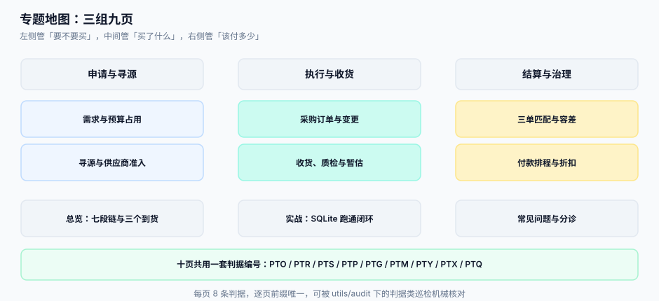

# 采购到付款（P2P）与三单匹配工程

采购系统最难的地方不是「下单」，而是**一笔钱要同时被三份文件证明**：订单说该买什么，收货说真的到了什么，发票说供应商要收多少。这三份文件由三个部门、在三个时间点、按三套口径写出来，任何两份之间的差额都会被财务用「挂账」兜住——而挂账是会计上最安静的失败：账是平的，钱是错的。

::: tip 一句话理解
**「到货了」在四个部门嘴里是四个不同的日子。** 采购说的是订单生效日，仓库说的是收货过账日，财务说的是发票记账日，出纳说的是银行回单日。把这四个日子分开记，P2P 才第一次变得可对账；只记一个「状态」，你就永远在解释「为什么账上有、仓库没有」。
:::

## 与相邻专题的分工

| 专题 | 它回答的问题 | 本专题的回答 |
| --- | --- | --- |
| [账务与分录](../Ledger/index.md) | 一笔业务怎么变成借贷分录、怎么结算 | 分录之前那一步：**这笔钱凭什么该记**（三份文件凑齐了没有） |
| [对账与差错处理](../Ledger/Reconciliation/index.md) | 两个账本对不上时怎么找差 | 差额的**产生地**在采购侧：收货差量、匹配差额、折扣放弃 |
| [库存与预占](../Ecommerce/Inventory/index.md) | 面向消费者的可售库存怎么算 | 面向供应商的**到货量**怎么算，以及超收允差为什么必须写进合同 |
| [合同演进](../ContractEvolution/index.md) | 合同条款怎么版本化、怎么迁移 | 订单变更（数量/价格/交期）与合同变更的差别：订单可以一天改三次 |
| [批量数据交换](../BulkDataExchange/index.md) | 大批量文件怎么导入、怎么给回执 | 供应商价目表、ASN、对账单这三类文件的**业务判据** |
| [主数据与数据标准](../../DB/DataGovernance/StandardsMasterData/index.md) | 主数据怎么建模、怎么治理 | 供应商、料号、价格这三张主数据**在采购链里谁说了算** |
| [承运商与履约](../ShippingCarrier/index.md) | 运力怎么寻源、面单怎么出 | 采购侧的寻源是「买什么」的寻源，运费只是落地成本的一项 |
| [实时风控决策](../RiskDecision/index.md) | 交易要不要拦、拦了怎么审 | 采购侧的风险是**准入与围标**，不是单笔交易的欺诈分 |

> 一句话记住边界：**账务系统假设「业务已经发生完了」；本专题假设「业务正在三个部门之间打架」。**

## 十页导航

| 页 | 讲什么 | 读完能做什么 |
| --- | --- | --- |
| [总览：七段链与四个时点](./Overview/index.md) | 七段链、四个时点、四个必失接缝 | 判断自己的系统把「到货」记错在了哪一段 |
| [需求申请与预算占用](./Requisition/index.md) | 申请单、预算四维、并发占用、释放 | 让「还有没有预算」变成一次原子写操作 |
| [寻源、密封报价与供应商准入](./Sourcing/index.md) | 发标、开标时点、比价口径、评分归一 | 让评分表不再由量纲决定排序 |
| [采购订单与变更](./PurchaseOrder/index.md) | 版本链、分批交货、价格与税率、允差 | 把「改了三次的订单」变成可对账的版本序列 |
| [收货、质检与暂估](./GoodsReceipt/index.md) | ASN、收货行、质检四态、GR/IR | 让一张收货单同时喂饱仓库和财务 |
| [三单匹配与容差](./InvoiceMatch/index.md) | 2/3/4 路匹配、容差、部分匹配、扣款 | 把「对不上」拆成四类可执行的差异 |
| [付款排程与折扣](./PaymentRun/index.md) | 账期、现金折扣、批次、回单与退票 | 算出「这笔折扣该不该拿」，并让重跑不重付 |
| [实战：本机跑通一条闭环](./Practice/index.md) | SQLite + Python 十步 + 三个负向用例 | 在本机复现「申请 → 付款」并验证四条不变式 |
| [常见问题与分诊](./FAQ/index.md) | 八类现象的分诊入口、二十项自查 | 三分钟内判断问题在采购、仓库还是财务 |

## 判据纪律

| 页 | 判据族 | 这一族管什么 | 条数 |
| --- | --- | --- | --- |
| 总览 | `PTO-A` ~ `PTO-H` | 四个时点是否分开记、接缝是否有对账键 | 8 |
| 需求申请 | `PTR-A` ~ `PTR-H` | 预算占用是否原子、释放是否只认终态 | 8 |
| 寻源与准入 | `PTS-A` ~ `PTS-H` | 密封性、开标时点、评分量纲、资质有效期 | 8 |
| 采购订单 | `PTP-A` ~ `PTP-H` | 版本链、分批、税率、允差、变更下限 | 8 |
| 收货与质检 | `PTG-A` ~ `PTG-H` | 收货行粒度、质检四态、暂估时点、退货冲销 | 8 |
| 三单匹配 | `PTM-A` ~ `PTM-H` | 匹配键、容差、部分匹配、差异分类、重复发票 | 8 |
| 付款排程 | `PTY-A` ~ `PTY-H` | 折扣判据、批次幂等、回单回写、退票闭环 | 8 |
| 实战 | `PTX-A` ~ `PTX-H` | 十条命令与三个必须失败的反向用例 | 8 |
| 常见问题 | `PTQ-A` ~ `PTQ-H` | 八类现象的分诊入口是否可判定 | 8 |

每条判据回答三件事：**看什么现象、判成什么、不满足时改哪里**。编号逐页唯一，可被 `utils/audit` 下的判据类巡检机械核对。

## 三个必须先接受的前提

1. **三份文件永远不可能同时齐**。订单是提前的，收货是当天的，发票是滞后的（月结供应商可能滞后 45 天）。任何「齐了才允许继续」的设计，都会让仓库停摆；正确做法是**允许缺，但缺的那一份必须有明确的责任人和时限**。
2. **差额是常态，不是异常**。价差来自报价口径（含税/不含税、含运费/不含运费），量差来自允差与短装，税差来自开票时点。**一个把差额判成「异常」的系统，会在第一个月就被关掉**；正确做法是把差额**分类**，每类给一个固定动作。
3. **付款的幂等单位是「批次」，不是「单据」**。重跑一次付款任务，错的不是某一笔，而是整批；所以批次号、批次内明细、银行回单三者必须一一对应，且批次重跑要能被识别为「同一批」。

## 版本组织说明

本专题**不建版本目录**（如 `P2Pv2/`）。三条理由：① 换代的是**ERP 产品与发票形态**（纸质发票 → 数电票），判据本身没变——`PTM-C` 说的「累计开票额不得超过累计收货额 ×(1+容差)」在两种形态下一字不差；② 纸质与数电票**长期并存**于同一批供应商，差异是「同一页里的两个分支」，不是两套要同时教的内容线；③ 真正需要按大版本组织的是**同一份代码的两套写法**（如 [`Spring5`/`Spring6`](../Java/Frame/Spring/index.md)），而这里两套票种可以在一张表里对照完。库内按大版本建目录的先例见 [`Spring5`/`Spring6`](../Java/Frame/Spring/index.md) 与 [SpringBoot `v2`/`v3`](../Java/Frame/SpringBoot/index.md)。

## 事实与口径速览

| 事项 | 口径 | 出处 |
| --- | --- | --- |
| 匹配路数 | 2-way（订单↔发票）、3-way（+收货）、4-way（+质检/验收单） | AP 自动化行业惯例，非强制标准 |
| 单据报文 | UBL 2.x（OASIS）的 `Order` / `DespatchAdvice` / `Invoice`；PEPPOL BIS Billing 3.0 基于 UBL | OASIS UBL、OpenPEPPOL |
| 付款报文 | ISO 20022 `pain.001`（发起）/ `pain.002`（状态）/ `camt.053`（对账单） | ISO 20022 报文目录 |
| 增值税税率 | 现行三档 **13% / 9% / 6%**（货物、交通运输与部分服务、现代服务），另有零税率与征收率 | 《增值税暂行条例》及现行税率表 |
| 发票形态 | 纸质专票/普票 与 **全面数字化电子发票（数电票）** 并存 | 国家税务总局推广口径 |
| 现金折扣 | 写法 `2/10 net 30`：10 天内付折 2%，否则 30 天内全额 | 商业惯例 |
| 三单匹配的会计结果 | 未匹配差额进 **GR/IR（收货/发票暂估）** 或差异科目 | 应付会计惯例 |

::: info 本轮的核对方式
本轮运行环境**无外网**，上表的标准编号与法规名称按库内既有口径与公开常识书写，**未逐条在线复核**；涉及税率的句子一律写成「现行三档」这种可自行核对的形态，不给具体文号。文中的性能与比例读数**均为本机实测**（Python 3.13 + SQLite，种子 `20261031`），复现方式见[实战](./Practice/index.md)。
:::

## 参考资料

- [开放平台与 API 产品化工程](../OpenPlatform/index.md)：同样按「七段链 + 每段一份证据」组织的相邻专题，可对照阅读
- [批量数据交换工程](../BulkDataExchange/index.md)：供应商价目表、ASN、对账单的导入与回执形态
- OASIS UBL 2.x 规范：`Order` / `DespatchAdvice` / `Invoice` 三类报文的字段来源
- OpenPEPPOL BIS Billing 3.0：欧洲电子发票的字段约束与校验规则
- ISO 20022 报文目录：`pain.001` / `pain.002` / `camt.053` 的付款与对账语义
