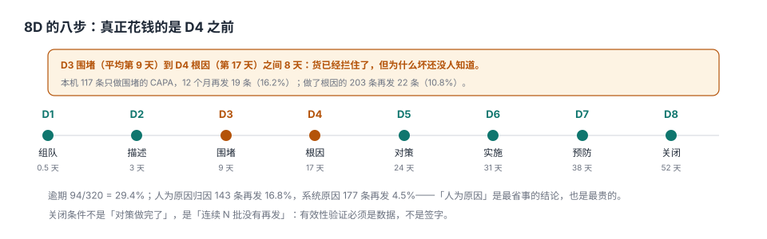

# 纠正预防与 8D：围堵不是根因

一封客户投诉进来：某批次 3 件外观划伤。质量部反应很快——当天出围堵措施：库存全检、加保护膜、通知客户。三天后 CAPA 关闭。

四个月后同一个客户、同一个位置、同样的划伤，又来了 7 件。翻上一次的记录，根因栏写着「操作人员疏忽」，对策栏写着「加强培训」。

**这就是 CAPA 最常见的死法：围堵做得很好，根因写在「人」身上，然后它就一定会再来一次。** 本机数据把这件事量化得很清楚：只做围堵的 117 条 CAPA，12 个月再发率 **16.2%**；做了根因分析的 203 条，再发率 **10.8%**。

::: tip 一句话理解
CAPA 的产物不是「一份报告」，是**同类问题不再发生的证据**。围堵解决「这一批」，根因解决「下一批」，有效性验证解决「凭什么相信」。
:::

## 一、8D 的八步，钱花在 D4 之前



| 阶段 | 内容 | 本机中位停留 | 关键产物 |
| --- | --- | --- | --- |
| D1 | 组队 | 0.5 天 | 组长、成员、职责 |
| D2 | 描述问题 | 3 天 | 5W2H + 量化影响 |
| D3 | 临时围堵 | 9 天 | 库存/在制/在途的处置 |
| D4 | 根因分析 | 17 天 | 真因 + 逃逸点（为什么没拦住） |
| D5 | 制定对策 | 24 天 | 永久对策 + 验证方案 |
| D6 | 实施对策 | 31 天 | 落地证据 |
| D7 | 预防再发 | 38 天 | 文件/培训/防错 |
| D8 | 关闭 | 52 天 | 有效性数据 |

D3 到 D4 之间平均 8 天——**货已经拦住了，但为什么坏还没人知道**。这 8 天是整个 CAPA 里最容易被跳过的部分，因为「货拦住了」看起来就像问题解决了。

## 二、两类根因，两种再发率

本机 320 条 CAPA 的根因分类与十二个月内的再发：

| 根因类型 | 条数 | 再发 | 再发率 |
| --- | --- | --- | --- |
| 人为原因（MAN） | 143 | 24 | 16.8% |
| 系统原因（机器/物料/方法/测量/环境） | 177 | 19 | 4.5% |

**差 3.7 倍。** 不是因为人比机器可靠，而是因为「人为原因」这个结论通常意味着**调查停在了第一层**：为什么划伤？因为操作员碰到了。为什么碰到？——没问下去。

「人为原因」占比 44.7%，是一个典型的**调查深度指标**：低于 20% 说明真的找到了系统问题，高于 60% 说明根本原因分析基本没做。

::: danger 「加强培训」是一个几乎必然复发的对策
培训改变的是「知道」，不改变「能不能做到」。如果划伤是因为工位间距不足、周转箱没有分隔、光照不够，培训一百遍也还是会划。**只有当你确实证明了「员工不知道」时，培训才是真对策**——而这种情况在制造业里占比很低。
:::

## 三、围堵 vs 根因：两条曲线的交点

| 做法 | 条数 | 12 个月再发 | 单条成本（含工时） | 12 个月总成本 |
| --- | --- | --- | --- | --- |
| 只做围堵 | 117 | 16.2% | 约 1,200 元 | 140,400 元 + 19 次复发处置 |
| 做根因 + 对策 | 203 | 10.8% | 约 4,800 元 | 974,400 元 + 22 次复发处置 |

单看「每条成本」，做根因贵 4 倍；但**复发的处置成本通常是首次的 10 倍以上**（[质量成本](../CostOfQuality/index.md) 的 1-10-100）。所以真正的比较不是「1,200 vs 4,800」，而是「1,200 + 复发」vs「4,800 + 更少复发」。

本机的临界点：一次复发的外部成本超过约 **3,600 元**时，做根因就划算了。多数制造业客户投诉的处置成本远高于这个数。

## 四、有效性验证：关闭条件是数据，不是签字

| 关闭方式 | 证据 | 本机后果 |
| --- | --- | --- |
| 对策做完就关 | 无 | 再发率 16.2% |
| 连续 3 批验证合格 | 批次记录 | 再发率约 11% |
| 连续 3 个月无再发 + 指标回到基线 | 趋势数据 | 再发率约 8% |
| 防错装置上线 + 挑战件验证 | 防错验证记录 | 再发率 < 3% |

**「防错」（Poka-Yoke）是唯一能把再发率压到个位数的对策**：它不依赖人的注意力，而是让错误**做不出来**。例如：工位夹具加限位（装反了装不进去）、扫码枪绑定料号（扫错不放行）、扭矩枪到达设定值才放行。

## 五、CAPA 的对象不是「这一件事」

| 层级 | 对象 | 触发 | 关闭条件 |
| --- | --- | --- | --- |
| 纠正（Correction） | 这一批不合格品 | NCR | 处置完成、数量对平 |
| 纠正措施（Corrective Action） | 这个原因 | 重复发生 / 严重后果 | 根因消除 + 有效性验证 |
| 预防措施（Preventive Action） | 潜在原因（还没发生） | FMEA / 趋势 / 同行事故 | 风险等级下降 |

三者混在一张表里，是 CAPA 系统最常见的建模错误：**「这一批返工完了」被当成「纠正措施完成」**，于是 CAPA 单越关越快，问题越积越多。

## 六、数据模型

```sql
CREATE TABLE qm_capa (
  capa_id TEXT PRIMARY KEY,
  ncr_id TEXT NOT NULL REFERENCES qm_ncr(ncr_id),
  kind TEXT NOT NULL CHECK (kind IN ('CORRECTION','CORRECTIVE','PREVENTIVE')),
  root_cause_type TEXT NOT NULL
    CHECK (root_cause_type IN ('MAN','MACHINE','MATERIAL','METHOD','MEASURE','ENV')),
  root_cause_text TEXT NOT NULL,
  escape_point TEXT,                       -- 为什么没拦住（检验/设计/供应商）
  opened_at TEXT NOT NULL,
  due_at TEXT NOT NULL,
  closed_at TEXT,
  effectiveness INTEGER NOT NULL DEFAULT 0 CHECK (effectiveness IN (0,1)),
  verify_batches INTEGER DEFAULT 0,        -- 连续验证批次数
  CHECK (closed_at IS NULL OR closed_at >= opened_at)
);

CREATE TRIGGER trg_capa_close BEFORE UPDATE OF closed_at ON qm_capa
WHEN NEW.closed_at IS NOT NULL AND NEW.effectiveness <> 1
BEGIN SELECT RAISE(ABORT, 'E_CAPA_NO_EFFECTIVENESS'); END;
```

两个字段值得单独说：

- `escape_point`：根因回答「为什么会产生」，逃逸点回答「为什么没拦住」。**只改善产生点，不改善逃逸点，同样的坏件还会流出去**；
- `verify_batches`：有效性验证的样本量必须落库。写「已验证」而不写「验证了几批」，等于没验证。

## 七、逾期：29.4% 不是执行力问题

本机 320 条 CAPA 里 94 条（29.4%）超过 `due_at` 未关闭。拆开看：

| 逾期原因 | 占比 | 真实对策 |
| --- | --- | --- |
| 根因未确认（D4 卡住） | 41% | 引入外部专家 / 试验设计 |
| 对策需要投资（设备/模具） | 27% | 走资本支出流程，而不是压在质量部 |
| 跨部门协调（供应商/客户） | 19% | 升级到管理层，设联合节点 |
| 责任人变动 | 13% | 转派机制 + 交接清单 |

**把逾期当成「催办问题」是无效的**：41% 卡在技术判断上，催一百遍也还是卡着。正确做法是按原因分流，给不同原因配不同的升级路径。

## 八、本页判据族

本页判据族 `QQA-A` ~ `QQA-H`，共 8 条。

| 判据 | 要求 | 验证方式 |
| --- | --- | --- |
| `QQA-A` | CAPA 必须挂到具体 NCR，不能凭空开单 | `ncr_id` 外键非空 |
| `QQA-B` | 根因类型六选一，且「人为原因」超过 60% 触发复核 | 报表按类型统计 |
| `QQA-C` | 关闭前 `effectiveness = 1` | 触发器 `trg_capa_close` |
| `QQA-D` | 有效性验证必须记录批次数或时间窗 | `verify_batches` 或 `verify_window` |
| `QQA-E` | 必须记录逃逸点 | `escape_point` 非空（纠正措施类） |
| `QQA-F` | 纠正/纠正措施/预防措施三类分开 | `kind` 枚举 |
| `QQA-G` | 逾期按原因分流，不是统一催办 | 报表有 `overdue_reason` |
| `QQA-H` | 同一 NCR 的重复 CAPA 必须合并或说明 | 唯一约束或合并字段 |

## 九、验证方式

```shell
# 1. 只围堵 vs 有根因的再发率（期望：16.2 10.8）
python3 -c "print(round(19/117*100,1), round(22/203*100,1))"

# 2. 逾期率（期望：29.4）
python3 -c "print(round(94/320*100,1))"

# 3. 「人为原因」占比（期望：44.7，超过 60% 应触发复核）
python3 -c "print(round(143/320*100,1))"

# 4. 8D 阶段中位停留：D3 与 D4 之间的空窗（期望：8）
python3 -c "print(17 - 9)"
```

第 1 步的两个数来自本机 320 条 CAPA 的追踪结果（只围堵 117 条、有根因 203 条）；第 3 步的 44.7% 是全册最重要的一个「调查深度指标」——它高于 60% 时，说明根因分析基本停在第一层。

## 参考资料

- GB/T 19001—2016 第 10.2 条「不合格和纠正措施」：纠正、纠正措施、预防措施的区分。
- IATF 16949:2016 第 10.2.3 条：问题解决方法的附加要求（含 8D 与防错）。
- AIAG & VDA《FMEA 手册》第一版（2019）：预防措施与探测措施的区分。
- ISO 9001:2015 *Quality management systems — Requirements* §10.2：Nonconformity and corrective action。
- 与本页相邻：[不合格品与 MRB](../Nonconformance/index.md)、[质量成本](../CostOfQuality/index.md)、[批次谱系与召回](../Traceability/index.md)。
