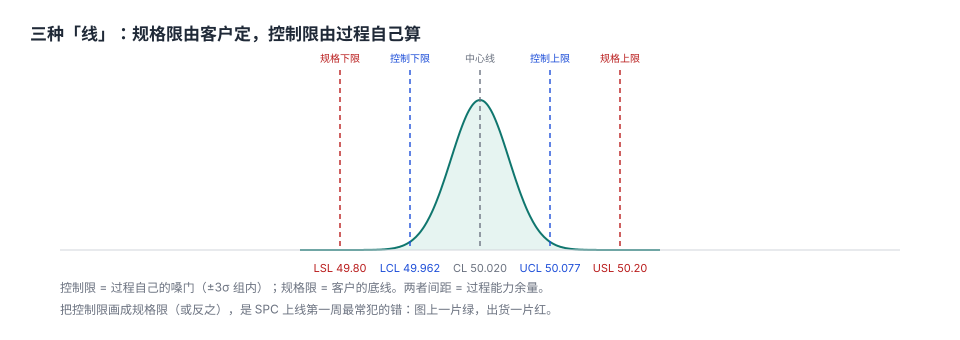
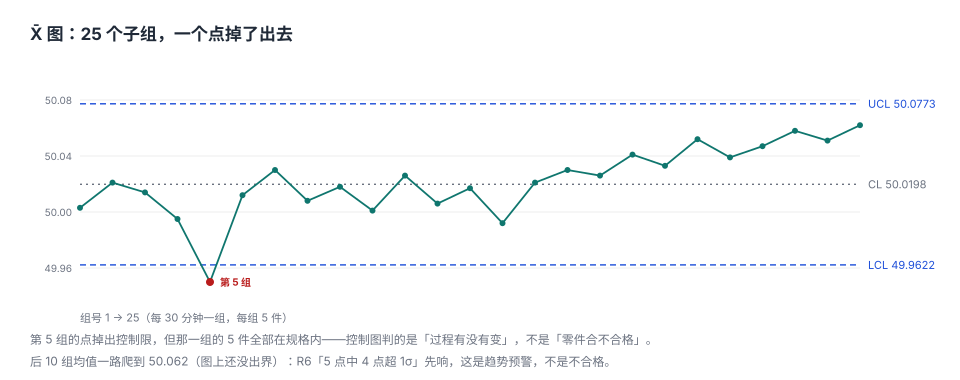
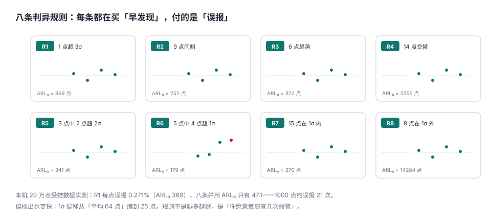

# 控制图与判异规则：控制限不是规格限

SPC 上线第一周，最常见的场面是这样：工程师把客户给的公差上限填进 `UCL`，下限填进 `LCL`，画出一张漂亮的图，然后说「我们的过程很稳定，一年没有一个点出界」。

**图确实很稳定，因为它画的不是过程，是客户的要求。** 控制限由过程自己的波动算出来（±3σ），规格限由客户给（±0.20）；把后者当前者，等于把「判不合格」和「判异常」合并成同一件事——出界的点早被判成不合格挑走了，图上自然一片绿。

::: tip 一句话理解
控制图监听的是一句话：**「这个过程还是原来那个过程吗？」** 它不判零件合不合格，只判过程有没有变；变了才去查原因，没变就继续生产。
:::

## 一、三种图，三种数据

| 图 | 数据形态 | 统计量 | 典型场景 |
| --- | --- | --- | --- |
| X̄-R | 连续、可分组（n = 2~10） | 子组均值 + 极差 | 机加工尺寸、注塑件重量 |
| I-MR | 连续、单件（n = 1） | 单值 + 移动极差 | 炉温、缸压、批次级指标 |
| p / np | 计数（合格/不合格） | 不合格品率 | 外观检验、功能测试 |

选错图的后果不是「不好看」，是**控制限算错**：把 n=1 的数据硬塞进 X̄ 图，组内 σ 会被算成 0；把计数数据画成 X̄ 图，3σ 限失去统计意义。

## 二、控制限是算出来的，不是填出来的



```text
X̄ 图：CL = x̄̄（总均值）        UCL/LCL = CL ± A₂ × R̄
R 图：CL = R̄                    UCL = D₄ × R̄，LCL = D₃ × R̄
σ组内 = R̄ / d₂                                    ← 这一步是关键
```

本机数据（25 组 × 5 件）：`x̄̄ = 50.0198`、`R̄ = 0.0997`，n=5 时 `A₂ = 0.577`、`D₄ = 2.114`：

| 量 | 公式 | 读数 |
| --- | --- | --- |
| X̄ 图中心线 | `x̄̄` | 50.0198 |
| X̄ 图上控制限 | `x̄̄ + A₂R̄` | 50.0773 |
| X̄ 图下控制限 | `x̄̄ − A₂R̄` | 49.9622 |
| R 图上控制限 | `D₄R̄` | 0.2108 |
| 组内 σ | `R̄/d₂` | 0.0429 |

而规格限是 **50.20 / 49.80**——比控制限宽得多。**宽出来的这一段，就是过程能力的余量**；如果规格限落在控制限之内（Cp < 1），那说明过程本来就没能力，图再漂亮也没用。

## 三、25 组数据里，一个点掉了出去



第 5 组的均值 49.9497 低于 LCL 49.9622，判异。但要注意三件事：

1. **那一组的 5 件全部在规格内**——异常 ≠ 不合格；
2. **掉出去的方向是「变小」**，通常是刀具磨损之外的偶发原因（装夹、测量、材料批次）；
3. **后 10 组的均值一路爬到 50.062**，图上还没出界，但这是更值得警惕的趋势。

第 3 点是控制图真正的价值：**它能在「还没出界」的时候先响**，前提是你开了趋势类规则（R3/R6）。

## 四、八条规则：每条都在买「早发现」，付「误报」



本机用 20 万点受控正态数据实测每条规则的误报率：

| 规则 | 内容 | 每点误报 | ARL₀（点） |
| --- | --- | --- | --- |
| R1 | 1 点超 3σ | 0.271% | 369 |
| R2 | 9 点在同侧 | 0.397% | 252 |
| R3 | 6 点单调趋势 | 0.269% | 372 |
| R4 | 14 点交替上下 | 0.018% | 5,555 |
| R5 | 3 点中 2 点超 2σ（同侧） | 0.293% | 341 |
| R6 | 5 点中 4 点超 1σ（同侧） | 0.560% | 179 |
| R7 | 15 点都在 1σ 内 | 0.370% | 270 |
| R8 | 8 点都在 1σ 外（两侧） | 0.007% | 14,284 |

八条并用：**每点误报 2.12%，ARL₀ 只有 47.1 点**——1000 个点大约误报 21 次。这就是「规则开满」的代价：一周一张图报三次警，第三次之后没人再看。

## 五、检出能力：规则开满换来的是「早」

| 均值偏移 | 仅 R1 平均检出 | 八条并用 |
| --- | --- | --- |
| 0.5σ | 161 点 | 45 点 |
| 1.0σ | 64 点 | 25 点 |
| 1.5σ | 36 点 | 22 点 |
| 2.0σ | 26 点 | 21 点 |

**大偏移时两者差不多（26 vs 21），小偏移时差 3.6 倍（161 vs 45）。** 所以规则不是「越多越好」，而是「按你愿意承受的误报量来选」：

| 场景 | 建议 | 理由 |
| --- | --- | --- |
| 新过程、原因未知 | R1 + R6 + R3 | 误报可控，对趋势敏感 |
| 稳定量产、人力紧张 | R1 + R3 | ARL₀ 约 130 点 |
| 关键特性、有专人值班 | 八条全开 | 误报换早发现，可接受 |
| 数据采集频率高（分钟级） | 只用 R1 | 误报按「点」计，点多了频率就高 |

::: warning 误报不是「假警报」，是「待解释的变异」
R6 报了一次，不代表过程一定变了；但也不代表可以忽略。正确处置是**记录并解释**：查换刀、换批、换人、环境，解释不了就留着——如果同类解释反复出现，说明这条规则在你的过程上误报率太高，该关掉，而不是每次都说「没事」。
:::

## 六、混批：控制限被稀释的经典事故

三台机床的数据混进同一张图，会发生什么？本机模拟（每台 σ = 1.0，均值相差 1.6σ）：

| 口径 | σ | 说明 |
| --- | --- | --- |
| 单台 | 1.000 | 真实过程波动 |
| 两台混批 | 1.294 | 控制限虚宽 28.5% |
| 混批后 1.5σ 的真实偏移 | 只剩 1.16 个「图上的 σ」 | 检出率大幅下降 |

**控制限是用数据算的，所以它会自动适应「混进来的那部分变异」。** 三台机床混一张图，图会很稳——稳在「三台的差异」上。正确做法是**分层**：每台一张图，或者用「短周期」图（同一批内连续几件算一组）。

## 七、数据模型：控制限必须带版本

```sql
CREATE TABLE qm_control_limit (
  char_id        TEXT NOT NULL REFERENCES qm_spec(char_id),
  version        INTEGER NOT NULL,
  effective_from TEXT NOT NULL,
  cl REAL NOT NULL, ucl REAL NOT NULL, lcl REAL NOT NULL,
  sigma_w REAL NOT NULL,
  basis          TEXT NOT NULL CHECK (basis IN ('R_BAR','S_BAR','MOVING_RANGE','P_BAR')),
  subgroup_n     INTEGER NOT NULL,
  PRIMARY KEY (char_id, version),
  CHECK (ucl > cl AND cl > lcl),
  CHECK (sigma_w > 0)
);
```

四个字段不能省：

- `version` + `effective_from`：控制限会随过程改进而变，**旧点必须用旧限判**，否则历史图会被「回溯性改判」；
- `basis`：极差法/标准差法/移动极差/ p̄，算法不同数不同；
- `subgroup_n`：A₂、D₄、d₂ 都依赖 n，n 变了限就变了；
- `sigma_w`：能力指数与控制图必须用同一个 σ，否则两处结论打架。

## 八、易错点

::: danger 六个让控制图变成装饰画的坑
1. **把规格限当控制限**：图上永远不出界，异常永远发现不了。
2. **用全部数据算控制限（含异常段）**：一次停机导致的偏移会把限拉宽，之后再也报不出来。**先用受控段算限，再判全段**。
3. **子组内混入不同来源**：一台机床的几个主轴、一个班次的几个操作员，组内差异被当成「普通原因」，σ 被放大。
4. **样本量不等于子组大小**：`n=5` 指「每组 5 件连续产出」，不是「随手抓 5 件」。
5. **规则全开但不解释**：一周 20 次报警，第三次之后没人看，图就废了。
6. **改了工艺不换控制限版本**：新旧数据画在一张图上，限是旧的，结论是错的。
:::

## 九、本页判据族

本页判据族 `QMC-A` ~ `QMC-H`，共 8 条。

| 判据 | 要求 | 验证方式 |
| --- | --- | --- |
| `QMC-A` | 控制限与规格限分表存储 | 两张表，互不引用 |
| `QMC-B` | 控制限由过程数据算出，并记录 `basis` 与 `subgroup_n` | 字段非空且可复算 |
| `QMC-C` | 计算控制限的数据段必须是受控段 | 有限定区间的查询可复现 |
| `QMC-D` | 控制限带版本与生效日，历史点用历史限 | `(char_id, version)` 唯一 |
| `QMC-E` | 判异规则集合显式登记，可开关 | 规则表 + 图配置引用 |
| `QMC-F` | 每条报警必须可归因（原因码或「未解释」） | 报警表有 `cause_code` |
| `QMC-G` | 混批数据必须分层（按机台/班次/模穴） | 子组表有 `stratum` 字段 |
| `QMC-H` | 图上的 σ 与能力指数用的是同一个 σ | 两处引用同一 `sigma_w` |

## 十、验证方式

```shell
# 1. 控制限（期望：50.0198 50.0773 49.9622 0.2108 0.0429）
python3 - <<'PY'
import random, statistics as st
random.seed(20261105)
subs = []
for i in range(25):
    mu = 50.005 + (0.057 * (i - 14) / 10 if i >= 15 else 0.0)
    subs.append([random.gauss(mu, 0.048) for _ in range(5)])
means = [st.mean(s) for s in subs]; rngs = [max(s) - min(s) for s in subs]
cl, rbar = st.mean(means), st.mean(rngs)
print(round(cl,4), round(cl + 0.577*rbar,4), round(cl - 0.577*rbar,4), round(2.114*rbar,4), round(rbar/2.326,4))
PY

# 2. 单条规则的 ARL0（期望：约 369，允许 ±15%）
python3 - <<'PY'
import random
random.seed(11)
n = 200000
z = [random.gauss(0, 1) for _ in range(n)]
c = sum(1 for i in range(20, n) if abs(z[i]) > 3)
print(round(1 / (c / (n - 20))))
PY

# 3. 混批稀释（期望：约 1.29）
python3 -c "
import random, statistics as st
random.seed(17)
x=[random.gauss(0.8 if i%2 else -0.8,1) for i in range(2000)]
print(round(st.stdev(x),3))"
```

第 2 步是这套判据的核心：**任何一条规则的误报率都必须能被独立测出来**，否则「报警太多」这件事只能靠感觉。

## 参考资料

- GB/T 4091—2001《常规控制图》：休哈特控制图的统计基础、判异准则与系数表。
- ISO 7870-2:2013 *Control charts — Part 2: Shewhart control charts*：判异规则（含 runs 规则）的国际口径。
- GB/T 17989.2—2020《控制图 第 2 部分：常规控制图》：与 ISO 7870-2:2023 的对应关系。
- Montgomery, D. C. *Introduction to Statistical Quality Control*, 8th ed., 2019：ARL 与规则组合的量化分析。
- 与本页相邻：[测量系统分析](../Measurement/index.md)、[规格与能力](../Specs/index.md)、[不合格品与 MRB](../Nonconformance/index.md)。
