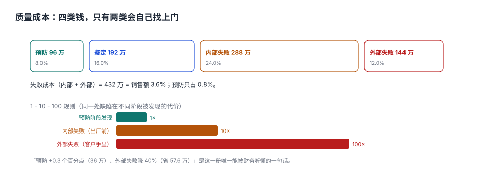

# 质量成本：1-10-100 与两张报表

财务问质量部：「你们今年花了多少钱？」

质量部报：「检验员工资、量具校准、检测设备折旧，一共 288 万。」

财务说：「那不合格品返工、报废、客户索赔呢？」

质量部说：「那是生产成本和销售费用，不算质量成本。」

**这段对话每年在几千家工厂里重复。** 结果是质量投入永远被当成「费用」，而不合格造成的损失散落在七八个科目里，没人汇总，也就没人看见它有多大。

::: tip 一句话理解
质量成本不是「质量部花的钱」，是**为了不让坏件流出去所付的全部代价**：预防（别做坏）、鉴定（挑出来）、内部失败（做坏了被发现）、外部失败（流出去了）。前三类是投资，第四类是罚款。
:::

## 一、四类成本与一个总和



本机按销售额 1.2 亿的模型：

| 类别 | 英文 | 占比 | 金额 | 性质 |
| --- | --- | --- | --- | --- |
| 预防 | Prevention | 0.80% | 96 万 | 投资（培训、防错、SPC、供应商开发） |
| 鉴定 | Appraisal | 1.60% | 192 万 | 投资（检验、试验、校准） |
| 内部失败 | Internal Failure | 2.40% | 288 万 | 损失（返工、报废、停线） |
| 外部失败 | External Failure | 1.20% | 144 万 | 罚款（索赔、退货、召回、运费） |

**COPQ（失败成本）= 内部 + 外部 = 432 万 = 销售额的 3.6%**。

三个值得记住的行业经验值（不作为标准引用）：制造业 COPQ 通常在 2%~4%，做得好的 1% 以下，做得差的 8% 以上；预防占比通常只有 0.5%~1%，而**预防占比越低，外部失败占比越高**。

## 二、1-10-100：同一处缺陷，越晚发现越贵

| 发现阶段 | 相对成本 | 本机模型 | 具体构成 |
| --- | --- | --- | --- |
| 预防阶段（还没发生） | 1× | 12 元 | 防错装置分摊、培训工时 |
| 内部失败（出厂前） | 10× | 120 元 | 返工工时 + 材料 + 停线分摊 |
| 外部失败（客户手里） | 100× | 1,200 元 | 替换 + 运费 + 索赔 + 信誉 |

**这不是线性增长，是指数增长**，因为外部失败包含了内部失败没有的三项：物流（往返）、客户停机损失、信任折损。本机把客户投诉处置按 1,800 元/起计（含上门与替换），已经接近 150×。

::: warning 1-10-100 是经验法则，不是精确公式
不同行业的倍数差别很大：汽车零部件召回的单件成本可以到 1,000×，快消品的退货可能只有 20×。**能直接用的是它的方向**：把钱花在前面，比花在后面便宜一个数量级。
:::

## 三、投资回报：加 0.3 个点的预防，换 40% 的外部失败

| 动作 | 金额 | 说明 |
| --- | --- | --- |
| 预防投入 +0.3 个百分点 | −36 万 | 防错装置 + SPC 培训 + 供应商联合改进 |
| 外部失败 −40% | +57.6 万 | 从 144 万降到 86.4 万 |
| 净收益 | **+21.6 万** | 第一年 |

第一年只赚 21.6 万，看起来不多。但请注意两件事：

1. **外部失败的下降通常有滞后**（6~12 个月），第一年只体现一部分；
2. **预防投入是一次性的**（防错装置装完就用很多年），而外部失败是每年都发生的。

把这笔账按三年摊：第一年投 36 万，三年维护 16 万，合计 52 万；外部失败三年省 172.8 万，净 **120.8 万**。

**这就是唯一一句能被财务听懂的话**：「花 36 万，第一年省 21.6 万，三年净省 120.8 万。」其余所有的质量术语，财务都不关心。

## 四、外部失败的隐性部分：账上没有，但真实存在

| 隐性成本 | 是否入账 | 量级 |
| --- | --- | --- |
| 客户索赔/退货 | 入账（销售费用） | 显性 |
| 往返运费 | 入账 | 显性 |
| 客户停线损失 | **不入账**（可能被索赔） | 可达显性成本的数倍 |
| 订单流失 | **不入账** | 无法量化，但最常见 |
| 品牌折损 | **不入账** | 长期 |
| 内部救火工时 | 入账为「管理费用」 | 常被忽略 |

所以 **COPQ 3.6% 是一个下限**。真实的失败成本通常比账面高 30%~100%，这也是为什么「质量投入不划算」的算法总是算不赢——它只算看得见的那一半。

## 五、把成本算对：三个口径陷阱

| 陷阱 | 错误算法 | 正确算法 |
| --- | --- | --- |
| 返工只算工时 | 返工 1 小时 × 时薪 | 工时 + 材料 + 设备占用 + 交期影响 |
| 报废按材料价 | 材料成本 | 材料 + 已投入工时 + 产能机会成本 |
| 检验算「质量部费用」 | 全部计入质量部 | 按「为谁检验」分摊到产品/客户 |

第三个陷阱最隐蔽：**为大客户做的全检，成本应归到那个客户的产品上**，而不是摊到所有产品。否则会出现「质量成本率 3.6%，但某个客户的产品实际是 11%」——那个客户其实在亏钱，但报表上看不出来。

## 六、数据模型

```sql
CREATE TABLE qm_cost (
  period   TEXT NOT NULL,                 -- '2026' / '2026-Q3' / '2026-10'
  category TEXT NOT NULL
    CHECK (category IN ('PREVENTION','APPRAISAL','INTERNAL_FAILURE','EXTERNAL_FAILURE')),
  amount   REAL NOT NULL CHECK (amount >= 0),
  basis    TEXT NOT NULL,                 -- 'ACTUAL' / 'ALLOCATED' / 'ESTIMATED'
  PRIMARY KEY (period, category)
);
```

`basis` 字段是关键：**实际发生、分摊、估算三种口径不能混在一张表里求和**。很多公司的质量成本报表之所以没人信，就是因为一半是实际、一半是拍脑袋，加起来的数既不能审计也不能比较。

| 口径 | 适用 | 可信度 |
| --- | --- | --- |
| ACTUAL | 有单据的成本（返工工时、报废材料） | 高 |
| ALLOCATED | 按规则分摊（检验员工时、设备折旧） | 中 |
| ESTIMATED | 无法直接计量（客户停线、信誉） | 低，仅供趋势 |

## 七、易错点

::: danger 五个把质量成本算成「数字游戏」的方式
1. **只算质量部预算**：把 COPQ 排除在外，于是「质量成本」永远只涨不跌，成了被砍的对象。
2. **把预防和鉴定混为一类**：预防降低失败，鉴定只是发现失败。混在一起后，砍掉鉴定看似省钱，实际是让失败流到外部。
3. **用 COPQ 占比做部门 KPI**：占比低可能是「没统计」，不是「做得好」。必须同时看外部失败绝对额。
4. **忽略隐性成本**：只算索赔，不算订单流失，结论必然偏向「不值得投入」。
5. **一次算完就锁进抽屉**：质量成本必须按季度滚动，否则看不到改善的滞后效应。
:::

## 八、本页判据族

本页判据族 `QMY-A` ~ `QMY-H`，共 8 条。

| 判据 | 要求 | 验证方式 |
| --- | --- | --- |
| `QMY-A` | 四类成本齐全，缺一类即报表不成立 | `COUNT(DISTINCT category) = 4` |
| `QMY-B` | 每类金额必须标口径（实际/分摊/估算） | `basis` 非空 |
| `QMY-C` | COPQ 只含内部与外部失败 | 报表口径固定 |
| `QMY-D` | 返工成本含材料与工时，不只工时 | 成本明细两类齐全 |
| `QMY-E` | 鉴定成本可按客户/产品分摊 | 分摊规则可查 |
| `QMY-F` | 外部失败与投诉单可对账 | 金额 = 投诉单汇总 |
| `QMY-G` | 预防投入与失败成本按季度同时呈现 | 报表双列 |
| `QMY-H` | 隐性成本单列，不与显性混算 | `ESTIMATED` 独立展示 |

## 九、验证方式

```shell
# 1. 四类占比与 COPQ（期望：96 万 192 万 288 万 144 万；COPQ 432 万 3.6%）
python3 - <<'PY'
sales = 120_000_000
for k, v in (("预防",0.008),("鉴定",0.016),("内部失败",0.024),("外部失败",0.012)):
    print(k, f"{sales*v/10000:.0f} 万", f"{v*100:.1f}%")
print("COPQ", f"{(0.024+0.012)*sales/10000:.0f} 万", f"{(0.024+0.012)*100:.1f}%")
PY

# 2. 投资回报（期望：-360000 576000 216000）
python3 -c "print(-120000000*0.003, 120000000*0.012*0.4, 120000000*0.012*0.4 - 120000000*0.003)"

# 3. 1-10-100 的相对倍数（期望：1 10 100）
python3 -c "print(12//12, 120//12, 1200//12)"
```

第 2 步的净收益 21.6 万，是全册唯一一个可以直接拿去开会的数——**它的前提是「外部失败下降 40%」这个假设成立**，而这个假设必须用试点数据支撑，不能凭感觉。

## 参考资料

- GB/T 19000—2016 第 3.6 系列术语：质量成本相关概念（预防、鉴定、失效）。
- ASQ《质量成本原理》（*Principles of Quality Costs*, 4th ed.）：PAF 模型与 COPQ 的口径。
- ISO 9001:2015 §9.1.3：分析与评价（含质量成本趋势的使用）。
- GB/T 19001—2016 第 9.1.3 条：数据分析应提供的信息。
- 与本页相邻：[不合格品与 MRB](../Nonconformance/index.md)、[纠正预防与 8D](../CAPA/index.md)、[CostAccounting/Overview](../../CostAccounting/Overview/index.md)。
