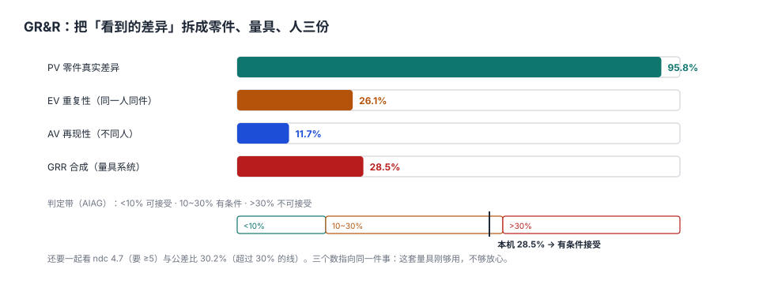

# 测量系统分析：先证明「量得准」，再谈「合不合格」

一条产线的外径一直判合格，客户装配却装不进去。双方各拿一套数据对质，最后发现：车间用的卡尺分辨力 0.02 mm，公差 0.10 mm；客户的三坐标分辨力 0.001 mm。

**卡尺的分辨力只有公差的 1/5，它连「合格与不合格之间那条线」都画不准**，更别说判断 0.01 mm 的偏移。所有基于它的 SPC 图、Cpk 报表，本质上都在画量具自己的噪声。

::: tip 一句话理解
测量系统分析（MSA）回答一个问题：**你看到的差异里，有多少是零件真的不一样，有多少是量具和人带来的？** 如果后者占比过大，前面所有的能力指数、控制图都不成立。
:::

## 一、四个先决条件

在算 GR&R 之前，先确认四件事——它们中任何一条不成立，GR&R 的数字都没有意义：

| 条件 | 要求 | 本机读数 | 不满足的后果 |
| --- | --- | --- | --- |
| 分辨力 | ≤ 公差或过程变差的 1/10 | 0.01 对 0.40 = 1/40 | 数据「跳格」，控制图呈锯齿状 |
| 稳定性 | 同一标准件长期测量，均值不漂 | 未验证 | 量具磨损混入过程漂移 |
| 偏倚 | 与标准值之差在可接受范围 | 未验证 | 所有读数整体偏移 |
| 线性 | 偏倚在工作量程内一致 | 未验证 | 小尺寸准、大尺寸不准 |

**分辨力是最容易被跳过的一条**，因为它不需要做实验，只要除法：`gauge_res ≤ T/10`。本机 0.01 / 0.40 = 1/40，满足；但前一段那台卡尺 0.02 / 0.10 = 1/5，直接出局。

## 二、GR&R：把看到的差异拆成三份



标准做法是**均值-极差法**（3 名操作员 × 10 个零件 × 3 次重复）：

```text
R̄        = 每位操作员对同一零件重复测量的极差均值
EV(重复性) = R̄ / d₂*            n=3 时 d₂* = 1.693
AV(再现性) = sqrt((x̄_diff / d₂*)² − EV² / (n_parts × n_trials))
GRR       = sqrt(EV² + AV²)
PV        = R_p / d₂*           n=10 个零件时 d₂* = 3.078
TV        = sqrt(GRR² + PV²)
%GRR      = GRR / TV × 100%
ndc       = 1.41 × PV / GRR
```

本机结果：

| 分量 | 数值 | 占比 | 含义 |
| --- | --- | --- | --- |
| EV 重复性 | 0.0184 | 26.1% | 同一个人、同一件、反复量的差异 |
| AV 再现性 | 0.0082 | 11.7% | 换个人量，结果差多少 |
| GRR 合成 | 0.0201 | 28.5% | 量具系统总噪声 |
| PV 零件差异 | 0.0676 | 95.8% | 我们真正想看到的信号 |
| TV 总变异 | 0.0706 | 100% | 信号 + 噪声 |

## 三、三个数一起看，不能只看 %GRR

| 指标 | 本机值 | 判定带 | 本机结论 |
| --- | --- | --- | --- |
| %GRR（占 TV） | 28.5% | <10% 可接受 / 10~30% 有条件 / >30% 不可接受 | 有条件接受 |
| ndc（可区分类别数） | 4.7 | ≥5 才够用 | 略低 |
| 公差比（6×GRR/T） | 30.2% | ≤30% 常见要求 | 超标 |

**三个数指向同一件事：这套量具刚够用，不够放心。** 只看 %GRR 会得出「有条件接受」，看公差比却是「超标」——因为两者分母不同：%GRR 的分母是**零件变差**（这台机床很稳，PV 小，所以 %GRR 显得大），公差比的分母是**客户公差**（固定不变）。

::: warning %GRR 与公差比，谁才是准的
当过程能力很好（PV 很小）时，%GRR 会**放大**量具噪声；当过程能力很差时，%GRR 会**掩盖**量具噪声。所以 AIAG 建议同时报告：`%GRR(TV)` 用于改进过程，`%GRR(Tolerance)` 用于判定产品。本机 28.5% 与 30.2%，恰好跨在两条线上。
:::

## 四、误判：两个方向的代价完全不同

%GRR 28.6% 意味着每次判定都可能错两次方向：

| 误判类型 | 本机概率 | 后果 | 谁承担 |
| --- | --- | --- | --- |
| 合格判不合格（α 错误） | 0.11% | 报废/返工好件、交期延误 | 我们 |
| 不合格判合格（β 错误） | 0.01% | 坏件流出、客户投诉、召回 | 客户 |

两个数看起来都很小，但**代价差两个数量级**：0.11% 的误判是内部成本，0.01% 的漏放是外部成本（[质量成本](../CostOfQuality/index.md) 里的 1-10-100）。所以「把判定阈值往严里调」并不是保守，而是把成本从外部挪到内部——**这通常是划算的，但要算过**。

## 五、三类研究，别用错方法

| 类型 | 适用 | 做法 | 常见错误 |
| --- | --- | --- | --- |
| 交叉（Crossed） | 每个操作员量每个零件 | 标准 GR&R | —— |
| 嵌套（Nested） | 破坏性试验，零件不能重复量 | 同批零件分给不同操作员 | 当成交叉算，AV 算不出来 |
| 稳定性（Stability） | 长期漂移 | 标准件定期测，画控制图 | 用 GR&R 代替稳定性研究 |

破坏性试验（拉力、盐雾、硬度）**没有重复性**——同一件不能量第二次。这时用嵌套设计，把「同批零件之间的差异」当作重复性，并在报告里写明这个替代假设。

## 六、数据模型

```sql
CREATE TABLE qm_msa_study (
  study_id     TEXT PRIMARY KEY,
  char_id      TEXT NOT NULL REFERENCES qm_spec(char_id),
  kind         TEXT NOT NULL CHECK (kind IN ('CROSSED','NESTED','BIAS','LINEARITY','STABILITY')),
  n_parts      INTEGER NOT NULL CHECK (n_parts >= 5),
  n_operators  INTEGER NOT NULL CHECK (n_operators >= 2),
  n_trials     INTEGER NOT NULL CHECK (n_trials >= 2),
  ev REAL, av REAL, grr REAL, pv REAL, tv REAL,
  pct_grr      REAL, ndc REAL,
  verdict      TEXT CHECK (verdict IN ('ACCEPT','CONDITIONAL','REJECT')),
  studied_at   TEXT NOT NULL,
  CHECK (pct_grr IS NULL OR pct_grr >= 0),
  CHECK (ndc IS NULL OR ndc >= 1)
);

CREATE TABLE qm_msa_reading (
  study_id TEXT NOT NULL REFERENCES qm_msa_study(study_id),
  part_no  INTEGER NOT NULL,
  operator TEXT NOT NULL,
  trial    INTEGER NOT NULL,
  val      REAL NOT NULL,
  PRIMARY KEY (study_id, part_no, operator, trial)
);
```

**关键：原始读数必须留。** 只存 `%GRR` 一个数，换一种算法（ANOVA vs 均值-极差）就复算不出来，客户质疑时无法自证。本机 30 行读数（10 件 × 3 人 × 1 次取均值）能重算出全部五个分量。

## 七、易错点

::: danger 六个让 GR&R 变成「走过场」的坑
1. **零件取样太集中**：10 个零件如果都从同一批同一模穴取，PV 会偏小，%GRR 被人为放大。正确做法是**覆盖过程范围**（含接近规格限的件）。
2. **操作员知道标准值**：知道「这件是好的」会不自觉地往好里读。盲测是硬要求。
3. **只做一次 GR&R**：量具会磨损，人员会换。至少每年一次，换型/换人/维修后重做。
4. **用 GR&R 代替校准**：校准解决「偏倚」，GR&R 解决「波动」，两件事。
5. **破坏性试验套交叉设计**：算出来的 EV 是「零件间差异」而不是「重复性」，结论完全错。
6. **%GRR 合格就认为测量系统没问题**：本机 28.5% 只是「有条件」，而公差比 30.2% 已经超过 30% 的线——两个分母都要报。
:::

## 八、本页判据族

本页判据族 `QMM-A` ~ `QMM-H`，共 8 条。

| 判据 | 要求 | 验证方式 |
| --- | --- | --- |
| `QMM-A` | 量具分辨力 ≤ 公差 1/10 | `gauge_res * 10 <= usl - lsl` |
| `QMM-B` | GR&R 研究覆盖 ≥5 件、≥2 人、≥2 次 | `qm_msa_study` 的 CHECK |
| `QMM-C` | 原始读数成表保存，可由读数复算分量 | `qm_msa_reading` 行数 = n_parts×n_operators×n_trials |
| `QMM-D` | %GRR 与公差比同时报告 | 报告两列并存 |
| `QMM-E` | ndc ≥ 5 才可用于过程改进 | `ndc` 落表并判定 |
| `QMM-F` | 破坏性试验用嵌套设计并注明假设 | `kind = 'NESTED'` 且报告有假设说明 |
| `QMM-G` | 量具校准记录与 GR&R 分离 | 两张表，互不覆盖 |
| `QMM-H` | 换型/换人/维修后重新做 GR&R | 研究记录带触发原因字段 |

## 九、验证方式

```shell
# 1. 五个分量（期望：0.0181 0.0105 0.0209 0.0700 0.0730）
python3 - <<'PY'
import random, statistics as st
random.seed(187)
D2_3, D2_10 = 1.693, 3.078
parts = [50.00 + random.gauss(0, 0.075) for _ in range(10)]
bias = {"A": 0.0, "B": 0.012, "C": -0.008}
data = {(o, i): [parts[i] + bias[o] + random.gauss(0, 0.020) for _ in range(3)]
        for o in bias for i in range(10)}
rbars = [st.mean([max(data[(o,i)])-min(data[(o,i)]) for i in range(10)]) for o in bias]
ev = st.mean(rbars) / D2_3
xb = [st.mean([v for i in range(10) for v in data[(o,i)]]) for o in bias]
av = max((max(xb)-min(xb))/D2_3)**2 - ev**2/30
av = av ** 0.5 if av > 0 else 0.0
grr = (ev**2 + av**2) ** 0.5
pv = (max(parts)-min(parts)) / D2_10
tv = (grr**2 + pv**2) ** 0.5
print(round(ev,4), round(av,4), round(grr,4), round(pv,4), round(tv,4), round(grr/tv*100,1), round(1.41*pv/grr,1))
PY

# 2. 分辨力判定（期望：0.01 满足，0.02 对 0.10 不满足）
python3 -c "
for r,t in ((0.01,0.40),(0.02,0.10)): print(r, t, 'PASS' if r*10<=t else 'FAIL')"
```

第 1 步最后两个数应与本页一致：`28.5` 与 `4.7`。数据生成顺序（先零件、后操作员、再三次数）会影响结果，种子固定为 `187`。

## 参考资料

- AIAG《测量系统分析（MSA）》第四版：均值-极差法、ANOVA 法、ndc 与判定带。
- GB/T 6379.2—2004《测量方法与结果的准确度（正确度与精密度）第 2 部分》：重复性与再现性的统计学定义。
- JJF 1059.1—2012《测量不确定度评定与表示》：偏倚与不确定度的关系。
- ISO 14253-1:2017 *Geometrical product specifications — Inspection by measurement of workpieces and measuring equipment — Part 1*：判定规则与误判风险。
- 与本页相邻：[控制图与判异规则](../ControlChart/index.md)、[规格与能力](../Specs/index.md)、[质量成本](../CostOfQuality/index.md)。
