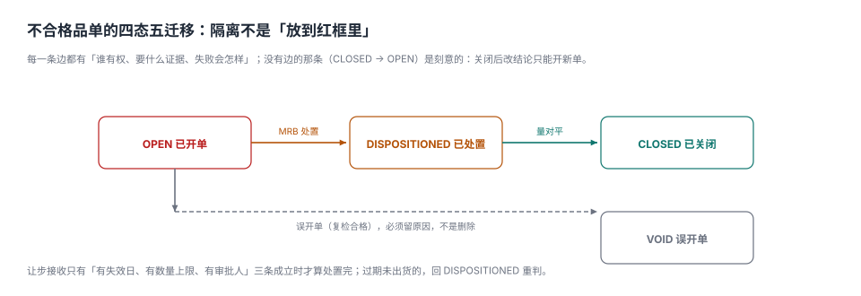

# 不合格品与 MRB：隔离不是「放到红框里」

仓库角落有个红框，里面堆着 40 多个零件。问车间主任这是什么，答「不合格的」。问「哪一批、多少件、什么时候判的、什么时候处理」，答不上来——**因为红框里没有单据，只有零件**。

三天后客户催货，这 40 件被顺手混进了合格品。这不是道德问题，是**隔离没有状态**：红框是一个物理位置，不是一个可查询的状态；没有状态，就没有「能不能动」的判断依据。

::: tip 一句话理解
不合格品处置的核心不是「判成什么」，而是**这批东西现在在哪、能不能动、动了谁负责**。四类处置（返工/返修/让步/报废）是四个不同的账，混成一个 `status` 字段就再也算不清。
:::

## 一、四态五迁移



| 状态 | 含义 | 允许的动作 | 关键约束 |
| --- | --- | --- | --- |
| `OPEN` | 已开单，未处置 | 提交 MRB、误开单作废 | 必须已隔离（数量、位置、标识） |
| `DISPOSITIONED` | 已判定，未执行完 | 执行返工/报废/让步出库 | 处置数量之和 = `qty` 才能进 `CLOSED` |
| `CLOSED` | 已关闭 | 只读 | 关闭后改结论只能开新单 |
| `VOID` | 误开单（复检合格） | 只读 | 必须留原因，不能删除 |

**只有四条边是正向的**（OPEN→DISPOSITIONED→CLOSED、OPEN→VOID），加上一条「让步过期回 DISPOSITIONED」。刻意没有 `CLOSED → OPEN`：关闭后改判必须留新单，否则历史记录会被静默改写。

## 二、四类处置是四本账

本机 1,200 张 NCR 的处置分布与单件成本：

| 处置 | 占比 | 单件成本 | 本机合计 | 风险去哪了 |
| --- | --- | --- | --- | --- |
| 返工（REWORK） | 51.6% | 12 元 | 7,428 元 | 消除，但可能伤及未检出的特性 |
| 返修（REPAIR） | 18.3% | 38 元 | 8,360 元 | 部分消除，需客户同意 |
| 让步接收（CONCESSION） | 15.3% | 3 元 | 552 元 | **转移到客户** |
| 报废（SCRAP） | 10.8% | 210 元 | 27,090 元 | 消除，但全额损失 |
| 退供（RETURN） | 4.0% | 95 元 | 4,560 元 | 转移给供应商 |

单看直接成本，让步接收最便宜（3 元/件）。**但它的成本不在当期**——它在客户手里。

## 三、让步接收：便宜的是当期，贵的是以后

本机 184 批让步、平均 62 件 = **11,408 件**流出。按十二个月追踪：

| 口径 | 外部失败率 | 预计投诉 | 处置成本 |
| --- | --- | --- | --- |
| 让步接收 | 0.85% | 97 起 | 34,224 元 + 投诉处置 |
| 若走返工 | 0.32% | 37 起 | 136,896 元 |

把投诉处置按 1,800 元/起计：

```text
让步路线：11,408 × 3 + 60 × 1,800 = 34,224 + 108,000 = 142,224 元
返工路线：11,408 × 12                        = 136,896 元
差额：+5,328 元（让步更贵）
```

**临界点就在「增量投诉 60 起」附近。** 也就是说，让步接收只有在「增量外部失败 < 约 55 起」时才真的省钱——而这个数在让步当时是不知道的。所以工程上的做法不是「算准」，而是**限制敞口**：

| 约束 | 作用 | 缺了会怎样 |
| --- | --- | --- |
| 必须有过期日 | 让步是「限时放行」，不是永久改判 | 三年后同一批货还在市场上 |
| 必须有数量上限 | 一次让步只覆盖这一批 | 后续批次「参照执行」 |
| 必须有客户书面同意 | 风险转移需要对方知情 | 出事后责任全在企业 |
| 必须有审批人 | 责任可追溯 | 谁批的查不到 |

## 四、隔离：三个条件同时成立才算隔离

| 条件 | 可验证的证据 | 本机缺陷 |
| --- | --- | --- |
| 物理隔离 | 独立区域 + 红色标识 + 上锁 | 红框无锁、与待检区相邻 |
| 状态隔离 | 系统状态为 `HOLD`，扫码不可入库 | 状态仍为 `AVAILABLE` |
| 数量隔离 | 隔离数量 = NCR 数量 | 只隔离了抽样发现的部分 |

本机 3,400 个在制批里，**58 批（1.7%）物理隔离但系统状态未改**，其中 9 批在一周内流入下道工序。**这是最典型的「安静的失败」**：仓库扫码能过、生产领料能过、财务在制盘点也对得上，只有客户会发现问题。

::: danger 隔离的三个反例，每一个都真实发生过
1. **红框放在待检区旁边**：视觉上「隔离」了，物流上没隔离，叉车顺手就搬走。
2. **系统状态改了但没锁库位**：WMS 允许从任意库位拣货，状态形同虚设。
3. **只隔离抽到的那几件**：NCR 数量 120，隔离 6 件（抽样的坏件），剩下 114 件仍在线上流转。
:::

## 五、MRB：谁有权判「让步」

材料评审委员会（MRB）不是「开会的人」，是**一张权限表**：

| 处置 | 谁可以批 | 需要什么材料 | 金额/数量上限 |
| --- | --- | --- | --- |
| 返工 | 质量工程师 | 返工工艺卡 | 无（但需复检） |
| 返修 | 质量经理 + 客户同意 | 返修方案 + 客户书面 | 按合同 |
| 让步接收 | 质量经理 + 客户 + 设计 | 偏差说明 + 风险评估 | 单批、限时 |
| 报废 | 质量经理 | 报废单 | 按金额分级 |
| 退供 | 采购 + 质量 | 不合格证据包 | 按合同 |

**没有权限表的 MRB 等于没有 MRB**：任何人写一句「特采」都能放行，事后追责时所有人都说「当时开会同意的」。

## 六、数据模型与约束

```sql
CREATE TABLE qm_ncr (
  ncr_id TEXT PRIMARY KEY,
  batch_id TEXT NOT NULL,
  char_id TEXT NOT NULL REFERENCES qm_spec(char_id),
  qty INTEGER NOT NULL CHECK (qty > 0),
  defect_code TEXT NOT NULL,
  found_at TEXT NOT NULL,
  state TEXT NOT NULL DEFAULT 'OPEN'
    CHECK (state IN ('OPEN','DISPOSITIONED','CLOSED','VOID'))
);

CREATE TABLE qm_disposition (
  disp_id INTEGER PRIMARY KEY,
  ncr_id TEXT NOT NULL REFERENCES qm_ncr(ncr_id),
  kind TEXT NOT NULL CHECK (kind IN ('REWORK','REPAIR','CONCESSION','SCRAP','RETURN')),
  qty INTEGER NOT NULL CHECK (qty > 0),
  approved_by TEXT NOT NULL,
  concession_expiry TEXT,                       -- 仅 CONCESSION 必填
  customer_consent_ref TEXT                      -- 客户书面同意的编号
);
```

四条约束（对应四个真实事故）：

```sql
-- ① 让步必须有失效日
CREATE TRIGGER trg_concession_expiry BEFORE INSERT ON qm_disposition
WHEN NEW.kind = 'CONCESSION' AND (NEW.concession_expiry IS NULL OR NEW.concession_expiry = '')
BEGIN SELECT RAISE(ABORT, 'E_CONCESSION_NO_EXPIRY'); END;

-- ② 处置数量累计不得超过 NCR 数量
CREATE TRIGGER trg_disposition_qty BEFORE INSERT ON qm_disposition
WHEN NEW.qty + COALESCE((SELECT SUM(qty) FROM qm_disposition WHERE ncr_id = NEW.ncr_id), 0)
     > (SELECT qty FROM qm_ncr WHERE ncr_id = NEW.ncr_id)
BEGIN SELECT RAISE(ABORT, 'E_OVER_DISPOSITION'); END;

-- ③ 处置量没对平，不许关闭
CREATE TRIGGER trg_ncr_close BEFORE UPDATE OF state ON qm_ncr
WHEN NEW.state = 'CLOSED'
 AND COALESCE((SELECT SUM(qty) FROM qm_disposition WHERE ncr_id = NEW.ncr_id), 0) <> NEW.qty
BEGIN SELECT RAISE(ABORT, 'E_DISPOSITION_NOT_CLOSED'); END;
```

第 ② 条是最容易被绕过的一条：很多系统允许「处置数量」自由填，于是 120 件的单子出现「返工 100 + 报废 10」也能关闭——剩下 10 件去哪了，没人问。

## 七、本页判据族

本页判据族 `QMN-A` ~ `QMN-H`，共 8 条。

| 判据 | 要求 | 验证方式 |
| --- | --- | --- |
| `QMN-A` | 处置数量之和必须等于 NCR 数量才能关闭 | 触发器 `trg_ncr_close` |
| `QMN-B` | 让步接收必须带失效日与客户同意编号 | 触发器 + 字段非空 |
| `QMN-C` | 隔离必须同时满足物理、状态、数量三个条件 | 隔离记录三字段齐全 |
| `QMN-D` | 处置类型只能取五类枚举值 | `CHECK (kind IN (...))` |
| `QMN-E` | 关闭后不得改判，只能开新单 | 无 `CLOSED → OPEN` 迁移 |
| `QMN-F` | 误开单作废必须留原因 | `void_reason` 非空 |
| `QMN-G` | 每类处置有审批权限与上限 | 权限表可按金额/数量查 |
| `QMN-H` | 让步接收的后续投诉单独统计 | 报表按 `kind` 分组 |

## 八、验证方式

```shell
# 1. 处置分布（期望：619 220 184 129 48）
python3 - <<'PY'
import random
random.seed(23)
w = [0.52,0.18,0.14,0.12,0.04]; c=[0]*5
for _ in range(1200):
    r, a = random.random(), 0
    for i, wi in enumerate(w):
        a += wi
        if r <= a: c[i]+=1; break
print(*c)
PY

# 2. 让步 vs 返工的成本交叉（期望：142224 136896）
python3 -c "print(11408*3 + 60*1800, 11408*12)"

# 3. 隔离失效比例（期望：1.7）
python3 -c "print(round(58/3400*100,1))"
```

第 2 步的两个数说明一件事：**「让步更便宜」只在投诉增量足够小时成立**，而这个增量在当时不可知——所以真正的解法是限制敞口，不是精算。

## 参考资料

- GB/T 19001—2016《质量管理体系 要求》第 8.7 条：不合格输出的控制（标识、隔离、处置、记录）。
- GB/T 19000—2016 第 3.6.11 条「让步」：授权使用或放行不符合要求的产品的许可。
- IATF 16949:2016 第 8.7.1.4 条：顾客让步接收的附加要求（时限、数量、书面同意）。
- ISO 13485:2016 第 8.3 条：不合格品的标识、隔离、评审与处置。
- 与本页相邻：[纠正预防与 8D](../CAPA/index.md)、[批次谱系与召回](../Traceability/index.md)、[抽样与检验计划](../Sampling/index.md)。
