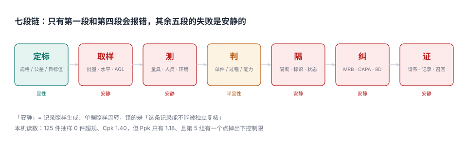

# 质量管理工程总览：一条能被独立复核的判断链

审计员来审厂，第一件事不是看产品，是随机抽三张不合格品单，问四个问题：这批有多少件？谁判的？判成什么？东西现在在哪？

三个问题都好答，第四个常常答不上来。因为单子上写着「已处置」，而处置的三条路——返工、让步、报废——在系统里只是同一个 `status` 字段的三个值，没有数量、没有审批人、没有失效日。仓库里那 120 件到底返了 100 件还是 120 件，没人能说清。

**这不是数据没录，是模型没地方放。** 一条判断如果要能被别人独立复核，它必须同时留下四样东西：**依据（哪条规格）、方法（怎么测的）、结论（判成什么）、证据（东西去哪了）**。缺一样，这条判断就只能靠当事人回忆。

::: tip 一句话理解
质量系统交付的不是「合格率」，是**判断的可复核性**：换一个人、换一台电脑、隔一年，都能沿着记录把同一个结论重新推一遍。
:::

## 一、七段链：五段失败是安静的



| 段 | 输入 | 产物 | 谁在下一段接手 | 失败形态 |
| --- | --- | --- | --- | --- |
| ① 定标 | 客户图纸、法规、历史投诉 | `spec`（USL/LSL/目标值） | 检验计划 | 公差抄错，评审能看出来 |
| ② 取样 | 批量、检验水平、AQL | `sampling_plan`（n / Ac / Re） | 检验员 | 抽 5 件全好就放行，没人复核样本量 |
| ③ 测 | 量具、人员、环境 | `measurement` | 判定 | 量具分辨力不足，数据照样「合格」 |
| ④ 判 | 规格 / 控制限 / 能力 | `subgroup` + 控制图 | MRB | 判据不写清，事后各说各话 |
| ⑤ 隔 | NCR、红框、状态 | `ncr` + `disposition` | 仓库 | 红框里混进合格品，扫码照样入库 |
| ⑥ 纠 | 围堵、根因、对策 | `capa` | 工艺 | 关了单，同类问题 3 个月后再来一次 |
| ⑦ 证 | 批次、序列号、记录 | `batch_link` | 售后 | 缺一环，召回只能整批 |

五段安静，是因为它们**不产生错误信号**：系统里没有一条约束会因为「样本量不够」「量具不够准」「红框里混了合格品」而拒绝写入。安静段落的共同解法只有一个——**把它们变成数据库约束或可执行的判据**，而不是操作规程里的一句「应注意」。

## 二、同一批数据，四个答案

本机造了一组 25 个子组 × 5 件的外径数据（目标 50.00，公差 ±0.20，组内 σ ≈ 0.043，后 10 组有缓慢上漂）：

| 视角 | 读数 | 结论 | 谁会说这句话 |
| --- | --- | --- | --- |
| 单件超规 | 0 / 125 | 这一批「一件没坏」 | 检验员 |
| 控制图 | 第 5 组 49.9497 < LCL 49.9622 | 过程「失控」了 | 工艺 |
| 组内能力 | Cp 1.555 / Cpk 1.401 | 能力「够」 | 项目 |
| 整体能力 | Pp 1.307 / Ppk 1.177 | 能力「不够」 | 客户审核 |

四个答案全部正确。**它们不矛盾，因为它们回答的不是同一个问题**：

- 「0/125」回答的是**这一批**的合格率，样本量 125 时，即使真实不良率 1%，抽不到坏件的概率仍有 28.5%；
- 「第 5 组越界」回答的是**过程有没有变**，与零件合不合格无关——那一组的 5 件全在规格内；
- 「Cpk 1.401」用的是**组内 σ**（R̄/d₂），它衡量的是「如果过程一动不动，能做到多好」；
- 「Ppk 1.177」用的是**整体 σ**，它把组间漂移算了进去，衡量的是「实际交付的水平」。

两者差 19.0%，这 19.0% 就是「漂移」的价格。**只报 Cpk 的系统，会把漂移藏起来**——这恰好是客户投诉时最想知道的那个数。

::: warning Cp 与 Cpk、Cpk 与 Ppk 是两组不同的比较
`Cp` vs `Cpk` 比的是**中心偏不偏**（同一把 σ）；`Cpk` vs `Ppk` 比的是**过程稳不稳**（两种 σ）。四个数一起看才能定位问题：Cp 高 Cpk 低是偏心，Cpk 高 Ppk 低是漂移，四个都低是能力真不够。
:::

## 三、判据必须能被别人复跑

这一册每页给 8 条判据，写法统一为「**可观测的证据 + 判定条件**」，例如：

| 示例 | 写法 | 为什么这样写 |
| --- | --- | --- |
| 好 | 每条 NCR 的处置数量之和等于 `ncr.qty` | 可 SQL 判定，不依赖人工解释 |
| 好 | 控制限表带 `effective_from` 且同特征不重叠 | 可查，且防止「改规格顺手改控制限」 |
| 坏 | 不合格品应妥善隔离 | 无法判定，「妥善」没有度量 |

反例那条读起来像要求，但没人能判定它成不成立。**判据的价值不在于写得漂亮，而在于别人能不能用它驳倒你。**

## 四、十条主线

| 主线 | 一句话 | 落在哪一页 |
| --- | --- | --- |
| 三个「合格」 | 单件、过程、能力，各有各的算法 | [规格与能力](../Specs/index.md) |
| α 与 β | 生产者风险与消费者风险是两笔钱 | [抽样](../Sampling/index.md) |
| 量得准 | %GRR 决定「判不判得了」 | [测量系统](../Measurement/index.md) |
| 控制限 ≠ 规格限 | 一条是过程自己算的，一条是客户给的 | [控制图](../ControlChart/index.md) |
| 八条规则 | 每条买「早发现」，付「误报」 | [控制图](../ControlChart/index.md) |
| 处置四类 | 返工/返修/让步/报废，四种成本四种风险 | [不合格品](../Nonconformance/index.md) |
| 围堵 ≠ 根因 | 只做围堵的 CAPA 再发率 16.2%，做了根因 10.8% | [CAPA](../CAPA/index.md) |
| 粒度 | 批次召回 480 台，序列号召回 38 台 | [追溯](../Traceability/index.md) |
| 1-10-100 | 越晚发现越贵，且不成比例 | [质量成本](../CostOfQuality/index.md) |
| 约束 | 把口径写成触发器，而不是操作规范 | [实战](../Practice/index.md) |

## 五、本册不判什么

边界写死，避免与相邻专题打架：

- **不判「这批收不收」的执行细节**：抽样表、判定单、来料接收流程在 [Manufacturing/Quality](../../Manufacturing/Quality/index.md) 与 [SupplierCollaboration/BatchReview](../../SupplierCollaboration/BatchReview/index.md)。
- **不判设备可靠性**：MTBF、浴盆曲线、备件在 [EquipmentMaintenance](../../EquipmentMaintenance/Overview/index.md)；本册只把维修记录当根因证据。
- **不判成本核算**：制造费用分摊、成本对象在 [CostAccounting](../../CostAccounting/Overview/index.md)；本册只用它的四分类口径。
- **不判「数据质量」的维度定义**：[DB/DataGovernance/DataQuality](../../../DB/DataGovernance/DataQuality/index.md) 讲完整性/一致性/及时性，本册讲「同一个测量值在三处的口径」。

## 六、易错点

::: danger 六个真实事故，每一个都能在系统里复现
1. **把控制限画成规格限**：图上永远不出界，因为出界的那部分已经被判成不合格挑走了。控制限要由过程数据算，且**只算受控段**。
2. **用 Cp 代替 Cpk 报给客户**：本机同批数据 Cp 1.555、Cpk 1.401，差 0.154；偏心越大差得越多，客户拿这个数判断「你能不能长期供」。
3. **只存子组均值与极差**：库存里没有原始值，Ppk 永远算不出来，客户要 Ppk 时只能「按 Cpk 填」。
4. **让步接收没有失效日**：一次让步变成永久放行，三年后同一批货还在市场上。工程上必须写 `concession_expiry`。
5. **NCR 只记状态不记数量**：`status = 'DISPOSITIONED'` 与「120 件都处置完了」是两句话，前者不需要证据，后者需要逐笔核销。
6. **把抽样合格率当整批合格率**：抽 80 件全好只能说明「缺陷率大概率低于 3.7%」（本机 95% 置信上界），不能说整批没有坏件。
:::

## 七、本页判据族

本页判据族 `QMO-A` ~ `QMO-H`，共 8 条。八条都能被单独判定，任何一条不成立就不算这篇文档写完。

| 判据 | 要求 | 验证方式 |
| --- | --- | --- |
| `QMO-A` | 七段链每段都标了「失败是否安静」 | 表格七行均有该列 |
| `QMO-B` | 同一批数据至少给出四个视角的读数 | 本页第二节表格四行 |
| `QMO-C` | 规格限与控制限分表存储且控制限带生效日 | `qm_spec` 与 `qm_control_limit` 两张表 |
| `QMO-D` | 三个「合格」的定义各有一句可复算的算法 | 第二节与 [规格页](../Specs/index.md) |
| `QMO-E` | 与四个相邻专题的分工写成表，且链接可点 | 第五节四条 |
| `QMO-F` | 每页判据族编号唯一且各 8 条 | `grep` 十族计数均为 8 |
| `QMO-G` | 每条 NCR 的处置数量之和等于 `qty` | 触发器 `trg_ncr_close` |
| `QMO-H` | 控制限同特征多版本生效区间不重叠 | 唯一键 `(char_id, version)` + 生效日校验 |

## 八、验证方式

```shell
# 1. 十族判据各 8 条（期望：每行 8，共 80）
for f in QMO QMS QMP QMM QMC QMN QQA QQT QMY QMX; do
  printf "%s %s\n" "$f" "$(grep -rho "$f-[A-H]" docs/Backend/QualityManagement | wc -l | tr -d ' ')"
done

# 2. 七段链的「安静」段数（期望：5）
grep -c "| \*\*安静\*\*" docs/Backend/QualityManagement/index.md

# 3. 同一批数据的四个视角读数可复算（期望：125 0.0429 1.401 1.177）
python3 - <<'PY'
import random, statistics as st
random.seed(20261105)
subs = []
for i in range(25):
    mu = 50.005 + (0.057 * (i - 14) / 10 if i >= 15 else 0.0)
    subs.append([random.gauss(mu, 0.048) for _ in range(5)])
flat = [v for s in subs for v in s]
rbar = st.mean([max(s) - min(s) for s in subs])
sw = rbar / 2.326
m = st.mean(flat)
print(len(flat), round(sw, 4), round(min(50.2 - m, m - 49.8) / (3 * sw), 3),
      round(min(50.2 - m, m - 49.8) / (3 * st.stdev(flat)), 3))
PY
```

第 3 步的输出应与本页表格一致：`125 0.0429 1.401 1.177`。若 σ 对不上，先确认随机种子与生成顺序（本册固定 `20261105`，先 25 组后逐件生成）。

## 参考资料

- GB/T 19000—2016《质量管理体系 基础和术语》：质量、要求、不合格、纠正、纠正措施、预防措施。
- GB/T 19001—2016《质量管理体系 要求》第 8.7 条「不合格输出的控制」：标识、隔离、处置与记录保留。
- ISO 9000:2015 *Quality management systems — Fundamentals and vocabulary*：§3.6 系列术语的英文原文。
- AIAG & VDA《FMEA 手册》第一版（2019）：失效链与预防/探测的区分，用于第 9 页成本归因。
- 与本页相邻：[规格与能力](../Specs/index.md)、[抽样](../Sampling/index.md)、[测量系统](../Measurement/index.md)。
