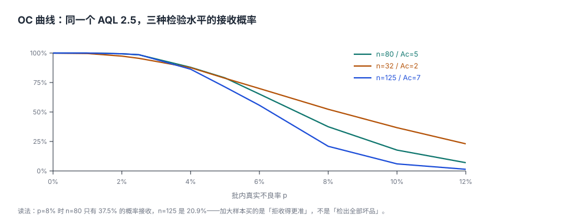

# 抽样与检验计划：AQL 管的是「批」，不是「件」

车间主任最常问的一句话是：「就坏了两件，凭什么退我一千件？」

质量员回答：「抽 80 件里有 6 件坏，超过 Ac=5。」

主任更不服气：「那不才 7.5% 吗？我 1,000 件里坏 75 件，你退我 1,000 件？」

**两个人都对，但说的不是一件事。** 抽样方案判的是「这一批的证据够不够支持接收」，不是「这一批里究竟有几件坏的」。方案一旦定下来，样本量、判定数、两类风险就全部锁定——**它是一场事先约定的赌局，不是一次临场判断**。

::: tip 一句话理解
AQL 抽样是**用 80 件的证据去赌 1,000 件的清白**：赌赢了不代表没有坏件，只代表「坏到某个程度以上的概率足够低」。抽样方案的三件事——抽多少、判几个、冒多大风险——必须同时写在纸上。
:::

## 一、三个参数，一张表

GB/T 2828.1—2012（等同采用 ISO 2859-1:1999）的检索链是：**批量 N → 样本量字码 → 样本量 n → AQL → Ac/Re**。

| 环节 | 输入 | 输出 | 本机例子 |
| --- | --- | --- | --- |
| ① 批量 | 交检批 N | 样本量字码 | N = 1,000 → 字码 J |
| ② 字码 | 字码 + 检验水平 | 样本量 n | 一般检验水平 II、字码 J → n = 80 |
| ③ 判定 | n + AQL | Ac / Re | AQL 2.5 → Ac = 5、Re = 6 |

判定规则只有一句：**样本中不合格品数 ≤ Ac 判接收，≥ Re 判拒收**（`Re = Ac + 1`，中间没有灰区）。

::: danger Re 必须是 Ac + 1，而且必须由约束保证
很多系统把 `ac` 与 `re` 当两个独立字段让人填，于是出现 `Ac=5 / Re=5` 或 `Ac=5 / Re=7` 这种表上不存在的组合。这不只是脏数据——它会让「6 件」这个结果既不算接收也不算拒收，检验员只能自己拍。正确写法是 `CHECK (re = ac + 1)`，并由触发器保证。
:::

## 二、OC 曲线：接收概率不是 0 或 1



同一批货，真实不良率 p 不同，被接收的概率完全不同：

| 真实不良率 p | n=80 / Ac=5 | n=32 / Ac=2 | n=125 / Ac=7 |
| --- | --- | --- | --- |
| 1.0% | 100.0% | 99.6% | 100.0% |
| 2.5%（AQL） | 98.5% | 95.5% | 98.6% |
| 5.0% | 78.9% | 78.6% | 71.2% |
| 8.0% | 37.5% | 52.3% | 20.9% |
| 10.0% | 17.7% | 36.7% | 6.0% |

三条曲线交叉在 5% 附近，右侧分道扬镳：**同样 AQL 2.5，样本越大，对「坏批」的拒收越坚决**。n=125 在 p=10% 时只有 6.0% 的概率放行，而 n=32 还有 36.7%。

## 三、α 与 β：两种错误，两笔钱

| 风险 | 定义 | 本机读数 | 谁承担 | 表现 |
| --- | --- | --- | --- | --- |
| 生产者风险 α | 好批（p = AQL）被判拒收 | 1.5% | 供应商 | 退货、返工、交期延误 |
| 消费者风险 β | 坏批（p = 8%）被判接收 | 37.5% | 客户 | 上线不良、售后、召回 |

**这两个数永远此消彼长**：把 Ac 调小，α 上升、β 下降；把样本量加大，两条曲线同时变陡（两个风险一起降，但检验成本上升）。

所以「AQL 2.5」不是一个技术参数，而是一份**商业约定**：它承认「2.5% 的坏可以收」，同时承认「8% 的坏有 37.5% 的概率会被放进来」。谈抽样方案时只说 AQL 不说 β，等于只说了一半。

::: warning β 常常高得让人不舒服
n=80 / Ac=5 在 p=8% 时 β = 37.5%。这不是方案设计得差，是**样本量 80 的物理极限**：想把这个 β 压到 10%，同一 AQL 下样本量要接近 200。要不要付这个检验成本，是经营决策，不是质量部能单方面决定的。
:::

## 四、抽 80 件全好，批里还剩几件坏的

这是抽样最容易被误读的地方：

```text
批内残留期望 = (N − n) × p
            = (1,000 − 80) × 1% = 9.2 件
```

抽 80 件全好，在 p = 1% 的假设下，**批里平均还剩 9.2 件坏的**。所以：

- 「抽 80 件全好」只能说明「至少检出 1 件的概率」是 55.2%（p=1% 时），**连一半都不到**；
- 用 80 件去证明「这批一件坏都没有」，在统计上是不成立的——需要的是**零缺陷抽样方案**（如 n=299 / Ac=0 才能在 95% 置信下证明 p < 1%）。

## 五、全检、抽检、免检：三种成本

| 方式 | 单件成本 | 漏检风险 | 适用 |
| --- | --- | --- | --- |
| 全检 | 高（人工 + 量具占用） | 检验疲劳导致漏检，实测漏检率 2%~5% | 关键特性、批量小、自动化检测 |
| 抽检 | 低（n/N 比例） | β 已知且写在方案里 | 一般特性、连续批 |
| 免检 | 极低 | 依赖供应商历史 | 有质量体系背书的长期供方 |

**全检不等于零漏检**：人眼在 1,000 件的连续检验中，后 200 件的漏检率通常是前 200 件的 2~3 倍。用自动化检测（视觉/激光）替代人眼，往往比「加人全检」更有效。

## 六、检验计划落库

```sql
CREATE TABLE qm_sampling_plan (
  plan_id      TEXT PRIMARY KEY,
  char_id      TEXT NOT NULL REFERENCES qm_spec(char_id),
  lot_min      INTEGER NOT NULL,
  lot_max      INTEGER NOT NULL,
  level        TEXT NOT NULL,           -- I / II / III
  aql          REAL NOT NULL,
  sample_n     INTEGER NOT NULL,
  ac           INTEGER NOT NULL,
  re           INTEGER NOT NULL,
  severity     TEXT NOT NULL DEFAULT 'NORMAL',  -- NORMAL / TIGHTENED / REDUCED
  CHECK (lot_max >= lot_min),
  CHECK (re = ac + 1),
  CHECK (sample_n >= 2 AND sample_n <= lot_min)
);
```

三个必须落库的约束：

1. `re = ac + 1`：杜绝表上不存在的组合；
2. `sample_n <= lot_min`：样本不能超过批量（小批量的字码会「降级」）；
3. `severity` 三态：正常/加严/放宽是**连续批的转移规则**，不是一次性设定。

::: info 转移规则是抽样方案的一部分
GB/T 2828.1—2012 的转移规则：连续 5 批中有 2 批被拒 → 转加严；加严后连续 5 批被接收 → 回正常；正常下连续 10 批被接收且样本中不合格数为 0 → 可转放宽。**只实现「正常」一档的系统，等于放弃了抽样标准的一半**。
:::

## 七、易错点

::: danger 五个把好方案用坏的方式
1. **把 AQL 当目标不良率**：AQL 是「可以接受的上限」，不是「我们要做到的均值」。把 AQL 2.5 写进 KPI，等于宣布「2.5% 的坏是达标的」。
2. **固定抽 5 件**：样本量由批量与检验水平决定，与「今天忙不忙」无关。固定 5 件在小批量下可能过多，在大批量下等于没抽。
3. **抽到了坏件就「再抽 20 件看看」**：这是**二次抽样**，会显著抬高 β，必须事先定义（GB/T 2828.1—2012 有专门的二次/多次方案表），不能临场加。
4. **只记判定结果，不记样本量**：一张「合格」的检验单，如果没写 n 与 Ac，事后无法判断它证明了什么。
5. **让步接收不走 MRB**：抽样拒收后的让步属于 [不合格品处置](../Nonconformance/index.md)，必须有数量、审批与失效日，不能由检验员在单子上写「特采」。
:::

## 八、本页判据族

本页判据族 `QMP-A` ~ `QMP-H`，共 8 条。

| 判据 | 要求 | 验证方式 |
| --- | --- | --- |
| `QMP-A` | 抽样方案落表，`sample_n` 由批量与检验水平检索得出 | `qm_sampling_plan` 可按 `lot_min/lot_max` 命中唯一方案 |
| `QMP-B` | `re = ac + 1` 由约束保证 | `CHECK (re = ac + 1)` 存在 |
| `QMP-C` | 样本量不得超过批量 | `CHECK (sample_n <= lot_min)` |
| `QMP-D` | 检验记录必须同时保存 `n` 与 `ac` | 检验单字段非空 |
| `QMP-E` | 转移规则三态可切换且留痕 | `severity` 有历史记录 |
| `QMP-F` | 抽样拒收后的让步走 MRB | 让步单必须引用 NCR |
| `QMP-G` | 抽样结论不得表述为「整批无坏件」 | 报告模板用「未发现不合格」而非「无不合格」 |
| `QMP-H` | 二次抽样必须事先定义，不得临场追加 | 方案表有 `stage` 字段或明确单一方案 |

## 九、验证方式

```shell
# 1. OC 曲线关键点（期望：98.5 78.9 37.5 17.7）
python3 - <<'PY'
from math import comb
def pa(n, ac, p):
    return sum(comb(n, k) * p**k * (1-p)**(n-k) for k in range(ac+1))
print(*[round(pa(80,5,p)*100,1) for p in (0.025,0.05,0.08,0.10)])
PY

# 2. 两类风险（期望：α 1.5% / β 37.5%）
python3 - <<'PY'
from math import comb
pa = lambda n,ac,p: sum(comb(n,k)*p**k*(1-p)**(n-k) for k in range(ac+1))
print(round((1-pa(80,5,0.025))*100,1), round(pa(80,5,0.08)*100,1))
PY

# 3. 批内残留期望（期望：9.2）
python3 -c "print(round((1000-80)*0.01,1))"
```

第 2 步的两个数就是这份方案的真实风险敞口；如果现场记录里找不到这两个数，说明方案只被当成了一张「抽几个」的表。

## 参考资料

- GB/T 2828.1—2012《计数抽样检验程序 第 1 部分：按接收质量限（AQL）检索的逐批检验抽样计划》：样本量字码表、Ac/Re 表、转移规则。
- ISO 2859-1:1999 *Sampling procedures for inspection by attributes — Part 1*：与国标等同采用关系。
- GB/T 2828.2—2008《计数抽样检验程序 第 2 部分：按极限质量水平（LQ）检索的孤立批检验抽样方案》：孤立批场景。
- GB/T 19001—2016 第 8.4.2 条：外部供方的验证活动（抽样方案的合同依据）。
- 与本页相邻：[规格与能力](../Specs/index.md)、[测量系统分析](../Measurement/index.md)、[不合格品与 MRB](../Nonconformance/index.md)。
