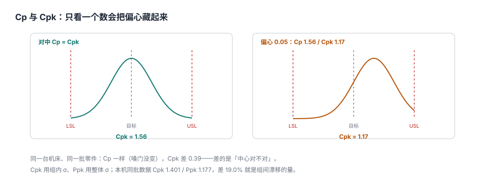

# 规格、公差与能力指数：三个「合格」不是一件事

客户来审核，摊开两张纸。第一张是我们报的「Cpk 1.40，过程能力充足」；第二张是他自己抽的 300 件实测数据算出来的「Ppk 1.12，未达标」。

同一台机床、同一批零件、同一段时间。**两个数都没造假，差在分母**：我们用的是组内 σ（R̄/d₂ ≈ 0.043），他用的是整体 σ ≈ 0.051。19.0% 的差距，就是这三个月里过程均值从 50.005 慢慢爬到 50.062 的那段漂移。

这一页要解决的问题只有一个：**「合格」这个词在四个地方有四个定义，任何一个被单独拿出来当成结论都会误导人**。

::: tip 一句话理解
规格是客户划的红线，公差是红线的宽度，目标值是红线中间那条虚线；Cp 问「宽度够不够」，Cpk 问「中心对不对」，Ppk 问「算上漂移还够不够」。
:::

## 一、四个词，一条链

| 词 | 英文 | 谁定的 | 本机取值 | 说错了会怎样 |
| --- | --- | --- | --- | --- |
| 规格限 | `USL` / `LSL` | 客户 / 设计 | 50.20 / 49.80 | 改小了要重新做能力验证 |
| 公差 | `T = USL − LSL` | 设计（由规格推出） | 0.40 | 与规格混用，谈「收公差」时口径乱 |
| 目标值 | `target` | 设计（常为公差中心） | 50.00 | 与实测均值混用，把「偏心」说成「能力」 |
| 实测均值 | `x̄` | 过程 | 50.0198 | 当成目标值，就再也看不到偏移 |

链条是单向的：**客户要求 → 规格 → 公差 → 过程设计 → 实测**。反过来推（拿实测去改规格）在工程上叫「按结果改标准」，是审核里最容易被开不符合项的动作。

```text
        LSL          目标          USL
  49.80 ├─────────────┼─────────────┤ 50.20     公差 T = 0.40
                 50.00
              ▲
              │ 实测均值 50.0198，偏了 +0.0198
```

## 二、Cp 与 Cpk：宽度与中心



```text
Cp  = (USL − LSL) / (6σ)                  ← 只问宽度
Cpk = min(USL − x̄, x̄ − LSL) / (3σ)        ← 同时问宽度与中心
```

两者只在**完全对中**时相等。本机：

| 口径 | 公式里的均值 | 读数 | 说明 |
| --- | --- | --- | --- |
| Cp | 用公差中心（等价于假设对中） | 1.555 | 「如果中心不偏，能做到多好」 |
| Cpk | 用实测均值 50.0198 | 1.401 | 实际水平，少 0.154 |
| Pp | 用整体 σ | 1.307 | 长期分散 |
| Ppk | 用整体 σ + 实测均值 | 1.177 | 客户看到的那个数 |

::: warning Cp 与 Cpk 的差不是「误差」，是「偏心」的价格
差值 0.154 对应偏心 0.0198 mm。偏心每增加 0.01 mm，Cpk 掉约 0.078（= 0.01 / (3 × 0.0429)）。所以「中心调一调」往往比「买台新机床」便宜得多——前提是有人把这两个数分开报。
:::

## 三、Cpk 与 Ppk：两种 σ，两种问题

| σ 来源 | 算法 | 衡量什么 | 变大意味着 |
| --- | --- | --- | --- |
| 组内 σ（短期） | `R̄ / d₂`（n=5 时 d₂ = 2.326） | 普通原因造成的波动 | 设备精度、夹具刚性、材料批次 |
| 整体 σ（长期） | 全部样本的标准差 | 普通原因 + 特殊原因 | 换刀、预热、班次、环境、量具漂移 |

本机 `σ组内 = 0.0429`、`σ整体 = 0.0510`，比值 1.189；Cpk/Ppk = 1.191，两者几乎一致——**这不是巧合**：当两组 σ 只差一个常数因子时，能力指数之比就等于 σ 之比。

判读规则（工程惯例，不是标准原文）：

| 现象 | 结论 | 该查什么 |
| --- | --- | --- |
| Cpk 高、Ppk 低（差 > 15%） | 过程有漂移或分层 | 换刀周期、班次、批次、环境 |
| Cpk 低、Ppk 低且接近 | 过程本身能力不足 | 设备、工艺参数、设计公差 |
| Cp 低、Cpk 也低但差距小 | 分散大且中心还行 | 减少波动，不是调中心 |

## 四、目标值偏心：同一个过程，三个 Cpk

把实测均值分别按三个「目标」来算（σ 不变）：

| 假设均值 | Cpk | 与对中相比 | 场景 |
| --- | --- | --- | --- |
| 50.000 | 1.555 | —— | 完全对中（等于 Cp） |
| 50.030 | 1.322 | −0.233 | 常见「调刀调过头」 |
| 50.050 | 1.166 | −0.389 | 偏心 1/8 公差，已低于 1.33 |

**这说明一件事**：能力指数不是一个「设备属性」，而是「设备 + 调机」的联合属性。同一台机床，换一个调机师傅，Cpk 可能从 1.55 掉到 1.17。

## 五、公差缩放：收 20% 要付什么

| 公差 | Cp | 变化 | 现实含义 |
| --- | --- | --- | --- |
| 0.48（放 20%） | 1.866 | +20.0% | 客户装配变松，但我们的余量变大 |
| 0.40（原） | 1.555 | —— | 基线 |
| 0.32（收 20%） | 1.244 | −20.0% | 装配变好，但过程要升级 |

Cp 与公差成正比，**所以「收公差」从来不是免费的**：公差收 20%，等于要求过程 σ 降 20%，通常意味着换设备或加一道工序。谈判时把这张表摆出来，比说「我们尽量」有用。

## 六、单边规格与不合格率换算

有些特性只有一边：平面度只有上限（越小越好），拉脱力只有下限。

```text
单边（只有 USL）：Cpk = (USL − x̄) / (3σ) = (50.20 − 50.0198) / (3 × 0.0429) = 1.401
```

本机数据恰好双侧能力也由 USL 侧决定（`USL − x̄ = 0.1802` < `x̄ − LSL = 0.2198`），所以单边与双侧的 Cpk 数值相同。**这不是普遍规律**：偏心方向一换，两侧就分道扬镳。

能力指数与预期不良率的换算（正态假设，双侧）：

| Cpk | 预期不良率 | 每百万件 | 备注 |
| --- | --- | --- | --- |
| 1.00 | 0.270% | 2,700 | 「三西格玛」水平 |
| 1.17 | 0.045% | 448 | 本机 Ppk |
| 1.33 | 0.0066% | 66 | 多数客户的及格线 |
| 1.40 | 0.0027% | 27 | 本机 Cpk |
| 1.67 | 0.00005% | 0.54 | 关键特性常见要求 |

::: danger 换算表不能反着用
「我们 Cpk 1.33，所以不良率 66 ppm」这句话只在**过程受控且分布近似正态**时成立。本机数据后 10 组在漂移，用 Cpk 换算出的 27 ppm 与实际观测（125 件 0 件超规）都无法互相验证——**能力指数是「预测」，不是「统计」**，它不能替代实际的不良率统计。
:::

## 七、数据模型

```sql
-- 规格：一个特征一行，带目标值与量具分辨力
CREATE TABLE qm_spec (
  char_id   TEXT PRIMARY KEY,
  name      TEXT NOT NULL,
  target    REAL NOT NULL,
  usl       REAL NOT NULL,
  lsl       REAL NOT NULL,
  gauge_res REAL NOT NULL,              -- 量具分辨力，用于判定 1/10 规则
  CHECK (usl > lsl),
  CHECK (target BETWEEN lsl AND usl)
);

-- 控制限单独一张表，且带生效日：改规格不许顺手改控制限
CREATE TABLE qm_control_limit (
  char_id        TEXT NOT NULL REFERENCES qm_spec(char_id),
  version        INTEGER NOT NULL,
  effective_from TEXT NOT NULL,
  cl REAL NOT NULL, ucl REAL NOT NULL, lcl REAL NOT NULL,
  sigma_w REAL NOT NULL,                -- 用于算 Cp/Cpk 的组内 σ
  PRIMARY KEY (char_id, version),
  CHECK (ucl > cl AND cl > lcl)
);

-- 子组：留 mean/rng 用于画图，但**必须**同时留原始值，否则 Ppk 算不出来
CREATE TABLE qm_subgroup (
  sg_id   INTEGER PRIMARY KEY,
  char_id TEXT NOT NULL REFERENCES qm_spec(char_id),
  ts      TEXT NOT NULL,
  n       INTEGER NOT NULL CHECK (n >= 2),
  mean    REAL NOT NULL,
  rng     REAL NOT NULL CHECK (rng >= 0),
  UNIQUE (char_id, ts)
);
```

三个字段是最容易被省掉的：`gauge_res`（没有它就没法判「分辨力够不够」）、`sigma_w`（没有它就只能用整体 σ 冒充，Cpk 虚高）、`effective_from`（没有它就无法回答「这张图是什么时候的控制限」）。

## 八、本页判据族

本页判据族 `QMS-A` ~ `QMS-H`，共 8 条。

| 判据 | 要求 | 验证方式 |
| --- | --- | --- |
| `QMS-A` | 规格、公差、目标值三者在库里可分别读出 | `qm_spec` 有 `target` 且不等于 `(usl+lsl)/2` 时能表达偏心设计 |
| `QMS-B` | Cp 与 Cpk 必须同时落表，且注明所用 σ | 报表两列并存，`sigma_w` 可查 |
| `QMS-C` | Ppk 只能由原始测量值算出 | 存在 `qm_measurement` 明细表 |
| `QMS-D` | 控制限与规格限分表且控制限带生效日 | 两张表，`effective_from` 非空 |
| `QMS-E` | 单边规格的能力指数按「有界那一侧」计算 | 只有 `usl` 时公式退化为单边，且 `lsl` 允许为空 |
| `QMS-F` | 能力指数附「样本量 + 时间窗」 | 报表带 `n` 与 `ts` 区间 |
| `QMS-G` | 公差变更必须留存旧值与生效日 | 规格表有版本或审计表 |
| `QMS-H` | 能力结论不能替代实际不良率统计 | 两套数并存，不互相替代 |

## 九、验证方式

```shell
# 1. 能力指数四件套（期望：1.555 1.401 1.307 1.177）
python3 - <<'PY'
import random, statistics as st
random.seed(20261105)
subs = []
for i in range(25):
    mu = 50.005 + (0.057 * (i - 14) / 10 if i >= 15 else 0.0)
    subs.append([random.gauss(mu, 0.048) for _ in range(5)])
flat = [v for s in subs for v in s]
m, sw, so = st.mean(flat), st.mean([max(s) - min(s) for s in subs]) / 2.326, st.stdev(flat)
d = min(50.2 - m, m - 49.8)
print(round(0.4 / (6 * sw), 3), round(d / (3 * sw), 3), round(0.4 / (6 * so), 3), round(d / (3 * so), 3))
PY

# 2. 目标偏心对 Cpk 的影响（期望：1.555 1.322 1.166）
python3 -c "
sw=0.0429
for m in (50.00,50.03,50.05): print(round(min(50.2-m,m-49.8)/(3*sw),3), end=' ')
print()"

# 3. 能力与不良率换算（期望：2700 448 66 27）
python3 -c "
import math
for k in (1.0,1.17,1.33,1.40):
    p=2*(1-0.5*(1+math.erf(3*k/2**0.5))); print(round(p*1e6), end=' ')
print()"
```

第 1 步的四个数应完全一致；若 Cpk 与 Ppk 相等，说明数据里没有组间漂移，本页的论证前提就不成立。

## 参考资料

- GB/T 4091—2001《常规控制图》：过程能力与过程性能的统计基础。
- ISO 22514-2:2017 *Statistical methods in process management — Capability and performance — Part 2*：Cp/Cpk 与 Pp/Ppk 的分母定义。
- GB/T 19001—2016《质量管理体系 要求》第 8.2.3 条：与产品和服务有关要求的评审（规格来源）。
- AIAG《统计过程控制（SPC）》第二版：`d₂`、`A₂`、`D₄` 系数表与子组容量建议。
- 与本页相邻：[抽样与检验计划](../Sampling/index.md)、[测量系统分析](../Measurement/index.md)、[控制图与判异规则](../ControlChart/index.md)。
