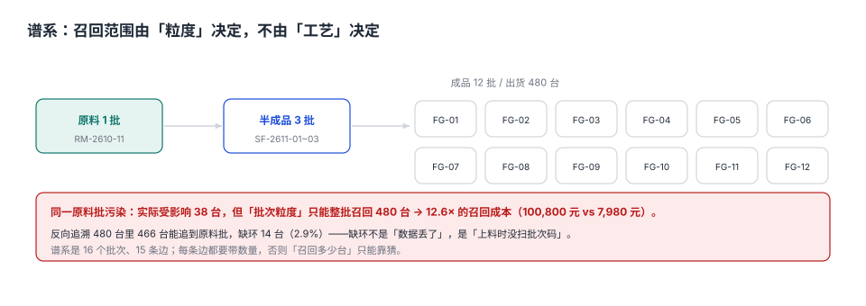

# 批次谱系与召回：粒度的钱

客户打电话来：「你们 10 月那批密封圈有问题，我们装了两百台设备，全都要拆。」

质量部第一件事不是道歉，是问：「哪一批？」

如果只能回答「10 月生产的都算」，召回范围就是 480 台；如果能回答「只有 38 台用了那批胶料」，召回范围就是 38 台。**差的不是响应速度，是记录粒度**——12.6 倍的成本差，在事发前就已经决定了。

::: tip 一句话理解
追溯能力不是「能查到批次号」，是**能沿着一张有向图，从任何一个点走到任何相关点**。图缺一条边，追溯就断在那里，剩下只能靠「整批召回」兜底。
:::

## 一、三种粒度，三种成本

| 粒度 | 记录到哪 | 召回范围 | 实施成本 | 适用 |
| --- | --- | --- | --- | --- |
| 工单级 | 生产工单 | 整个工单（常为整批） | 最低 | 低风险、低单价 |
| 批次级 | 原料批/生产批 | 整批 + 下游所有批 | 中 | 多数制造业 |
| 序列号级 | 单件 | 单件 | 高 | 安全件、高价值、法规要求 |



本机的例子：1 批原料（RM-2610-11）→ 3 批半成品 → 12 批成品 → 480 台出货。16 个批次、15 条边。

| 追溯方式 | 能定位到 | 实际受影响 | 召回量 | 成本（210 元/台） |
| --- | --- | --- | --- | --- |
| 工单级 | 12 批 | 38 台 | 480 台 | 100,800 元 |
| 批次级 | 12 批 | 38 台 | 480 台 | 100,800 元 |
| 序列号级 | 480 台中 38 台 | 38 台 | 38 台 | 7,980 元 |

**批次级与工单级在这里没有区别**，因为这一批原料恰好流向了全部 12 批成品。批次级真正的价值出现在「原料分批使用」的场景：一批原料只进了 3 批成品，召回就只需 3 批。

## 二、正向与反向：两个方向，两种用途

| 方向 | 从哪到哪 | 回答的问题 | 本机覆盖 |
| --- | --- | --- | --- |
| 正向（forward） | 原料批 → 成品批 → 客户 | 「这批料流到哪了」 | 12/12 批成品可追 |
| 反向（backward） | 成品/客诉件 → 原料批 | 「这台为什么坏」 | 466/480 台可追到原料（97.1%） |

**反向追溯的缺口是最致命的**：14 台（2.9%）追不到原料批，意味着这 14 台无法判断是否受影响——只能按「可能受影响」处理，等于把召回范围又放大一次。

缺口的成因几乎总是同一个：**上料时没扫批次码**。可能是补料、可能是换班、可能是扫码枪坏了用手输。系统层面的解法不是「加强管理」，而是**让不扫码就领不出料**（见第五节）。

## 三、谱系是一张图，不是一条链

现实中的批次关系不是树，是**有向无环图**：一批原料可能分给多个半成品批，一个成品批可能混用多批原料（合批）。

```text
RM-2610-11 ──┬──> SF-2611-01 ──┬──> FG-01 ──> 出货 40 台
             │                 ├──> FG-02 ──> 出货 40 台
             ├──> SF-2611-02 ──┼──> FG-03 ... FG-08
             └──> SF-2611-03 ──┴──> FG-09 ... FG-12
```

查询必须用**递归 CTE**，而不是「查一层再查一层」：

```sql
-- 反向：从成品批追到所有上游
WITH RECURSIVE up(batch, depth) AS (
  SELECT 'FG-2611-12', 0
  UNION ALL
  SELECT l.parent, up.depth + 1
  FROM up JOIN qm_batch_link l ON l.child = up.batch
  WHERE up.depth < 20
)
SELECT batch, MIN(depth) AS depth FROM up GROUP BY batch ORDER BY depth;

-- 正向：从原料批追到所有下游
WITH RECURSIVE down(batch, depth) AS (
  SELECT 'RM-2610-11', 0
  UNION ALL
  SELECT l.child, down.depth + 1
  FROM down JOIN qm_batch_link l ON l.parent = down.batch
  WHERE down.depth < 20
)
SELECT batch, MIN(depth) AS depth FROM down GROUP BY batch ORDER BY depth;
```

`depth < 20` 是必要的护栏：谱系一旦成环（数据错误），没有护栏的递归会一直跑下去。

## 四、边必须带数量，否则「召回多少」只能猜

```sql
CREATE TABLE qm_batch_link (
  parent TEXT NOT NULL,
  child  TEXT NOT NULL,
  qty    INTEGER NOT NULL CHECK (qty > 0),
  linked_at TEXT NOT NULL,
  PRIMARY KEY (parent, child),
  CHECK (parent <> child)
);
```

只有 `(parent, child)` 两张表能回答「有没有关系」，回答不了「多少」。而召回的赔偿、替换、物流全部按数量算：

| 问题 | 需要什么 | 只有边没有数量时 |
| --- | --- | --- |
| 这批料流到几个成品批 | 边 | 能答 |
| 每个成品批用了多少 | 边上的 `qty` | 答不了 |
| 召回多少台 | `qty` 汇总 + 出货记录 | 只能按整批估 |
| 是否合批 | 一个 child 有多条入边 | 能答 |

## 五、让「不扫码」变成不可能

| 环节 | 防错设计 | 效果 |
| --- | --- | --- |
| 领料 | 扫码枪读批次码才开库位 | 消除手工输入 |
| 上料 | 工位扫码与工单绑定，不匹配不启动 | 消除「扫了但扫错」 |
| 换料 | 换料必须扫新码，旧码自动解绑 | 消除「换了没记」 |
| 合批 | 合批单必须列出所有子批 | 消除「混了不知道」 |
| 返工 | 返工入线重扫，产生新的边 | 消除「返工后链路断」 |

本机 2.9% 的缺环，全部出自「补料时手工输入」与「换班交接未扫码」两个环节。这两个环节的共同点是：**系统允许不扫码也能继续**。

## 六、召回范围的计算

召回范围不是「所有相关批次」，是「所有**可能受影响且在客户手上**的批次」：

```text
候选批次 = 正向追溯（污染批 → 所有下游成品批）
在库数量 = 候选批次中仍在库/在制的数量
已出货   = 候选批次 − 在库数量
召回量   = 已出货中「无法证明未受影响」的部分
```

本机：候选 12 批 480 台，在库 0 台（全部出货），无法证明未受影响 480 台 → 召回 480 台。

**如果能证明「这 3 批用的是另一批原料」**，召回就降到 3 批 120 台。这就是为什么谱系要精确到每一批：**每多一条准确的分叉记录，召回范围就可能缩小一截**。

## 七、本页判据族

本页判据族 `QQT-A` ~ `QQT-H`，共 8 条。

| 判据 | 要求 | 验证方式 |
| --- | --- | --- |
| `QQT-A` | 批次关系落成有向图且带数量 | `qm_batch_link` 有 `qty` |
| `QQT-B` | 图必须无环 | 递归 CTE 查 `a = b` 结果为 0 |
| `QQT-C` | 正向与反向追溯都能在 20 跳内完成 | 递归带 `depth` 护栏 |
| `QQT-D` | 上料必须扫码，且与工单绑定 | 扫码记录表与工单关联 |
| `QQT-E` | 反向追溯缺口必须可统计 | 缺口率报表 |
| `QQT-F` | 合批必须记录所有子批 | 一个 child 多条入边 |
| `QQT-G` | 返工/返修产生新边而非改旧边 | 边只增不改 |
| `QQT-H` | 召回范围可按「排除证明」缩小 | 支持标记「未使用污染批」 |

## 八、验证方式

```shell
# 1. 谱系规模与无环（期望：5 4 0；本册完整数据为 16 批 15 边，此处用 4 条边的最小夹具）
python3 - <<'PY'
import sqlite3
db = sqlite3.connect(":memory:")
db.executescript("""
CREATE TABLE l(parent TEXT, child TEXT, qty INTEGER, PRIMARY KEY(parent,child));
INSERT INTO l VALUES ('RM-2610-11','SF-2611-01',480),('RM-2610-11','SF-2611-02',480),
                     ('RM-2610-11','SF-2611-03',480),('SF-2611-01','FG-2611-01',40);
""")
print(db.execute("SELECT COUNT(*) FROM (SELECT parent FROM l UNION SELECT child FROM l)").fetchone()[0],
      db.execute("SELECT COUNT(*) FROM l").fetchone()[0])
print(db.execute("""WITH RECURSIVE p(a,b) AS (
  SELECT parent, child FROM l UNION ALL SELECT p.a, l.child FROM p JOIN l ON p.b=l.parent)
  SELECT COUNT(*) FROM p WHERE a=b""").fetchone()[0])
PY

# 2. 召回倍率与成本（期望：12.6 100800 7980）
python3 -c "print(round(480/38,1), 480*210, 38*210)"

# 3. 反向追溯缺口（期望：2.9）
python3 -c "print(round(14/480*100,1))"
```

第 1 步的三个数说明图是连通的、无环的——它们是谱系健康度的最小指标；把夹具换成完整谱系，应得到「16 15 0」。

## 参考资料

- GB/T 19001—2016 第 8.5.2 条「标识和可追溯性」：必要时对输出进行唯一性标识。
- IATF 16949:2016 第 8.5.2.1 条：可追溯性（含批次与序列号要求）。
- ISO 22005:2007 *Traceability in the feed and food chain*：链式追溯的通用模型。
- GB/T 38155—2019《重要产品追溯 追溯体系通用要求》：追溯单元与链路完整性。
- 与本页相邻：[不合格品与 MRB](../Nonconformance/index.md)、[质量成本](../CostOfQuality/index.md)、[WarehouseOps/Overview](../../WarehouseOps/Overview/index.md)。
