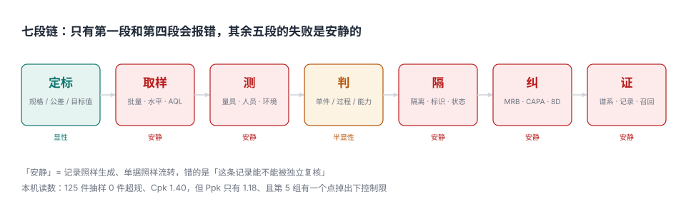
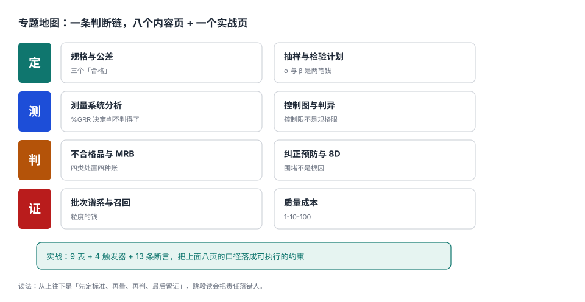

# 质量管理工程

<p style="text-align:center;"></p>

一台机床连着跑了三个月，外径一直很稳。某天客户投诉说「这批装不进去」，质量部把留样翻出来复测，件件都在图纸公差里。于是三方各说一句话：生产说「我按图纸做的」，质量说「我抽了 125 件全合格」，客户说「装不进去」。

**这三句话都没有说谎，也都不解决问题。** 因为「合格」这个词在三处指的不是同一件事：客户说的是**装配后的功能**，图纸说的是**单件的尺寸区间**，质量部报表上的那个 99.2% 说的是**抽样这一批的比例**。而机床真正发生的变化——中心慢慢偏了 0.06 mm——在这三句话里一个字都没出现。

::: tip 一句话理解
质量管理的产物不是「合格证」，是**一条能被别人独立复核的判断链**：凭什么标准、怎么取的样、谁量的、量的准不准、判的哪一条、判完东西去哪了、下次怎么证明改好了。
:::

## 一、这个专题讲什么

从「图纸发下来」到「客户手上出问题能追回」，一次判断要走七段：

| 段 | 这一段在做什么 | 产物 | 失败是否安静 |
| --- | --- | --- | --- |
| ① 定标 | 把客户要求翻译成规格、公差、目标值 | `spec` + 检验计划 | 显性（写错了评审能看出来） |
| ② 取样 | 定批量、检验水平、AQL、Ac/Re | `sampling_plan` | **安静**（抽多少没人复核） |
| ③ 测 | 量具、人员、环境、方法 | `msa_study` | **安静**（量错了照样出数） |
| ④ 判 | 单件判 / 过程判 / 能力判 | `subgroup` + 控制图 | 半显性（判据不写就没人知道判的是哪条） |
| ⑤ 隔 | 隔离、标识、状态、MRB | `ncr` + `disposition` | **安静**（红框里混进合格品不会报错） |
| ⑥ 纠 | 围堵、根因、对策、有效性 | `capa` | **安静**（关了单不代表不再发） |
| ⑦ 证 | 谱系、记录、追溯、召回 | `batch_link` | **安静**（缺一环，召回就只能整批） |



七段里**五段的失败是安静的**。它们的共同形态是：单据齐全、系统不报错、审核能过，错的是「这条判断能不能被别人独立复核」。

本机在一组 25 个子组 × 5 件的模拟数据上跑出来的读数，正好把这七段的裂缝摊开：

| 视角 | 读数 | 它回答的问题 |
| --- | --- | --- |
| 单件超规 | 0 / 125（0.0%） | 这一批有没有坏件 |
| 控制图越界 | 1 点（第 5 组 49.9497 < LCL 49.9622） | 过程有没有变 |
| 过程能力 Cpk | 1.401（Cp 1.555） | 过程能不能稳定产出合格品 |
| 实际能力 Ppk | 1.177 | 把组间漂移算进去还够不够 |

同一批数据，四个视角四个答案：**「一件没坏」「过程失控」「能力看着够」「实际不够」**。这一册的每一页，都是把其中一个视角拆到能复算。

## 二、三个「合格」

| 口径 | 定义 | 谁在关心 | 常见错法 |
| --- | --- | --- | --- |
| 单件合格 | 实测值落在 `[LSL, USL]` 内 | 检验员、客户 | 用抽样的合格率代表整批 |
| 过程受控 | 子组统计量落在控制限内且无判异模式 | 工艺、设备 | 把控制限画成规格限 |
| 过程能力 | `Cpk ≥ 1.33`（或客户指定） | 项目、客户审核 | 只报 Cp 不报 Cpk，或拿组内 σ 冒充整体 σ |

三者的关系是一条单向链：**受控 ≠ 有能力**（可以很稳地做在规格外），**有能力 ≠ 全合格**（1.33 对应约 63 ppm 双侧），**全合格 ≠ 有能力**（125 件里 0 件超规，只能说明缺陷率大概率低于 2.4%）。

::: danger 三件事必须写进数据模型，不能留给「报表时再算」
1. **规格限与控制限必须分表存**：`spec` 存客户给的 `usl/lsl/target`，`control_limit` 存过程算出来的 `ucl/lcl/cl`，且带生效日期。合成一张表后，改规格会顺手改掉控制限，图上一片绿而货一片红。
2. **子组的原始测量值必须留**：只存 `mean` 与 `range` 就永远算不出整体 σ，也就永远算不出 Ppk；本机 Cpk 1.401 与 Ppk 1.177 的 19.0% 差距，只能从原始值复算出来。
3. **不合格品单不能只用「状态字段」表达处置**：`qty` 必须被处置明细逐笔核销（返工 100 + 让步 20 = 120），否则「处置完了」永远是一句口头承诺。
:::

## 三、专题地图



按「一次判断的生命周期」读：

| 阶段 | 页面 | 一句话 |
| --- | --- | --- |
| 读 | [总览：七段链与三个「合格」](Overview/index.md) | 先看整条链在哪一段会「安静地失败」，再逐段拆 |
| 定 | [规格、公差与能力指数](Specs/index.md) | 三个「合格」各有各的算法，混用就吵架 |
| 定 | [抽样与检验计划](Sampling/index.md) | AQL 管的是「批」，α 与 β 是两笔不同的钱 |
| 测 | [测量系统分析](Measurement/index.md) | 先证明量得准，再谈合不合格 |
| 测 | [控制图与判异规则](ControlChart/index.md) | 控制限不是规格限，八条规则买的是「早发现」 |
| 判 | [不合格品与 MRB](Nonconformance/index.md) | 隔离不是放到红框里，是状态与数量的双重锁定 |
| 判 | [纠正预防与 8D](CAPA/index.md) | 围堵不是根因，关闭条件不是「做完了」 |
| 证 | [批次谱系与召回](Traceability/index.md) | 召回范围由粒度决定，不由工艺决定 |
| 证 | [质量成本](CostOfQuality/index.md) | 1-10-100：越晚发现越贵，且贵得不成比例 |
| 实战 | [实战：建库与断言](Practice/index.md) | 9 表 + 4 触发器 + 13 条断言，把口径落成约束 |

## 四、与相邻专题的分工

这一册刻意**不讲**下面这些内容，它们各有归属：

| 判什么 | 归属专题 | 本册只借什么 |
| --- | --- | --- |
| 这一批收不收（来料/过程检验的执行与判定） | [Manufacturing/Quality](../../Backend/Manufacturing/Quality/index.md) | AQL 抽样表的用法 |
| 来料批的抽样接收与供应商申诉 | [SupplierCollaboration/BatchReview](../../Backend/SupplierCollaboration/BatchReview/index.md) | 批与样本的关系 |
| 设备可靠性、MTBF、预防性维护 | [EquipmentMaintenance](../../Backend/EquipmentMaintenance/Overview/index.md) | 维修记录作为根因证据 |
| 数据质量维度（完整性/一致性/及时性） | [DB/DataGovernance/DataQuality](../../DB/DataGovernance/DataQuality/index.md) | 「同一口径」的思路 |
| 成本对象、制造费用分摊 | [CostAccounting](../../Backend/CostAccounting/Overview/index.md) | 失败成本的四分类 |
| 事故响应、值班与止损 | [Ops/IncidentResponse](../../Ops/IncidentResponse/Overview/index.md) | 时间线取证的方法 |
| 批次库存与出库追溯 | [WarehouseOps](../../Backend/WarehouseOps/Overview/index.md) | 批次号作为主键 |
| 培训、资质与上岗证 | [TrainingQualification](../../Backend/TrainingQualification/index.md) | 人员资质对测量再现性的影响 |

::: info 为什么不并入 Manufacturing/Quality
那一页回答的是「**这一批收不收**」——抽样方案、Ac/Re、让步接收一路带到客户；这一册回答的是「**这个判断本身可不可信**」——量具够不够、过程跑没跑偏、错了怎么改、改完怎么证明。前者的产物是判定单，后者的产物是判据。
:::

## 五、本专题的判据族

十个页面各有一族八条判据，共 **80 条**，全部可以单独判定：

| 页面 | 判据族 | 条数 |
| --- | --- | --- |
| 总览 | `QMO` | 8 |
| 规格、公差与能力指数 | `QMS` | 8 |
| 抽样与检验计划 | `QMP` | 8 |
| 测量系统分析 | `QMM` | 8 |
| 控制图与判异规则 | `QMC` | 8 |
| 不合格品与 MRB | `QMN` | 8 |
| 纠正预防与 8D | `QQA` | 8 |
| 批次谱系与召回 | `QQT` | 8 |
| 质量成本 | `QMY` | 8 |
| 实战 | `QMX` | 8 |

## 六、版本组织

本专题**不建版本目录**，三条理由：

1. 换代的是标准版本（GB/T 2828.1—2012 相对 2003 版的收放、ISO 2859-1:1999 的修订），**判据一字未变**：批量→样本量、AQL→Ac/Re 的映射可以换表，但「抽样方案的样本量由批量与检验水平决定」不变。
2. 并存差异是**行业与客户要求**，不是代际：汽车行业的 PPAP/CPK 要求、医疗器械的 ISO 13485:2016、航空的 AS9100，差异在条款与提交物，不在方法论。
3. 真正需要版本目录的是「**同一份代码两套写法**」（如 Java、Vue）。标准版本变化只需在页内用 `::: info` 标注适用版本，参见 [Java/Frame/Spring/Spring5](../Java/Frame/Spring/Spring5/index.md) 与 [Spring6](../Java/Frame/Spring/Spring6/index.md)、[Frontend/Frame/Vue/Vue2](../../Frontend/Frame/Vue/Vue2/index.md) 与 [Vue3](../../Frontend/Frame/Vue/Vue3/index.md) 的做法——旧版本保留并标注状态，不覆盖旧内容。

## 七、怎么读这一册

- **要交方案**：先读 [规格、公差与能力指数](Specs/index.md) 与 [抽样与检验计划](Sampling/index.md)，它们决定「判什么、抽多少」。
- **要上线 SPC**：先读 [测量系统分析](Measurement/index.md)，再做 [控制图](ControlChart/index.md)。顺序颠倒的后果是：图很漂亮，但它在画量具的噪声。
- **被客户投诉**：从 [批次谱系与召回](Traceability/index.md) 倒着读，先定范围，再定责任。
- **要说服老板投钱**：读 [质量成本](CostOfQuality/index.md)，那一页只有一句话是给财务听的。

## 八、验证方式

```shell
# 1. 目录与章节齐全（期望：11）
find docs/Backend/QualityManagement -name index.md | wc -l

# 2. 十族判据各 8 条，共 80 条（期望：QMO:8 QMS:8 ... QMX:8，合计 80）
grep -rho "Q[A-Z][A-Z]-[A-H]" docs/Backend/QualityManagement | sort | uniq -c | awk '{s+=$1} END {print s}'

# 3. 配图全部落地且是合法 XML（期望：12 个文件，0 个报错）
python3 - <<'PY'
import glob, xml.etree.ElementTree as ET
fs = sorted(glob.glob("docs/Backend/QualityManagement/assets/qm-*.svg"))
bad = [f for f in fs if not (lambda p: (ET.fromstring(open(p, encoding="utf-8").read()), True)[1])(f)]
print(len(fs), len(bad))
PY
```

第 2 步的期望是 **80**；如果得到 72 或 88，说明有一页多写或少写了一条判据。

## 参考资料

- GB/T 19000—2016《质量管理体系 基础和术语》：质量、要求、不合格、纠正措施的定义。
- GB/T 2828.1—2012《计数抽样检验程序 第 1 部分：按接收质量限（AQL）检索的逐批检验抽样计划》。
- GB/T 4091—2001《常规控制图》：控制图的统计基础与判异准则。
- ISO 22514-2:2017《统计方法在过程管理中的应用 第 2 部分：过程能力与性能》：Cp/Cpk 与 Pp/Ppk 的口径。
- AIAG《测量系统分析（MSA）》第四版：GR&R 的均值-极差法与判定带。
- 与本专题相邻：[Manufacturing/Quality](../../Backend/Manufacturing/Quality/index.md)、[SupplierCollaboration/BatchReview](../../Backend/SupplierCollaboration/BatchReview/index.md)、[EquipmentMaintenance](../../Backend/EquipmentMaintenance/Overview/index.md)。
