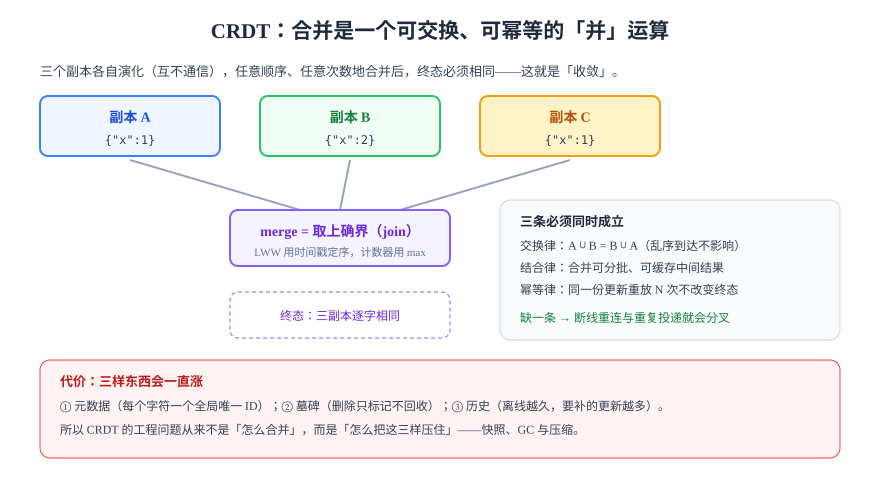

# CRDT：收敛的代价

CRDT（Conflict-free Replicated Data Type，无冲突复制数据类型）走的是另一条路：**不做变换，直接设计一种「合并顺序无关」的数据结构**。只要所有副本最终收到同样的更新集合，无论顺序、无论重复几次，终态一定相同。

代价是：为了「顺序无关」，每个值都要带足够的元数据。**CRDT 的工程难点从来不是合并，而是这些元数据怎么压住。**

## 1. 两种形态

| 形态 | 传递什么 | 合并方式 | 优点 | 缺点 |
| --- | --- | --- | --- | --- |
| **基于状态（CvRDT）** | 整个副本状态（或状态摘要） | 逐字段取上确界 `join` | 天然容忍丢包与乱序，实现最简单 | 状态可能很大，需要 delta 优化 |
| **基于操作（CmRDT）** | 每个操作 | 要求**因果有序**投递（通常靠版本向量） | 报文小 | 网络层必须保证因果序，否则会丢操作 |
| **delta-state** | 状态差量 | 与 CvRDT 相同 | 报文小 + 容错 | 实现复杂，是当前主流库的做法 |

::: tip 一句话区分
CvRDT 是「我把我的全部认知告诉你，你自己取并集」；CmRDT 是「我只告诉你我改了什么，但你必须按顺序听」。
:::

## 2. 半格与三条律



`merge` 必须是一个**半格上的上确界（least upper bound）**运算，也就是同时满足：

- **交换律**：`merge(a, b) = merge(b, a)` —— 乱序到达不影响结果
- **结合律**：`merge(merge(a, b), c) = merge(a, merge(b, c))` —— 可以分批合并、缓存中间结果
- **幂等律**：`merge(a, a) = a` —— 同一份更新重放 N 次不改变终态

这三条不是「最好满足」，而是**定义**。缺任何一条，断线重连与重复投递就会让副本分叉，而且分叉之后没有任何办法自动修复。

```typescript [counter.ts]
// G-Counter：每个副本只增自己的格子，合并取逐格最大值
type GCounter = Map<string, number>;

export function increment(c: GCounter, replica: string, by = 1): GCounter {
  const next = new Map(c);
  next.set(replica, (next.get(replica) ?? 0) + by);
  return next;
}

export function merge(a: GCounter, b: GCounter): GCounter {
  const out = new Map(a);
  for (const [k, v] of b) out.set(k, Math.max(out.get(k) ?? 0, v));
  return out; // 交换、结合、幂等三条同时成立
}

export function value(c: GCounter): number {
  let sum = 0;
  for (const v of c.values()) sum += v;
  return sum;
}
```

验证三条律的最小方式（三个副本，六种合并顺序，断言结果相同）：

```javascript [counter-check.mjs]
import { increment, merge, value } from "./counter.js";

const base = new Map();
const a = increment(base, "A", 3);
const b = increment(base, "B", 5);
const c = increment(base, "C", 2);

const orders = [
  merge(merge(a, b), c),
  merge(merge(a, c), b),
  merge(merge(b, c), a),
  merge(a, merge(b, c)),
  merge(b, merge(a, c)),
  merge(c, merge(a, b)),
];
const values = orders.map(value);
console.log(new Set(values)); // 预期输出：Set(1) { 10 }
```

**预期结果**：输出 `Set(1) { 10 }`——六种顺序得到同一个值，这就是「收敛」。把 `Math.max` 改成 `+`，这个脚本立刻会输出 6 个不同的数。

## 3. 常用类型速查

| 类型 | 解决什么 | 合并规则 | 已知代价 |
| --- | --- | --- | --- |
| **G-Counter** | 只增计数（浏览量、点赞数） | 逐副本取 max | 不能减 |
| **PN-Counter** | 可增可减计数 | 两个 G-Counter 相减 | 元数据翻倍；不能表达「减到负数」的约束 |
| **LWW-Register** | 单值字段（标题、状态） | 时间戳大者胜，平局比副本 ID | **静默丢写**；时钟偏移会导致「旧值赢」 |
| **MV-Register** | 需要保留并发值的字段 | 保留全部并发值，交给上层裁决 | 需要 UI 支持「冲突提示」 |
| **OR-Set** | 集合增删（标签、成员） | 每个元素带唯一 tag，删除移除 tag | 墓碑会累积，需要 GC |
| **RGA / YATA** | 有序序列（文本、列表） | 按「左邻 + 唯一 ID」插入定序 | 元数据与字符数同阶 |
| **Logoot / LSEQ** | 有序序列（稀疏位置） | 位置用可比较的分数串表示 | 频繁插入会让位置串变长 |
| **Fugue** | 有序序列（当前较优） | 区分「左插入 / 右插入」避免交织 | 实现较新，生态较少 |

### 序列 CRDT 的三条路线

文本协同是 CRDT 里最难的一块，历史上分三条路线：

1. **树形（RGA / YATA / Yjs）**：每个字符记住「我插在谁后面」，形成一棵插入树，遍历即得顺序。优点是插入快，缺点是要保存完整树结构。
2. **位置寻址（Logoot / LSEQ）**：给每个字符分配一个可比较的位置标识（如 `[0.5, 0.25]`），插入即取相邻两者的中点。优点是无树、易压缩，缺点是位置标识会越来越长。
3. **交织规避（Fugue / Peritext 研究）**：前两代在「两人同时在同一位置插入」时会产生**交织**（interleaving），即 `A1 B1 A2 B2` 这种人类读不懂的顺序。Fugue 通过区分「往后插」与「往前插」来避免。

::: warning 交织是可读性问题，不是正确性问题
交织的文档在所有副本上**完全一致**——算法没错。但用户看到「我打的字被别人的字插碎了」，体验上等同于 bug。评估文本 CRDT 时，除了收敛，**必须单独测交织**。
:::

## 4. 墓碑、GC 与体积

CRDT 的删除通常是「标记删除」（墓碑），因为要防止「删除」与「并发插入」撞车后元素复活。于是有了三样必然增长的东西：

| 增长项 | 来源 | 压缩手段 |
| --- | --- | --- |
| 元数据 | 每个字符 / 元素的唯一 ID 与左邻引用 | 二进制编码 + 游程压缩（同副本连续 ID 可压成区间） |
| 墓碑 | 删除只标记不抹除 | 墓碑 GC：当所有副本都已看到该删除时方可回收 |
| 历史更新 | 离线期间累积的 update | 快照 + 截断；快照本身也是一种「共识点」 |

```typescript [snapshot-policy.ts]
// 快照策略的三个参数：按更新条数、按字节数、按时间
export interface SnapshotPolicy {
  maxUpdates: number;   // 每 N 条更新打一次快照
  maxBytes: number;     // 文档超过 N 字节时打快照
  maxAgeMs: number;     // 最长 N 毫秒必须打一次
}

export const DEFAULT_POLICY: SnapshotPolicy = {
  maxUpdates: 500,
  maxBytes: 1024 * 1024,
  maxAgeMs: 10 * 60 * 1000,
};

export function shouldSnapshot(p: SnapshotPolicy, u: number, b: number, ageMs: number): boolean {
  return u >= p.maxUpdates || b >= p.maxBytes || ageMs >= p.maxAgeMs;
}
```

**为什么三条都要**：只按条数，长文本单条 update 就可能几 MB；只按字节，低频文档可能几天不打快照，重启时要重放几千条。

## 5. 主流库的取舍

| 维度 | Yjs | Automerge | Loro |
| --- | --- | --- | --- |
| 核心语言 | 纯 JS | Rust + WASM | Rust + WASM |
| 体积（gzip） | 约 23.7 kB | JS 约 15.3 kB + WASM 约 1.1 MB | JS 约 12.9 kB + WASM 约 1.1 MB |
| 类型覆盖 | Text / Array / Map / XmlFragment | Text / List / Map / Counter | Text / List / **MovableList** / **MovableTree** / Map / Counter |
| 历史与回溯 | UndoManager（不含任意版本 checkout） | 完整历史 | 任意版本 checkout（Eg-walker） |
| 编辑器生态 | 最广（ProseMirror / CodeMirror / Tiptap） | 一般 | 成长中 |
| 适用判断 | 要最快接进现有编辑器 | 要「文档数据库」式历史 | 要移动语义与版本浏览 |

::: info 选型的一句话结论
**生态优先选 Yjs，历史优先选 Automerge，移动与版本浏览优先选 Loro。** 三者在「合并是否正确」上没有差别——选型不该在这上面纠结，而该在体积、数据模型与生态上纠结。
:::

## 6. 判据

| 判据 | 约定 | 怎么验证 |
| --- | --- | --- |
| `RTR-A` | `merge` 必须满足交换、结合、幂等三条律 | 写六种合并顺序的断言，结果必须完全相同；再补一条「同一 update 应用两次」的断言 |
| `RTR-B` | 删除必须用墓碑或唯一 tag，不得物理删除 | 代码里删除路径不出现 `splice` 后直接丢弃元数据；并发「删除 + 插入同位置」后元素不复活 |
| `RTR-C` | 每个元素必须有全局唯一 ID（`clientId + seq`） | 两端各自生成 1000 个元素，ID 集合交集为空 |
| `RTR-D` | 必须测交织，不能只测收敛 | 两人在同一位置交替插入 `A1 A2` / `B1 B2`，断言结果不是 `A1 B1 A2 B2` |
| `RTR-E` | 快照策略必须三维（条数 / 字节 / 时间）齐全 | 配置文件里三个参数都存在且非 0；重启后重放条数小于上限 |
| `RTR-F` | 墓碑 GC 只能在「所有副本都已确认」后执行 | 存在 `minVersionVector` 计算；人为让一个副本离线后 GC 不发生 |
| `RTR-G` | 文档体积必须有监控与上限 | 有 `doc_bytes` 指标；超过阈值时告警而不是静默增长 |
| `RTR-H` | LWW 字段必须记录「被丢弃的值」，不能静默覆盖 | 数据库里存在 `conflict_log` 或审计表，抽查一条并发覆盖能找到落败值 |

## 7. 验证方式

```shell
pnpm add yjs
node --input-type=module -e "
import * as Y from 'yjs';
const a = new Y.Doc(), b = new Y.Doc();
a.getText('t').insert(0, 'Hello');
b.getText('t').insert(0, 'World');
Y.applyUpdate(b, Y.encodeStateAsUpdate(a));
Y.applyUpdate(a, Y.encodeStateAsUpdate(b));
console.log(a.getText('t').toString() === b.getText('t').toString(), a.getText('t').toString());
"
```

**预期结果**：输出 `true` 加一段合并后的文本，两端逐字相同。删掉其中一行 `applyUpdate` 再跑，会输出 `false`——这说明**收敛不是自动的，它依赖「双方都收到对方的更新」**。

## 8. 易错点

::: danger 六个高频错误
1. **以为 CRDT 不需要服务端**：CRDT 让你**可以**没有中心，但在 Web 场景里你仍然需要服务端做鉴权、持久化与广播。它省掉的是「合并」，不是「服务端」。
2. **用 `Date.now()` 做 LWW 时间戳**：客户端时钟不可信。要用 Lamport 时钟或服务端时间。
3. **在 CRDT 上直接做业务校验**：比如「卡片标题不超过 100 字」，合并后的中间态可能超限。校验要放在**提交时**，不能在合并时。
4. **把整个文档当一个 CRDT 对象**：粒度太粗，任何一个小改动都要同步全文档。要按「卡片 / 列表 / 段落」拆成独立子文档。
5. **忽略 WASM 的加载成本**：Automerge / Loro 的 WASM 约 1.1 MB，首屏要处理加载与初始化，别等到用户点开才加载。
6. **把墓碑 GC 当成日常清理**：GC 时机错了会让离线客户端复活已删内容。GC 必须以「全网最小版本向量」为界。
:::

## 参考资料

- Shapiro, M. et al. *Conflict-free Replicated Data Types*（SSS 2011）
- Kleppmann, M., Gomes, V. et al. *Local-first software*（Ink & Switch, 2019）
- Weidner, M., Kleppmann, M. *The Art of the Fugue: Minimizing Interleaving in Collaborative Text Editing*（2023）
- [Yjs 内部文档](https://github.com/yjs/yjs/blob/main/INTERNALS.md) · [Automerge 文档](https://automerge.org/docs/) · [Loro 文档](https://loro.dev/docs)
- 对比与选择：[同步协议与状态向量](../SyncProtocol/index.md)
