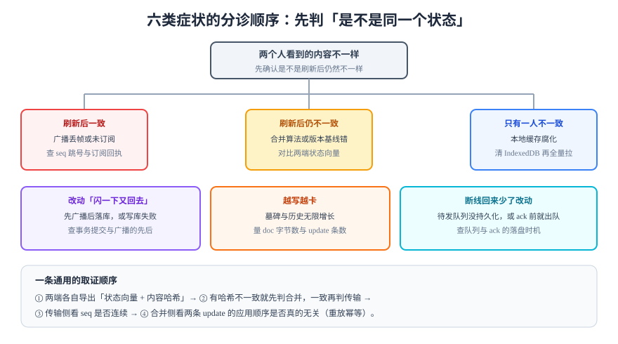

# 常见问题与最佳实践

协作系统的故障有一个共同特点：**它不会报错**。没有异常栈、没有 5xx、构建全绿，只是两个人看到的内容不一样。所以这一页按「症状」组织，而不是按「组件」组织。



## 1. 六类症状分诊表

| 症状 | 最可能的原因 | 第一个要看的数 | 处置 |
| --- | --- | --- | --- |
| 两人内容不同，**刷新后一致** | 广播丢帧 / 订阅建立晚于广播 | 客户端收到的 `seq` 是否连续 | 订阅回执里带上当前 `seq`，发现跳号主动拉缺口 |
| 两人内容不同，**刷新后仍不同** | 合并算法或版本基线错 | 两端的 `stateVector` 与内容哈希 | 先判合并（对比哈希），再判传输 |
| **只有一个人**内容不对 | 本地缓存腐化 | 清 IndexedDB 后是否恢复 | 加缓存版本号，版本不符时全量重拉 |
| 改动**闪一下又回去** | 先广播后落库 / 落库失败 | 事务提交时间 vs 广播时间 | 严格「落库成功再广播」 |
| 越写越卡 | 墓碑与历史无限增长 | `doc_bytes` 与 `update` 条数 | 快照 + 墓碑 GC + 增量截断 |
| 断线回来**少了改动** | 队列未持久化 / ack 前出队 | 本地 outbox 条数 | 落盘入队、ack 后出队 |

::: tip 一条通用的取证顺序
① 两端各导出「状态向量 + 内容哈希」→ ② 哈希一致说明数据没问题，查渲染；不一致先判合并，再判传输 → ③ 传输侧看 `seq` 连续性 → ④ 合并侧重放幂等测试。
:::

## 2. 十二个高频问题

**Q1：选了 CRDT 是不是就不需要服务端了？**
不是。CRDT 省掉的是「合并算法」，服务端仍然要负责鉴权、持久化、广播与审计。真正的 P2P 协作在浏览器里成本很高（NAT 穿透、离线发现、权限无中心）。

**Q2：OT 和 CRDT 到底怎么选？**
需要离线 / 无中心 → CRDT；有中心服务端、文本为主、希望服务端掌握全部权限与历史 → OT。**两者在「合并是否正确」上没有差别**，差别在工程形态。

**Q3：文本用字符级还是块级合并？**
字符级体验最好但元数据最重；块级（按段落）实现简单，但两人改同一段会互相覆盖。折中方案是「段落 CRDT + 段落内字符 CRDT」，Yjs 的 `Y.XmlFragment` 就是这种结构。

**Q4：为什么我们两人编辑没问题，三人就错乱？**
大概率是 `transform` 只满足了 TP1，没满足 TP2——三方并发时变换结果依赖了应用顺序。这类缺陷只在三人以上出现，测试必须覆盖三方。

**Q5：光标位置为什么总是错位？**
存了屏幕坐标而不是逻辑偏移；或者滚动/缩放后没有重新计算覆盖层位置。永远存逻辑偏移，渲染时再换算。

**Q6：`presence` 需要存数据库吗？**
不需要，而且不应该。它是秒级过期的临时态，写库会打满磁盘且永远没有清理时机。

**Q7：多人同时拖动同一张卡片，谁赢？**
这不是 CRDT 问题，是业务规则问题。常见做法是「乐观锁 + 版本号，后提交者收到 409 并看到对方的结果」，而不是「合并位置」。位置没有「合并」的语义。

**Q8：离线很久之后回来，会不会把别人的改动覆盖掉？**
如果用 CRDT 且合并正确，不会「覆盖」，但可能产生「你基于旧内容写的段落插在了新内容中间」。所以离线要有上限，并在重连时提示「已合并 N 处他人修改」。

**Q9：WebSocket 断了怎么知道是网络问题还是被踢？**
看关闭码。`1006` 是网络异常（应重连），`4403` 是自定义的「无权限」（不该重连）。标准区间 4000~4999 留给应用。

**Q10：文档越来越大怎么办？**
三件事：定期快照（把历史压成状态）、墓碑 GC（以全网最小版本向量为界）、按子文档拆分（一张卡片一个文档，而不是一个看板一个文档）。

**Q11：怎么测「乱序到达」？**
同机测不出来。用 `tc netem` 加延迟与抖动，或人为在服务端 `setTimeout` 打乱广播顺序；再用两个不同网络的设备实测一次。

**Q12：审计要记到多细？**
记到**字段级**，且拒绝也要记。只记「谁保存了文档」在追责时几乎无用——你需要的是「谁把 `assignee` 从张三改成了李四」。

## 3. 十二条最佳实践

1. **先定一致性承诺，再选技术**：写不出「允许短时不同到什么程度」，就不要开始选型。
2. **冲突策略写进数据字典**，每个可并发修改的字段都有一行。
3. **位置型数据必须有稳定 ID**，永不按下标寻址。
4. **落库成功再广播**，这条顺序不要为了「看起来更快」而调换。
5. **幂等键由客户端生成**，不要靠内容比较去重。
6. **ack 只回客户端序号**，服务端序号用于广播与追平，两套体系不要混。
7. **presence 只进内存**，靠 TTL 自然消失。
8. **快照策略三维齐全**：条数、字节、时间。
9. **权限变更必须踢连接**，且用自定义关闭码表达原因。
10. **富文本在服务端白名单清洗**，前端只负责渲染受控内容。
11. **验收脚本要能证伪**：先故意破坏一条，确认判据会红。
12. **至少做一次「真实网络」测试**：同机 localhost 的并发测试几乎没有价值。

## 4. 选型速查

| 你的情况 | 建议 |
| --- | --- |
| 已有 ProseMirror / Tiptap 编辑器，要最快接上 | Yjs |
| 需要「文档数据库」式完整历史与回放 | Automerge |
| 需要拖动排序、树形移动、按版本浏览 | Loro（MovableList / MovableTree） |
| 服务端已有一套 JSON 文档模型，要最小改动 | ShareDB（json0/json1） |
| 只是想让列表「别人改了我也能看到」 | 不要上 CRDT，用 SSE + 轮询即可 |

## 5. 术语表

| 术语 | 含义 |
| --- | --- |
| **OT** | Operational Transformation，操作变换；靠中心定序 + `transform` 收敛 |
| **CRDT** | Conflict-free Replicated Data Type，无冲突复制数据类型；靠交换/结合/幂等收敛 |
| **CvRDT / CmRDT** | 基于状态 / 基于操作的 CRDT |
| **状态向量（version vector）** | 每个副本一个计数器的映射，用于算增量 |
| **墓碑（tombstone）** | 删除时保留的标记，防止并发插入导致元素复活 |
| **交织（interleaving）** | 两人同位置插入产生 `A1 B1 A2 B2` 的可读性问题 |
| **presence** | 在线状态、光标、焦点等秒级临时态 |
| **outbox** | 待发队列；本地持久化的未确认操作 |
| **幂等键** | 客户端生成的唯一标识，用于服务端去重 |

## 6. 判据

| 判据 | 约定 | 怎么验证 |
| --- | --- | --- |
| `RTQ-A` | 每个线上问题都要能落到「合并 / 传输 / 渲染 / 存储」四类之一 | 故障单里有「归属类别」字段，抽查 5 单均非空且与处置一致 |
| `RTQ-B` | 排障第一步必须能导出两端的「向量 + 哈希」 | 存在调试接口或命令，能在 1 分钟内拿到两端读数 |
| `RTQ-C` | 至少有一条「三人并发」的自动化用例 | 测试文件里存在三方客户端用例，且断言终态哈希相同 |
| `RTQ-D` | 至少做一次真实网络（非 localhost）的并发验证 | 有测试记录，注明网络条件与延迟读数 |
| `RTQ-E` | 每个「⚠️ 有条件允许」的权限格都有正反两条用例 | 权限用例表覆盖正反两向，数量与矩阵中的 ⚠️ 格一致 |
| `RTQ-F` | 文档体积与更新条数必须可观测 | 监控面板有 `doc_bytes` 与 `updates_per_doc` 两个指标 |
| `RTQ-G` | 选定方案的「不适用场景」必须写进文档 | 选型文档里有「不适用」小节，且列出至少三条 |

## 7. 验证方式

把上面十二条逐条落成一次自查，能跑的部分用命令跑：

```shell
# 1) 三人并发的最小复现：起三个客户端，各插入一段，比对哈希
node acceptance.mjs        # 期望：三条哈希相同
# 2) 乱序：给广播加 0~300ms 随机延迟后再跑一次
node acceptance.mjs --jitter   # 期望：仍然三条哈希相同
# 3) 幂等：把同一条 update 连发三次
node acceptance.mjs --replay 3 # 期望：哈希不变
```

**预期结果**：三次运行都输出 `PASS`。**如果三次里有一次失败**，说明问题在协议层（乱序/幂等），不在合并算法——这正好是分诊表第一行与第六行覆盖的两类。

## 8. 易错点

::: danger 四条「看起来对但没用」的验证
1. **「我点了两下，看起来一样」**：肉眼比对不能替代哈希比对，尤其是长文本。
2. **「单机两个标签页通过」**：延迟接近 0，乱序与重连永远测不到。
3. **「构建通过就没事」**：协作缺陷几乎从不导致构建失败（本仓的 `ignoreDeadLinks` 同理——**构建绿不等于功能对**）。
4. **「日志里没报错」**：合并错误通常是「合法但不对」，全程无异常。
:::

## 参考资料

- Kleppmann, M. *Designing Data-Intensive Applications*（2017）
- [Yjs FAQ 与常见坑](https://docs.yjs.dev/)
- [Automerge 文档：Sync 与 Storage](https://automerge.org/docs/)
- 回顾：[概述：三类冲突与五种一致性](../Overview/index.md) · [实战：卡片描述的协作编辑](../Practice/index.md)
