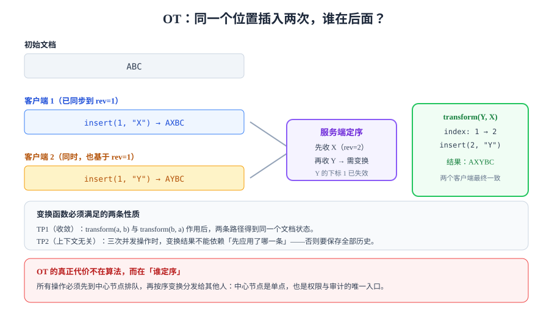

# OT：操作变换与定序

OT（Operational Transformation，操作变换）的思路是：**不阻止并发，而是在收到别人的操作时，把自己的操作改一改再应用**。它的正确性依赖一个中心节点来定序，也依赖一个叫 `transform` 的函数把「基于旧版本的操作」翻译成「基于新版本的操作」。

本页只讲清三件事：`transform` 到底要满足什么、服务端的状态机长什么样、这套东西的代价落在哪。

## 1. 操作是什么

OT 世界里的「一次编辑」不是最终状态，而是一个**函数**：`apply(state, op) -> state'`。常见操作只有三种：

| 操作 | 参数 | 语义 | 示例 |
| --- | --- | --- | --- |
| `insert` | `index`, `text` | 在 `index` 处插入字符串 | `insert(2, "X")` |
| `delete` | `index`, `length` | 从 `index` 起删除 `length` 个字符 | `delete(2, 3)` |
| `retain` | `length` | 跳过 `length` 个字符（用于组合多个操作） | `retain(5)` |

带 `retain` 的操作序列（如 `[retain(2), insert("X")]`）是 OT 的标准表示法，好处是**可以把「一次编辑」表示成对整篇文档的一次扫描**，也让 `transform` 有了统一的组合方式。

## 2. 为什么需要 transform



场景：文档是 `ABC`，客户端 1 发了 `insert(1, "X")`，客户端 2 同时发了 `insert(1, "Y")`。

服务端先收 X，文档变成 `AXBC`（rev=2）。此时收到 Y——但 Y 是基于 `ABC` 算的，`index=1` 在 `AXBC` 里已经不是原来那个位置了。**直接应用会插到 A 和 X 之间**，两个客户端的意图都被破坏。

正确做法是先变换：`transform(Y, X) = insert(2, "Y")`，应用后得到 `AXYBC`。

```typescript [transform.ts]
export type Op =
  | { type: "insert"; index: number; text: string }
  | { type: "delete"; index: number; length: number };

/** 把 opA 变换到「已经应用过 opB」的文档上 */
export function transform(a: Op, b: Op): Op {
  if (a.type === "insert" && b.type === "insert") {
    // 同一位置插入时用固定规则打平：后来者靠后（也可以靠前，但必须全局一致）
    return a.index <= b.index ? a : { ...a, index: a.index + b.text.length };
  }
  if (a.type === "insert" && b.type === "delete") {
    if (a.index <= b.index) return a;
    if (a.index >= b.index + b.length) return { ...a, index: a.index - b.length };
    return { ...a, index: b.index }; // 落在被删区间内部：贴到删除起点
  }
  if (a.type === "delete" && b.type === "insert") {
    return a.index < b.index ? a : { ...a, index: a.index + b.text.length };
  }
  // 两个 delete：区间求差
  const aEnd = a.index + a.length;
  const bEnd = b.index + b.length;
  const start = Math.max(a.index, b.index);
  const end = Math.min(aEnd, bEnd);
  if (start >= end) return a; // 不相交
  return { type: "delete", index: start, length: a.length - (end - start) };
}
```

这段代码是正确的**起点**，但它只处理了「两个操作」的情形——真正的 OT 要处理一串操作之间的相互变换，复杂度立刻上一个量级。

## 3. 两条必须成立的性质

| 性质 | 形式化表述 | 不成立会怎样 |
| --- | --- | --- |
| **TP1（收敛）** | 对任意并发 `a`、`b`：`apply(apply(S, a), transform(b, a)) === apply(apply(S, b), transform(a, b))` | 两个客户端最终内容不同，且刷新也修不好 |
| **TP2（上下文无关）** | 三方并发时，`transform` 的结果不能依赖「先应用了哪一条」 | 必须保存全部历史才能正确变换，内存随时间线性增长 |

TP1 是「必须」，TP2 是「想要」。**很多自研 OT 只做到了 TP1**，表现为：两人编辑没问题，三人同时编辑偶尔错乱——这是 OT 最典型的线上症状。

::: danger TP1 的测试不能靠「看起来对」
人工点两下发现内容一样，**不构成 TP1 成立**。必须写成属性测试：随机生成 1000 组操作对，对每组断言「两条路径的终态逐字相等」。这条断言一旦写出来，绝大多数自研 transform 会当场挂掉。
:::

## 4. 服务端状态机

OT 的服务端不是「转发器」，它要维护每个文档的操作历史与版本号：

```text
客户端                        服务端（单文档串行处理）
  |  rev=7, op=A  ----------->  | 校验 rev==7
  |                             | 历史[7] = A，rev -> 8
  |                             | 广播 A 给其他人
  |  <---- ack(rev=8) --------- |
  |                             |
  |  同时另一客户端发来 rev=7, op=B
  |                             | transform(B, A) => B'
  |                             | 历史[8] = B'，rev -> 9
```

关键点有四个：

1. **同一文档的操作必须串行处理**（按 `docId` 分片到单线程 / 单队列），否则定序本身就成了竞态。
2. **历史要保留**，因为要处理「客户端基于 rev=3 提交，服务端已经到 rev=9」的情况——需要把 op 依次对 3..9 的每一条做变换。
3. **版本号必须单调且连续**，客户端据此判断自己是否落后。
4. **中心节点是单点**，也是权限与审计的唯一入口——这是 OT 的缺点，也是它在企业场景里的优点。

## 5. 结构化数据的 OT：json0 与 json1

文本只是特例。ShareDB 用的是 JSON 层面的 OT：

| 类型 | 操作形态 | 特点 |
| --- | --- | --- |
| `json0` | `{ p: ["cards", 2, "title"], od: "旧", oi: "新" }` | 路径寻址，简单直观；**下标移动会误伤** |
| `json1` | 带 `es` / `ed` 的嵌入编辑与移动操作 | 支持真正的「移动」语义，实现复杂度高得多 |

`json0` 的坑很具体：路径里带数组下标时，A 删除 `cards[2]` 会让 B 对 `cards[3]` 的修改作用到错误的元素上。**解决方案不是修 json0，而是避免让关键数据按下标寻址**——这正好对应 [概述](../Overview/index.md) 里 `RTC-B` 那条判据。

```javascript [sharedb-server.mjs]
import ShareDB from "sharedb";
import { WebSocketServer } from "ws";
import { WebSocketJSONStream } from "@teamwork/websocket-json-stream";

const backend = new ShareDB();
const connection = backend.connect();
const doc = connection.get("boards", "board-42");

doc.subscribe((err) => {
  if (err) throw err;
  // 首次打开：创建或读取
  if (!doc.type) {
    doc.create({ title: "未命名看板", lists: [] }, (e) => {
      if (e) throw e;
    });
  }
});

const wss = new WebSocketServer({ port: 8080 });
wss.on("connection", (ws) => {
  backend.listen(new WebSocketJSONStream(ws));
});
console.log("ShareDB 已启动：ws://localhost:8080");
```

验证：两个浏览器标签页同时连 `ws://localhost:8080` 并改标题，**两端应逐字一致**，且 `doc.version` 单调递增。

## 6. 代价清单

| 代价 | 具体表现 | 缓解方式 |
| --- | --- | --- |
| 中心节点 | 所有操作必须到一个地方排队 | 按 `docId` 分片；单文档串行是特性不是缺陷 |
| 历史膨胀 | 每个文档的历史要保留以支持变换 | 定期快照 + 截断到「最落后客户端」之后的版本 |
| 离线困难 | 离线越久，回来要变换的历史越长，且无法保证意图 | 离线场景改用 CRDT，或限制离线时长 |
| transform 难写 | 每一种操作组合都要写对 | 用成熟库（ShareDB / ot.js），不要自研文本 OT |
| 调试困难 | 出问题时是「某一步变换错了」 | 每个 op 落日志，附带变换前后的下标 |

## 7. 判据

| 判据 | 约定 | 怎么验证 |
| --- | --- | --- |
| `RTO-A` | `transform` 必须有属性测试，覆盖 insert/insert、insert/delete、delete/delete 三类组合 | 测试文件里存在随机生成 1000 组操作对的用例，且断言终态字符串相等 |
| `RTO-B` | 同一文档的操作必须串行处理 | 代码中存在按 `docId` 分片的队列/锁；并发压测时版本号无跳号、无重复 |
| `RTO-C` | 版本号必须单调连续，客户端可据此判断落后 | 抓包检查 `ack` 里的 `rev` 严格 +1；人为丢一帧后客户端能触发全量同步 |
| `RTO-D` | 历史必须能支撑「落后 N 个版本」的变换 | 用一个落后 10 个版本的客户端提交，断言服务端能正确变换而不是报错 |
| `RTO-E` | 同一位置插入的定序规则必须全局唯一 | 搜索代码，确认只有一处比较逻辑；两端并发插入后结果在所有客户端一致 |
| `RTO-F` | 不得让关键数据按下标寻址 | 检查操作路径，数组元素必须带稳定 ID（如 `cards[id=..]`） |
| `RTO-G` | 历史必须可截断，且截断不得破坏在线客户端 | 快照后重启服务，在线客户端仍能提交（走全量重拉路径） |
| `RTO-H` | 离线时长必须有限制或明确降级 | 产品文档写明「超过 N 分钟离线将放弃本地未提交修改」，代码中有对应分支 |

## 8. 验证方式

```shell
node --experimental-strip-types transform-test.ts
```

**预期结果**：输出 `TP1 ok: 1000/1000`。如果出现任何一条不一致，打印出该组的两个操作与两条路径的终态——**先修 transform，不要先改测试**。

## 9. 易错点

::: danger 五个高频错误
1. **只在同一台机器上测两个客户端**：延迟接近 0 时，操作几乎不会乱序到达，TP1 的缺陷被完全掩盖。
2. **把 `transform` 写成「谁后到谁赢」**：那不是 OT，那是 LWW，会静默丢修改。
3. **用客户端时间戳裁决**：客户端时钟可被篡改，且时区/夏令时会带来额外问题。要服务端逻辑时钟。
4. **忘记 ack 之前不要清空待确认队列**：ack 丢包时客户端会认为已提交，实际服务端没收到。
5. **把历史截断到「当前版本」**：还在线的落后客户端会直接卡死。截断点必须取所有在线客户端版本的最小值。
:::

::: tip 什么时候别用 OT
需要离线编辑、需要 P2P、需要「无中心也能合并」时，OT 的成本会陡增。这三类需求基本只有一个答案：CRDT。见 [CRDT：收敛的代价](../CRDT/index.md)。
:::

## 参考资料

- Ellis, C. A., Gibbs, S. J. *Concurrency Control in Groupware Systems*（SIGMOD 1989）
- Sun, C. et al. *Achieving Convergence, Causality Preservation, and Intention Preservation in Real-Time Cooperative Editing Systems*（1998）—— TP1/TP2 的经典表述
- [ShareDB 文档](https://share.github.io/sharedb/) · [ot.js 源码](https://github.com/Operational-Transformation/ot.js)
- [OT 与 CRDT 的对比（Ink & Switch）](https://www.inkandswitch.com/peritext/)
