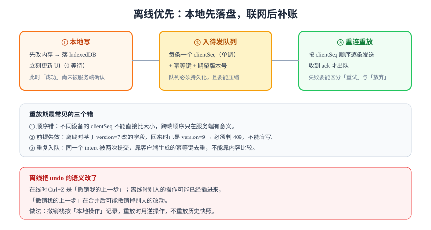

# 离线优先与重放

「离线也能改」听起来是个加分项，实际是一个**架构选择**：一旦承诺离线可用，你的客户端就从「视图」变成了「副本」——它必须自己保存状态、自己排队、自己判断哪些改动还能提交。这会把服务的复杂度搬到前端，而且搬过去之后就搬不回来了。

本页讲清三件事：本地写怎么落盘、重连怎么重放、离线把哪些语义改了。

## 1. 离线优先的三条原则

1. **本地先行**：用户操作先改本地状态并立即渲染，网络是后台动作。这和「提交后等响应再渲染」是两种完全不同的交互模型。
2. **本地即真相（暂时的）**：离线期间本地状态就是该用户的真相，服务端不知道。所以必须能回答「这条改动还没被确认」。
3. **重放必须能分辨三种结局**：成功、可重试失败、永久失败。分不清就会出现「一直转圈」或「悄悄丢掉」。

::: tip 一句话判据
把网线拔掉，用户能不能继续工作 10 分钟？能，且恢复后**改动一条不少**——这才叫离线优先。只做到「离线时提示网络异常」，那是「离线可用」的降级提示，不是离线优先。
:::

## 2. 本地存什么

| 存储 | 适合 | 不适合 | 注意 |
| --- | --- | --- | --- |
| `localStorage` | 小型配置、用户偏好 | 结构化数据、大文本 | 同步 API，会阻塞主线程；约 5 MB 上限 |
| `IndexedDB` | 文档快照、待发队列、附件元数据 | 需要复杂查询的场景 | 异步 API，需要处理版本升级 |
| Cache Storage | 静态资源、附件预签名 URL 缓存 | 频繁变更的业务数据 | 与 Service Worker 配合 |
| SQLite（WASM） | 需要在本地做查询 | 首屏预算紧的场景 | 初始化成本高（WASM 体积） |

绝大多数协作产品的组合是：**IndexedDB 存「文档快照 + 未确认队列」**，Cache Storage 存资源。

```typescript [store.ts]
const DB_NAME = "collab";
const DB_VERSION = 1;

export function openDb(): Promise<IDBDatabase> {
  return new Promise((resolve, reject) => {
    const req = indexedDB.open(DB_NAME, DB_VERSION);
    req.onupgradeneeded = () => {
      const db = req.result;
      if (!db.objectStoreNames.contains("docs")) db.createObjectStore("docs");
      if (!db.objectStoreNames.contains("outbox")) {
        // keyPath 用复合键：客户端内自增序号，保证顺序
        db.createObjectStore("outbox", { keyPath: "clientSeq", autoIncrement: true });
      }
    };
    req.onsuccess = () => resolve(req.result);
    req.onerror = () => reject(req.error);
  });
}
```

## 3. 待发队列：四个字段缺一不可



```typescript [outbox.ts]
export interface OutboxItem {
  /** 客户端内单调递增，用于本地排序与 ack 匹配 */
  clientSeq: number;
  /** 幂等键：由客户端生成，服务端据此去重 */
  idempotencyKey: string;
  /** 提交时的前提版本：服务端据此判断「是否已经被别人改过」 */
  baseVersion: number;
  /** 操作本身（可压缩：同一字段的连续修改可合并为最后一条） */
  op: { path: string[]; value: unknown };
}
```

四个字段各自解决一个问题：

| 字段 | 解决什么 | 缺了会怎样 |
| --- | --- | --- |
| `clientSeq` | 本地顺序与 ack 匹配 | 无法判断哪条已被确认，只能全量重发 |
| `idempotencyKey` | 服务端去重 | 网络重试导致重复提交（如重复评论） |
| `baseVersion` | 检测「前提已失效」 | 盲目覆盖别人的修改，即「丢更新」 |
| `op` | 操作内容 | ——（但要注意压缩策略，见下） |

::: danger 队列必须持久化，且要在 ack 之前不出队
把队列放在内存里，刷新页面就全丢；收到响应就出队、但 ack 在网络上丢了，会导致「服务端没收到但本地以为成功」。**正确顺序是：落盘入队 → 发送 → 收到 ack → 落盘出队。**
:::

## 4. 重放的三种结局

| 结局 | 判定依据 | 客户端动作 | 用户可见 |
| --- | --- | --- | --- |
| 成功 | 收到 `ack` | 出队、更新本地版本 | 状态从「同步中」变「已同步」 |
| 可重试失败 | 网络错误 / 5xx / 429 | 保留队列，指数退避重试 | 保持「同步中」，可手动重试 |
| 永久失败 | 4xx（409 冲突 / 403 无权限 / 422 校验失败） | 出队并记录冲突 | 明确提示「这条修改未能保存」并给出处理入口 |

409 是最需要设计的一类：它意味着「你离线时，别人改过这个字段」。

```typescript [replay.ts]
export type ReplayResult =
  | { kind: "ok"; version: number }
  | { kind: "retry"; reason: string }
  | { kind: "conflict"; serverValue: unknown; serverVersion: number };

export async function replayOne(item: OutboxItem, post: (i: OutboxItem) => Promise<Response>): Promise<ReplayResult> {
  let res: Response;
  try {
    res = await post(item);
  } catch (e) {
    return { kind: "retry", reason: (e as Error).message };
  }

  if (res.ok) return { kind: "ok", version: (await res.json()).version };
  if (res.status === 409) {
    const body = await res.json();
    return { kind: "conflict", serverValue: body.current, serverVersion: body.version };
  }
  if (res.status >= 500 || res.status === 429) return { kind: "retry", reason: `http ${res.status}` };
  return { kind: "retry", reason: `unhandled ${res.status}` }; // 别默默吞掉
}
```

**注意最后一行**：所有未识别的状态码都归到 `retry`，而不是「悄悄出队」。宁可让用户看到「同步中」，也不要让改动无声消失。

## 5. 离线把 undo 的语义改了

在线时，`Ctrl+Z` 的直觉是「撤销我刚才那一步」。离线并合并之后，这个直觉不再成立：

| 场景 | 在线 | 离线 + 合并 |
| --- | --- | --- |
| 撤销自己的插入 | 删除那段文字 | 只能删自己插入的字符，不能删别人插在中间的 |
| 撤销自己的删除 | 把文字插回原位 | 位置可能已经被别人改动，插回会出现在意外位置 |
| 撤销别人的操作 | 不适用 | **禁止**：撤销栈只记录本地操作 |

做法是：**撤销栈按「本地操作」记录逆操作，重放时应用逆操作，而不是回滚到某个快照**。这也是为什么 Yjs 的 `UndoManager` 需要 `trackedOrigins` 参数——它必须能分辨「哪些更新是我产生的」。

```javascript [undo-scope.mjs]
import * as Y from "yjs";

const doc = new Y.Doc();
const text = doc.getText("body");
const undo = new Y.UndoManager(text, { trackedOrigins: new Set(["local"]) });

doc.transact(() => text.insert(0, "本地写的"), "local");     // 会被记录
doc.transact(() => text.insert(3, "（别人的）"), "remote-1"); // 不会被撤销
undo.undo();
console.log(text.toString()); // 预期输出：（别人的）
```

## 6. 多标签页与容量

| 问题 | 现象 | 做法 |
| --- | --- | --- |
| 多标签页同时重放 | 同一改动被提交两次 | 用 `BroadcastChannel` 选主，只有主标签页发送 |
| IndexedDB 被清 | 用户清理浏览器数据后离线队列丢失 | 队列里只放「未确认」的短窗口数据，长历史交给服务端 |
| 队列无限增长 | 长时间离线后几万条待发 | 同字段连续修改合并为最后一条；超过上限时提示用户「有 N 条未同步」 |
| 存储配额超限 | 写入抛 `QuotaExceededError` | 监听该错误并降级为「内存队列 + 明确提示」 |

## 7. 判据

| 判据 | 约定 | 怎么验证 |
| --- | --- | --- |
| `RTF-A` | 断网后所有编辑必须能落盘并在刷新后仍在 | 断网 → 编辑 3 处 → 刷新页面 → 内容与队列都还在 |
| `RTF-B` | 队列项必须同时有 `clientSeq`、幂等键、`baseVersion` | 检查 IndexedDB 记录，四个字段齐全；缺任一字段判不合格 |
| `RTF-C` | 重放必须区分成功、可重试、永久失败 | 构造 500、409、403 三种响应，三种分支都被走到（有日志或断言） |
| `RTF-D` | 未识别状态码不得静默出队 | 构造 418 响应，队列项仍在且状态为待重试 |
| `RTF-E` | 重连后必须按 `clientSeq` 升序重放 | 队列 1..10 依次发送，抓包顺序严格递增 |
| `RTF-F` | 离线撤销只能撤销本地操作 | 远端更新插入后按 `Ctrl+Z`，远端内容不被删除 |
| `RTF-G` | 多标签页不得重复提交 | 两个标签页同时在线，编辑一次，服务端只收到一条（比对 `idempotencyKey`） |
| `RTF-H` | 队列必须有上限与压缩策略 | 连续修改同一字段 100 次，队列长度为 1（压缩生效） |

## 8. 验证方式

```shell
# 1) 断网：打开 DevTools → Network → Offline，编辑三处
# 2) 刷新页面，确认内容与「未同步 N 条」提示都还在
# 3) 恢复网络，观察 Network 面板
```

**预期结果**：恢复网络后能看到 `POST /api/cards/{id}` 依次发出，`200`/`204` 之后「未同步」计数归零；如果出现 `409`，界面必须弹出「该卡片已被他人修改」并展示两版内容，而不是静默丢弃。

也可以用一条命令确认「队列真的持久化了」：

```javascript
// 在 DevTools Console 中执行
const db = await new Promise((r) => { const q = indexedDB.open("collab"); q.onsuccess = () => r(q.result); });
const tx = db.transaction("outbox").objectStore("outbox").getAll();
tx.onsuccess = () => console.table(tx.result);
```

**预期结果**：离线编辑过的条目逐条列出，且 `clientSeq` 连续。

## 9. 易错点

::: danger 五个高频错误
1. **只在内存里排队**：刷新即丢，用户会认为「系统吃掉了我的修改」。
2. **靠内容比较做去重**：两次真的想写一样的内容（如「收到」）会被误判为重复。要用客户端生成的幂等键。
3. **重放时不带 `baseVersion`**：直接覆盖，别人的修改被静默冲掉。
4. **离线期间允许「删除 + 新建同 ID」**：重放顺序错了会变成「删了新的」。要保证同一实体的操作可排序。
5. **把 Service Worker 当成离线方案的全部**：它只缓存**资源**，不解决**数据**排队。两者是两件事。
:::

## 参考资料

- Kleppmann, M. et al. *Local-first software: You own your data, in spite of the cloud*（2019）
- [MDN: IndexedDB API](https://developer.mozilla.org/docs/Web/API/IndexedDB_API)
- [Yjs UndoManager](https://docs.yjs.dev/api/undo-manager)
- 相关页面：[同步协议与状态向量](../SyncProtocol/index.md) · [CRDT：收敛的代价](../CRDT/index.md)
