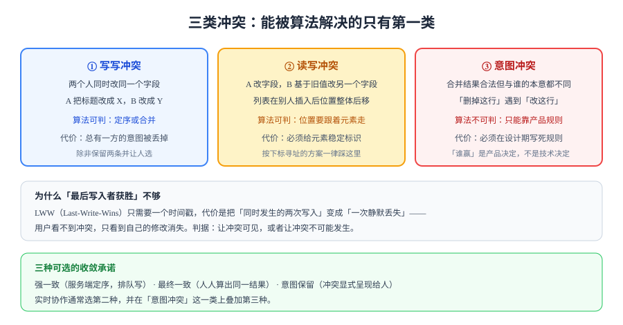

# 概述：三类冲突与五种一致性

「实时协作」四个字经常被当成一个功能，其实它是一组**承诺**。搞清楚自己到底承诺了哪一档，比选 Yjs 还是 ShareDB 重要得多——因为绝大多数「协作出 bug」的工单，最后都不是算法错了，而是**承诺给多了**。

本页先把冲突分类、把一致性分档，后面每一页都在这张地图上落一个点。

## 1. 冲突从哪来：三个前提同时成立

只要同时满足下面三条，冲突就一定存在，跟用什么库无关：

1. **无锁**：A 改的时候，B 不等 A 改完（否则就退化成「排队写」，也就没有实时协作这回事了）。
2. **多副本**：内容在每个客户端都有一份，而不是只有一个服务端状态（否则每次编辑都要等一个往返）。
3. **乱序**：两个客户端的操作到达服务端的顺序，与它们产生的顺序不一定相同。

这三个前提换来的是「0 延迟的手感」，代价就是**必须有一套机制来决定「两个人都动了同一处，听谁的」**。

::: tip 一条判据
如果你能接受「编辑时加锁、别人等着」，那么恭喜——你不需要 OT 也不需要 CRDT，一个 `SELECT ... FOR UPDATE` 就够了。**先确认自己真的需要无锁**，再谈算法。
:::

## 2. 三类冲突

这是本专题的第一张地图，后面所有算法只覆盖前两类：



| 类别 | 典型场景 | 算法能不能解 | 正确做法 |
| --- | --- | --- | --- |
| **① 写写冲突** | 两人同时改同一个标题 | 能（定序或合并） | 明确「谁赢」的规则：时间戳 / 客户端 ID / 角色优先级，并写进文档 |
| **② 读写冲突** | A 在列表里插入，B 同时移动另一项 | 能（但要稳定标识） | 位置跟着元素走，不按下标寻址 |
| **③ 意图冲突** | A 删掉一段，B 正在改这段里的错别字 | **不能** | 把冲突显式呈现给人：保留两人的版本，或按产品规则丢弃并告知 |

第 ③ 类是最容易被工程师忽略的一类：合并后的文档在语法上完全合法，但读起来莫名其妙。**它不是技术缺陷，是设计缺陷**——必须在需求阶段就写死规则，例如「删除优先，但删除时若目标正在被编辑，则留下一条系统提示」。

## 3. 五种一致性承诺

「最终一致」是一个太粗的说法。工程上至少要区分下面五档，每一档的代价差一个数量级：

| 承诺 | 含义 | 用户感受 | 典型实现 |
| --- | --- | --- | --- |
| **强一致** | 写入完成即可见，所有人立刻看到同一状态 | 有等待 | 服务端定序 + 同步 RPC |
| **顺序一致** | 所有人看到的操作顺序相同，但不保证立刻可见 | 轻微延迟 | 单一序列器（中心节点） |
| **因果一致** | 有因果关系的操作不乱序，无因果的可以 | 基本无感 | 版本向量 / 因果广播 |
| **最终一致** | 不再有新操作后，最终人人相同 | 短时可能不同 | CRDT、定期对账 |
| **意图保留** | 合并结果符合双方本意 | 需要 UI 配合 | 冲突显式化 + 人工裁决 |

实时协作产品通常的组合是：**因果一致（保证「回复不会跑到提问前面」）+ 最终一致（保证收敛）+ 意图保留（只用在少数高风险操作上）**。

::: warning 为什么不能全都要
强一致 + 无锁 + 低延迟，这三者在分布式系统里最多同时满足两个（CAP 的具体表现）。协作编辑选择了「无锁 + 低延迟」，所以只能在一致性上让步——让步的方式就是上面那张表。
:::

## 4. 什么时候不该做实时协作

这一节比后面九页都省钱。以下四种场景，**加实时同步是负收益**：

1. **写的人少、读的人多**（如公告、文档发布）：一个「保存」按钮 + 乐观锁版本号，比任何 CRDT 都可靠。
2. **内容有强校验**（如金额、状态机）：合并出一个「语法合法但业务非法」的中间态，比冲突更难处理。
3. **团队没有运维长连接的能力**：WebSocket 的连接数、心跳、粘性路由、灰度发布，每一样都是长期成本。
4. **数据本身不允许丢任意一方**（如审批意见）：这种情况要的是**追加式日志**，不是就地合并。

反过来，真正适合实时协作的特征是：**同一小块内容被 2~8 人反复修改、修改本身很轻（打字、拖动、勾选）、丢一次修改用户能立刻发现**。

## 5. 决策路径

从需求出发，五步就能定位到自己该落在哪一页：

| 步骤 | 问题 | 如果答案是「是」 | 如果答案是「否」 |
| --- | --- | --- | --- |
| 1 | 需要「别人改了我立刻看到」吗 | 继续 | 用乐观锁 + 轮询，结束 |
| 2 | 会同时改**同一个字段**吗 | 继续 | 字段级锁即可，不需要合并算法 |
| 3 | 内容是**连续文本**吗 | 读 [OT](../OT/index.md) 与 [CRDT](../CRDT/index.md) 的对比 | 读 [CRDT](../CRDT/index.md) 的结构化类型 |
| 4 | 必须支持**离线编辑**吗 | 一定要用 CRDT 系（OT 的离线代价极高） | OT 可接受 |
| 5 | 有**中心服务端**且能承担定序吗 | OT / 服务端 CRDT 均可 | 只能选 CRDT（无中心） |

## 6. 判据

| 判据 | 约定 | 怎么验证 |
| --- | --- | --- |
| `RTC-A` | 每个可被并发修改的字段，都要写明「冲突时谁赢」 | 打开数据字典，逐字段检查是否有「冲突策略」一列，缺一列即不合格 |
| `RTC-B` | 位置型数据必须有稳定标识，不得按下标寻址 | 并发测试：A 在首位插入、B 删除末位，检查 B 的操作是否误伤 A 插入的元素 |
| `RTC-C` | 「意图冲突」必须有产品规则，且规则要能被测试 | 用例表里存在「同时删除与编辑」的场景，并断言最终提示文案 |
| `RTC-D` | 一致性承诺要写进接口文档，不靠口头约定 | 接口文档中能找到「一致性」小节，且与实现一致（抽查一条） |
| `RTC-E` | 不得对「金额 / 状态机 / 审批意见」类字段启用自动合并 | 搜索合并策略配置，确认这些字段为「拒绝并提示」 |
| `RTC-F` | 客户端必须能区分「本地已应用」与「服务端已确认」 | UI 上可观察到「同步中 / 已同步」两态，断网时停在「同步中」 |
| `RTC-G` | 任何「实时」功能都要有降级路径 | 关掉 WebSocket 后，页面仍可通过刷新看到最新内容 |
| `RTC-H` | 并发上限要显式声明（同文档同时编辑人数） | 压测报告中有「N 人同文档」的读数，且与产品文档一致 |

## 7. 验证方式

用一个最小脚本确认「并发真的会分叉」，这是后面所有方案的对照基线：

```javascript [baseline.mjs]
// 两个副本各自基于同一初始值修改，最后直接覆盖 —— 看谁丢
let server = { title: "旧标题", updatedAt: 0 };

function write(value, ts) {
  // 典型的「谁后到谁赢」，没有任何合并
  if (ts >= server.updatedAt) server = { title: value, updatedAt: ts };
}

write("A 的标题", 100);
write("B 的标题", 100); // 同一毫秒，顺序决定结果
console.log(server.title); // 预期输出：B 的标题（A 被静默丢弃）
```

运行：

```shell
node baseline.mjs
```

**预期结果**：输出 `B 的标题`，且过程中没有任何报错、没有冲突提示。这就是「最后写入者获胜」的真实代价——**丢失是静默的**。

## 8. 易错点

::: danger 四个高频误判
1. **「我们用了 CRDT，所以不会冲突」**：CRDT 消除的是「合并失败」，不是「合并不合意」。删除与编辑撞车时，CRDT 会给你一个合法的结果，而不是一个合理的结果。
2. **把「最终一致」当成「马上一致」**：最终一致允许窗口期内两人看到不同内容。如果产品要求「保存后另一边必须立刻看到」，那是强一致需求，要换方案。
3. **用时间戳做冲突裁决却不校时**：客户端时间可以被改，也可能差几分钟。要用**服务端时间**或**逻辑时钟**。
4. **只测单机两个标签页**：同机延迟接近 0，乱序永远不出现。至少用 `tc netem` 或两个不同网络实测一次。
:::

## 参考资料

- Shapiro, M. et al. *Conflict-free Replicated Data Types*（SSS 2011）
- Kleppmann, M. *Designing Data-Intensive Applications* 第 5 章「复制」
- [MDN: WebSocket API](https://developer.mozilla.org/docs/Web/API/WebSockets_API)
- 本专题实战落地：[卡片描述的协作编辑](../Practice/index.md)
