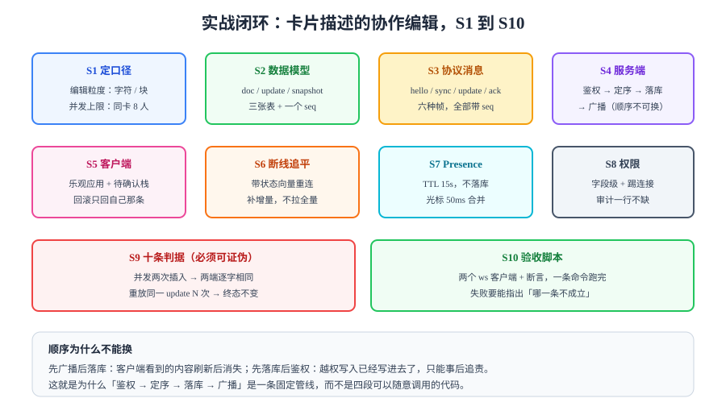

# 实战：卡片描述的协作编辑

前面八页讲原理，这一页把它拼成一条能跑的链路：**看板里每张卡片的「描述」支持多人同时编辑**，两个人同时打字不会互相覆盖，断线回来能补齐，退出重进能看到别人改的最新版本。

选这个场景是因为它足够小（一个字段、一种内容类型），又足够完整（并发、实时、离线、权限、审计全都要用到）。



## 1. 先把口径定死（S1）

| 口径 | 取值 | 为什么这么定 |
| --- | --- | --- |
| 编辑粒度 | **字符级** | 块级在「同一段两人同时改」时仍会互相覆盖 |
| 并发上限 | 同卡片 **8 人** | 超过 8 人时降级为「只读 + 提示稍后再改」 |
| 合并算法 | CRDT（Yjs `Y.Text`） | 需要离线，OT 的离线代价太高 |
| 一致性承诺 | 最终一致 + 因果一致 | 允许短时不同，不允许「回复早于提问」 |
| 冲突提示 | 只在「同时删除同一段」时提示 | 字符级合并本身无冲突，不需要频繁打扰 |
| 保存形态 | 快照 + 增量 | 只存快照无法回放，只存增量重建太慢 |

::: tip 口径为什么必须先定
「字符级还是块级」这一个选择，会决定数据库表结构、协议帧大小、离线队列的压缩策略。等写完代码再改，等于重做。
:::

## 2. 数据模型（S2）

```sql
-- 一份协作文档对应一张卡片的描述
CREATE TABLE card_doc (
  card_id      bigint PRIMARY KEY REFERENCES card(id) ON DELETE CASCADE,
  board_id     bigint      NOT NULL,
  -- 当前快照（Yjs 二进制状态的 base64），用于快速打开
  snapshot     bytea       NOT NULL,
  -- 快照对应的服务端序号：之后的所有 update 都要重放到快照上
  snapshot_seq bigint      NOT NULL DEFAULT 0,
  -- 全文字符数，用于展示与体积监控
  char_count   int         NOT NULL DEFAULT 0,
  updated_at   timestamptz NOT NULL DEFAULT now()
);

-- 增量日志：一条 update 一行
CREATE TABLE card_doc_update (
  board_id   bigint   NOT NULL,
  card_id    bigint   NOT NULL REFERENCES card_doc(card_id) ON DELETE CASCADE,
  seq        bigint   NOT NULL,          -- 文档内全局单调
  client_id  text     NOT NULL,          -- 产生该更新的客户端
  client_seq bigint   NOT NULL,          -- 客户端内序号，用于幂等
  payload    bytea    NOT NULL,          -- Yjs update 二进制
  actor_id   bigint   NOT NULL,
  created_at timestamptz NOT NULL DEFAULT now(),
  PRIMARY KEY (card_id, seq),
  -- 幂等键：同一客户端的同一序号只能有一条
  UNIQUE (card_id, client_id, client_seq)
);

CREATE INDEX idx_update_card_seq ON card_doc_update (card_id, seq);
```

三个设计点：

1. **`UNIQUE (card_id, client_id, client_seq)`** 把「幂等」交给数据库，而不是交给应用代码的判断。
2. **`snapshot_seq`** 让「快照 + 增量」的拼接点明确：只重放 `seq > snapshot_seq` 的更新。
3. **`payload` 用 `bytea`**，不存 JSON：Yjs update 是二进制，转 base64 会膨胀 33%。

## 3. 协议消息（S3）

| 帧 | 字段 | 说明 |
| --- | --- | --- |
| `hello` | `cardId`, `stateVector`(base64), `lastSeq` | 客户端已有什么 |
| `sync` | `snapshot`(base64)?, `snapshotSeq`, `updates[]` | 服务端补差 |
| `update` | `cardId`, `clientSeq`, `payload`(base64) | 一条编辑 |
| `ack` | `clientSeq`, `seq` | 服务端已落库 |
| `presence` | `focus`, `cursor`, `updatedAt` | 临时态 |
| `error` | `code`, `retryable` | 失败分类 |

```json [协议示例：一次完整的握手]
{ "t": "hello", "cardId": 42, "stateVector": "AQAAA...", "lastSeq": 1180 }
```

```json [服务端回复：只补缺口]
{ "t": "sync", "snapshotSeq": 1100, "updates": [{ "seq": 1181, "payload": "BQAA..." }] }
```

## 4. 服务端管线（S4）

顺序固定为 **鉴权 → 定序 → 落库 → 广播**，这四步的顺序不可交换：

```typescript [server.ts]
async function onUpdate(ctx: Conn, msg: UpdateMsg): Promise<void> {
  // ① 写入鉴权：字段级，member 可写描述
  if (!ctx.can("card.description.write")) {
    return ctx.send({ t: "error", code: "FORBIDDEN", retryable: false });
  }

  // ② 定序：同一 cardId 串行（Redis 锁或单分区队列）
  await ctx.serializedBy(`card:${msg.cardId}`, async () => {
    // ③ 落库：唯一索引负责幂等，重复插入视为成功
    const seq = await repo.appendUpdate({
      cardId: msg.cardId,
      clientId: ctx.clientId,
      clientSeq: msg.clientSeq,
      payload: Buffer.from(msg.payload, "base64"),
      actorId: ctx.userId,
    });

    // ④ 广播：必须晚于落库，否则客户端会看到「闪一下又回去」
    await bus.publish({ cardId: msg.cardId, seq, payload: msg.payload, origin: ctx.instanceId });
    ctx.send({ t: "ack", clientSeq: msg.clientSeq, seq });
  });
}
```

::: danger `serializedBy` 的粒度必须是「单卡片」
按「单看板」加锁会让同看板里所有卡片的编辑互相排队，8 个人同时打字立刻出现明显延迟。粒度选择的标准是**「有没有可能互相影响」**——不同卡片的描述互不影响，就不该共享一把锁。
:::

## 5. 客户端（S5）

```typescript [client.ts]
import * as Y from "yjs";

const doc = new Y.Doc();
const text = doc.getText("description");
const pending = new Map<number, Uint8Array>();

let clientSeq = 0;

// 本地编辑：立即应用，并生成一条待发更新
text.observe((event, origin) => {
  if (origin === "remote") return; // 远端来的不要再回发
  const update = Y.encodeStateAsUpdate(doc, Y.encodeStateVector(doc));
  const seq = ++clientSeq;
  pending.set(seq, update);
  socket.send({ t: "update", cardId, clientSeq: seq, payload: b64(update) });
});

// 收到 ack：出队
socket.on("ack", (m) => pending.delete(m.clientSeq));

// 收到远端更新：以 "remote" 为 origin 应用，避免回环
socket.on("update", (m) => Y.applyUpdate(doc, fromB64(m.payload), "remote"));
```

**`origin` 参数是必须的**：不加 origin 判断，收到的远端更新会再次触发 `observe`，形成无限回环（表现为「一打字流量暴涨」）。

## 6. 断线追平与离线（S6、S7）

```typescript
// 重连时不要全量，带向量
socket.on("open", () => {
  socket.send({
    t: "hello",
    cardId,
    stateVector: b64(Y.encodeStateVector(doc)),
    lastSeq, // 已应用的最后一个服务端序号
  });
});
```

| 场景 | 期望行为 |
| --- | --- |
| 断线 30s | 重连后只补这几秒的增量（通常 < 10 条） |
| 断线 2 小时 | 缺口超阈值 → 服务端发快照 + 尾部增量 |
| 本地离线编辑 | 优化：本地立即生效，`pending` 保留，重连后按 `clientSeq` 顺序重发 |
| 冲突发生 | 字符级合并无冲突；若同时删除同一段，界面提示「有内容被删除」 |

## 7. 十条判据（S9）

每条都是**可证伪**的：写出来之后，故意破坏实现，它必须失败。

| 判据 | 约定 | 怎么验证 |
| --- | --- | --- |
| `RTX-A` | 两端并发编辑后逐字相同 | 两个 ws 客户端各插入一段，比对 `text.toString()` 的 SHA-256 |
| `RTX-B` | 同一 update 重放 3 次，终态不变 | 手动重发一条 payload 三次，比对内容哈希 |
| `RTX-C` | `ack` 只回 `clientSeq`，且 1s 内到达 | 抓包检查 ack 字段；断网恢复后待确认队列 1s 内清空 |
| `RTX-D` | 缺口语义正确：新客户端只补增量或快照之一 | 用 `lastSeq=1180` 的客户端连接，日志里不出现全量快照 |
| `RTX-E` | 广播晚于落库 | 人为让落库慢 200ms，客户端不会出现「先看到后消失」 |
| `RTX-F` | 非成员订阅被拒且无内容帧 | 用非成员令牌订阅，2s 内只有一条 `error` 帧 |
| `RTX-G` | 移出成员后 1s 内收不到新事件 | 移出后立刻发一条更新，被移出者连接已关闭（4403） |
| `RTX-H` | 快照与增量的拼接点正确 | 强制打快照后重启，重放 `seq > snapshot_seq` 的更新，内容与服务端一致 |

## 8. 验收脚本（S10）

```javascript [acceptance.mjs]
import WebSocket from "ws";
import { createHash } from "node:crypto";
import * as Y from "yjs";

const URL = "ws://localhost:8080/ws?card=42";
const b64 = (u) => Buffer.from(u).toString("base64");
const unb64 = (s) => new Uint8Array(Buffer.from(s, "base64"));

function client(name) {
  const doc = new Y.Doc();
  const text = doc.getText("description");
  const ws = new WebSocket(URL, { headers: { Authorization: `Bearer ${process.env[name]}` } });
  const outbox = [];
  ws.on("open", () =>
    ws.send(JSON.stringify({ t: "hello", cardId: 42, stateVector: b64(Y.encodeStateVector(doc)), lastSeq: 0 })),
  );
  ws.on("message", (raw) => {
    const m = JSON.parse(raw.toString());
    if (m.t === "sync") (m.updates ?? []).forEach((u) => Y.applyUpdate(doc, unb64(u.payload), "remote"));
    if (m.t === "ack") outbox.splice(outbox.indexOf(m.clientSeq), 1);
  });
  return { name, doc, text, ws, outbox };
}

const a = client("TOKEN_A");
const b = client("TOKEN_B");
await new Promise((r) => setTimeout(r, 600));

a.text.insert(0, "A 写的第一段。");
b.text.insert(0, "B 写的第一段。");
await new Promise((r) => setTimeout(r, 800));

const ha = createHash("sha256").update(a.text.toString()).digest("hex");
const hb = createHash("sha256").update(b.text.toString()).digest("hex");
console.log("RTX-A", ha === hb ? "PASS" : "FAIL", ha.slice(0, 12), hb.slice(0, 12));
```

```shell
TOKEN_A=xxx TOKEN_B=yyy node acceptance.mjs
```

**预期结果**：输出 `RTX-A PASS` 且两个哈希前 12 位相同。若为 `FAIL`，先打印两边的 `text.toString()`——常见原因是「其中一边没把远端更新应用进来」，而不是合并算法错了。

## 9. 剩下的判据怎么跑

| 判据 | 命令或操作 |
| --- | --- |
| `RTX-B` | 在 `acceptance.mjs` 里把同一条 `payload` 连发三次，再比对哈希 |
| `RTX-C` | DevTools 抓 WS 帧，检查 `ack.clientSeq`；期间执行 `Network → Offline` 10s 再恢复 |
| `RTX-D` | 连接时把 `lastSeq` 设为 `snapshotSeq + 1`，看服务端是否只回一条增量 |
| `RTX-E` | 在 `onUpdate` 里 `await sleep(200)` 后再落库，观察客户端是否闪回 |
| `RTX-F` | 用非成员令牌 `websocat` 订阅，2s 内应只有 `error` 帧 |
| `RTX-G` | 管理员移出 B 后，用 A 发一条更新，B 的 ws 应立即 `close(4403)` |
| `RTX-H` | 手动 `POST /admin/snapshot?card=42`，重启服务，再打开页面比对内容 |

## 10. 易错点

::: danger 六个高频错误
1. **`observe` 里不加 origin 判断**：一打字就流量暴涨，因为远端更新被回发了一遍。
2. **快照的 `snapshot_seq` 取错**：取成「当前最大 seq + 1」，重启后会漏掉一条更新。
3. **把 `payload` 存成 base64 文本**：体积膨胀 33%，且失去二进制比较能力。
4. **同一看板共用一把锁**：8 人同时编辑时延迟肉眼可见。锁粒度要按卡片。
5. **广播里带完整快照**：每次编辑都推几 MB。广播只带增量，快照只在 `sync` 时发。
6. **验收脚本只测「最终一致」**：那只能证明算法对，证明不了 `ack`、追平、踢连接这些工程环节。
:::

## 参考资料

- [Yjs 文档：共享类型与更新](https://docs.yjs.dev/api/shared-types)
- [Yjs y-websocket 服务端实现](https://github.com/yjs/y-websocket)
- 回顾原理：[CRDT：收敛的代价](../CRDT/index.md) · [同步协议与状态向量](../SyncProtocol/index.md)
- 项目实例：[在线协作任务看板](../../../../project/Complete/TeamBoard/index.md)
