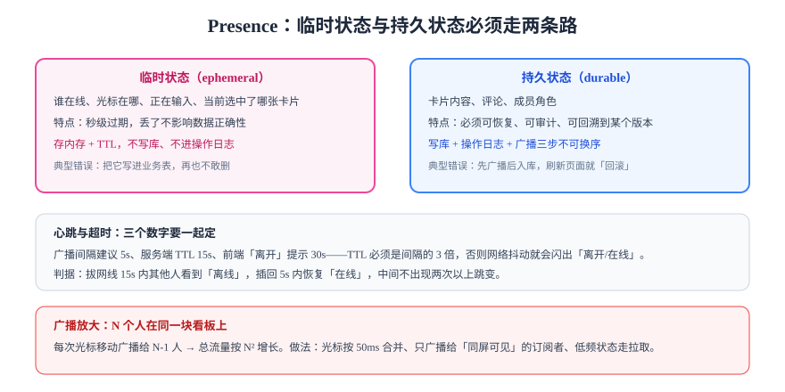

# Presence：在线状态与光标

Presence（在线状态）是协作产品里「最不值钱也最容易做坏」的一块：它不参与数据正确性，但**一旦做错，用户第一眼就看得见**——头像闪来闪去、光标停在昨天的位置、明明离线却显示在线。

核心判断只有一句：**临时状态必须和持久状态走两条完全不同的路。**

## 1. 两类状态，两条路



| 维度 | 临时状态（ephemeral） | 持久状态（durable） |
| --- | --- | --- |
| 内容 | 在线/离线、光标、选区、正在输入、正在拖动哪张卡 | 卡片内容、评论、成员角色 |
| 变化频率 | 每秒数次到数十次 | 每次用户操作 |
| 丢失后果 | 无（下一秒就刷新） | 不可接受 |
| 存储 | 内存 + TTL | 数据库 + 操作日志 |
| 传输 | 不保证到达（可丢） | 必须确认（ack） |
| 是否入审计 | 否 | 是 |

::: danger 把 presence 写进业务表
看起来「顺手」，实际是三输：① 每秒几十次写入把库打满；② 这些行永远没有删除时机（用户关掉浏览器不会发请求）；③ 备份、审计、数据治理全被污染。**它只该活在内存在，靠 TTL 自然消失。**
:::

## 2. 心跳与超时的三个数字

这三个数必须一起定，单独调任何一个都会出问题：

| 参数 | 建议值 | 作用 | 定错的后果 |
| --- | --- | --- | --- |
| `heartbeatMs` | 5000 | 客户端上报间隔 | 太短：无效流量；太长：离线发现慢 |
| `ttlMs` | 15000 | 服务端保留时长 | 小于 2×心跳 → 网络抖动就闪「离线」 |
| `staleHintMs` | 30000 | 前端显示「可能已离开」 | 与 TTL 太接近 → 提示与头像不同步 |

经验规则：**`ttlMs ≥ 3 × heartbeatMs`**。因为一次心跳丢失不该被判定为离线，至少容忍连续丢两次。

## 3. 客户端怎么算「谁在看我这张卡」

服务端只知道「这个连接订阅了哪些主题」，不知道「用户现在看的是哪张卡」。所以要在协议里显式声明「视口」：

```typescript [presence.ts]
export interface PresenceState {
  userId: string;
  clientId: string;
  name: string;
  color: string;
  /** 当前聚焦的对象：卡片 ID 或段落 ID */
  focus: string | null;
  /** 光标（仅文本编辑时有意义） */
  cursor?: { anchor: number; head: number };
  /** 服务端收到的时间，用于计算 TTL */
  updatedAt: number;
}

/** 合并同一用户的多个连接：以 focus 非空者优先，再取最新 */
export function mergeByUser(states: PresenceState[]): Map<string, PresenceState> {
  const out = new Map<string, PresenceState>();
  for (const s of states) {
    const prev = out.get(s.userId);
    if (!prev) {
      out.set(s.userId, s);
      continue;
    }
    if (prev.focus === null && s.focus !== null) out.set(s.userId, s);
    else if (prev.focus === s.focus && s.updatedAt > prev.updatedAt) out.set(s.userId, s);
  }
  return out;
}
```

**为什么要按用户合并**：同一个人可能开了三个标签页。不合并的话，协作栏里会出现三个「张三」，光标也有三个，用户会以为系统坏了。

## 4. 广播放大：N² 是怎么来的

一块看板上 N 个人，每个人的光标移动要广播给其余 N-1 人 → 总量 ≈ N²。N=8 时是 56 条/次，N=50 时是 2450 条/次，一秒移动 10 次就直接打满带宽。

| 手段 | 做法 | 效果 |
| --- | --- | --- |
| 时间合并 | 光标 50ms 节流，只发最后一次 | 减少 80%~95% 的帧 |
| 空间过滤 | 只发给「订阅了同一张卡」的人 | 与同屏人数成正比，而不是与全板人数 |
| 分级精度 | 光标发实时，`focus` 发 1s 一次 | 把高频与低频拆开 |
| 空闲降频 | 30s 无操作后停止上报光标 | 挂机用户不再产生流量 |

```typescript [throttle.ts]
/** 尾触发节流：保证最后一次一定发出去，中间的高频更新被丢弃 */
export function throttleTrailing<T>(fn: (v: T) => void, waitMs: number) {
  let timer: ReturnType<typeof setTimeout> | null = null;
  let last: T | undefined;
  return (v: T) => {
    last = v;
    if (timer) return;
    timer = setTimeout(() => {
      timer = null;
      if (last !== undefined) fn(last);
    }, waitMs);
  };
}
```

**为什么不直接用 `requestAnimationFrame`**：协作光标不需要 60fps，50ms 已经足够顺滑；用 rAF 在高刷屏上会变成 120fps，白白多一倍流量。

## 5. 远端光标怎么画

文本协作里，光标的坐标是「文档中的逻辑位置」（字符偏移），不是屏幕坐标。渲染要经过三步：

1. **拿到远端 `anchor/head`**（逻辑偏移）；
2. **换算成 DOM Range**（编辑器提供 `posToDOMRange` 之类的能力）；
3. **叠加一层覆盖层画光标**（绝对定位的 `div`），不要试图修改正文 DOM。

::: warning 用「覆盖层」而不是「改造正文」
直接往正文里插 `<span>` 会污染编辑器自己的文档模型，导致撤销栈错乱、序列化结果变化。覆盖层方案与编辑器解耦，代价是滚动与缩放时要重新计算位置。
:::

## 6. 判据

| 判据 | 约定 | 怎么验证 |
| --- | --- | --- |
| `RTP-A` | presence 不得写入业务表，只能存内存或 TTL 缓存 | 搜索代码，`presence` 相关写入不出现 `INSERT INTO`；关掉服务后无残留行 |
| `RTP-B` | `ttlMs` 必须 ≥ 3 × `heartbeatMs` | 读配置：`15000 ≥ 3 × 5000`；把心跳改成 6000 后校验会失败 |
| `RTP-C` | 同一用户的多个连接必须合并成一个展示 | 同一账号开三个标签页，协作栏只出现一个头像 |
| `RTP-D` | 光标必须节流，且保证最后一次送达 | 快速移动光标 1s，统计发出的帧数 ≤ 25，且停止移动后最终位置正确 |
| `RTP-E` | 断开连接必须立即清除该连接的 presence | 关闭标签页后 1s 内其他人看不到该光标（不等 TTL） |
| `RTP-F` | 远端光标必须画在覆盖层，不改写正文 DOM | 打开远端光标后，编辑器序列化结果与无光标时逐字相同 |
| `RTP-G` | 空闲用户必须停止上报光标 | 30s 无输入后抓包，`presence` 帧数为 0（心跳除外） |
| `RTP-H` | presence 帧必须可丢弃，不影响内容同步 | 人为丢弃全部 `presence` 帧，文档内容仍能正常同步 |

## 7. 验证方式

```javascript [presence-check.mjs]
// 模拟同一用户的两个连接，验证合并逻辑与节流
import { mergeByUser } from "./presence.js";
import { throttleTrailing } from "./throttle.js";

const now = Date.now();
const merged = mergeByUser([
  { userId: "u1", clientId: "c1", name: "张三", color: "#3B82F6", focus: null, updatedAt: now - 1000 },
  { userId: "u1", clientId: "c2", name: "张三", color: "#3B82F6", focus: "card-7", updatedAt: now },
  { userId: "u2", clientId: "c3", name: "李四", color: "#22C55E", focus: null, updatedAt: now },
]);
console.log("users:", merged.size, "u1.focus:", merged.get("u1").focus);
// 预期：users: 2 u1.focus: card-7

let sent = 0;
const send = throttleTrailing(() => sent++, 50);
for (let i = 0; i < 100; i++) send(i);
setTimeout(() => console.log("frames:", sent), 200);
// 预期：frames: 1（100 次调用在 50ms 内被合并成 1 帧）
```

```shell
node presence-check.mjs
```

**预期结果**：输出 `users: 2 u1.focus: card-7` 与 `frames: 1`。若 `frames` 接近 100，说明节流没生效（常见原因是每次调用都新建了定时器）。

## 8. 易错点

::: danger 五个高频错误
1. **靠 `beforeunload` 清理 presence**：移动端切后台、进程被杀都不会触发。必须以「连接断开」为准。
2. **TTL 太短导致闪烁**：`ttl = heartbeat` 时，一次丢包就闪一次「离线」，用户体验极差。
3. **把光标位置存成屏幕坐标**：别人滚动一下就错位。永远存逻辑偏移。
4. **忘了隐身/多端登录**：同一账号在手机和电脑同时在线时，要按设备区分展示，否则「我自己在看我」。
5. **把 presence 也做持久化历史**：没有任何产品价值，只会让备份变大、清理变难。
:::

## 参考资料

- [Yjs Awareness 协议](https://docs.yjs.dev/api/about-awareness)
- [Figma 多人协作的技术解读](https://www.figma.com/blog/how-figmas-multiplayer-technology-works/)
- MDN：[Page Visibility API](https://developer.mozilla.org/docs/Web/API/Page_Visibility_API)
- 相关页面：[同步协议与状态向量](../SyncProtocol/index.md) · [离线优先与重放](../Offline/index.md)
