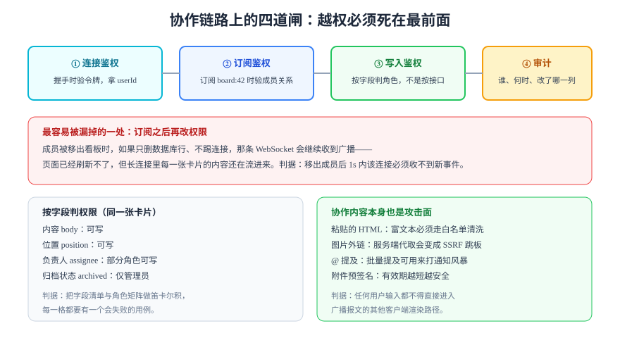

# 权限、审计与内容安全

协作系统把「写」的权力分散给很多人，同时又用一条长连接把内容推给很多人——这两件事叠加，让权限模型里最容易出问题的地方从「接口」变成了**「订阅」**。

本页按链路的顺序讲四道闸，每一道都给出「漏了会怎样」与「怎么验证它没漏」。



## 1. 四道闸的位置

| 闸门 | 时机 | 判什么 | 漏了的后果 |
| --- | --- | --- | --- |
| **连接鉴权** | WebSocket 握手 | 令牌是否有效、`userId` 是谁 | 匿名连接，后续全部失效 |
| **订阅鉴权** | 客户端订阅 `board:42` | 该用户是不是这个看板的成员 | **被动越权**：不需要写，只要订阅就能看全部内容 |
| **写入鉴权** | 每条 `update` | 该角色能不能改这个字段 | 越权修改，且审计里看不出异常 |
| **审计** | 写入成功后 | 记下谁、何时、改了哪一列 | 出事无法追责，也无法回滚 |

::: danger 最容易被漏掉的是第二道
「连接鉴权」和「写入鉴权」大家都记得，唯独**订阅**经常只校验「登录了没有」。于是一个被移出看板的成员，只要还握着手上的 `boardId`，就能继续订阅并收到每一条广播。这不是理论风险——它是协作类产品最常见的一类越权。
:::

## 2. 订阅鉴权：三道检查，一条都不能省

```typescript [subscribe.ts]
interface Subscriber {
  userId: string;
  boardId: string;
  role: "owner" | "admin" | "member" | "viewer";
}

export async function authorizeSubscribe(
  userId: string,
  boardId: string,
  loadMembership: (u: string, b: string) => Promise<Subscriber | null>,
): Promise<Subscriber> {
  const m = await loadMembership(userId, boardId);
  if (!m) throw new Error("FORBIDDEN_NOT_MEMBER"); // ① 成员关系
  if (m.role === "viewer" && !(await canReadBoard(boardId))) {
    throw new Error("FORBIDDEN_NO_READ"); // ② 读权限（可能来自上级策略）
  }
  if (await isBoardArchived(boardId)) {
    throw new Error("FORBIDDEN_ARCHIVED"); // ③ 生命周期状态
  }
  return m;
}

async function canReadBoard(_boardId: string): Promise<boolean> {
  return true; // 真实实现要接组织级策略
}
async function isBoardArchived(_boardId: string): Promise<boolean> {
  return false; // 真实实现查 boards.archived_at
}
```

三条检查分别对应三种现实：**不是成员**、**是成员但被组织策略禁读**、**看板已归档**。漏掉第三条时，归档看板会继续推送内容，用户会以为归档没生效。

## 3. 踢连接：权限变更必须立刻生效

订阅鉴权只在「建立订阅」时执行一次。之后权限变了怎么办？

| 变更 | 必须做的动作 | 不做会怎样 |
| --- | --- | --- |
| 成员被移出 | 关闭该用户在这个看板上的所有连接 | 长连接继续收到广播（页面刷新不了，但内容在流进来） |
| 角色降级（admin → viewer） | 更新连接上缓存的角色 | 仍能写入，直到重连 |
| 看板归档 | 广播一条 `board:archived` 并停止推送 | 客户端继续编辑，全部提交失败 |
| 用户被禁用 | 关闭该用户所有连接 | 禁用形同虚设 |

```typescript [kick.ts]
const rooms = new Map<string, Set<{ userId: string; close: (code: number) => void }>>();

export function kickUserFromBoard(boardId: string, userId: string): number {
  const room = rooms.get(boardId);
  if (!room) return 0;
  let n = 0;
  for (const conn of room) {
    if (conn.userId !== userId) continue;
    conn.close(4403); // 自定义关闭码：无权限
    room.delete(conn);
    n++;
  }
  return n; // 返回踢掉的连接数，便于断言
}
```

**关闭码要自定义**：`4403` 让客户端能区分「网络断了」与「我被踢了」，前者自动重连，后者提示「你已失去访问权限」并停止重连。

## 4. 字段级权限矩阵

协作系统里「能不能写」很少是整体判断，通常是按字段：

| 字段 | owner | admin | member | viewer |
| --- | --- | --- | --- | --- |
| 卡片标题 / 描述 | ✅ | ✅ | ✅ | ❌ |
| 卡片位置（拖动） | ✅ | ✅ | ✅ | ❌ |
| 负责人 assignee | ✅ | ✅ | ⚠️ 仅自己相关 | ❌ |
| 归档 / 删除卡片 | ✅ | ✅ | ❌ | ❌ |
| 成员与角色 | ✅ | ⚠️ 不能改 owner | ❌ | ❌ |
| 看板可见性 | ✅ | ❌ | ❌ | ❌ |

::: warning 「⚠️」的格子才是真正的测试重点
表里的 ✅/❌ 很容易实现，⚠️ 才是业务规则。例如「member 只能把自己设成负责人」——这条规则必须落成「判断目标值与自己是否相等」，而不是「member 不能改 assignee」。**把 ⚠️ 写成 ❌ 是最常见的过度收紧，用户会发现「我居然不能认领自己的任务」。**
:::

## 5. 审计：不是日志，是可追责的证据

| 要素 | 必须记录 | 为什么 |
| --- | --- | --- |
| 主体 | `userId` + `clientId` + IP | 同一账号多端时能定位到具体设备 |
| 时间 | 服务端时间（毫秒） | 客户端时间不可信 |
| 对象 | `boardId` / `cardId` / 字段名 | 能按对象查历史 |
| 变化 | 旧值 → 新值（或操作摘要） | 能回答「谁把它改成这样」 |
| 结果 | 成功 / 拒绝 / 冲突 | 拒绝也要记，否则「试图越权」无处可查 |
| 关联 | `seq` / `traceId` | 与广播、日志、链路追踪对齐 |

```sql
-- 审计表的最小结构（PostgreSQL）
CREATE TABLE collab_audit (
  id           bigserial PRIMARY KEY,
  board_id     bigint      NOT NULL,
  card_id      bigint,
  actor_id     bigint      NOT NULL,
  client_id    text        NOT NULL,
  field        text        NOT NULL,
  old_value    jsonb,
  new_value    jsonb,
  result       text        NOT NULL CHECK (result IN ('ok','denied','conflict')),
  seq          bigint,
  trace_id     text,
  created_at   timestamptz NOT NULL DEFAULT now()
);

-- 按对象查历史（最常用的查询）
CREATE INDEX idx_audit_card_time ON collab_audit (card_id, created_at DESC);
-- 按人查（追责与异常检测）
CREATE INDEX idx_audit_actor_time ON collab_audit (actor_id, created_at DESC);
```

**审计写入不能与业务写入分离到两个事务**：业务成功但审计失败，等于「改了但查不到谁改的」。要么同事务，要么用 outbox 保证最终一致并监控积压。

## 6. 协作内容本身就是攻击面

| 风险 | 场景 | 缓解 |
| --- | --- | --- |
| **存储型 XSS** | 富文本粘贴携带 `<script>` / `onerror` | 服务端白名单清洗（不靠前端），渲染时用受控组件 |
| **SSRF** | 「粘贴图片链接自动抓取」由服务端代取 | 禁止内网地址段、限制协议与重定向、加超时 |
| **通知风暴** | 一次 `@all` 触发上千条通知 | 提及去重 + 按人限流 + 批量合并 |
| **附件越权** | 预签名 URL 长期有效被转发 | 有效期 ≤ 5 分钟，且签名绑定 `userId` |
| **内容注入到广播报文** | 用户输入直接拼进推送 JSON | 结构化字段序列化，禁止字符串拼接 |

```typescript [sanitize.ts]
// 富文本白名单：只保留需要的标签与属性，其余一律丢弃
const ALLOWED_TAGS = new Set(["p", "br", "strong", "em", "code", "pre", "ul", "ol", "li", "a"]);
const ALLOWED_ATTR: Record<string, Set<string>> = {
  a: new Set(["href", "title"]),
};

export function isSafeHref(href: string): boolean {
  try {
    const u = new URL(href, "https://example.invalid");
    return u.protocol === "https:" || u.protocol === "http:";
  } catch {
    return false;
  }
}

export function pickAttrs(tag: string, attrs: Record<string, string>): Record<string, string> {
  const allow = ALLOWED_ATTR[tag];
  if (!allow) return {};
  const out: Record<string, string> = {};
  for (const [k, v] of Object.entries(attrs)) {
    if (!allow.has(k)) continue;
    if (k === "href" && !isSafeHref(v)) continue; // 拦 javascript: 与 data:
    out[k] = v;
  }
  return out;
}

export function isAllowedTag(tag: string): boolean {
  return ALLOWED_TAGS.has(tag);
}
```

## 7. 判据

| 判据 | 约定 | 怎么验证 |
| --- | --- | --- |
| `RTZ-A` | 订阅必须校验成员关系，不能只校验登录 | 用一个非成员的令牌订阅 `board:42`，必须收到 `FORBIDDEN_NOT_MEMBER` 且无任何内容帧 |
| `RTZ-B` | 权限变更必须在 1s 内踢掉相关连接 | 移出成员后立刻用另一账号发一条更新，被移出者的连接收不到（或已关闭，关闭码 4403） |
| `RTZ-C` | 写入必须按字段判角色，不能只按接口判 | 用 member 令牌修改 `archived` 字段，返回 403 且审计有一行 `denied` |
| `RTZ-D` | `⚠️` 类规则（有条件允许）必须有独立用例 | 测试里存在「member 认领自己」通过、「member 认领他人」拒绝两条 |
| `RTZ-E` | 审计必须与业务写入同事务或经 outbox 保证 | 人为让审计写入失败，业务写入必须一起回滚（或进入重试队列） |
| `RTZ-F` | 富文本必须服务端白名单清洗 | 提交含 `` 的内容，落库后的内容里不含 `onerror` |
| `RTZ-G` | 服务端代取外部资源必须防 SSRF | 提交 `http://127.0.0.1:6379/` 作为图片地址，必须被拒绝 |
| `RTZ-H` | 预签名 URL 有效期 ≤ 5 分钟且绑定用户 | 生成链接后 6 分钟访问返回 403；换一个账号访问也返回 403 |

## 8. 验证方式

用 `websocat` 或 Node 脚本模拟「非成员订阅」：

```shell
# 1) 取一个不属于 board-42 的用户令牌
TOKEN="<非成员令牌>"
# 2) 订阅并观察前 2 秒的输出
websocat -H "Authorization: Bearer $TOKEN" "ws://localhost:8080/ws?doc=board-42"
```

**预期结果**：连接建立后**立刻**收到一条错误帧（`FORBIDDEN_NOT_MEMBER`），随后连接被关闭；2 秒内**没有**任何内容帧。如果看到了内容帧，说明订阅鉴权缺失，这一条比任何算法 bug 都严重。

权限矩阵的验证则应该是一个用例表：

```text
4 角色 × 6 字段 = 24 格，其中 4 个 ⚠️ 格需要两种取值 → 28 条用例
```

**预期结果**：28 条全部通过，且每条失败信息能指出「哪个角色在哪个字段上被误判」。

## 9. 易错点

::: danger 六个高频错误
1. **只在握手时鉴权**：长连接的生命周期远长于令牌有效期。要么定期复核，要么在权限变更时主动踢。
2. **把「前端不显示按钮」当成权限控制**：接口仍然可以被直接调用。
3. **审计只记成功**：拒绝记录才是发现「有人在试探」的唯一线索。
4. **用前端清洗富文本**：攻击者不经过你的前端。清洗必须在服务端，且是白名单而非黑名单。
5. **预签名 URL 当成授权**：URL 一旦泄露，任何人可用。要绑定用户或用短有效期。
6. **关闭码用 1000/1001 表意**：标准关闭码语义固定，自定义语义要用 4000~4999 段，客户端才能区分「该重连」与「不该重连」。
:::

## 与「租户边界」章节集的分工（第 155 天补充）

| 维度 | 本页 | 「租户边界」章节集（第 155 天） |
| --- | --- | --- |
| 回答的问题 | 订阅鉴权、字段级权限、审计与内容攻击面 | 主题名里的租户命名空间、权限变更后的时效性、跨实例广播的租户携带 |
| 鉴权时机 | 连接与订阅时 | 订阅时 + 每次广播前（两道），并在权限变更时主动断开 |
| 隔离层 | 文档 / 字段级 | destination 字符串级：主题名不带租户就意味着两个租户共用一个目的地 |
| 广播 | 跨实例 fan-out | Redis 频道可以全局，但消息必须自带 `tenantId`，接收端用它重建 destination |

一句话结论：**本页讲「订阅这个动作怎么鉴权」，章节集讲「订阅之后权限变了怎么办」**。

::: danger 这一页特有的坑
只在 `SUBSCRIBE` 时判一次权限，是这一族里最隐蔽的缺陷：成员被移出后连接还开着，消息还在推，而所有「订阅鉴权」的用例都是通过的。
:::

## 参考资料

- [OWASP Top 10（2021）](https://owasp.org/Top10/)：A01 访问控制失效、A03 注入
- [OWASP WebSocket 安全指南](https://owasp.org/www-project-web-security-testing-guide/)
- [RFC 6455 §7.4.2 关闭码定义](https://www.rfc-editor.org/rfc/rfc6455#section-7.4.2)
- [MDN: Content Security Policy](https://developer.mozilla.org/docs/Web/HTTP/CSP)
- 相关页面：[概述：三类冲突与五种一致性](../Overview/index.md) · [实战：卡片描述的协作编辑](../Practice/index.md)
