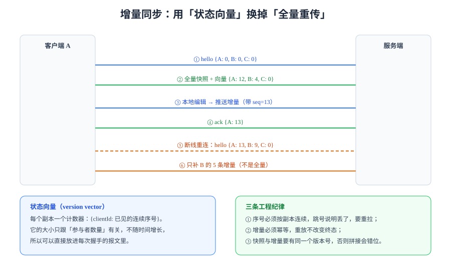

# 同步协议与状态向量

算法负责「怎么合并」，协议负责「怎么把要合并的东西送到对的人手上，并且只送一次、按能合并的顺序送」。线上协作的故障里，**算法出错的比例远低于协议出错**——内容不一致、刷新才恢复、断线丢改动，基本都是这一层的问题。

## 1. 六种帧就够了

一个够用的协作协议，消息类型通常只有六种。多出来的每一种都会让状态机更难测：

| 帧 | 方向 | 载荷 | 作用 |
| --- | --- | --- | --- |
| `hello` | C → S | 客户端状态向量、`docId` | 握手：告诉服务端「我已经有什么」 |
| `sync` | S → C | 缺失的增量或快照 + 服务端向量 | 补齐：只发客户端缺的那部分 |
| `update` | C ↔ S | 一条或多条操作 + `clientSeq` | 增量：一次编辑 |
| `ack` | S → C | 已持久化的 `clientSeq` / `seq` | 确认：客户端据此出队 |
| `presence` | C ↔ S | 光标、选区、在线状态（带 TTL） | 临时态：不入库 |
| `error` | S → C | 错误码 + 是否可重试 | 失败：区分「重试」与「放弃」 |

::: tip 帧的类型越少越好
每多一种帧，就要多测「A 状态下收到 B 帧」的组合。六种帧的状态机已经需要 30+ 条用例；十种帧基本测不完。
:::

## 2. 状态向量：把「我有什么」压成常数大小



状态向量（version vector）是 `Map<clientId, lastContiguousSeq>`。它有两个关键性质：

1. **大小与参与过该文档的客户端数量成正比**，**与操作总数无关**。10 万条更新也不会让它变大。
2. **可用于差集计算**：服务端把「自己有的」减去「客户端已确认的」，剩下的就是 `sync` 要发的。

```typescript [vector.ts]
export type VersionVector = Record<string, number>;

/** 计算「我有而对方没有」的部分：按副本逐个比较 */
export function diff(mine: VersionVector, theirs: VersionVector): VersionVector {
  const out: VersionVector = {};
  for (const [client, seq] of Object.entries(mine)) {
    const known = theirs[client] ?? 0;
    if (seq > known) out[client] = seq - known;
  }
  return out;
}

/** 合并两个向量：逐副本取最大值（与 CRDT 的 join 同构） */
export function join(a: VersionVector, b: VersionVector): VersionVector {
  const out: VersionVector = { ...a };
  for (const [client, seq] of Object.entries(b)) {
    out[client] = Math.max(out[client] ?? 0, seq);
  }
  return out;
}

/** 判断 a 是否覆盖 b（b 的所有操作 a 都有） */
export function dominates(a: VersionVector, b: VersionVector): boolean {
  return Object.entries(b).every(([client, seq]) => (a[client] ?? 0) >= seq);
}
```

`diff` 返回的只是**每个副本还差多少条**，还需要服务端按 `clientId` 建索引才能取出具体更新——这就是为什么更新表的主键通常是 `(docId, clientId, seq)`。

## 3. 序号的两套体系，别混用

| 序号 | 归属 | 语义 | 用途 |
| --- | --- | --- | --- |
| `clientSeq` | 客户端生成 | 该客户端第 N 次编辑，**单调递增、连续** | 幂等键、待发队列排序、ack 匹配 |
| `seq` | 服务端生成 | 该文档第 N 条被接受的更新，**全局单调** | 广播顺序、客户端追平、审计回放 |

混用的典型后果：客户端拿 `seq` 去匹配 ack，结果服务端在中间插入了别人的更新，ack 的 `seq` 永远对不上，客户端的待确认队列永远不空——表现为**「一直显示同步中」**。

::: danger ack 只认 `clientSeq`
服务端返回的 `ack` 必须回显**客户端自己的** `clientSeq`。只回 `seq` 是不够的：客户端无法判断「这条 seq 对应我的哪一次编辑」，只好保守地全部重发，于是产生重复更新（虽然幂等能兜住，但流量翻倍）。
:::

## 4. 重连追平：三步而不是一步

断线重连不是「重新拉全量」，而是一个三段式：

1. **握手**：客户端发 `hello`，带上自己的状态向量。
2. **补齐**：服务端算 `diff`，把缺的增量按 `seq` 升序发回。若缺口过大（超过阈值，如 500 条），改发**快照 + 快照之后的增量**——这是性能与正确性的权衡点。
3. **对齐**：客户端应用完毕后回报新的向量；服务端确认后，双方进入实时广播状态。

| 参数 | 建议值 | 依据 |
| --- | --- | --- |
| 增量补齐阈值 | 500 条 | 超过则快照更省流量 |
| 单帧最大字节 | 256 KB | 超过要分片，否则代理层可能截断 |
| 重连退避 | 0.5s 起，指数到 30s，加 ±20% 抖动 | 避免服务重启时全员同时重连 |
| 心跳间隔 | 25s（服务端 60s 超时） | 低于常见 NAT/代理的 60s 空闲断连阈值 |

## 5. 多实例广播：别只做「本地广播」

单机部署时，客户端连在同一个进程上，广播就是遍历连接。**一旦扩到两个实例，立刻出问题**：A 连实例 1、B 连实例 2，A 的更新只广播给了实例 1 上的连接，B 永远收不到。

标准解法是「本地广播 + 跨实例发布订阅」：

```typescript [broadcast.ts]
import type { Redis } from "ioredis";

interface Envelope {
  docId: string;
  seq: number;
  origin: string; // 实例 ID，用于跳过自己发的消息
  payload: Uint8Array;
}

export class Broadcaster {
  private local = new Map<string, Set<(e: Envelope) => void>>();

  constructor(
    private redis: Redis,
    private instanceId: string,
  ) {
    // 只订阅一次，收到后交给本地连接
    this.redis.subscribe("doc-updates");
    this.redis.on("message", (_ch, raw) => {
      const env: Envelope = JSON.parse(raw);
      if (env.origin === this.instanceId) return; // 自己发的不重复投递
      this.deliverLocal(env);
    });
  }

  async publish(env: Envelope): Promise<void> {
    this.deliverLocal(env); // 先本地，省一次往返
    await this.redis.publish("doc-updates", JSON.stringify(env));
  }

  private deliverLocal(env: Envelope): void {
    for (const send of this.local.get(env.docId) ?? []) send(env);
  }
}
```

三个必须注意的点：

1. **`origin` 去重**：订阅者会收到自己发布的消息，不去重就是「本地收到两份」。
2. **`seq` 是广播顺序的唯一依据**：客户端发现 `seq` 跳号，说明订阅建立晚于广播，要主动拉缺口。
3. **Redis 发布订阅不持久**：实例重启期间的消息会丢。真正不能丢的更新必须先落库，广播只是「通知去拉」。

## 6. 判据

| 判据 | 约定 | 怎么验证 |
| --- | --- | --- |
| `RTS-A` | 增量必须按 `seq` 升序发送与接收 | 抓包检查同一 `docId` 的 `seq` 严格递增；乱序时客户端应拒绝应用并触发重拉 |
| `RTS-B` | `ack` 必须回显客户端 `clientSeq` | 断网 10s 后恢复，客户端待确认队列能在 1s 内清空 |
| `RTS-C` | 更新必须幂等：同一 `(docId, clientId, seq)` 应用多次结果不变 | 手动重发同一条 update 三次，文档内容哈希不变 |
| `RTS-D` | 缺口超过阈值必须走「快照 + 增量」 | 构造 600 条缺口，断言服务端返回 `sync` 快照帧而不是 600 条增量 |
| `RTS-E` | 跨实例广播必须有 origin 去重 | 两实例各连一个客户端，A 的更新在 B 侧只出现一次（比对 `seq` 序列无重复） |
| `RTS-F` | 重连必须退避并带抖动 | 模拟服务重启，100 个客户端在 5s 内的重连时间分布不是同一毫秒 |
| `RTS-G` | 心跳与超时时间必须显式配置，不依赖默认值 | 配置文件里有 `heartbeatMs` 与 `timeoutMs`，且超时 ≥ 心跳 × 2 |
| `RTS-H` | 广播失败不得影响落库结果 | 关闭 Redis 后提交更新：落库成功、广播报错被记录，客户端重连后能拉到 |

## 7. 验证方式

用 Node 起两个客户端，验证「断线重连只补增量」：

```javascript [reconnect.mjs]
import WebSocket from "ws";

const URL = "ws://localhost:8080/ws?doc=board-42";
const clients = [];

function connect(vector) {
  const ws = new WebSocket(URL);
  ws.on("open", () => ws.send(JSON.stringify({ t: "hello", vector })));
  ws.on("message", (raw) => console.log("<-", raw.toString().slice(0, 120)));
  clients.push(ws);
  return ws;
}

connect({ A: 0 });
connect({ A: 12, B: 4 }); // 模拟「已有一部分」的客户端
setTimeout(() => {
  console.log("clients:", clients.length);
  clients.forEach((c) => c.close());
}, 1500);
```

```shell
node reconnect.mjs
```

**预期结果**：第一个连接收到全量快照帧；第二个连接只收到 `B` 的增量（少于 5 条），且日志里**不出现**全量快照。若第二个连接也收到快照，说明 `diff` 没生效——先查服务端是否真的用上了 `vector`。

## 8. 易错点

::: danger 五个高频错误
1. **握手不带状态向量**：服务端无法算差集，只能全量，流量与重连时间都翻倍。
2. **用 `seq` 匹配 `ack`**：见第 3 节，会导致「一直同步中」。
3. **广播先于落库**：客户端看到内容闪一下又回退。落库成功后再广播，是硬顺序。
4. **Redis 当作消息可靠通道**：发布订阅不持久，实例重启窗口内的通知会丢。可靠做法是「落库 + 通知去拉」。
5. **重连不做退避**：服务重启时全员同时重连，直接把刚起来的实例打挂。
:::

## 9. 与「实时推送接线」的分工

本页讲**协议层**：帧的设计、状态向量、`clientSeq` 与 `seq` 两套序号、重连三段式。**「这条事件怎么从一个实例送到另一个实例的浏览器」属于工程接线**，见[在线协作任务看板 · 实时推送接线](/project/Complete/TeamBoard/RealtimeWiring/index.md)。

那页补的东西恰好是本页没有覆盖的一层：

| 层 | 本页 | 项目侧 |
| --- | --- | --- |
| 序号语义 | `seq` 单调、允许空洞、客户端按缺口补拉 | 兜底实现：`resync_required{fromSeq,toSeq}` 下行帧 + `GET /events?after=` |
| 跨实例 | 只提到「广播需要外部通道」 | Redis 发布订阅的实测：1,000 条 × 3 订阅者 **172 ms**，每订阅者 1,000/1,000 收到 |
| 幂等 | 靠 `event_id` 去重 | 同一实例「本地直推 + 订阅自己的频道」会推两次，要 `origin` 去重 |

::: danger 协议层最容易漏的一条：pub/sub 不持久化
Redis 的发布订阅**没有订阅者时直接丢弃**，重启也不重放。这意味着：
- 它不能承担「必须有」的语义（那是事件表与 outbox 的职责）；
- 实例启动时必须**先建订阅、再宣告 ready**，否则滚动发布时前几秒的推送会静默消失。
「协议正确」不等于「送达正确」——后者需要一条持久化的、可按 `seq` 补拉的读路径。
:::

## 参考资料

- [RFC 6455: The WebSocket Protocol](https://www.rfc-editor.org/rfc/rfc6455)
- Kleppmann, M. *Designing Data-Intensive Applications* 第 5 章（复制与版本向量）
- [Yjs 的同步协议实现](https://github.com/yjs/y-protocols)
- [Automerge sync protocol](https://automerge.org/docs/reference/documents/sync/)
- 相关专题：[分布式缓存](../../DistributedCache/index.md) 的多实例广播；[消息队列](../../MessageQueue/index.md) 的至少一次投递
