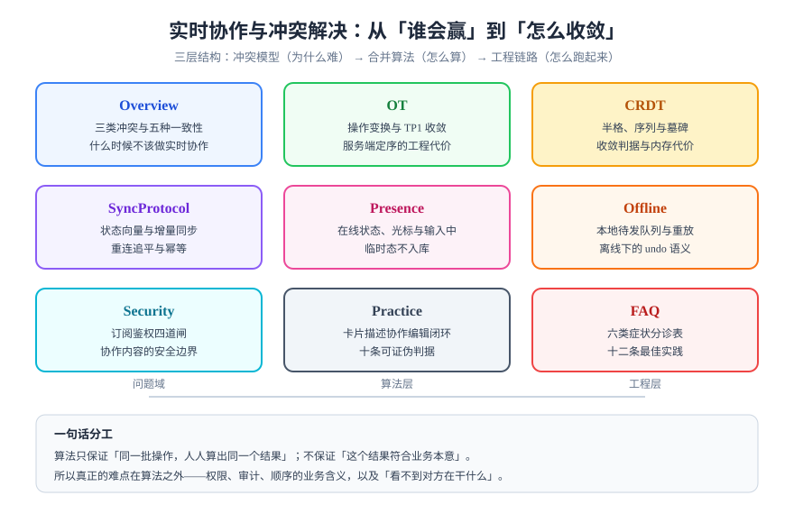

# 实时协作与冲突解决

实时协作（Realtime Collaboration）要解决的问题只有一句话：**当多个客户端同时修改同一份状态时，怎么让所有人最终看到同一个结果，并且这个结果听起来像是人干的事。**

<p style="text-align:center;"></p>

它看起来像个算法问题（OT、CRDT），实际上是个**产品问题 + 工程问题**：合并算法只保证「同一批操作，人人算出同一个结果」，它不保证这个结果符合业务本意，也不负责权限、审计、离线与广播。

::: tip 一句话理解
协作编辑的难点不是「怎么算出结果」，而是「**算出结果之后，怎么让人相信这是自己刚才干的**」。
:::

## 专题地图

| 页面 | 回答什么问题 | 适合谁读 |
| --- | --- | --- |
| [概述：三类冲突与五种一致性](Overview/index.md) | 冲突到底分几种、哪些算法能解、哪些只能靠产品规则 | 所有人，先读这页 |
| [OT：操作变换与定序](OT/index.md) | transform 函数怎么写、TP1 为什么必需、中心节点意味着什么 | 要自研文本协同的人 |
| [CRDT：收敛的代价](CRDT/index.md) | 半格、序列 CRDT、墓碑与 GC、内存与体积 | 要选型或自研结构化协同的人 |
| [同步协议与状态向量](SyncProtocol/index.md) | 增量怎么算、重连怎么追平、ack 与幂等怎么配合 | 写实时网关的人 |
| [Presence：在线状态与光标](Presence/index.md) | 临时状态为什么不入库、心跳三个数字怎么定、广播怎么放大 | 写前端协同交互的人 |
| [离线优先与重放](Offline/index.md) | 待发队列、重放顺序、离线下的 undo 语义 | 要做「没网也能改」的人 |
| [权限、审计与内容安全](Security/index.md) | 四道闸分别管什么、踢连接为什么是必需的、协作内容怎么防注入 | 后端与安全负责人 |
| [实战：卡片描述的协作编辑](Practice/index.md) | 从口径到验收脚本的十步闭环，含十条可证伪判据 | 想直接照做的人 |
| [常见问题与最佳实践](FAQ/index.md) | 六类症状分诊、十二问、十二条最佳实践 | 所有人 |



## 判据族声明

本专题每一页的约定都编号，每条只回答三件事：**约定是什么 / 定错了会怎样 / 怎么验证它没被破坏**。

| 页面 | 判据族 | 数量 |
| --- | --- | --- |
| 概述 | `RTC-A` ~ `RTC-H` | 8 |
| OT | `RTO-A` ~ `RTO-H` | 8 |
| CRDT | `RTR-A` ~ `RTR-H` | 8 |
| 同步协议 | `RTS-A` ~ `RTS-H` | 8 |
| Presence | `RTP-A` ~ `RTP-H` | 8 |
| 离线 | `RTF-A` ~ `RTF-H` | 8 |
| 权限与安全 | `RTZ-A` ~ `RTZ-H` | 8 |
| 实战 | `RTX-A` ~ `RTX-H` | 8 |
| 常见问题 | `RTQ-A` ~ `RTQ-G` | 7 |

## 与相邻专题的分工

这个题目很容易和另外几块内容混在一起，先把边界写死：

| 相邻专题 | 那边讲什么 | 本专题讲什么 | 为什么不互相替代 |
| --- | --- | --- | --- |
| [高并发系统设计](../HighConcurrency/index.md) | 流量超过容量时的分层限流、排队削峰 | 同一个位置被两个人同时写时怎么合并 | 那边解决「请求太多」，这边解决「写入撞车」；限流挡不住语义冲突 |
| [响应式编程](../ReactiveProgramming/index.md) | Reactor、背压、流式处理 | 推送通道的消息帧与追平 | 那边是「怎么把流接起来」，这边是「流里装什么、顺序怎么定」 |
| [分布式缓存](../DistributedCache/index.md) | Redis 缓存一致性、失效策略 | 多实例之间怎么广播增量 | 那边管「缓存与库谁先写」，这边管「多进程怎么把同一份增量送到每个客户端」 |
| [消息队列](../MessageQueue/index.md) | 至少一次投递、消费幂等、顺序性 | 协作帧的序号与重放 | 那边是服务间异步，这边是服务到浏览器的长连接；语义相通但链路不同 |
| [文档协作流程](../../Tools/Collaboration/DocCollaboration/index.md) | 谁改、怎么留痕、状态怎么流转 | 同一份内容被同时改时数据怎么收敛 | 那边是**流程与权限**，这边是**数据与算法** |
| [低代码平台](../../Frontend/LowCode/index.md) | 协议设计、渲染引擎、物料体系 | 画布多人同时编辑时的合并 | 那边讲「页面怎么被描述出来」，这边讲「描述被两个人改时怎么办」 |
| [可观测性](../../Ops/Observability/index.md) | Trace、指标、日志三件套 | 协作链路要看哪几个数 | 那边给工具，这边给「用这些工具看什么」 |
| [在线协作任务看板](../../../project/Complete/TeamBoard/index.md) | 一个具体项目里怎么落地 | 通用算法与协议 | 那边是实例，这边是原理；实例页只写「这一套系统怎么做的」 |

## 版本与生态状态（2026-10 核对）

| 组件 | 版本 | 状态与口径 |
| --- | --- | --- |
| Yjs | 13.6.33（2026-09-23） | 生态最广（ProseMirror / CodeMirror / Tiptap 绑定齐全），纯 JS，约 23.7 kB gzip |
| Automerge | 3.5.0（2026-09-16） | Rust 核心 + WASM，3.x 相比 2.x 内存降约一个数量级；自带 sync protocol 与二进制格式 |
| Loro | 1.16.2（2026-09-21） | Rust + WASM，Fugue 文本算法，支持 MovableList / MovableTree 与历史 checkout |
| ShareDB | 6.0.5（2026-10-06） | OT 路线的代表（JSON0 / JSON1），服务端定序，自带 presence 与 pub/sub 扩展点 |
| Diamond Types | 1.0.2（2023-05） | 参考实现，npm 包已陈旧，**不要用于生产** |
| ElectricSQL / PowerSync | 1.5.28 / 0.10.2 | 不是 CRDT：一个是 Postgres 形状流，一个是离线写队列；选型时别混为一谈 |

::: warning 版本组织说明
本专题**不按大版本建目录**：上述库的 1.x / 13.x 都是「同一个 API 语义下的快速迭代」，没有出现「旧版本文档仍然有效但语义不同」的情况。算法层（OT / CRDT）本身不随库版本变化，故统一在页内用 `::: info` 标注适用版本。
:::

## 学习路径

1. **先读概述**，把三类冲突分清楚——后面所有算法都只解决第一、二类。
2. **按你的场景二选一**：文本协同读 [OT](OT/index.md) 与 [CRDT](CRDT/index.md) 的对比；结构化数据（看板、表格、脑图）直接读 [CRDT](CRDT/index.md)。
3. **然后读同步协议**，因为绝大多数线上问题不在算法，而在「增量算错了」和「重连没追平」。
4. **最后读权限与实战**，把一条能跑的链路拼出来。

::: danger 三条最容易踩的坑
1. **以为选了 CRDT 就不用管顺序**：CRDT 保证合并收敛，但不保证「提交到数据库的顺序」和「广播给客户端的顺序」一致，刷新后回滚就是这么来的。
2. **把 presence 写进业务表**：光标位置每秒变化几十次，写库会立刻把数据库打满，而且这些数据永远没有清理的时机。
3. **只在单机上测过并发**：单机 `localhost` 两个标签页的延迟接近 0，永远测不出「乱序到达」与「重连补偿」这两类问题。
:::

## 验证方式

本专题的示例都在 Node 22+ 与浏览器控制台可跑，最小验证：

```shell
node -e "console.log(process.version)"
# 预期输出 v22.x 或更高
```

页面里的 `yjs` 示例按 `pnpm add yjs` 安装后即可运行；`loro-crdt` 与 `@automerge/automerge` 同理。**本仓不提供可执行示例工程**，命令与片段都在正文里，读者在自己的工程中落地。

## 参考资料

- Lamport, L. *Time, Clocks, and the Ordering of Events in a Distributed System*（1978）—— 定序问题的源头
- Ellis, C. A., Gibbs, S. J. *Concurrency Control in Groupware Systems*（SIGMOD 1989）—— OT 的起点
- Shapiro, M. et al. *Conflict-free Replicated Data Types*（SSS 2011）—— CvRDT / CmRDT 的形式化定义
- Kleppmann, M. *Designing Data-Intensive Applications*（2017）第 5、9 章 —— 复制与一致性
- [Yjs 文档](https://docs.yjs.dev/) · [Automerge 文档](https://automerge.org/docs/) · [Loro 文档](https://loro.dev/docs) · [ShareDB 文档](https://share.github.io/sharedb/)
- RFC 6455（WebSocket）· RFC 7692（permessage-deflate）
