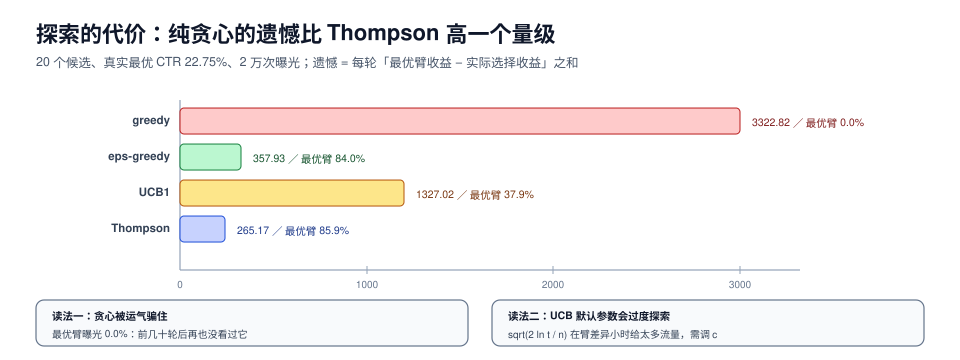

# 冷启动与探索：不探索就永远不知道

冷启动的经典定义是「新用户、新物品、新系统」，但这三种的解法几乎不重叠：新用户缺的是**兴趣信号**，新物品缺的是**曝光机会**，新系统缺的是**整个日志**。把它们混成一个「冷启动优化」项目，结果通常是三件事都没做好。

这一页讲：三种冷启动各自的抓手、探索为什么必须有预算（有四组策略的实测遗憾）、探索预算怎么算、新物品的「内容 + 配额」组合、新用户的会话特征、以及自我强化回路怎么打破。



本页判据族 `RCC-A` ~ `RCC-H`，共 8 条。定义表见文末「本页判据」一节。

## 一、三种冷启动，三条不同的路

| 类型 | 缺什么 | 主要抓手 | 次要抓手 | 别做什么 |
| --- | --- | --- | --- | --- |
| 新物品 | 行为数据（无曝光 → 无样本） | 内容特征 + 固定曝光配额 | 相似物品迁移、探索 | 等它「自然起来」 |
| 新用户 | 兴趣信号（不知道喜欢什么） | 会话内实时行为 + 热门/多样化兜底 | 注册信息、地域、设备 | 直接套用老用户模型 |
| 新系统 | 全部日志 | 规则 + 人工运营 + 快速实验 | 公开数据集预训练 | 一上线就追个性化 |

新物品最容易做错：团队常常给它「一次曝光机会」然后看 CTR，CTR 低就判定不行。但**一次曝光的 CTR 只有 0 或 1**，没有统计意义；而如果这次曝光在最差的位置，连「0 或 1」都被位置倾向压过（见[排序](../Ranking/index.md))）。

## 二、不探索的代价：一组可以直接读的数

20 个候选、真实 CTR 服从 Beta(2,18)（均值约 10%，最优臂 22.75%）、2 万次曝光，四种策略的累积遗憾（regret = 每轮「最优臂收益 − 实际选择收益」之和）：

```text
greedy：累积遗憾 3322.82，最优臂曝光占比  0.0%（真实最优 CTR 22.750%）
   eps：累积遗憾  357.93，最优臂曝光占比 84.0%
   ucb：累积遗憾 1327.02，最优臂曝光占比 37.9%
    ts：累积遗憾  265.17，最优臂曝光占比 85.9%
```

四行读数，四个结论：

1. **纯贪心最差，而且差一个量级**（3322 vs 265）。它在前几十轮里被一个「运气好」的臂骗住，之后再也不看别的——**0.0% 的最优臂曝光占比**说明它一次都没找到最好的那个。
2. **ε-greedy 用 10% 的随机换来了 84% 的最优臂占比**，遗憾降到 358。代价是 10% 的流量永远浪费在明显差的臂上。
3. **UCB1 在这个规模上不如 ε-greedy**（1327 vs 358）。这不是 UCB 不好，而是 `sqrt(2 ln t / n)` 的探索奖励在 t 很大、臂差异很小时**过度探索**——它把大量流量花在「还没试够」的中等臂上。参数 `c` 需要按收益差调，默认值不一定合适。
4. **Thompson Sampling 最好**（265，85.9%）。它按后验概率采样，自然地在「不确定」和「看起来好」之间平衡，不需要调参。

::: tip 一句话选型
**臂少（< 50）、收益差明显 → ε-greedy（简单、可解释）；臂多或需要个性化 → Thompson Sampling；需要严格的最坏情况保证 → UCB 系列（并调 c）。**
:::

## 三、探索预算：不是「留 10% 流量」这么粗

探索的成本可以直接算：`成本 = 探索流量比例 × (最优收益 - 被探索臂的平均收益)`。而收益是「找到更好臂之后省下的遗憾」。

一个可操作的算法：

```text
1. 估当前策略与最优策略的收益差 Δ（用历史 A/B 或离线模拟）
2. 估一个新臂需要多少次曝光才能把 CTR 估到 ±10% 相对精度：
   n ≈ (1.96 / 0.1)^2 × (1 - p) / p      # p 为该臂 CTR
3. 每月新增臂数 m → 每月最少探索曝光 = m × n
4. 探索比例 = 每月最少探索曝光 / 每月总曝光
```

以 p = 5% 为例：`n ≈ 384 × 19 = 7296` 次曝光/臂。每月新增 20 个物品 → 需要 14.6 万次探索曝光。如果月总曝光是 2000 万，探索比例 0.73%——**远低于拍脑袋的 10%**。

这也解释了为什么「留 10% 探索」常常是浪费：它远超必要量，而且因为随机分配，探索流量大多打在已经确定的差臂上。

## 四、新物品：内容特征 + 配额 + 快速淘汰

三段式：

1. **内容特征先给一个先验分**。用标题/图像/类目的 embedding 找最近邻物品，把邻居的 CTR 作为它的初始分（这就是「相似物品迁移」）。注意：迁移的是**先验**，不是长期结论。
2. **固定配额保证曝光**。在召回层给新物品一个 `min_quota`（见[召回](../Recall/index.md))），并且**位置不能永远在最后**——否则你测的是位置，不是物品。
3. **快速淘汰要有统计判据**。不要用「CTR < 阈值」，要用「在 n 次曝光后，CTR 的置信上界仍低于类目均值」：

```python [app/coldstart/decide.py]
import math

def should_drop(clicks: int, shows: int, base_ctr: float, z: float = 1.64) -> bool:
    """z=1.64 → 单侧 95%：只有「显著差」才淘汰，避免小样本误杀"""
    if shows < 200:
        return False                      # 样本不足，不做结论
    p = clicks / shows
    se = math.sqrt(max(p * (1 - p), 1e-9) / shows)
    return p + z * se < base_ctr
```

`shows < 200` 那行是整段代码最重要的部分：**在样本不足时拒绝下结论**。少了它，新品会因为前 10 次曝光运气不好被批量淘汰。

## 五、新用户：前三次请求决定一切

新用户的信号量极少，可用的只有：注册信息、设备、地域、来源渠道、**以及本次会话内的实时行为**。按信息量排序：

| 信号 | 可用时点 | 价值 | 坑 |
| --- | --- | --- | --- |
| 会话内点击序列 | 第 2 次请求起 | 最高 | 需要实时特征通道（见[特征](../Features/index.md))） |
| 来源渠道/落地页 | 第 1 次请求 | 高 | 渠道作弊会污染 |
| 地域/设备 | 第 1 次请求 | 中 | 隐私合规，见[数据最小化](../../../Others/PrivacyEngineering/Minimization/index.md) |
| 注册信息 | 第 1 次请求 | 低~中 | 多数用户不填 |

新用户的兜底策略必须是**多样化**而不是**热门**：热门给的是「所有人都看的东西」，前三次请求全推热门，等于放弃了探索这个用户的机会。可行的做法是「热门 + 分类型各取 1~2 个」，并在第 2 次请求开始用会话行为收敛。

## 六、自我强化：系统只能看见自己愿意展示的东西

这是推荐系统特有的结构性偏差，实测读数（50 个物品、10 个新品、真实 CTR 8.40%）：

```text
新品（40~49）真值 8.400%，朴素 0.810%
曝光量：老品均值 10067，新品均值 16（633.1×）
```

新品真实 CTR 比老品均值还高，但曝光量只有 **1/633**，观测 CTR 被压到 **0.81%**，然后再拿这个 0.81% 训练——**闭环完成，新品永久判死**。

三个破环点，按代价排序：

1. **配额**（最便宜）：召回层给新物品固定配额，位置随机化。
2. **探索**（中等）：Thompson Sampling 在排序层给不确定物品更高的采样概率。
3. **反事实评估**（最贵）：用 IPS/双稳健估计，在**不实际曝光**的情况下估新物品的 CTR（见[评估与实验](../Evaluation/index.md))）。

::: danger 两个「看起来在解决冷启动」的做法
1. **给新品加权（`score += 0.05`）**。它能让新品出现，但也会让真正的差品出现，而且权重是拍的、无法归因。正确做法：在召回层给配额，在排序层用探索，两者都可度量。
2. **把新品和老品放在同一个 A/B 里比 CTR**。新品曝光少、位置差，CTR 天然低——这个实验的结论永远是「新品不行」。正确做法：比较「有探索」与「无探索」两组在**大盘指标**上的差异，而不是新品自身的 CTR。
:::

## 七、验收：四个可复跑的动作

1. **遗憾模拟**：用历史数据离线模拟四种策略，报累积遗憾与最优臂占比（本页脚本可直接复跑）。
2. **探索比例核算**：按第三节公式算出「必要探索量」，与实际配置对比，偏差 > 2 倍要说明原因。
3. **新品存活率**：上架 30 天后仍有一定曝光的比例；低于 40% 说明淘汰过严。
4. **新用户第 2 次请求的 CTR**：与老用户对比，差距 > 30% 说明会话特征没接上。

## 本页判据

| 编号 | 判据 | 看什么现象 | 不满足时改哪里 |
| --- | --- | --- | --- |
| `RCC-A` | 三类冷启动分开治理 | 三条独立策略与指标 | 拆开，别用一个「冷启动项目」盖住 |
| `RCC-B` | 有探索策略且非纯贪心 | 排序/召回里有 ε、TS 或 UCB | 加探索，最小可用是 ε=0.02 |
| `RCC-C` | 探索预算可算 | 有「每臂最少曝光 n」的计算 | 按第三节公式算，别拍 10% |
| `RCC-D` | 新品有固定配额 | 召回配置里有 `min_quota` | 加配额，位置随机化 |
| `RCC-E` | 淘汰用置信上界 | 判断逻辑含样本量下限 | 改 `should_drop` 那类实现 |
| `RCC-F` | 新用户兜底多样化 | 首次请求的类型分布不集中 | 改兜底池，热门+分类型 |
| `RCC-G` | 会话特征在第 2 次请求生效 | 实时特征通道有延迟指标 | 接实时通道，或缩短批处理间隔 |
| `RCC-H` | 冷启动实验不按自身 CTR 判定 | 实验报告用大盘指标对比 | 改成「有/无探索」的组间对比 |

## 参考资料

- Auer et al., *Finite-time Analysis of the Multiarmed Bandit Problem*（UCB1）：<https://homes.di.unimi.it/~cesabian/Pubblicazioni/ml-02.pdf>
- Chapelle & Li, *An Empirical Evaluation of Thompson Sampling*：<https://papers.nips.cc/paper/4321-an-empirical-evaluation-of-thompson-sampling>
- Lattimore & Szepesvári, *Bandit Algorithms*（在线版，遗憾界的系统推导）：<https://tor-lattimore.com/downloads/book/book.pdf>
- Schein et al., *Methods and Metrics for Cold-Start Recommendations*：<https://dl.acm.org/doi/10.1145/564376.564421>
