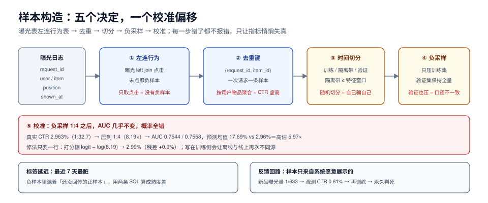

# 数据与样本：曝光日志怎么变成训练集

推荐系统的训练集不是「点击表」，而是**「曝光表」左连接「行为表」**。这个差别听起来像废话，但它决定了三件事：负样本是谁、正样本什么时候算数、以及为什么你的 AUC 高得可疑。

这一页讲：一条样本的完整定义、五类标签口径、负采样的三种做法与它带来的校准偏移（有实测）、时间切分为什么必须按时间而不是随机、以及标签延迟如何让「最近 7 天」变成最脏的数据。



本页判据族 `RCS-A` ~ `RCS-H`，共 8 条。定义表见文末「本页判据」一节。

## 一、一条样本的完整定义

一条训练样本由五个字段决定，缺一个都会在某个下游环节出事：

| 字段 | 含义 | 取错的后果 |
| --- | --- | --- |
| `request_id` | 一次请求（一次曝光机会） | 无法去重，同一次请求的多条曝光被当成独立样本 |
| `user_id` | 谁 | 用户维度切分做不了，冷启动评估失真 |
| `item_id` | 什么 | 特征穿越查不出来 |
| `position` | 展示位次 | 位置偏差无法校正 |
| `label` | 点击/时长/转化 | 目标函数与业务指标脱节 |
| `ts` | 曝光时间（不是点击时间） | 时间切分与特征窗口全错 |

最常被漏掉的是 `position` 与 `ts`：前者让「位置偏差」变成不可修的暗病，后者让「用点击时间做窗口」变成一个隐蔽的穿越——点击时间晚于曝光时间，用它算的特征在曝光那一刻还不存在。

```sql [sql/010_sample.sql]
-- 从曝光表构造样本：一条曝光 = 一条样本（不论有没有点击）
with expo as (
  select request_id, user_id, item_id, position, shown_at
  from rec_exposure
  where shown_at >= :start and shown_at < :end
),
acts as (
  select request_id, item_id, min(event_time) as click_at
  from rec_action
  where event_type = 'click'
  group by request_id, item_id
)
select e.request_id, e.user_id, e.item_id, e.position,
       e.shown_at,
       case when a.click_at is null then 0 else 1 end as label,
       a.click_at
from expo e
left join acts a on a.request_id = e.request_id and a.item_id = e.item_id;
```

注意 `acts` 里按 `(request_id, item_id)` 聚合而不是按 `user_id, item_id`：**同一个用户在不同请求里看到同一个物品，是两条样本**。按用户物品聚合会把「看了 5 次点了 1 次」压成一条正样本，等于人为把 CTR 从 20% 改成 100%。

## 二、五类标签口径，先选一个再写 SQL

| 口径 | 定义 | 适用 | 副作用 |
| --- | --- | --- | --- |
| 点击 | 曝光后 N 秒内点击 | 通用 CTR | 标题党收益高 |
| 有效点击 | 点击后停留 > 3 s | 内容推荐 | 需要前端埋点，回传有延迟 |
| 时长加权 | `min(dwell, cap)` 归一化 | 视频/图文 | 长内容天然占优，需按类目归一 |
| 转化 | 下单/付费 | 电商 | 极稀疏（千分之几），需要延迟建模 |
| 负反馈 | 不感兴趣/举报 | 混排护栏 | 样本极少，通常只做惩罚项不做主目标 |

::: danger 三个会把样本做废的写法
1. **只取有点击的曝光**。正负样本比变成 1:0，模型学不到「不点」。正确做法：曝光左连接行为，未点击即负样本。
2. **用「用户-物品」聚合去重**。同一次请求的重复曝光被合并，CTR 被系统性放大。正确做法：按 `request_id + item_id` 去重。
3. **用点击时间做特征窗口**。点击晚于曝光，用它聚合出的「最近 N 天行为」在曝光时刻并不存在。正确做法：所有特征窗口以 `shown_at` 为右端点，且只允许 `ts < shown_at` 的事件。
:::

## 三、负采样：三种做法与各自的代价

真实曝光里正样本通常只有 2%~5%，全量训练一次要扫几亿行。于是有负采样，三种：

| 做法 | 做法 | 训练成本 | 校准 | 适用 |
| --- | --- | --- | --- | --- |
| 不下采样 | 全量曝光 | 100% | 天然正确 | 数据量可控、需要概率 |
| 负样本下采样 | 保留全部正样本，负样本抽 1/k | 降到 ~1/(k·ratio) | **被破坏，必须校正** | 大厂主流 |
| 正样本上采样 | 复制正样本 | 不变或更高 | 被破坏（反向） | 类别极不平衡的转化模型 |

下采样的代价可以精确算出来。下面这组读数来自本机脚本（20 万曝光、真实 CTR 2.963%、正负比 1:32.7，负样本压到 1:4）：

```text
全量曝光 200000，点击 5926（真实 CTR 2.9630%），未点击 194074（1:32.7）
负采样到 1:4 → 样本 29630，样本内点击率 20.00%
AUC：全量 0.7544 ／ 1:4 样本 0.7558（只改样本分布，不改排序）
负样本被压缩 8.19× → logit 平移 log(8.19) = +2.103
在 1:4 样本上校准好的模型，直接用于全量：预测均值 17.69% vs 真实 2.96% → 高估 5.97×
减掉这段先验：预测均值 2.99%（残差 +0.9%）
```

三行读数对应三个结论：

1. **AUC 几乎不动**（0.7544 → 0.7558）。因为 AUC 只看排序，而负采样是「按比例删负样本」，删完顺序不变。**所以「AUC 没掉」不能证明采样无害。**
2. **均值高估 5.97 倍**，正好是压缩倍数 8.19 与样本内先验的合成效果。
3. **校正只要一次 logit 平移**：`logit(p) - log(k)`，其中 `k` 是负样本压缩倍数。残差 0.9% 来自采样噪声。

校正写在打分侧，不写在训练侧——训练侧改了会让「离线指标」与「线上分数」再次不同源：

```python [app/score/calibrate.py]
import math

def correct_logit(raw_logit: float, neg_keep_ratio: float) -> float:
    """把「在 1:k 样本上训练的模型」输出还原到真实先验。
    neg_keep_ratio = 保留的负样本比例（1:4 时为 1/8.19 ≈ 0.122）"""
    return raw_logit - math.log(1.0 / neg_keep_ratio)

def to_prob(raw_logit: float, neg_keep_ratio: float) -> float:
    z = correct_logit(raw_logit, neg_keep_ratio)
    return 1.0 / (1.0 + math.exp(-z))
```

::: warning 什么时候校正会失效
校正成立的前提是「采样只依赖标签、不依赖特征」。如果负样本是**按热度采样**（热门多抽）或**按曝光位置采样**（低位置多抽），采样概率与特征相关，单一 logit 平移就不够，需要按分层分别校正，或直接改用 IPS 权重。判断方法：按位置分桶看「校正后预测均值 / 实际均值」，比值不接近 1 就是分层漂移。
:::

## 四、时间切分：随机切分是最常见的自欺

随机切分会让同一天、甚至同一秒的数据同时出现在训练集和验证集。推荐场景下这几乎必然导致离线指标虚高，因为**用户兴趣在小时级别是高度自相关的**。

| 切分方式 | 验证集 AUC | 线上表现 | 问题 |
| --- | --- | --- | --- |
| 随机 8:2 | 最高 | 通常最差 | 同请求/同会话泄漏 |
| 按用户切分 | 中 | 中 | 只有新用户评估，老用户能力测不到 |
| 按时间切分（T-1 训练，T 验证） | 最低但最真 | 与离线最接近 | 需要留出特征窗口的前置数据 |

正确做法是**三层切分 + 一个隔离带**：

```text
|---- 训练 ----|-- 隔离带 --|---- 验证 ----|-- 隔离带 --|---- 测试 ----|
       30 天        1 天          1 天          1 天         1 天
```

隔离带的宽度由「最长特征窗口」决定：如果用了「近 7 天点击」，隔离带至少 7 天，否则验证集的特征窗口会伸进训练期。

## 五、标签延迟：最近 7 天是最脏的数据

点击有回传延迟（弱网、离线缓存、客户端补报），转化更夸张（下单到支付可能几小时，退货要 7~15 天）。于是「最近 7 天」的样本标签是**不完整的**：负样本里混着大量「还没回传的正样本」。

三种处理，按代价排序：

1. **截断窗口**：只用到 T-2 的数据，简单有效，代价是模型新鲜度。
2. **延迟加权**：按「事件发生到回传的时间差」分布给样本加权，越近的样本权重越低。
3. **双模型**：一个即时模型（短窗口、标签完整度低）+ 一个延迟模型（长窗口），线上融合。

无论哪种，都必须能回答一个问题：**「昨天」的数据里，标签完整率是多少？** 这个数通常按 `1 - 未回传比例` 估算，做法是在 T 日抽样一批曝光，等到 T+7 再看最终标签，得到回传曲线。

```sql [sql/020_label_maturity.sql]
-- 标签成熟度：按曝光日期统计「T+N 天后仍是负样本」的比例
select date(shown_at) as d,
       count(*) as expo,
       avg(case when click_at is null then 1 else 0 end) as neg_ratio_now,
       avg(case when click_at is null or click_at > shown_at + interval '7 day' then 1 else 0 end) as neg_ratio_mature
from rec_exposure
where shown_at >= current_date - 14
group by 1
order by 1;
```

`neg_ratio_now` 与 `neg_ratio_mature` 的差就是「假负样本率」。接近 0 说明延迟可忽略；差 5% 以上，最近几天不能直接进训练集。

## 六、样本权重：三个必须加权的场景

| 场景 | 权重 | 不做的后果 |
| --- | --- | --- |
| 位置偏差 | `1 / propensity(position)` | 模型学会「排前面就有点击」 |
| 多目标 | 各目标损失加权（如 CTR + 0.3×CVR） | 单一目标压死其他目标 |
| 类目不平衡 | 按类目逆频率或按业务价值 | 高频类目垄断，长尾类目永远学不好 |

位置偏差的权重在第[排序](../Ranking/index.md))一页展开，这里只强调一点：**权重只能在训练时用，打分时不能乘**——否则线上分数会被位置先验污染。

## 七、反馈回路：样本只来自「系统愿意展示的东西」

这是推荐系统与普通监督学习最大的结构差异：**你的训练数据是自己的历史决策产生的**。系统不给某个物品曝光，它就永远没有样本；没有样本，模型就永远认为它不好。

实测一组读数（50 个物品、12 万次请求，其中 10 个是新品，真实 CTR 8.40%）：

```text
真实 Top5      ：[39, 38, 37, 36, 35]  均值 9.660%
朴素 CTR Top5  ：[39, 38, 37, 36, 35]  均值 6.577%
新品（40~49）真值 8.400%，朴素 0.810%
曝光量：老品均值 10067，新品均值 16（633.1×）
```

新品真实 CTR 8.40%（比老品均值还高），但因为排序器系统性低估它们（模拟冷启动），它们的曝光量只有老品的 **1/633**，观测 CTR 被位置倾向压成 **0.81%**——**再拿这个 0.81% 去训练，就是在教模型「新品不行」**。打破这个循环只有两条路：给新品固定配额（见[召回](../Recall/index.md))），或做主动探索（见[冷启动与探索](../ColdStart/index.md))）。

## 八、验收：五个能算的数字

上线一份新训练集之前，这五个数必须能报出来，缺一个就不要训练：

1. **正负比**与**样本内 CTR**（对不上真实 CTR 就说明采样口径有问题）。
2. **重复率**：`count(*) / count(distinct request_id, item_id)`，> 1.0 说明曝光表里有重复上报。
3. **标签完整率**：最近 3 天与前 30 天的差异。
4. **时间切分的隔离带宽度** ≥ 最长特征窗口。
5. **特征缺失率**：训练集与线上日志的缺失率差 > 3 个百分点，说明两侧特征定义已经分叉。

## 本页判据

| 编号 | 判据 | 看什么现象 | 不满足时改哪里 |
| --- | --- | --- | --- |
| `RCS-A` | 样本来自曝光表而非点击表 | 样本数 ≈ 曝光数（去重后） | 改成 `exposure left join action` |
| `RCS-B` | 去重键是请求 + 物品 | `request_id + item_id` 唯一 | 不要按用户物品聚合 |
| `RCS-C` | 负采样有校正 | 打分侧存在 `logit - log(k)` 或等价校准 | 加一层校准并监控均值偏差 |
| `RCS-D` | 采样只依赖标签 | 采样概率与位置/热度无关 | 分层采样或改用 IPS 权重 |
| `RCS-E` | 时间切分 + 隔离带 | 隔离带 ≥ 最长特征窗口 | 补隔离带，改随机切分为按时间 |
| `RCS-F` | 标签完整率可算 | 有 `neg_ratio_now` 与 `neg_ratio_mature` | 加成熟度 SQL，近 3 天降权或不入训 |
| `RCS-G` | 位置进样本 | 样本表有 `position` 字段 | 补字段，供位置偏差校正 |
| `RCS-H` | 反馈回路有出口 | 新品有固定曝光配额或探索预算 | 加配额/探索，否则长尾永远起不来 |

## 参考资料

- Yi et al., *Sampling-Bias-Corrected Neural Modeling*（负采样与流式校正的工业做法）：<https://arxiv.org/abs/1907.05171>
- Joachims et al., *Unbiased Learning-to-Rank with Biased Feedback*（倾向加权）：<https://arxiv.org/abs/1608.04468>
- Kohavi et al., *Trustworthy Online Controlled Experiments*（第 3 章：指标与样本口径）：<https://experimentguide.com/>
- Steck, *Training and Testing of Recommender Systems on Data Missing Not at Random*（MNAR 与评估偏差）：<https://dl.acm.org/doi/10.1145/1835804.1835895>
