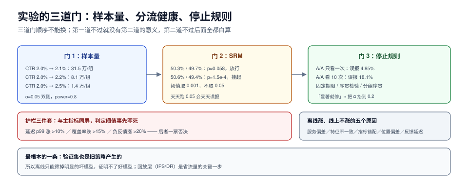

# 评估与实验：什么时候可以停

推荐系统的实验有一个特殊困难：**指标之间天然冲突**。CTR 涨了，时长可能跌；人均时长涨了，7 日留存可能跌；短期涨了，长期生态可能被破坏。所以「实验显著」不是终点，**「知道它为什么显著、以及会不会在两个月后反噬」才是**。

这一页讲：三层评估各自能回答什么、离线指标怎么选、样本量必须先算（有三个实测数）、SRM 与偷看这两个把人骗得最惨的陷阱（有实测误报率）、护栏指标怎么配、以及「离线涨线上不涨」的五个结构性原因。



本页判据族 `RCX-A` ~ `RCX-H`，共 8 条。定义表见文末「本页判据」一节。

## 一、三层评估，各回答一个问题

| 层 | 做法 | 能回答 | 不能回答 |
| --- | --- | --- | --- |
| 离线 | 历史数据上算 AUC/NDCG | 「模型在这批数据上排序更好吗」 | 「线上会更好吗」 |
| 离线回放 | 用日志回放新策略（IPS/DR） | 「如果当时用新策略，点击会变吗」 | 「用户会适应新策略吗」 |
| 在线 A/B | 真实分流 | 「整体指标变了吗」 | 「为什么变」 |

三层的关系是**漏斗而不是替代**：离线筛掉 90% 的坏想法，回放筛掉一半「离线好但因果不成立」的，A/B 决定上不上。跳过任何一层都会让成本上升——最常见的是跳过回放，直接把离线好模型推上 A/B，浪费两周流量。

## 二、离线指标怎么选：三个必须同时报

| 指标 | 度量什么 | 单独报的风险 |
| --- | --- | --- |
| AUC / GAUC | 排序能力 | 不看位置、不看列表、不看校准 |
| NDCG@K | 前 K 位的质量 | 需要分级标签，二值标签时退化为排序准确率 |
| 校准误差（ECE） | 分数能不能当概率 | 常被忽略，但乘法融合时致命 |

三个一起报，才能避免「AUC 涨了但线上没变」的典型困惑：如果 AUC 涨、NDCG 不涨，说明提升集中在长尾位置；如果 NDCG 涨、ECE 变差，说明模型为了排序牺牲了概率含义，混排/出价会出问题。

## 三、样本量：先算，再开实验

最小样本量由「基线、最小可检测效应（MDE）、显著性水平、功效」四个数决定。实测（α=0.05 双侧，power=0.8）：

```text
CTR 2.0% → 2.1%：每组需 315,206 曝光
CTR 2.0% → 2.2%：每组需 80,682 曝光
CTR 2.0% → 2.5%：每组需 13,809 曝光
```

三个数说明一件事：**想要 0.1 个百分点的提升，需要 31 万曝光/组**。日曝光 50 万的产品，这要跑两天；日曝光 5 万的产品，要跑 13 天——而 13 天的实验期间，用户的兴趣已经换了一轮。

所以实验设计的现实做法是：

1. **先定 MDE**，再算样本量，再算需要几天。三者不匹配时，**改 MDE 或改实验设计**，不要「先跑三天看看」。
2. **用更敏感的指标**。CTR 的方差大，可以看「人均点击次数」或「有转化的会话占比」，方差更小、所需样本更少。
3. **分层或配对**。按用户历史活跃度分层，能显著降低方差（同等样本量下 MDE 更小）。

```python [app/experiment/samplesize.py]
import math

def n_per_group(p0: float, p1: float, alpha: float = 0.05, power: float = 0.8) -> int:
    z_a = 1.959964 if alpha == 0.05 else 2.575829     # 双侧
    z_b = 0.841621 if power == 0.8 else 1.281552
    pbar = (p0 + p1) / 2
    num = (z_a * math.sqrt(2 * pbar * (1 - pbar)) + z_b * math.sqrt(p0 * (1 - p0) + p1 * (1 - p1))) ** 2
    return math.ceil(num / (p1 - p0) ** 2)
```

## 四、SRM：分流比例不对，后面全都白算

SRM（Sample Ratio Mismatch）指实际分流比例与设计不符。它不直接说明指标有问题，但**几乎总是意味着实验实现有 bug**（分流键偏斜、某组请求被缓存、某组用户被过滤）。

实测：

```text
SRM 50,300/49,700：χ²=3.60，p≈5.78e-02
SRM 50,600/49,400：χ²=14.40，p≈1.48e-04
```

第一组（50.3% / 49.7%）在 p<0.001 下不显著，属于正常波动；第二组（50.6% / 49.4%）p≈1.5e-4，**必须停下来查**。注意判据用的是 `p < 0.001` 而不是 0.05——SRM 检查每天都跑，用 0.05 会天天误报。

常见的 SRM 原因：

| 原因 | 表现 | 排查 |
| --- | --- | --- |
| 分流键偏斜 | 某组用户数略多 | 对 `hash(uid) % 100` 做均匀性检验 |
| 缓存污染 | 某组请求命中另一组的缓存 | 检查缓存键是否含实验分组 |
| 组间过滤 | 新用户只进了对照组 | 检查实验入口条件 |
| 埋点丢失 | 某组曝光少 | 对比服务端日志与埋点日志 |

## 五、偷看：看得越多，越容易「显著」

「每天看一眼，显著就停」是最常见的实验陋习。实测（A/A 实验，真实无差异）：

```text
A/A 只看一次（每组 3000）：误报 4.85%
A/A 每 300/组看一次、最多看 10 次：至少一次显著 18.1%
```

**同样的数据、同样的检验，只因为多看了 9 次，误报率从 4.85% 涨到 18.1%**——接近 4 倍。这意味着「每天看、显著就停」的实验里，大约每 5 个「显著」就有 1 个是假的。

三种正确做法：

1. **固定期限**：实验开始前定好结束日期与所需样本量，中途只看护栏指标（是否要紧急停止），不看主指标显著性。
2. **序贯检验**：用 always-valid p-value 或 mSPRT，允许连续监控但控制误报率（代价是需要更大的效应才能显著）。
3. **分组序贯**（group sequential）：把实验分成 2~5 个阶段，用调整后的 α 边界（如 O'Brien-Fleming）。

## 六、护栏指标：主指标涨了也可能不能上

每次实验至少配三个护栏：

| 护栏 | 为什么 | 判定 |
| --- | --- | --- |
| 延迟 p99 | 模型变复杂最直接的代价 | 涨 > 10% 需评估 |
| 多样性/覆盖率 | 短期 CTR 常常靠收敛到头部换来 | 覆盖率跌 > 15% 需复议 |
| 负反馈率（举报/不感兴趣） | 短期指标的常见代价 | 涨 > 20% 一票否决 |

护栏指标的判定规则要**事先写死**，不能等结果出来再讨论「这个涨 25% 算不算问题」——那就是在给结论找理由。

## 七、离线涨、线上不涨：五个结构性原因

| 原因 | 机理 | 判别方法 |
| --- | --- | --- |
| 服务偏差 | 训练数据只来自旧策略的曝光 | 看新模型推荐了多少「从未曝光」的物品 |
| 特征不一致 | 训练/服务窗口或口径不同 | 双跑比对（见[特征](../Features/index.md))） |
| 指标错配 | 优化 AUC，业务看时长 | 离线同时算业务指标的代理（如 NDCG@10） |
| 位置偏差 | 离线评估用的是历史位置 | 用 IPS 重算离线指标 |
| 反馈延迟 | 短期指标看不到长期影响 | 延长观察窗，加 7 日留存护栏 |

第一项最根本：**你的验证集也是旧策略产生的**。新模型在「旧策略愿意曝光的物品」上更好，不代表它在「新策略愿意曝光的物品」上更好。这就是为什么离线评估永远只能筛掉明显的坏模型，不能证明好模型。

## 八、验收：五个可复跑的动作

1. **样本量计算表**：每个实验都有「基线/MDE/所需样本/预计天数」四列。
2. **SRM 日报**：所有在跑实验的 χ² 与 p 值，p<0.001 自动挂起。
3. **停止规则**：实验配置里写死「固定期限」或「序贯方案」，二者必选其一。
4. **护栏看板**：三个护栏指标与主指标同屏。
5. **复盘口径**（对结论本身）：实验结束后，把「离线预测的提升」与「线上实测的提升」并列，差距 > 50% 要写原因。

## 本页判据

| 编号 | 判据 | 看什么现象 | 不满足时改哪里 |
| --- | --- | --- | --- |
| `RCX-A` | 三层评估各司其职 | 有离线、回放、A/B 三类报告 | 补回放层，别从离线直接跳 A/B |
| `RCX-B` | 离线三指标同报 | AUC、NDCG@K、ECE 并列 | 补 NDCG 与校准 |
| `RCX-C` | 实验前算样本量 | 有 MDE 与所需样本的记录 | 按第三节公式算，再定天数 |
| `RCX-D` | SRM 阈值 0.001 且自动挂起 | 有 SRM 日报与告警 | 加 χ² 检查，阈值改 0.001 |
| `RCX-E` | 停止规则事先写死 | 实验配置里可见期限或序贯方案 | 禁止「显著就停」 |
| `RCX-F` | 三个护栏同屏 | 延迟/覆盖/负反馈与主指标并列 | 加护栏，判定阈值事先定 |
| `RCX-G` | 离线线上差距有归因 | 报告里有差距分析与原因 | 按第七节五项逐条排查 |
| `RCX-H` | 观察窗覆盖反馈延迟 | 观察期 ≥ 转化延迟 p90 | 延长观察窗或加留存护栏 |

## 参考资料

- Kohavi, Tang & Xu, *Trustworthy Online Controlled Experiments*（SRM、护栏、OEC 的系统论述）：<https://experimentguide.com/>
- Johari et al., *Always Valid Inference*（序贯检验）：<https://arxiv.org/abs/1512.04922>
- Deng et al., *Diagnosing Sample Ratio Mismatch in Online Controlled Experiments*：<https://dl.acm.org/doi/10.1145/3292500.3330722>
- Swaminathan & Joachims, *Off-Policy Evaluation for Large Action Spaces*：<https://arxiv.org/abs/1511.03722>
- Kohavi & Longbotham, *Online Controlled Experiments and A/B Testing*（综述）：<https://link.springer.com/referenceworkentry/10.1007/978-1-4899-7687-1_891>
