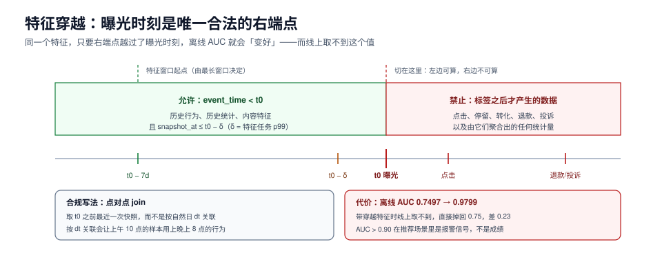

# 特征：训练与服务必须是同一个数

特征是推荐系统里唯一「同一份代码在两个时间点跑」的东西，所以它是最容易分叉的部分。分叉的表现很统一：**离线一切正常，线上分数明显偏低或明显集中**。而排查时最费时间的一句话是「这个特征离线也这么算的啊」——它通常意味着有四个人各自实现了同一份特征。

这一页讲：特征的三条时间约束、五种穿越形态（有实测读数）、训练/服务同源的四个断点、窗口漂移的量化方法、点对点 join 的正确写法，以及高基数特征为什么必须早做决定。



本页判据族 `RCF-A` ~ `RCF-H`，共 8 条。定义表见文末「本页判据」一节。

## 一、三条时间约束，违反任意一条即穿越

对任意一个特征 `f(item, user, t)`，在曝光时刻 `t0` 必须满足：

1. **数据可见性**：只用 `event_time < t0` 的事实（不是 `ingest_time`，不是 `update_time`）。
2. **计算可见性**：特征的计算逻辑在 `t0` 之前就已经存在（不能是「上了新模型才有这个特征」）。
3. **标签独立性**：不能用到任何由「这次曝光的结果」派生出来的数据（点击、停留、转化、退款）。

第三条最隐蔽。一个真实例子：把「该用户是否在 7 天内退款」作为特征，看起来完全合规（它只约束历史），但如果训练样本的标签是「是否点击」，而退款发生在点击之后，那么这个特征在训练时**包含了未来**。实测这类的杀伤力：

```text
无穿越特征：AUC 0.7497
带穿越特征：AUC 0.9799
```

0.98 的 AUC 在推荐场景里不是「模型强」，而是**报警信号**。一个可操作的判断：**如果 AUC 超过 0.90 而线上没感觉，先查穿越，不要庆祝。**

## 二、五种穿越形态，按出现频率排

| 形态 | 例子 | 为什么错 | 怎么查 |
| --- | --- | --- | --- |
| 标签后数据 | 是否退款、是否投诉 | 标签之后才产生 | 看特征的 `min(event_time)` 是否晚于 `t0` |
| 全量统计 | 物品「历史总 CTR」 | 包含曝光之后的数据 | 改成 `t0` 前的滑动窗口 |
| 未来分桶 | 用全量数据做分位数分桶 | 桶边界含未来信息 | 桶边界只用训练期数据拟合并冻结 |
| 跨样本聚合 | batch 内均值、batch 内排序 | 服务时 batch=1 | 禁止跨样本特征 |
| 数据修复回填 | 事后补录的行为 | `ingest_time` 晚于 `t0` | 用 `event_time` 过滤，且回填数据打标记 |

第四种最容易被框架掩盖：`BatchNorm`、`batch 内 top-k 归一化`、`同一批候选之间做 softmax` 都属于这一类。它们在离线（大 batch）表现很好，线上（batch=1 或极小）直接失效。

::: danger 一个反直觉的结论
**穿越特征不会让离线指标变差，只会让它变好。** 所以「离线涨了」这个方法本身无法发现穿越——它必须靠结构检查：每个特征都要能回答「在 `t0` 那一刻，这个值算得出来吗」。把这个问题写进特征注册表，比事后排查便宜一百倍。
:::

## 三、训练/服务同源：四个断点

「同一个特征」在工程上有四个可能分叉的位置：

| 断点 | 表现 | 修法 |
| --- | --- | --- |
| 实现分叉 | 离线用 Spark SQL，线上用 Java | 单一实现 + 双跑比对（同一批 key 两边算，diff < 1e-6） |
| 窗口分叉 | 离线 7 天聚合，线上 1 小时 | 窗口写进特征定义，双侧共用 |
| 口径分叉 | 离线算「去重 UV」，线上算「PV」 | 口径写进注册表，含空值处理 |
| 时间分叉 | 离线用 `event_time`，线上用「最后更新时间」 | 统一用事件时间，服务侧只读已结算窗口 |

第三、四个断点最贵，因为它们不报错。可执行的守卫是**双跑比对**：

```sql [sql/040_feature_parity.sql]
-- 用同一批 request_id，对比离线特征表与线上特征日志
select o.feature_name,
       count(*) as n,
       avg(abs(o.value - l.value)) as mae,
       max(abs(o.value - l.value)) as max_err,
       count(*) filter (where abs(o.value - l.value) > 1e-6) as diff_rows
from offline_feature o
join online_feature_log l
  on l.request_id = o.request_id and l.feature_name = o.feature_name
where o.dt = current_date - 1
group by 1
having count(*) filter (where abs(o.value - l.value) > 1e-6) > 0
order by diff_rows desc;
```

`diff_rows` 应该是 0。不是 0 时，`mae` 很小、`max_err` 很大通常意味着**少量 key 走了不同分支**（比如新用户冷启动路径），而不是整体算法错。

## 四、窗口漂移：同一个特征，换个窗口就不是同一个特征

「近 N 天点击数」是最常见的特征，也是最容易在两侧用不同 N 的。实测把离线 7 天窗口与线上 1 小时窗口对齐看 PSI（Population Stability Index，>0.2 视为显著漂移）：

```text
离线 7 天窗口(6.2/2.1) vs 线上 1 小时窗口(5.4/1.9)：PSI=0.170
离线 7 天窗口(6.2/2.1) vs 线上 1 小时窗口(4.6/1.7)：PSI=0.749
离线 7 天窗口(6.2/2.1) vs 线上 1 小时窗口(3.8/1.5)：PSI=1.946
```

第一行是「还能用」，第二行是「模型在服务一个它没见过的分布」，第三行是「这个特征已经废了」。PSI 的价值在于它能**在指标变化之前报警**——AUC 通常要等一周才反应，PSI 第二天就能看到。

```python [app/feature/psi.py]
import math

def psi(base: list[float], live: list[float], bins: int = 10) -> float:
    lo, hi = min(base + live), max(base + live)
    w = (hi - lo) / bins or 1.0

    def hist(xs: list[float]) -> list[float]:
        h = [0] * bins
        for x in xs:
            h[min(bins - 1, int((x - lo) / w))] += 1
        return [max(1e-6, v / len(xs)) for v in h]

    a, b = hist(base), hist(live)
    return sum((x - y) * math.log(x / y) for x, y in zip(a, b))
```

::: warning PSI 的两个使用前提
1. **基线必须是「上线时的训练分布」**，不是「昨天的线上分布」。用滚动基线会让漂移被慢慢吸收，永远报不出来。
2. **分桶边界要冻结**。每次重算分位数等于让尺子跟着物体变，PSI 恒为 0。
:::

## 五、点对点 join：为什么 `join on date` 一定错

最常见的错误写法：

```sql [sql/bad_pit_join.sql]
-- 错误：把「用户当天的汇总特征」直接按日期关联到样本上
select s.*, f.click_cnt_7d
from sample s
join user_feature_daily f
  on f.user_id = s.user_id and f.dt = date(s.shown_at);
```

问题在于 `user_feature_daily` 的 `dt` 是**按自然日结算**的：它包含当天全天的数据，而样本的 `shown_at` 是当天上午 10 点。于是这条样本用上了晚上 8 点的行为——**同一天内的穿越**。

正确写法是 as-of join，取「`t0` 之前最近一次结算」的快照：

```sql [sql/050_pit_join.sql]
-- 正确：as-of join，取 shown_at 之前最近的快照
select s.request_id, s.user_id, s.item_id, s.shown_at,
       f.click_cnt_7d, f.snapshot_at
from sample s
left join lateral (
  select click_cnt_7d, snapshot_at
  from user_feature_daily f
  where f.user_id = s.user_id
    and f.snapshot_at <= s.shown_at - interval '10 minute'   -- 留出结算延迟
  order by f.snapshot_at desc
  limit 1
) f on true;
```

那个 `10 minute` 是**结算延迟的安全边界**：特征任务 10:00 跑完，标记的是「截至 10:00」，但如果它 10:07 才写完，10:05 的请求就读不到，只能用 09:50 的快照。边界取多大，取决于特征任务的 p99 完成时间——**这个数必须实测，不能拍**。

## 六、在线特征读取：三条路径与各自的坑

| 路径 | 延迟 | 一致性 | 坑 |
| --- | --- | --- | --- |
| 请求内实时计算 | 高（依赖外部服务） | 强 | 拖垮 p99，必须有超时与默认值 |
| 特征存储（KV） | 低（1~5 ms） | 最终一致 | 写入延迟导致「刚发生的行为看不到」 |
| 本地缓存 | 最低 | 弱 | 多实例不一致，实验结论会抖 |

主流分层是「**KV 为主 + 实时补丁 + 缺省兜底**」：KV 存离线算好的批量特征，实时补丁覆盖最近 N 分钟的行为，缺省值保证任何情况下都能打分。

```yaml [conf/feature.yaml]
features:
  user_ctr_7d:   {source: kv,   default: 0.05, timeout_ms: 8}
  item_ctr_7d:   {source: kv,   default: 0.03, timeout_ms: 8}
  user_recent:   {source: rt,   default: [],   timeout_ms: 12, ttl_s: 300}
  item_price_band: {source: local, default: "unknown"}
on_timeout: use_default_and_count      # 超时用默认值，并打点
```

`on_timeout` 必须是「用默认值 + 计数」，不能是「整条请求失败」。推荐是**可失败的降级服务**：少一个特征最多是排序变差，整条失败是页面空白。

## 七、高基数：在「哈希」和「砍掉」之间选一个

用户 ID、物品 ID、店铺 ID 这类高基数字段，四种处理：

1. **哈希分桶**（`hash(id) % 2^20`）：省内存，但桶间冲突会引入噪声；冲突率约 `n/2^20`，百万级 ID 时约 1%，可接受。
2. **频次截断**（只保留 Top-N，其余归 `OTHER`）：最常用，代价是长尾共享一个嵌入。
3. **目标编码**（用历史 CTR 代替 ID）：强，但**必须点对点计算**，否则必穿越。
4. **不用 ID，用内容特征**：冷启动友好，表达力弱。

判断标准是**「这个 ID 的样本量够不够学一个嵌入」**：样本数 < 100 的 ID，嵌入基本是噪声，不如走内容特征或直接归 `OTHER`。

## 八、验收：五个能跑的动作

1. **穿越扫描**：对每个特征，检查它引用的所有表的最小 `event_time` 是否都早于样本 `t0`。
2. **双跑比对**：同一批 `request_id`，离线与线上特征 diff 行数为 0。
3. **PSI 报告**：每个特征对「上线基线」的 PSI，> 0.2 的进入观察名单。
4. **缺失率**：线上默认值占比 < 5%，且与训练集缺失率差 < 3 个百分点。
5. **超时演练**：人为让特征存储延迟 500 ms，确认请求仍能返回（用默认值），且降级计数上涨。

## 本页判据

| 编号 | 判据 | 看什么现象 | 不满足时改哪里 |
| --- | --- | --- | --- |
| `RCF-A` | 特征只用 `event_time < t0` 的数据 | 特征注册表写明了数据边界 | 改成事件时间过滤，回填数据打标记 |
| `RCF-B` | 无标签后数据 | 每个特征能回答「曝光时算得出来吗」 | 删掉或在训练时改用「上一次」的值 |
| `RCF-C` | 无跨样本统计特征 | 代码里没有 batch 内聚合 | 改为滑窗聚合或固定统计量 |
| `RCF-D` | 训练/服务单一实现或双跑一致 | diff 行数为 0 | 收敛实现，加日常双跑 |
| `RCF-E` | 窗口与口径写进注册表 | 两侧读同一份配置 | 把 N、去重口径、空值策略写进定义 |
| `RCF-F` | 点对点 join + 结算延迟边界 | 特征 `snapshot_at <= t0 - δ` | 改 as-of join，δ 取特征任务 p99 |
| `RCF-G` | PSI 有冻结基线 | 基线版本号可见，分桶边界固定 | 冻结基线，按版本升级 |
| `RCF-H` | 超时降级用默认值并计数 | 有 `feature_default_total` 指标 | 改降级策略，别让请求整体失败 |

## 参考资料

- Sculley et al., *Hidden Technical Debt in Machine Learning Systems*（特征与管道债的经典论述）：<https://papers.nips.cc/paper/5656-hidden-technical-debt-in-machine-learning-systems>
- Uber Michelangelo（特征存储与点对点 join 的工程实践）：<https://www.uber.com/blog/michelangelo-machine-learning-platform/>
- Feast 文档（feature view 与 point-in-time join 语义）：<https://docs.feast.dev/>
- PSI 与特征漂移监控：<https://dl.acm.org/doi/10.1145/3132188>
