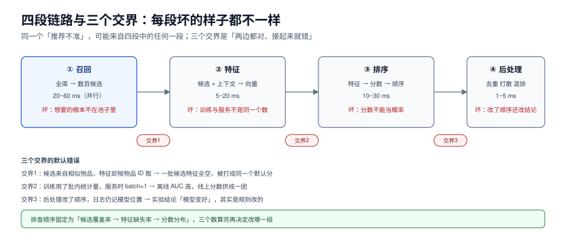

# 总览：一条推荐请求穿过的四段

一条推荐请求从「用户打开 App」到「十张卡片出现在屏幕上」，中间只发生四件事：**从几百万个物品里取出几千个候选（召回）→ 把这批候选的几百个特征算出来（特征）→ 打一个分并排序（排序）→ 按业务规则重排、去重、混排、补位（后处理）**。这四段的失败长得完全不一样，但症状常常都表现为「推荐不准」。

这一页给的是全局图和三条交界：哪一段该为哪一类线上现象负责、出了问题先看哪里、以及为什么「离线 AUC 涨了」不能作为任何一段通过验收的证据。



本页判据族 `RCO-A` ~ `RCO-H`，共 8 条。定义表见文末「本页判据」一节。

## 一、四段各管什么，各自怎么坏

| 段 | 输入 → 输出 | 典型耗时预算 | 这一段坏了的典型症状 | 对应章节 |
| --- | --- | --- | --- | --- |
| 召回 | 全库 → 数百~数千候选 | 20~60 ms（并行） | 「想找的东西根本不在池子里」；新品/长尾永远不出现 | [召回](../Recall/index.md)) |
| 特征 | 候选 + 用户上下文 → 向量 | 5~20 ms（走特征存储） | 离线好线上差；同一用户两次请求分数跳变 | [特征](../Features/index.md)) |
| 排序 | 特征 → 分数 → 顺序 | 10~30 ms | 分数不可当概率；AUC 高但混排/出价算错 | [排序](../Ranking/index.md)) |
| 后处理 | 有序列表 → 最终展示 | 1~5 ms | 重复、同作者连出、已读仍推、广告位挤掉主内容 | 本页第五、六节 |

**关键比例**：召回决定了「天花板」。召回里没有的东西，排序给多高的分都没用——这也是为什么「换个更强的排序模型」常常毫无体感：**天花板没变，只是把天花板下面的顺序挪了挪**。

一个可以自查的经验值：把召回池扩大到 2 倍，如果线上指标不动，说明瓶颈在排序或后处理；如果动了，说明之前的召回一直在漏。

## 二、三个交界，各有一个「默认错误」

四段之间的三个交界，是事故最喜欢待的地方。它们的共同点是**两段各自都正确，接起来就错**。

| 交界 | 默认错误 | 表现 | 怎么钉死 |
| --- | --- | --- | --- |
| 召回 → 特征 | 特征按「物品 ID」算，但召回给的是「相似物品」，两者 ID 空间不同 | 一批候选的特征全为空，被打成同一个默认分 | 候选必须带 `item_id` 与来源通道；特征缺失要有显式默认值与计数 |
| 特征 → 排序 | 训练用批内统计特征（如 batch 内均值），服务时 batch=1 | 离线 AUC 高，线上分数全挤在一起 | 禁止使用跨样本统计量；或把它改成时间窗口聚合 |
| 排序 → 后处理 | 后处理改了顺序，但归因仍按排序位置记 | 实验结论「模型变好」，其实是规则改的 | 曝光日志必须记录**最终位置**与**干预来源** |

第三条最容易被忽略：一次混排规则（比如「第 3 位必须是短视频」）就能让排序模型的 A/B 结论完全失真，因为模型的分和最终位置不再对应。

## 三、一条请求的时间轴

把四段摊在时间轴上，才能看出「延迟预算」该怎么分：

```text
t=0    请求到达（用户 ID、上下文、位置）
t=2ms  用户特征读取（画像、实时行为序列）
t=5ms  ├─ 召回 A（向量）   ─┐
       ├─ 召回 B（协同）   ─┤ 并行，取 max 而不是 sum
       ├─ 召回 C（热度/规则）─┘
t=45ms 合并去重、按配额截断
t=55ms 特征拼装（候选 × 特征，通常 200~500 维）
t=75ms 排序模型打分
t=80ms 后处理（去重、打散、补位、广告位）
t=85ms 返回
```

两个读法：

1. **并行只省「和」与「最大」的差**。实测六路召回的串行 p99 是 **160.2 ms**、并行 p99 是 **70.3 ms**（2.3×），但并行之后 p99 由**最慢的那一路**决定——所以「并行化」不是优化，是**把预算问题转换成超时问题**。详见[在线服务](../Serving/index.md))。
2. **特征与排序是串行的**，没有并行空间。想让总分从 85 ms 降到 60 ms，只有三条路：砍召回通道、砍特征数、砍模型层数。**没有第四条**。

## 四、四段各自的「必失点」

所谓必失点，是不做就会有、而且不会报错的东西。四段各一个：

| 段 | 必失点 | 为什么会失 | 一条可执行的守卫 |
| --- | --- | --- | --- |
| 召回 | 单路通吃 | 某一路分数尺度大，融合时挤掉其他路。实测：三路不归一化直接加权，Top20 **全部来自同一路**（20/20）；z-score 后是 11/7/2，RRF 是 7/7/6 | 融合前必须归一化，或直接用 RRF；并对每路设配额上限 |
| 特征 | 穿越 | 特征里混进了「标签之后才产生的数据」。实测带穿越特征 AUC **0.9799**，去掉后 **0.7497** | 特征必须能回答「在曝光那一刻，这个值算出来了吗」；用时间切分而非随机切分 |
| 排序 | 分数不是概率 | 负采样、样本权重、混排都会破坏校准。实测负采样 1:4 后预测均值高估 **5.97×** | 上线前做一次校准检查：预测均值 vs 实际均值，偏差 > 10% 先修校准 |
| 后处理 | 干预不可归因 | 规则改了位置但日志仍记模型位置 | 曝光日志同时记 `model_rank` 与 `final_rank`，以及 `intervention` 字段 |

## 五、后处理不是「收尾」，它会改结论

后处理常见的五类动作，每一类都会改变实验的读数：

1. **去重**（同作者/同店铺/同主题只留一个）：会系统性压低「多样性高但重复多」的模型的曝光。
2. **打散**（相邻位置不能同类）：会让「强模型」的优势被摊平——它本来能把好内容集中在前三，现在被迫分开。
3. **补位**（不足 10 条时用热门补）：新用户的实验结果会被热门内容污染，看起来「冷启动策略无效」。
4. **混排**（广告、短视频、直播插入固定位置）：位置效应直接混进模型效果，见[排序](../Ranking/index.md))的位置偏差一节。
5. **业务规则**（屏蔽词、地域、库存）：规则命中率高的时段，模型 A/B 的差异会被稀释。

::: warning 一条纪律
**后处理规则变更必须和模型变更分开实验。** 同一次实验里既改模型又改打散规则，得到的任何结论都不能用于下一轮决策——因为你不知道是哪一个起了作用，也不知道它们在互相抵消还是互相放大。
:::

## 六、生成式推荐换掉了哪一段

2025 年以来工业界的一条主线是「用生成式模型替代多路召回 + 排序的多阶段栈」：把物品编码成语义 ID（semantic ID），用 decoder-only 模型自回归地「生成」候选，甚至直接生成整页排版。它确实改变了一些东西：

| 维度 | 多阶段栈 | 生成式 | 变了吗 |
| --- | --- | --- | --- |
| 候选怎么来 | 多路召回 + 融合 | 模型逐 token 生成 | **变了** |
| 特征 | 人工 +  embedding，几百维 | 序列 token，端到端 | **变了** |
| 校准 | 单独一层（Platt/isotonic） | 仍是问题：生成概率不等于点击率 | **没变** |
| 位置偏差 | 存在 | 存在（甚至更强，因为训练数据也是曝光日志） | **没变** |
| 冷启动 | 内容特征 + 探索 | 仍需要探索预算 | **没变** |
| 评估 | 离线指标 + A/B | 同左，且更贵 | **没变** |

所以本专题的四段链路图在生成式架构下依然成立，只是「召回」那一段从「查索引」变成「跑解码」，**而它的失败模式（候选单一、长尾消失、延迟爆炸）一模一样**。读新论文时用这张表对照，就不容易被「端到端」这个词带走。

## 七、先问三个数，再谈模型

任何一次「推荐不准」的排查，先要三个数，缺一个就不要往下走：

1. **候选池覆盖率**：这次请求的候选里，用户最终点击的物品在不在？不在就是召回问题，别改排序。
2. **特征缺失率**：排序用到的特征里，有多少是默认值？超过 5% 就先修特征。
3. **分数分布**：线上打分的均值与离线预测均值差多少？差 2 倍以上先修校准。

这三个数都能从日志里直接算，不需要重新训练。**先定位段，再谈方法**——这是本专题所有章节的共同前提。

## 本页判据

| 编号 | 判据 | 看什么现象 | 不满足时改哪里 |
| --- | --- | --- | --- |
| `RCO-A` | 四段各有独立耗时与失败指标 | 监控里召回/特征/排序/后处理各有 p99 与错误率 | 拆 span，别只报一个「推荐接口 p99」 |
| `RCO-B` | 候选池覆盖率可算 | 能从日志算出「点击物品是否在候选集内」 | 曝光日志记候选集哈希或候选 ID 列表采样 |
| `RCO-C` | 特征缺失率可算 | 每条请求有「默认值特征占比」指标 | 特征拼装层统一打点，缺失填默认值并计数 |
| `RCO-D` | 三个交界各有一个契约 | 候选带来源通道；无跨样本统计特征；日志记最终位置 | 按第二节三行逐条补契约 |
| `RCO-E` | 融合前必须归一化 | 每路分数有归一化或直接使用 RRF | 加 z-score/min-max 或换 RRF，并给每路配额 |
| `RCO-F` | 后处理干预可归因 | 日志同时有 `model_rank` 与 `final_rank` | 补 `intervention` 字段，规则变更单独实验 |
| `RCO-G` | 生成式与多阶段用同一套判据 | 新架构仍能回答校准、偏差、冷启动三问 | 不要把「端到端」当作免检理由 |
| `RCO-H` | 排查先定位段 | 每次「不准」的结论能指到某一段 | 按第七节三个数走一遍，再决定改哪里 |

## 参考资料

- Covington et al., *Deep Neural Networks for YouTube Recommendations*（两阶段架构的原始动机）：<https://research.google/pubs/pub45530/>
- Gomez-Uribe & Hunt, *The Netflix Recommender System: Algorithms, Business Value, and Innovation*：<https://dl.acm.org/doi/10.1145/2843948>
- Cormack et al., *Reciprocal Rank Fusion*（多路融合的基线方法）：<https://plg.uwaterloo.ca/~gvcormac/cormacksigir09-rrf.pdf>
- 快手 OneRec / 生成式推荐工业实践综述（2026-06）：<https://www.cnr.cn/tech/techph/20260617/t20260617_527665273.shtml>
