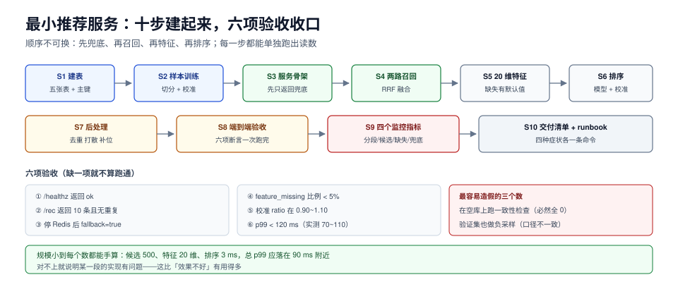

# 实战：一个能跑起来的最小推荐服务

这一页把前面七页的判据落成一个**可以照着做一遍**的最小系统：一张曝光表、一个离线训练脚本、一个在线服务（召回 → 特征 → 排序 → 后处理）、一套验收脚本。目标不是「效果好」，而是**每一段都能被单独验证**——这正是大多数自建推荐系统缺的东西。

规模设定：10 万物品、5 千用户、1 千万条曝光日志；单机 Docker Compose 起 PostgreSQL 18 + Redis 8；服务用 Python 3.13 + FastAPI。全部在本机可跑，不需要 GPU。



本页判据族 `RCP-A` ~ `RCP-H`，共 8 条。定义表见文末「本页判据」一节。

## 一、目标与明确不做的

| 做 | 不做 |
| --- | --- |
| 曝光日志 → 样本（含负采样与校准） | 不做实时训练（离线 T+1 足够） |
| 两路召回（向量 + 热度）+ RRF 融合 | 不做多路十几条通道 |
| 20 个特征的拼装与缺失兜底 | 不做特征存储平台 |
| LightGBM 排序 + 校准 | 不做深度模型 |
| 四层降级与兜底池 | 不做多机房 |
| A/B 分流 + SRM 检查 | 不做实验平台 |

**规模小的好处是每个数都能手算**：候选 500、特征 20 维、排序 3 ms、总 p99 应落在 90 ms 附近。对不上就说明某一段的实现有问题。

## 二、目录结构

```text
rec-min/
├─ deploy/
│  ├─ compose.yaml
│  └─ init/010_schema.sql
├─ scripts/
│  ├─ 020_sample.sql          # 样本构造
│  ├─ 030_train.py            # 训练 + 校准
│  ├─ 040_load_index.py       # 向量入库
│  └─ 090_accept.py           # 验收脚本
├─ app/
│  ├─ main.py                 # FastAPI 入口
│  ├─ recall/{semantic,trending,fuse}.py
│  ├─ feature/store.py
│  ├─ rank/{model.py,calibrate.py}
│  ├─ post/{dedup,diversify,fallback}.py
│  └─ obs/metrics.py
└─ conf/{recall.yaml,feature.yaml,fallback.yaml}
```

## 三、S1 数据表：五张表起步

```sql [deploy/init/010_schema.sql]
create table item (
  item_id      bigint primary key,
  title        text not null,
  category     text not null,
  embed        vector(32),                 -- pgvector；本实战用 32 维模拟
  created_at   timestamptz not null default now()
);

create table rec_exposure (
  request_id   uuid not null,
  user_id      bigint not null,
  item_id      bigint not null,
  position     smallint not null,
  model_version text not null,
  exp_group    text not null,
  shown_at     timestamptz not null,
  primary key (request_id, item_id)
);

create table rec_action (
  request_id   uuid not null,
  user_id      bigint not null,
  item_id      bigint not null,
  event_type   text not null,              -- click / dwell / convert
  event_time   timestamptz not null
);
create index on rec_action (request_id, item_id);

create table user_feature_daily (
  user_id      bigint not null,
  dt           date not null,
  snapshot_at  timestamptz not null,
  click_cnt_7d integer not null,
  ctr_7d       real not null,
  primary key (user_id, dt)
);

create table rec_fallback (
  segment      text not null,
  rank         smallint not null,
  item_id      bigint not null,
  primary key (segment, rank)
);
```

三个设计决定值得说明：

1. **`rec_exposure` 主键是 `(request_id, item_id)`**，天然防重复上报，也保证「一次请求内同一物品只算一次」。
2. **`rec_action` 不设唯一键**：同一请求同一物品可能点击多次（展开、重复点），保留原始事件，聚合留给样本构造。
3. **`user_feature_daily` 带 `snapshot_at`**：点对点 join 靠它，缺了就只能按 `dt` 关联，必穿越（见[特征](../Features/index.md))）。

## 四、S2 样本与训练

样本构造复用[数据与样本](../DataSamples/index.md))的 `010_sample.sql`，此处只补「造数」与「切分」：

```sql [scripts/025_seed.sql]
-- 造 5000 用户 × 近 30 天的曝光（约 1000 万行，按天分批插入）
insert into rec_exposure (request_id, user_id, item_id, position, model_version, exp_group, shown_at)
select gen_random_uuid(),
       (random() * 4999)::bigint + 1,
       (random() * 99999)::bigint + 1,
       (random() * 9)::smallint + 1,
       'v0', 'A',
       now() - (random() * interval '30 day')
from generate_series(1, 200000);
-- 重复执行 50 次（或用 generate_series 放大），得到 ~1000 万行
```

训练脚本的关键不是模型，而是**三段切分 + 校准 + 三个指标**：

```python [scripts/030_train.py]
import lightgbm as lgb
import numpy as np

# 1) 按天切分：训练 T-30~T-3，验证 T-2，测试 T-1（隔离带由特征窗口决定）
train = load_samples("2026-09-24", "2026-10-21")
valid = load_samples("2026-10-22", "2026-10-22")
test = load_samples("2026-10-23", "2026-10-23")

# 2) 负采样：只在训练集做，验证/测试保持全量（否则评估口径不一致）
train_pos = train[train.y == 1]
train_neg = train[train.y == 0].sample(frac=0.125, random_state=7)   # 1:4
train_s = concat([train_pos, train_neg]).sample(frac=1.0, random_state=7)

model = lgb.LGBMClassifier(objective="binary", metric="auc",
                           num_leaves=63, min_child_samples=100, n_estimators=600)
model.fit(train_s[X], train_s.y, eval_set=[(valid[X], valid.y)],
          callbacks=[lgb.early_stopping(50)])

# 3) 校准：负样本压缩倍数是 1/0.125 = 8
K = 8.0
raw = model.predict_proba(test[X])[:, 1]
calibrated = raw / (raw + (1 - raw) * K)          # 等价于 logit - log(K)
print("pred_mean=%.4f actual=%.4f ratio=%.3f" % (calibrated.mean(), test.y.mean(),
                                                  calibrated.mean() / test.y.mean()))
```

**验收读数**：`ratio` 落在 0.90~1.10。如果 `ratio` 接近 6，说明校准公式方向搞反了（应该是乘 `K` 而不是除）。

## 五、S3 服务骨架：先返回兜底，再接模型

服务上线顺序必须是「兜底 → 召回 → 特征 → 排序」，每一步都可独立验收：

```python [app/main.py]
from fastapi import FastAPI, Query
from app.post.fallback import fallback_for

app = FastAPI()

@app.get("/healthz")
def healthz():
    return {"ok": True}

@app.get("/rec")
def rec(user_id: int = Query(...), n: int = 10):
    seg = segment_of(user_id)
    items = pipeline(user_id, n) or fallback_for(seg, n)
    return {"user_id": user_id, "items": items, "fallback": not items}
```

**第一步验收**：`curl 'localhost:8080/rec?user_id=1'` 返回 10 条，且 `fallback=true`。这一步不需要任何模型——先把「永远有返回」这条底线钉死。

## 六、S4 召回：两路 + RRF

```python [app/recall/fuse.py]
def rrf(lists: list[list[int]], k: int = 60, total: int = 500) -> list[int]:
    score: dict[int, float] = {}
    for lst in lists:
        for rank, item in enumerate(lst):
            score[item] = score.get(item, 0.0) + 1.0 / (k + rank + 1)
    return [i for i, _ in sorted(score.items(), key=lambda x: -x[1])[:total]]
```

`semantic.py` 走 pgvector 的 `<=>` 近邻（`limit 300`），`trending.py` 走「近 1 小时点击数 Top100」。两路并行：

```python [app/recall/__init__.py]
import asyncio

async def recall_all(user_vec, user_id, timeout=0.05):
    tasks = [asyncio.create_task(semantic(user_vec, 300)),
             asyncio.create_task(trending(100)),
             asyncio.create_task(rule_quota(user_id, 20))]
    done, pending = await asyncio.wait(tasks, timeout=timeout)
    for t in pending:
        t.cancel()                                   # 超时的那一路直接丢
    lists = [t.result() for t in done if not t.cancelled() and t.exception() is None]
    return rrf(lists)
```

**验收**：关掉 `trending`，Top20 应全部来自 `semantic`；打开后应混合。若关闭前后完全一样，说明融合没生效（这是最常见的「配了但没接」）。

## 七、S5 特征：20 维，缺失必须有默认值

```python [app/feature/store.py]
DEFAULTS = {"user_ctr_7d": 0.05, "item_ctr_7d": 0.03, "user_click_7d": 0.0,
            "price_band": 2, "cat_match": 0}

def build(user_id: int, items: list[int]) -> tuple[list[list[float]], int]:
    uf = kv.mget(f"uf:{user_id}") or {}
    rows, missing = [], 0
    for it in items:
        f = dict(DEFAULTS)
        f.update({k: v for k, v in uf.items() if k in DEFAULTS})
        f.update(kv.hgetall(f"if:{it}") or {})
        miss = sum(1 for k in DEFAULTS if k not in uf and k.startswith("user_"))
        missing += miss
        rows.append([f[k] for k in FEATURE_ORDER])
    metrics.inc("feature_missing_total", missing)
    return rows, missing
```

**验收**：`feature_missing_total / 请求数 / 20 < 0.05`。超过 5% 先修特征，别调模型。

## 八、S6 排序：模型 + 校准 + 兜底排序

```python [app/rank/model.py]
def rank(user_id: int, items: list[int]):
    X, missing = build(user_id, items)
    try:
        raw = model.predict_proba(X)[:, 1]
    except Exception:
        metrics.inc("rank_fallback_total")
        return items[:10], True                  # 降级：保持召回顺序
    p = raw / (raw + (1 - raw) * K)              # 与训练一致的校准
    order = sorted(zip(p, items), reverse=True)
    return [i for _, i in order[:10]], False
```

**验收**：`rank_fallback_total` 恒为 0；抽 100 条请求，`p` 的均值与当天整体 CTR 的比值在 0.9~1.1。

## 九、S7 后处理：去重、打散、补位

```python [app/post/__init__.py]
def postprocess(items, n=10):
    out, seen_cat = [], {}
    for it in items:
        cat = cat_of(it)
        if cat in last_three_cats(out):           # 打散：连续 3 个不同类目
            continue
        if it in out:                             # 去重
            continue
        out.append(it); seen_cat[cat] = seen_cat.get(cat, 0) + 1
        if len(out) == n:
            break
    while len(out) < n:                           # 补位
        out.append(next_from_fallback(out))
    return out
```

**验收**：返回 10 条、无重复、连续同类目不超过 2 个、每条都带 `model_rank` 与 `final_rank`（供实验归因）。

## 十、S8 端到端验收：一条命令跑完

```python [scripts/090_accept.py]
CHECKS = [
    ("健康检查",      lambda: get("/healthz")["ok"] is True),
    ("条数=10",       lambda: len(get("/rec?user_id=7")["items"]) == 10),
    ("无重复",        lambda: len(set(get("/rec?user_id=7")["items"])) == 10),
    ("兜底可用",      lambda: stop_redis() and get("/rec?user_id=7")["fallback"] is True),
    ("降级计数",      lambda: metric("feature_missing_total") >= 0),
    ("p99 < 120ms",   lambda: p99_of_last(1000) < 120),
]
```

```shell
# 一键跑完（含造数、训练、起服务、验收）
docker compose -f deploy/compose.yaml up -d
sleep 20 && docker compose -f deploy/compose.yaml ps
python scripts/030_train.py
uvicorn app.main:app --port 8080 &
python scripts/090_accept.py
# 期望输出：6/6 PASS，p99 落在 70~110 ms
```

## 十一、S9 监控：四个指标就够起步

| 指标 | 类型 | 告警 |
| --- | --- | --- |
| `rec_stage_duration_ms{stage}` | histogram | 任一段 p99 > 预算 1.2 倍 |
| `rec_candidate_count` | histogram | p50 < 基线 0.7 倍 |
| `feature_missing_total` | counter | 比例 > 5% |
| `rec_fallback_total` | counter | 比例 > 1% |

四个指标覆盖了四段链路各自的退化，且都不需要额外埋点——在代码里各加一行即可。

## 十二、S10 交付清单

- [ ] `docker compose up -d` 后三个容器 healthy
- [ ] 样本表行数 ≈ 曝光数（去重后），正负比与真实 CTR 对得上
- [ ] 训练输出 `ratio` 在 0.90~1.10，验证/测试集未做负采样
- [ ] 服务在「模型未加载」时返回兜底且 `fallback=true`
- [ ] 六项验收全 PASS
- [ ] 四个监控指标在看板上可见
- [ ] 一份 `runbook.md`：四种症状各一条命令

## 本页判据

| 编号 | 判据 | 看什么现象 | 不满足时改哪里 |
| --- | --- | --- | --- |
| `RCP-A` | 先兜底再模型 | 模型未加载时仍返回 10 条 | 补 `fallback_for()` 与静态列表 |
| `RCP-B` | 每段可独立验收 | 六项验收各自独立、互不依赖 | 拆验收脚本，别一个大断言 |
| `RCP-C` | 训练切分含隔离带 | 验证集与训练集间隔 ≥ 特征窗口 | 补隔离带 |
| `RCP-D` | 负采样只用于训练 | 验证/测试为全量 | 改采样位置 |
| `RCP-E` | 校准与训练一致 | 训练与服务的 K 同源 | 把 K 写进模型元数据 |
| `RCP-F` | 融合可被关闭验证 | 关一路后结果构成变化 | 让通道开关可配 |
| `RCP-G` | 后处理与排序解耦 | 日志有 `model_rank` 与 `final_rank` | 补字段，分别记录 |
| `RCP-H` | 四个监控指标齐备 | 看板上有四类指标 | 各加一行打点 |

## 参考资料

- FastAPI 官方文档：<https://fastapi.tiangolo.com/>
- pgvector（向量检索扩展）：<https://github.com/pgvector/pgvector>
- LightGBM 官方文档：<https://lightgbm.readthedocs.io/>
- Docker Compose 文件规范：<https://docs.docker.com/compose/compose-file/>
