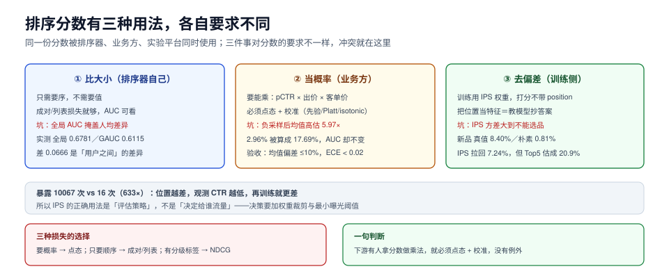

# 排序：AUC、校准与位置偏差

排序模型负责的是「给定这批候选，谁排前面」。它输出一个分数，而这个分数在工程上会被三种人用：**排序器自己**（比大小）、**业务方**（算预期收益）、**实验平台**（算指标）。这三件事对分数的要求完全不同，而绝大多数线上事故来自「用排序分数去做业务决策」。

这一页讲：先定目标再选损失、三种损失各自的适用、AUC 为什么能骗你（有 GAUC 实测）、分数怎么才能当概率用（有校准实测）、位置偏差为什么不能靠「把位置当特征」解决、以及多目标该怎么合。



本页判据族 `RCK-A` ~ `RCK-H`，共 8 条。定义表见文末「本页判据」一节。

## 一、先定目标，再选损失

排序阶段的目标只有三种，选错会让后续所有调优都白做：

| 目标 | 定义 | 适用 | 训练信号 |
| --- | --- | --- | --- |
| 点态（pointwise） | 预测单条样本的 CTR | 需要「分数当概率」的场景（出价、预算、混排） | 每条样本一个标签 |
| 成对（pairwise） | 预测「A 比 B 好」 | 只关心顺序（列表排序） | 同请求内的样本对 |
| 列表（listwise） | 直接优化整个列表的排序指标 | 有明确 NDCG 目标 | 整个列表的标签分布 |

判断方法一句话：**下游有人拿分数做乘法（CTR × 出价 × 时长）→ 必须点态 + 校准；只用来排顺序 → 成对/列表更划算。**

成对与列表的代价是「分数失去物理意义」：LambdaMART 的输出是一个无界实数，不能解释成概率。如果你的排序结果要和广告、直播混排，那么第一步就得回到点态。

## 二、三种损失的实现与坑

```python [app/rank/train.py]
import lightgbm as lgb

# 点态：二分类，输出需要校准才能当概率
pointwise = lgb.LGBMClassifier(
    objective="binary", metric="auc", learning_rate=0.05,
    num_leaves=63, min_child_samples=100, n_estimators=800,
)

# 成对 / 列表：需要 group（每个请求的候选数）
lambdarank = lgb.LGBMRanker(
    objective="lambdarank", metric="ndcg", ndcg_eval_at=[10],
    lambdarank_truncation_level=30, learning_rate=0.05, n_estimators=800,
)
# 训练时必须提供 group=[每个 request_id 的候选数]
lambdarank.fit(X, y, group=group_sizes)
```

三个坑：

1. **`group` 传错**。`group` 是「每个请求的候选数」而不是「每个用户的样本数」。传错不会报错，只会让 NDCG 变成一个随机数。
2. **`lambdarank_truncation_level` 设太大**。它决定「只看前多少位算梯度」，设成候选总数等于让尾部噪声参与训练；通常 20~50。
3. **成对模型拿去算期望收益**。它的输出没有概率含义，乘上单价会得到一个量纲错误的数。

## 三、AUC 能骗你的三种方式

| 骗法 | 现象 | 为什么会骗 |
| --- | --- | --- |
| 全局 AUC 掩盖人均差异 | 全局 0.6781，GAUC 0.6115 | 用户之间的先验差异被算进了排序能力 |
| 负采样掩护 | 采样前后 AUC 0.7544 → 0.7558 | AUC 只看顺序，不看分数尺度 |
| 候选集变小 | 候选从 500 降到 50，AUC 涨 | 难样本被召回阶段过滤掉了，不是模型变强 |

第二条在[数据与样本](../DataSamples/index.md))已有实测。第一条的读数是：

```text
全局 AUC 0.6781／GAUC 0.6115（380 个用户两侧都有样本）
差 +0.0666：全局 AUC 里混进了「用户之间」的差异
```

GAUC 的做法是**按用户分组算 AUC，再按曝光量加权平均**。它回答的是「在同一个用户内部，你把好东西排前面了吗」——这才是推荐真正要做的事。全局 AUC 高、GAUC 低，说明模型主要在学「哪些用户爱点」，而不是「这个用户会点哪个」。

```python [app/rank/metrics.py]
def gauc(records: list[tuple[int, float, int]]) -> float:
    """records: [(user_id, score, label)]，返回按曝光量加权的 GAUC"""
    from collections import defaultdict

    buckets: dict[int, list[tuple[float, int]]] = defaultdict(list)
    for uid, s, y in records:
        buckets[uid].append((s, y))

    total_w, acc = 0.0, 0.0
    for pairs in buckets.values():
        pos = [s for s, y in pairs if y == 1]
        neg = [s for s, y in pairs if y == 0]
        if not pos or not neg:
            continue
        win = sum(1 for a in pos for b in neg if a > b) + 0.5 * sum(1 for a in pos for b in neg if a == b)
        acc += win / (len(pos) * len(neg)) * len(pairs)
        total_w += len(pairs)
    return acc / total_w if total_w else float("nan")
```

::: warning AUC 的正确用法
AUC 适合**同一候选集内的模型对比**，不适合跨时期、跨候选集规模、跨采样口径比较。写实验报告时必须同时给出：候选集规模、采样比、GAUC。三个数缺一个，AUC 就可以被调到任意好看。
:::

## 四、校准：分数不是概率

排序分数要当概率用，必须过一道校准。三种方法：

| 方法 | 做法 | 优点 | 缺点 |
| --- | --- | --- | --- |
| 先验平移 | `logit(p) - log(k)` | 一行代码，可解释 | 只修全局偏移，不修形状 |
| Platt scaling | 拟合 `1/(1+exp(a·z+b))` | 简单、稳定 | 假设 sigmoid 形状 |
| Isotonic | 单调回归 | 不假设形状 | 小样本易过拟合，需足够数据 |

实测的偏移量级（负采样 1:4、真实 CTR 2.963%）：

```text
在 1:4 样本上校准好的模型，直接用于全量：预测均值 17.69% vs 真实 2.96% → 高估 5.97×
减掉这段先验：预测均值 2.99%（残差 +0.9%）
```

**5.97 倍的偏差意味着什么**：如果下游用 `pCTR × 客单价` 算预期 GMV，会高估近 6 倍；如果用 pCTR 做出价，会系统性超价。这类错误不会在 AUC 上体现，也不会在 CTR 上体现——它只在财务口径上体现。

校准的验收标准不是「曲线好看」，而是三个数：

1. **均值偏差** `E[pred] / E[actual]`，应在 1.0 ± 0.1。
2. **分桶偏差**：按预测值分 10 桶，每桶的 `pred/actual` 都应在 1.0 ± 0.2。
3. **ECE**（Expected Calibration Error，期望校准误差）：加权平均分桶偏差，< 0.02 为佳。

## 五、位置偏差：把位置当特征等于教模型抄答案

最自然的做法是「把 position 作为一个特征喂给模型」。它确实能让离线指标变好，但学到的是「排第一就有点击」，而不是「这个物品好」。上线后，模型会给「它认为会被排在前面的物品」高分，形成自我强化。

正确做法是**训练时纠偏、打分时不用位置**。倾向加权（IPS）的实测：

```text
真实 Top5      ：[39, 38, 37, 36, 35]  均值 9.660%
朴素 CTR Top5  ：[39, 38, 37, 36, 35]  均值 6.577%
IPS 校正 Top5  ：[47, 49, 13, 39, 38]  均值 20.895%
新品（40~49）真值 8.400%，朴素 0.810%，IPS 7.240%
曝光量：老品均值 10067，新品均值 16（633.1×）
```

三行读数要一起读：

1. **朴素 CTR 系统性低估**（6.577% vs 真值 9.660%，约 0.68×）——因为每条曝光都乘了该位置的倾向（≤1），位置越差乘得越狠。
2. **IPS 把新品从 0.81% 拉回 7.24%**（真值 8.40%），说明「新品不行」这个结论本身是位置造成的。
3. **但 IPS 的方差大到不能直接用于选品**：Top5 均值 20.9%，比真值高一倍多。原因是被估物品只有 16 次曝光，单次点击权重 11 倍，一两个点击就能把估计打到 100% 以上。

所以 IPS 的正确用法是**评估**（判断某个策略是否比另一个好），不是**决策**（决定给谁流量）。要用于决策，必须先做权重裁剪（`min(w, 10)`）或改用 SNIPS（自归一化），并且**曝光数低于阈值的物品不出结论**。

```python [app/rank/ips.py]
def ips_ctr(clicks: list[int], props: list[float], clip: float = 10.0) -> float:
    """clicks: 每次曝光是否点击；props: 该次曝光位置的倾向"""
    if not clicks:
        return 0.0
    w = [min(1.0 / max(p, 1e-6), clip) for p in props]
    return sum(c * wi for c, wi in zip(clicks, w)) / len(clicks)
```

## 六、多目标：乘法、加权、约束

三个目标（点击、转化、时长）不能简单相加，因为量纲不同。三种合流：

| 做法 | 公式 | 适用 | 风险 |
| --- | --- | --- | --- |
| 乘法 | `pCTR × pCVR × price` | 电商、广告 | 任一因子校准错，整体放大 |
| 加权 | `Σ w_i · score_i` | 内容社区 | 权重要频繁调，容易「按下葫芦浮起瓢」 |
| 约束优化 | 主目标 + 约束（如时长 ≥ 基线） | 有硬性护栏 | 实现复杂，需拉格朗日或分层 |

乘法的前提是**每个因子都已校准**。这就是为什么第[四节](#四、校准-分数不是概率)的校准不是「可选优化」，而是乘法融合的**前置条件**。

## 七、排序阶段的评估：NDCG 与分桶

| 指标 | 算什么 | 什么时候用 | 陷阱 |
| --- | --- | --- | --- |
| AUC / GAUC | 全局/人均排序能力 | 模型迭代对比 | 不看位置、不看列表 |
| NDCG@K | 前 K 位的折损增益 | 有分级标签（点/加购/买） | 需要相关性分级，二值标签退化为排序准确率 |
| MAP | 平均精度 | 多相关等级 | 对长尾不敏感 |
| Recall@K | 前 K 位命中率 | 与召回联合评估 | 与候选集规模强相关 |

NDCG 的关键是**折损函数**：`DCG = Σ (2^rel - 1) / log2(i + 1)`。第 1 位与第 10 位的权重差约 3.3 倍（`log2(11)/log2(2)`），这也是为什么「把最好的放第一」比「把好的都放进前十」更值钱。

## 八、验收：四个可复跑的动作

1. **GAUC 与全局 AUC 同时报**，差值 > 0.05 要解释。
2. **校准三件套**：均值偏差、分桶偏差、ECE。
3. **位置消融**：训练时去掉 position 特征，比较 GAUC；掉很多说明模型原本在抄答案。
4. **分数分布对比**：线上打分分布 vs 离线预测分布，KS < 0.1。

## 本页判据

| 编号 | 判据 | 看什么现象 | 不满足时改哪里 |
| --- | --- | --- | --- |
| `RCK-A` | 目标与损失匹配 | 需要概率的场景用点态，纯排序可用成对 | 改损失，别让成对模型去算收益 |
| `RCK-B` | `group` 按请求分组 | 训练时 group 之和 = 样本数 | 修 group 构造 |
| `RCK-C` | 同时报 GAUC | 报告里有全局 AUC 与 GAUC 两个数 | 补 GAUC，差值大要查用户先验 |
| `RCK-D` | 分数经过校准 | 均值偏差 ≤ 10%，ECE < 0.02 | 加先验平移/Platt/isotonic |
| `RCK-E` | 训练用位置纠偏、打分不用位置 | 线上打分链路无 position 特征 | 去掉线上位置特征，训练加 IPS 权重 |
| `RCK-F` | IPS 用于评估不用于决策 | 低曝光物品不进入 IPS 排名结论 | 加权重裁剪与最小曝光阈值 |
| `RCK-G` | 多目标乘法前先校准 | 每个因子都有校准报告 | 先修校准，再上乘法融合 |
| `RCK-H` | NDCG 的标签分级明确 | 折损函数与相关性分级写进文档 | 定义分级，二值标签就报排序准确率 |

## 参考资料

- Burges, *From RankNet to LambdaRank to LambdaMART: An Overview*：<https://www.microsoft.com/en-us/research/publication/from-ranknet-to-lambdarank-to-lambdamart-an-overview/>
- Joachims et al., *Unbiased Learning-to-Rank with Biased Feedback*：<https://arxiv.org/abs/1608.04468>
- Niculescu-Mizil & Caruana, *Predicting Good Probabilities With Supervised Learning*：<https://www.cs.cornell.edu/~alexn/papers/calibration.icml05.crc.rev3.pdf>
- Järvelin & Kekäläinen, *Cumulated Gain-Based Evaluation of IR Techniques*（NDCG 原始论文）：<https://dl.acm.org/doi/10.1145/582415.582418>
- LightGBM 排序参数说明：<https://lightgbm.readthedocs.io/en/latest/Parameters.html>
