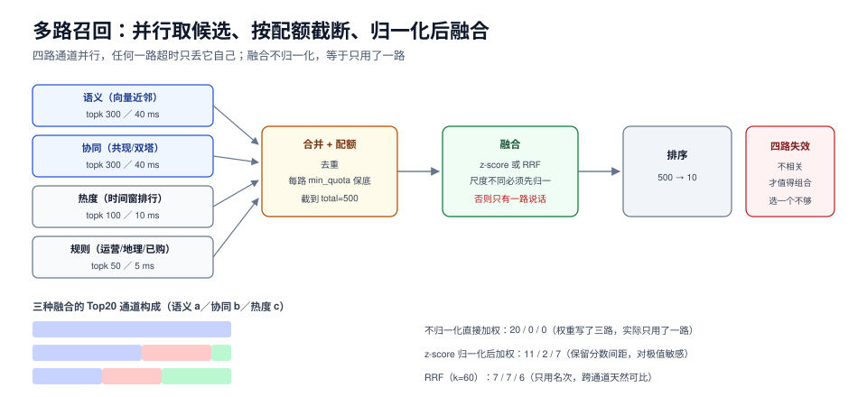

# 召回：多路候选、ANN 损失与融合

召回只回答一个问题：**用户可能想要的几千个物品，怎么在 50 ms 内找出来**。它不负责排序，也不负责好看——它负责「别漏」。而「漏」这件事在离线指标上几乎看不见：AUC 是在给定候选集内算的，候选集本身缺了东西，AUC 一点都不会掉。

这一页讲：四类召回通道各自的失效、ANN 的召回率与延迟怎么权衡（有实测）、每路该给多少配额、三种融合做法的实测差异、以及怎么用点击日志算「召回到底漏了多少」。



本页判据族 `RCR-A` ~ `RCR-H`，共 8 条。定义表见文末「本页判据」一节。

## 一、召回要回答的三个问题

| 问题 | 不回答的后果 | 怎么回答 |
| --- | --- | --- |
| 从多大的库里找 | 库大小决定索引类型与延迟模型 | 写进容量文档：物品数、维度、更新频率 |
| 找多少个 | 太少则排序无米下锅，太多则特征与打分开销爆炸 | 按排序吞吐反推，通常 200~2000 |
| 允许漏多少 | 不允许漏就只能暴力扫 | 定 `recall@K` 目标（对点击的覆盖率），常见 85%~95% |

第三个问题是关键，也是最常被跳过的一个。**没有「允许漏多少」的约定，就无法选择索引**——暴力扫描永远召回 100%，但它跑不动。

## 二、四类通道，四种失效

| 通道 | 做法 | 强在哪 | 典型失效 |
| --- | --- | --- | --- |
| 协同（item-CF / 双塔） | 用户/物品向量近邻、共现 | 发现「跨类目的隐性关联」 | 新品无向量；热门物品向量趋同 |
| 内容/语义（embedding） | 文本/图像向量近邻 | 新品可用（有内容就有向量） | 语义相似但不合口味；同质化 |
| 统计（热度/趋势） | 时间窗内点击排行 | 稳定、可解释、兜底 | 马太效应；突发事件处理不了 |
| 规则（运营/地理/已购） | 人工配置 | 可控、可解释 | 维护成本高；规则之间互相打架 |

工业界的标准做法是**四类全上 + 配额**，而不是选一个最好的。原因很简单：它们的失效不相关，组合起来才能覆盖。只上协同，新品永远起不来；只上热度，首页永远是那 20 个。

## 三、ANN：用召回率换延迟，换多少要算

向量召回的核心取舍是「扫描多少数据」。三种索引的实测（4000 条 × 32 维、120 次查询、纯 Python 实现，绝对值不可横向对比生产，但**相对关系**可参考）：

```text
暴力：recall@10 1.000，8.66 ms/查询（4000 条 × 32 维）
IVF（20 簇，nprobe=2）：recall@10 1.000，0.89 ms/查询，平均扫描 408 条
LSH（12 表 × 10 bit）：recall@10 0.846，0.69 ms/查询，平均候选 10 条
```

三个读数各自说明一件事：

1. **IVF 扫 10% 的数据就拿到 100% 召回**——因为数据本身是 20 个聚簇的，聚簇假设成立时 IVF 几乎免费。这也解释了为什么 IVF 在「真实分布有明显簇结构」时好用，在均匀分布上会明显掉点。
2. **LSH 用 15% 的召回损失只换来 23% 的延迟下降**（0.89 → 0.69 ms），**这笔交易不划算**。LSH 的价值在「内存受限」而不是「延迟」。
3. **候选越少不等于越快**：LSH 平均只回 10 个候选，但它的哈希计算是 120 次点积，固定成本压不下去。**延迟的主项常常是「索引查找的固定开销」，不是「距离计算」。**

::: danger 三个 ANN 参数陷阱
1. **用「离线 recall@10」定 nprobe，却在线上的候选池里评估**。线上候选池远大于离线评估集，同样的 nprobe 召回率会掉 5~15 个百分点。正确做法：用**线上真实查询向量**回放，而不是用训练集里的物品向量自查询。
2. **把 `nprobe` 调大当作「提升效果」**。它只提升召回率，不提升排序能力；如果排序模型没变，多召回的候选大概率排不进前 10，延迟却实打实涨了。
3. **索引不更新**。向量索引的增量更新能力差异很大：有的要重建、有的支持软删除。物品日更 5% 以上时，「每天重建一次」意味着**最坏情况有一天的物品不在索引里**。
:::

## 四、配额：每路给多少，由「边际收益」决定

多路召回合并后要截断到排序能吃下的量。最朴素的做法是按分数取 Top-N，但**分数不可比**（下一节），所以工业界普遍用**配额**：

```yaml [conf/recall.yaml]
channels:
  - name: semantic
    topk: 300
    timeout_ms: 40
    min_quota: 60          # 保底，即使分数低也留
  - name: collaborative
    topk: 300
    timeout_ms: 40
    min_quota: 60
  - name: trending
    topk: 100
    timeout_ms: 10
    min_quota: 20
  - name: rule
    topk: 50
    timeout_ms: 5
    min_quota: 10
merge:
  total: 500
  strategy: rrf            # rrf | zscore | raw
  rrf_k: 60
```

配额的定法有三条纪律：

1. **新/小通道要有 `min_quota`**，否则它永远被大通道挤掉，然后因为「没有曝光」被判定无效——这是个自我实现的预言。
2. **通道数不是越多越好**。六路并行时 p99 由最慢一路决定（实测见[在线服务](../Serving/index.md))），加一路的收益要能覆盖它的 p99 成本。
3. **配额要能被实验改动**。把配额当常量写死，就没法回答「语义通道给 100 会不会更好」。

## 五、融合：不归一化等于只用了一路

三路候选、分数尺度完全不同（语义相似度 0.3~1.0、BM25 3~30、热度 0~100000），三种融合的实测 Top20 来源：

```text
不归一化直接加权： {'c': 20}
z-score 归一化后加权： {'a': 11, 'c': 7, 'b': 2}
RRF（k=60）： {'a': 7, 'b': 7, 'c': 6}
```

第一行是最常见的线上事故：**权重写了 0.4/0.3/0.3，实际效果是「只用了一路」**，因为热度那一路的数值量级是语义的 10 万倍，权重再小也压死另外两路。

三种做法的取舍：

| 做法 | 公式 | 优点 | 缺点 |
| --- | --- | --- | --- |
| 原始加权 | `Σ w_i · s_i` | 简单 | 尺度敏感，必须逐路归一化才可用 |
| z-score | `(s - μ) / σ` 后加权 | 保留分数间距 | 对长尾分布不稳（少数极值拉偏 σ） |
| RRF | `Σ 1/(k + rank_i)` | **只用名次，不用分数**，跨通道天然可比 | 丢掉「差多少」的信息 |

RRF 的 `k` 常规取 60；`k` 越小，头部名次越重要。它的最大好处是**不需要为每路调尺度**，代价是「第 1 名领先第 2 名很多」这种信息被抹平了。

```python [app/recall/fuse.py]
def rrf(lists: list[list[str]], k: int = 60, total: int = 500) -> list[str]:
    """lists: 每路的物品 ID 列表（已按该路分数降序）"""
    score: dict[str, float] = {}
    for lst in lists:
        for rank, item in enumerate(lst):
            score[item] = score.get(item, 0.0) + 1.0 / (k + rank + 1)
    return [i for i, _ in sorted(score.items(), key=lambda x: -x[1])[:total]]
```

::: tip 一句话判断用哪种
**通道数 ≥ 3 且分数尺度差异大 → RRF；通道少且分数同源（同一模型的不同头） → z-score。** 原始加权只在「所有通道都输出同一个模型的分数」时才成立。
:::

## 六、召回评估：用点击日志算「漏了多少」

排序有 AUC，召回没有现成的离线指标。可行的做法是**用线上点击反推**：

```sql [sql/030_recall_coverage.sql]
-- 每次请求：用户点击的物品，有多少出现在候选集里
with picked as (
  select e.request_id, e.item_id
  from rec_exposure e
  join rec_action a
    on a.request_id = e.request_id and a.item_id = e.item_id
  where a.event_type = 'click' and e.shown_at >= current_date - 7
),
cand as (
  select request_id, item_id from rec_candidate
  where created_at >= current_date - 7
)
select count(*) filter (where c.item_id is not null)::numeric / count(*) as recall_at_k
from picked p left join cand c
  on c.request_id = p.request_id and c.item_id = p.item_id;
```

四个注意点：

1. **分母是「被点击的物品」**，不是「被曝光的物品」。曝光但没点的物品，缺了不算漏。
2. **只看 Top-K 候选**，并且 K 要与线上真实截断一致（不是索引返回的 300，而是进排序的 500）。
3. **分渠道看**。总体 92% 掩盖不了「语义通道对新品召回率 11%」。
4. **它是事后指标**：算出来的是「上一次的候选池漏没漏」，用来定位，不用于训练。

## 七、覆盖与长尾：两个容易被指标掩盖的数

只看 CTR/AUC，系统会自然收敛到「推头部」。两个必须单独盯的数（实测，10 万物品、5000 次请求 × 10 位）：

```text
按热度采样：覆盖率 20.2%，Top20 商品占曝光 18.1%
热度指数降到 0.6：覆盖率 34.3%，Top20 商品占曝光 1.7%
```

- **覆盖率** = 周期内被曝光过的物品数 / 可推荐物品总数。
- **集中度** = Top20 物品占全部曝光的比例。

覆盖率低不一定坏（电商首页本来就该推爆款），但它必须**是选择的结果，不是算法的副作用**。判断方法：看新品/长尾的曝光配额是否被单独配置。如果没有，那覆盖率就是「排序模型的偏好」而不是「业务策略」。

## 八、验收：四个可复跑的动作

1. **单路回放**：关掉其他通道，只留一路跑 1000 次请求，记录它的 p99 与候选数。
2. **配额生效**：把某路 `min_quota` 从 60 改到 0，重跑，确认它在融合结果里的占比下降——如果不变，说明配额没接进代码。
3. **融合对照**：同一批候选分别用 raw / z-score / RRF 融合，比较 Top20 的通道构成。
4. **召回覆盖率**：跑上面的 SQL，按渠道分组，得到每条通道的 `recall_at_k`。

## 本页判据

| 编号 | 判据 | 看什么现象 | 不满足时改哪里 |
| --- | --- | --- | --- |
| `RCR-A` | 库规模、候选数、`recall@K` 目标三件事有文档 | 容量文档里三个数齐全 | 补文档，否则无法选索引 |
| `RCR-B` | 通道失效互补 | 至少一路对新品有效、一路稳定兜底 | 补内容通道或热度兜底 |
| `RCR-C` | ANN 参数用线上查询回放校准 | 回放脚本用的是真实请求向量 | 换成线上日志里的 query 向量 |
| `RCR-D` | 每路有 `min_quota` 与超时 | 配置文件里逐路可见 | 加 `min_quota`，避免小路被挤死 |
| `RCR-E` | 融合前归一化或使用 RRF | Top20 不来自单一通道 | 加归一化/RRF，复跑构成统计 |
| `RCR-F` | 召回覆盖率可按渠道算 | 有 `recall_at_k` 的 SQL 与看板 | 补候选表与查询 |
| `RCR-G` | 覆盖率与集中度有基线 | 两个数有周同比 | 加指标，否则长尾退化不可见 |
| `RCR-H` | 索引更新延迟进 SLA | 新品进索引的时延可测 | 改增量索引或缩短重建周期 |

## 参考资料

- Malkov & Yashunin, *HNSW*（图索引的召回-延迟权衡）：<https://arxiv.org/abs/1603.09320>
- Johnson et al., *Billion-scale similarity search with GPUs*（IVF-PQ 的工程实现，FAISS）：<https://arxiv.org/abs/1702.08734>
- Cormack et al., *Reciprocal Rank Fusion*：<https://plg.uwaterloo.ca/~gvcormac/cormacksigir09-rrf.pdf>
- Carbonell & Goldstein, *The use of MMR, diversity-based reranking*（多样性与覆盖的经典权衡）：<https://dl.acm.org/doi/10.1145/290941.291025>
- FAISS wiki（索引选型与参数）：<https://github.com/facebookresearch/faiss/wiki>
