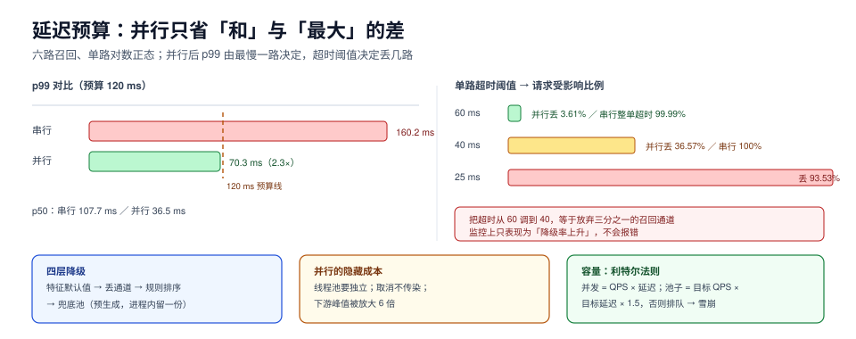

# 在线服务：延迟预算、降级与兜底

推荐服务是**可失败的降级服务**：它不像支付，失败一次就是资金差错；它失败一次只是「这次推得不准」。这个定位决定了它的工程原则——**宁可推得差一点，也不能让页面空着或转圈**。但绝大多数推荐服务的实现恰好相反：一个特征服务超时，整条请求 500。

这一页讲：延迟预算怎么分、并行化到底省了多少（有实测）、超时与降级该怎么配、三层缓存各自的失效、兜底池为什么是最后一道防线、以及模型热更新时怎么不把在途请求打穿。



本页判据族 `RCV-A` ~ `RCV-H`，共 8 条。定义表见文末「本页判据」一节。

## 一、预算先分，再写代码

一条推荐请求的预算通常来自上层页面的 SLA。假设首页要求「推荐模块 120 ms 内返回」，分配如下：

| 阶段 | 预算 | 超时策略 | 超时后 |
| --- | --- | --- | --- |
| 上下文与用户特征 | 15 ms | 到点用默认值 | 降级 + 打点 |
| 召回（并行） | 50 ms | 整段超时，丢掉未返回通道 | 用已返回的通道 |
| 特征拼装 | 20 ms | 单特征 8 ms，整体 20 ms | 缺失填默认 |
| 排序 | 30 ms | 到点用 fallback 排序（按召回分） | 走规则排序 |
| 后处理 | 5 ms | 无 | —— |
| 余量 | 10 ms | —— | 给 GC/网络抖动 |

**余量必须留**。不留余量的预算等于把 p99 直接顶在 SLA 上，任何一次网络抖动都会变成超时。

## 二、并行化：省下来的是「和」与「最大」的差

六路召回，单路延迟服从对数正态（p50 约 12~33 ms），串行 vs 并行的实测：

```text
串行：p50 107.7 ms，p99 160.2 ms
并行：p50 36.5 ms，p99 70.3 ms（p99 差 2.3×）
单路超时 60 ms：串行整单超时 99.99%；并行丢一路 3.61%
单路超时 40 ms：串行整单超时 100.00%；并行丢一路 36.57%
单路超时 25 ms：串行整单超时 100.00%；并行丢一路 93.53%
```

三个结论：

1. **并行后 p99 由最慢的一路决定**，所以「加通道」的边际成本是「p99 可能变差」，不是「平均延迟 +5 ms」。
2. **超时阈值的敏感度是非线性的**：60 ms 时只丢 3.6%，40 ms 时丢 36.6%，25 ms 时丢 93.5%。**把超时从 60 调到 40，等于放弃了三分之一的召回通道**，而这在监控上只表现为「降级率上升」，不会报错。
3. **串行在 60 ms 阈值下几乎 100% 超时**——这不是「串行慢一点」，是「串行根本不可用」。

::: danger 并行化的三个隐藏成本
1. **线程/协程数爆炸**。6 路 × 每请求 = 6 个并发任务，QPS 2000 时是 12000 个在途任务。必须有独立的召回线程池，不能和 Web 容器共用。
2. **取消不会传染**。主请求超时返回后，未完成的召回仍在跑（Java 里 `Future.cancel` 对不响应中断的代码无效）。正确做法：召回内部有超时，或使用支持中断的客户端。
3. **下游被打穿**。并行化让 6 个下游同时收到请求，峰值放大 6 倍。下游若按「推荐服务 QPS」做容量规划，会被打穿。
:::

## 三、降级的四层，从便宜到贵

| 层 | 做法 | 触发条件 | 用户感知 |
| --- | --- | --- | --- |
| 1 | 单特征缺失 → 默认值 | 特征超时 | 几乎无 |
| 2 | 单通道丢失 → 用其余通道 | 召回超时 | 略窄 |
| 3 | 排序降级 → 按召回分排 | 模型超时/不可用 | 顺序变差 |
| 4 | 整体兜底 → 兜底池 | 全链路失败 | 「这不是给你推的」 |

兜底池（fallback pool）是最容易被忽略的一层。它应该是**预生成的、按人群粗分组的静态列表**，不能是「实时查热度」——因为热度服务可能就是挂掉的那个。

```yaml [conf/fallback.yaml]
fallback:
  pool: redis://rec-fallback/pool:{segment}     # 预生成，10 分钟刷新
  segments: [new_user, active, dormant, unknown]
  max_age_minutes: 30
  on_empty: static_hot_list                       # 最后一道：进程内常量
  metrics: rec_fallback_total{reason,segment}
```

`on_empty` 那行指的是**进程内硬编码的一份列表**。听起来很土，但它是唯一能在「Redis 挂、模型挂、特征挂」时还返回内容的方案。

## 四、缓存：三层，各自的失效方式

| 层 | 缓存什么 | TTL | 失效方式 | 注意 |
| --- | --- | --- | --- | --- |
| 客户端/CDN | 静态兜底页 | 分钟级 | 主动刷新 | 不要把个性化内容放这里 |
| 服务本地 | 用户画像、物品特征 | 秒~分钟 | LRU 淘汰 | 多实例不一致，实验会抖 |
| Redis | 推荐结果（按用户） | 30 s~5 min | 主动失效 + TTL | 键必须带模型版本与实验分组 |

第三层的键设计是关键：`rec:{user_id}:{model_version}:{exp_group}`。少了 `model_version`，模型发布后一小时内用户还在看旧结果；少了 `exp_group`，A/B 两组会互相污染缓存。

::: warning 缓存不是「优化」，是「换一致性」
按用户缓存推荐结果，意味着**用户行为变化要等 TTL 才生效**。对「刚看完一个视频，首页还推同一个」这类体验问题，缓存是直接原因。缓解办法是让行为事件主动失效缓存（写少读多，成本可控），而不是把 TTL 调到 5 秒（那样缓存就没意义了）。
:::

## 五、过载：排队、限流、快速失败

推荐服务的流量有明显峰谷（早晚高峰 3~5 倍）。三种过载策略：

| 策略 | 做法 | 适用 | 风险 |
| --- | --- | --- | --- |
| 排队 | 有界队列 + 超时丢弃 | 短时抖动 | 队列越长，尾延迟越差（利特尔法则） |
| 限流 | 令牌桶，按用户/接口 | 持续过载 | 阈值难定，容易误伤 |
| 快速失败 | 直接返回兜底 | 下游已挂 | 需要熔断器，否则一直在失败路径上耗资源 |

利特尔法则给了一个硬约束：`并发 = QPS × 延迟`。1000 QPS × 80 ms = 80 个并发；如果线程池只有 50 个，排队就会发生，而排队会让延迟上升，进而让并发需求上升——**雪崩的标准路径**。所以线程池大小要按 `目标 QPS × 目标延迟 × 安全系数 1.5` 配置。

## 六、发布：模型热更新不能打穿在途请求

模型更新有四种方式，风险依次上升：

| 方式 | 做法 | 影响 | 适用 |
| --- | --- | --- | --- |
| 双缓冲热加载 | 新模型加载完成后原子切换引用 | 无中断 | 常规迭代（首选） |
| 滚动重启 | 逐实例重启 | 单实例短暂不可用 | 依赖变更 |
| 灰度（按流量） | 1% → 10% → 50% → 100% | 可控 | 大版本 |
| 全量替换 | 一次性 | 高风险 | 不建议 |

双缓冲的实现要点：**加载失败必须保留旧模型并告警**，不能「加载失败就退出」。同时，模型版本要进日志——否则实验结论无法归因到具体模型。

## 七、可观测：四个必须有的指标

| 指标 | 为什么必须有 | 告警阈值参考 |
| --- | --- | --- |
| 各段 p99 与降级率 | 定位是哪一段慢 | p99 > 预算 1.2 倍或降级率 > 5% |
| 候选数分布 | 召回是否在悄悄变少 | 中位数低于基线 30% |
| 特征缺失率 | 特征服务是否在退化 | > 5% |
| 兜底命中率 | 用户体验是否已经降级 | > 1%（说明有故障） |

**候选数分布**是最容易被漏掉的一个：召回超时不会报错，只会让候选从 500 变成 120，而排序依然正常工作，指标上看不出异常——直到有人发现「推荐怎么老是这几个」。

## 八、验收：五个可复跑的动作

1. **分段耗时**：日志里能看到四段各自的 p50/p99，而不只是一个总耗时。
2. **超时演练**：人为给某一路召回加 200 ms 延迟，确认请求仍返回、降级计数上涨、候选数下降但 > 0。
3. **兜底演练**：把 Redis 与模型都停掉，确认返回兜底池。
4. **缓存键检查**：抽查 10 个键，都带 `model_version` 与 `exp_group`。
5. **过载测试**：把 QPS 打到 2 倍，确认是「降级」而不是「超时雪崩」。

## 本页判据

| 编号 | 判据 | 看什么现象 | 不满足时改哪里 |
| --- | --- | --- | --- |
| `RCV-A` | 预算分段且有 10% 余量 | 配置里有逐段超时 | 补分段预算，留余量 |
| `RCV-B` | 召回并行且有独立线程池 | 线程池名可见，与 Web 容器分离 | 拆线程池，按利特尔法则定大小 |
| `RCV-C` | 超时阈值与降级率联动监控 | 有「超时阈值变更」的记录与影响 | 调阈值需评估丢通道比例 |
| `RCV-D` | 四层降级齐备 | 特征/通道/排序/兜底各有开关 | 补兜底池与规则排序 |
| `RCV-E` | 兜底池预生成且进程内有一份 | 断网演练仍能返回 | 加静态列表与刷新任务 |
| `RCV-F` | 缓存键含模型版本与实验分组 | 抽查键格式一致 | 改键设计，发布时主动失效 |
| `RCV-G` | 模型热加载失败保留旧模型 | 加载失败只告警不退出 | 改双缓冲逻辑 |
| `RCV-H` | 候选数分布有监控 | 有 `candidate_count` 直方图 | 加指标，否则召回退化不可见 |

## 参考资料

- Google SRE Book, *Addressing Cascading Failures*（重试放大、超时与降级）：<https://sre.google/sre-book/addressing-cascading-failures/>
- Google SRE Workbook, *Managing Load*（限流与过载）：<https://sre.google/workbook/managing-load/>
- Little's Law 与排队论基础：<https://en.wikipedia.org/wiki/Little%27s_law>
- Nygard, *Release It!*（熔断、舱壁与超时模式）：<https://pragprog.com/titles/mnee2/release-it-second-edition/>
