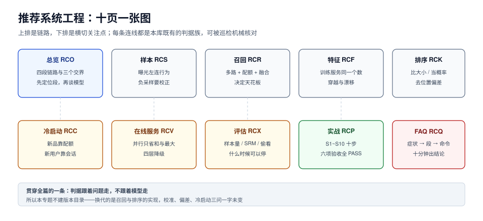

# 推荐系统工程

推荐系统最反直觉的地方是：**离线指标涨了，线上大概率不变，甚至变差**。它不是一个模型问题，而是一条链路上四个环节各自会「合理地」骗人的问题——样本被负采样扭曲、特征在训练与服务之间不是同一个东西、排序模型输出的分数不是概率、实验在看第 3 天就宣布胜利。

本专题讲**这条链路的工程层**：一条推荐请求从候选到曝光要过哪四段、每段的失效长什么样、怎么用可复跑的读数把「这次改动真的更好」固定下来。模型结构（双塔、DIN、SASRec、生成式推荐）只在必须解释失效原因时点到，不展开讲网络。

::: tip 一句话理解
推荐 = **候选**（有没有出现在池子里）+ **特征**（训练和服务是不是同一个数）+ **排序**（分数能不能当概率用）+ **实验**（改动到底有没有用）。四段里任何一段没有判据，另外三段的努力都会随机失效。
:::

::: info 本专题与相邻专题的分工
- **搜索的工程层（分析链、相关性、索引更新）** → [全文检索与搜索工程](../../DB/FullTextSearch/index.md)：那边回答「一条 query 怎么被召回和排序」，本专题回答「**没有 query 的时候，候选从哪来**」。
- **向量检索的索引与量化** → [向量数据库](../../DB/VectorDatabase/index.md)、[多模态检索](../../AI/MultimodalRetrieval/index.md)：那边讲 HNSW/IVF/PQ 的参数与召回曲线，本专题只讲「**召回率损失多少才算可接受**」以及它和排序的耦合。
- **A/B 平台的工程实现** → [观测驱动开发](../../Tools/ObservabilityDriven/Experiments/index.md)：那边讲分流、埋点、看板，本专题讲「**什么时候可以停**」与三类统计陷阱（第 3 天显著、SRM、偷看）。
- **缓存与降级** → [分布式缓存](../DistributedCache/index.md)：推荐侧的缓存是「按用户维度、带 TTL 的可丢副本」，与那边讲的强一致缓存不是同一个东西，见[在线服务](Serving/index.md)。
- **用户画像的合规边界** → [数据最小化](../../Others/PrivacyEngineering/Minimization/index.md)：本专题只讲「特征该怎么算」，能不能算、能留多久在那边。
- **项目侧的订单与履约** → [EventOrderHub 项目总览](../../../project/Complete/EventOrderHub/index.md)：推荐与订单的交接点是「推荐 → 下单」的归因，不在本专题范围内。
:::

## 目录

- [总览：一条推荐请求穿过的四段](Overview/index.md)
- [数据与样本：曝光日志怎么变成训练集](DataSamples/index.md)
- [召回：多路候选、ANN 损失与融合](Recall/index.md)
- [特征：训练与服务必须是同一个数](Features/index.md)
- [排序：AUC、校准与位置偏差](Ranking/index.md)
- [冷启动与探索：不探索就永远不知道](ColdStart/index.md)
- [在线服务：延迟预算、降级与兜底](Serving/index.md)
- [评估与实验：什么时候可以停](Evaluation/index.md)
- [实战：一个能跑起来的最小推荐服务](Practice/index.md)
- [常见问题与分诊](FAQ/index.md)

## 专题地图

## 判据纪律

沿用全库写法：**每页 8 条，编号形如 `RCO-A`**，逐页前缀唯一，可被 `utils/audit` 下的判据类巡检机械核对。每条判据回答三件事：**看什么现象、判成什么、不满足时改哪里**。

| 页 | 判据族 | 这一族管什么 | 条数 |
| --- | --- | --- | --- |
| 总览 | `RCO-A` ~ `RCO-H` | 四段链路、三个交界、必失点 | 8 |
| 数据与样本 | `RCS-A` ~ `RCS-H` | 曝光口径、负采样、时间切分、标签延迟 | 8 |
| 召回 | `RCR-A` ~ `RCR-H` | 多路配额、ANN 召回率、融合、覆盖 | 8 |
| 特征 | `RCF-A` ~ `RCF-H` | 穿越、窗口、在线一致性、漂移 | 8 |
| 排序 | `RCK-A` ~ `RCK-H` | 目标、校准、偏差、GAUC | 8 |
| 冷启动与探索 | `RCC-A` ~ `RCC-H` | 三类冷启动、探索预算、自我强化 | 8 |
| 在线服务 | `RCV-A` ~ `RCV-H` | 延迟预算、超时降级、缓存、兜底 | 8 |
| 评估与实验 | `RCX-A` ~ `RCX-H` | 指标选择、样本量、SRM、停止规则 | 8 |
| 实战 | `RCP-A` ~ `RCP-H` | 端到端验收、可观测、交付物 | 8 |
| 常见问题 | `RCQ-A` ~ `RCQ-H` | 分诊表、误判、止血顺序 | 8 |

合计 **10 族 80 条**。

## 为什么这里没有版本目录

本专题**不建 `v1/` `v2/` 这类版本目录**，理由三条，写在这里以免下次又被当成「漏了大版本规范」：

1. **换代的是模型，不是判据**。从协同过滤到双塔到生成式推荐（OneRec、GenPage 这一类语义 ID + 自回归生成），换掉的是「候选怎么产生」，而「候选池有没有被单路吃干」「训练和服务的特征是不是同一个数」「实验什么时候可以停」这三类问题一字未变。判据跟着问题走，不跟着模型走。
2. **并存差异是选型，不是代际**。同一年里，有人用 LightGBM 的 `lambdarank`，有人用双塔 + DIN，也有人上生成式检索——它们是**同一时期的三种选型**，不是「新版替代旧版」。按版本建目录会把「选型对照」拆成「历史存档」，反而更难读。
3. **差异已收敛进表格**。凡是有「新旧两套做法」的地方（如 LTR 的 pointwise/pairwise/listwise、召回的倒排/ANN/生成式），都用同一张表把「什么时候用哪个」写清楚，不给旧写法单独开页。

作为对照，本库确实存在需要版本目录的主题：[Spring 5 / Spring 6](../Java/Frame/Spring/index.md)、[MySQL 5.7 / 8.4](../../DB/SchemaEvolution/index.md)、[Vue 2 / Vue 3](../../Frontend/Frame/Vue/index.md)——它们的共同点是**同一个产品的两代 API 不兼容且旧版仍在跑**，与本题不同。

## 三条底线

::: danger 三条不可让步的底线
1. **负采样改变的是校准，不是排序**。把 1:32.7 的曝光下采样到 1:4，AUC 从 **0.7544** 变成 **0.7558**（几乎不动），但模型输出的均值从 2.96% 变成 **17.69%**（高估 **5.97×**）。只要下游有人拿这个分数去算「预期 GMV」，5.97 倍就会直接变成财务口径的错误。**排序指标掩护不了校准错误。**
2. **训练和服务必须用同一个特征定义**。带穿越特征时离线 AUC **0.9799**，线上取不到该特征就掉回 **0.7497**——差 0.23，比任何一次模型迭代的收益都大。而「同一个特征换窗口」也会漂：离线 7 天窗口 vs 线上 1 小时窗口，PSI 从 **0.170** 涨到 **1.946**。
3. **不主动探索，系统会把自己的历史当成真相**。50 个商品里 10 个新品真实 CTR **8.40%**，但在「按历史 CTR 排序」的系统里，它们的观测 CTR 只有 **0.81%**，曝光量是老品的 **1/633**。这不是新品不行，这是**系统只让它们在最差的位置出现了一次**。
:::

## 阅读顺序

先读[总览](Overview/index.md)拿到四段链路的全局图，然后按手上的问题选主线：

- **离线涨、线上不涨** → [数据与样本](DataSamples/index.md) → [特征](Features/index.md) → [评估与实验](Evaluation/index.md)
- **首页全是老爆款、新品起不来** → [冷启动与探索](ColdStart/index.md) → [召回](Recall/index.md)
- **分数没法当概率用（预算、出价、排序混排）** → [排序](Ranking/index.md)
- **p99 抖动、超时、降级后一片空白** → [在线服务](Serving/index.md)
- **要从零搭一个能验收的最小系统** → [实战](Practice/index.md)，按 S1~S10 走
- **线上出问题要止血** → [常见问题与分诊](FAQ/index.md)

## 参考资料

- Rendle et al., *BPR: Bayesian Personalized Ranking from Implicit Feedback*（隐式反馈成对损失）：<https://arxiv.org/abs/1205.2618>
- Covington et al., *Deep Neural Networks for YouTube Recommendations*（两阶段召回 + 排序的工业范式）：<https://research.google/pubs/pub45530/>
- Yi et al., *Sampling-Bias-Corrected Neural Modeling for Large Corpus Item Recommendations*（负采样与流式校正）：<https://arxiv.org/abs/1907.05171>
- Joachims et al., *Unbiased Learning-to-Rank with Biased Feedback*（IPS 与位置偏差）：<https://arxiv.org/abs/1608.04468>
- Malkov & Yashunin, *Efficient and robust approximate nearest neighbor search using HNSW*：<https://arxiv.org/abs/1603.09320>
- Cormack et al., *Reciprocal Rank Fusion outperforms Condorcet and individual Rank Learning Methods*：<https://plg.uwaterloo.ca/~gvcormac/cormacksigir09-rrf.pdf>
- Kohavi, Tang & Xu, *Trustworthy Online Controlled Experiments*（实验设计、SRM 与护栏指标）：<https://experimentguide.com/>
- Johari et al., *Always Valid Inference: Continuous Monitoring of A/B Tests*（序贯检验）：<https://arxiv.org/abs/1512.04922>
- Niculescu-Mizil & Caruana, *Predicting Good Probabilities With Supervised Learning*（校准）：<https://www.cs.cornell.edu/~alexn/papers/calibration.icml05.crc.rev3.pdf>
- LightGBM 排序任务参数（`lambdarank` / `rank_xendcg`）：<https://lightgbm.readthedocs.io/en/latest/Parameters.html>
