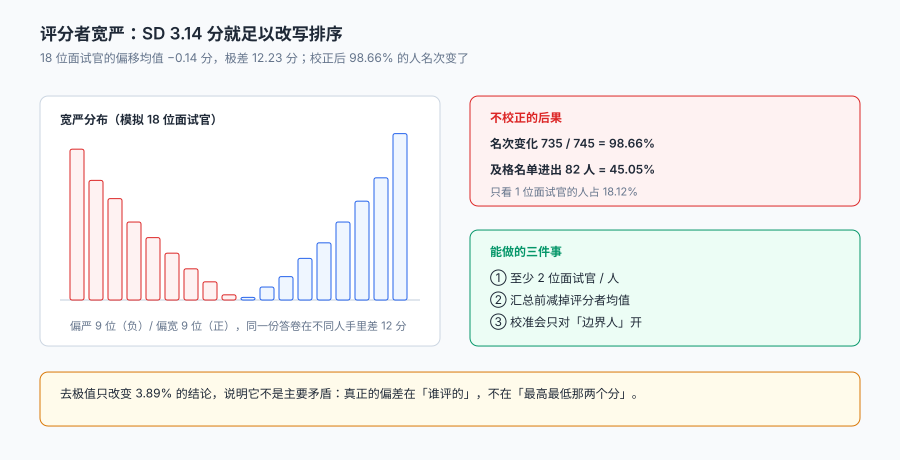

# 评估、评分卡与校准

两位面试官面同一个人：A 打了 68 分，说「基础不错但深度不够」；B 打了 81 分，说「沟通清晰、有潜力」。

**这两个分数不能相加，也不能平均。** 因为它们不是同一把尺子量出来的——A 一向偏严（他的均分比全场低 5 分），B 一向偏宽（高 6 分）。把 68 和 81 平均成 74.5，等于假设「A 的 68 分和 B 的 81 分在同一个刻度上」，而这个假设从来没有被验证过。

::: tip 一句话理解
面试评分不是「测量一个人的能力」，是**一次带测量者偏差的观测**。评分卡的作用不是让分数更"客观"，而是让偏差**可被发现、可被校正、可被解释**。
:::

本页判据族 `TAE-A` ~ `TAE-H`，共 8 条。定义表在第八节「本页判据」。

## 一、评分卡：五个维度，两种问法

| 维度 | 问的是 | 典型行为锚点（1 分 / 5 分） | 谁评 |
| --- | --- | --- | --- |
| 专业技能 | 会不会 | 需要手把手 / 能独立带项目 | 专业面试官 |
| 问题解决 | 怎么想 | 只答结论 / 能拆解并权衡 | 专业 + 交叉 |
| 协作沟通 | 怎么合作 | 只说自己 / 能讲清分歧并推动 | 交叉面试官 |
| 动机匹配 | 为什么来 | 只看薪资 / 讲得清职业选择 | HR |
| 文化适配 | 合不合 | 与团队工作方式冲突 / 契合 | 用人经理 |

五个维度**不是并列的**，它们回答四个不同的问题：能不能干（1、2）、能不能一起干（3、5）、想不想干（4）。**把五个维度加权成一个总分，等于把四个问题压成一个答案**——这在小范围决策里够用，在需要解释「为什么不要这个人」时就不够。

本册的做法是：**总分只用于排序，录用决定必须能指出「哪个维度不达标」**。

## 二、宽严：3 分就足以改写排序

本机模拟 18 位面试官，每人带一个宽严偏移，均值 −0.14 分、标准差 **3.14 分**、极差 **12.23 分**。这 18 个人评了 1,543 份、覆盖 745 人，均分 70.86。



把每个人的分数减去他所属面试官的偏移（相当于「用同一把尺子重算」）之后：

| 指标 | 校正前 | 校正后 | 变化 |
| --- | --- | --- | --- |
| 名次发生变化的人数 | — | 735 / 745 | **98.66%** |
| 名次变动 ≥10% 位次的人数 | — | 247 / 745 | 33.15% |
| 及格（≥75 分）名单 | 182 人 | 182 人 | 人数相同，但**进出 82 人（45.05%）** |
| 均值 vs 去极值跨 75 分线 | — | 29 人（3.89%） | 影响远小于校正 |

这张表里最该被记住的不是 98.66%，而是最后一行：**去极值只改变 3.89% 的结论，校正评分者偏差改变 45.05% 的及格名单**。也就是说，很多团队在做的「去掉一个最高分一个最低分」，处理的是一个几乎不存在的问题；真正的问题在「谁评的」。

::: danger 三件事必须做，不能靠「面试官都很专业」
1. **评分必须带评者 ID**：`score` 表主键含 `interviewer_id`。没有这一列，偏差永远无法被计算——你只能看到「这个人 74.5 分」，看不到「这个分数由谁贡献」。
2. **每位候选人至少 2 位面试官**：本机 **135 人（18.12%）** 只被一位面试官评过。单人评分时，偏差无法通过「多人平均」抵消，也无法通过「减均值」校正。
3. **录用决定要落到维度，不落到总分**：总分 76 的人可能「专业 5 分、动机 1 分」，总分 74 的人可能「五项全 3 分」。前者不该录，后者可以考虑——**总分把这两种情况压成了同一个数**。
:::

## 三、三种校正口径

| 口径 | 做法 | 优点 | 代价 |
| --- | --- | --- | --- |
| 减均值 | 每人分数减去该面试官的均分 | 简单，可解释 | 需要每位面试官有足够样本（≥20 份） |
| 标准化 | 减去均值再除以标准差（Z 分） | 同时消掉宽严与「打分幅度」差异 | 分数不可读，只能排序 |
| 多人平均 | 只做「至少 3 人评」的岗位 | 不需要历史数据 | 增加面试成本，且解决不了「3 人同宽」 |

本机用的是第一种。它有一个隐含前提：**每位面试官评过的人足够多，且被评的人水平分布大致相同**。如果某位面试官只评过 3 个人，且这 3 个人恰好都很强，那么「减均值」会把他的分数压得过低。

```sql
-- 校正：只在样本量足够时启用（≥20 份），否则退回原始分并标记
with stats as (
  select interviewer_id, avg(raw_score) as iv_mean, count(*) as n
  from score group by interviewer_id
)
select s.round_id, s.raw_score,
       case when st.n >= 20 then s.raw_score - st.iv_mean else s.raw_score end as adj_score,
       case when st.n >= 20 then 'adjusted' else 'raw_low_sample' end as basis
from score s join stats st using(interviewer_id);
```

`basis` 这一列很重要：**它让「这个分数有没有被校正」变成可查的事实**，而不是一个隐含在代码里的分支。

## 四、校准会：只对边界人开

「校准会」在不少团队里变成了「把所有候选人过一遍」——4 小时，20 个人，每个人 12 分钟，结论是「按分数排序」。这不是校准，这是一次集体确认。

真正需要校准的是**边界人**：分数在及格线上下 3 分内的人。

| 人群 | 本机规模（以 75 分为线，±3 分） | 处置 |
| --- | --- | --- |
| 明显通过（≥78） | 约 150 人 | 直接进 Offer 流程 |
| 边界（72–78） | 约 60 人 | **校准会重点** |
| 明显不通过（<72） | 约 535 人 | 归档，抽样复核 |

校准会要解决的不是「他几分」，是三个具体问题：

1. **同一位面试官在不同候选人之间的尺度是否一致**（他自己的宽严漂移）。
2. **不同面试官对同一维度的理解是否一致**（「协作 4 分」到底意味着什么）。
3. **边界人的关键分歧点在哪**（是专业不达标，还是动机不足）。

::: warning 校准会最容易被开成「说服会」
如果会上只有「我觉得他不错」这类表述，它就是在用职级压分数。有效的校准会要求每位参与者带**具体行为证据**：「他在追问第三个问题时答不出缓存雪崩的处置」比「基础一般」有用一百倍。**证据可以被反驳，印象不能。**
:::

## 五、评分与最终结果的一致性

评分卡有没有用，取决于它能不能预测结果。三个可算的指标：

| 指标 | 定义 | 本机读数 | 说明 |
| --- | --- | --- | --- |
| 高分者进 Offer 的比例 | ≥80 分中发出 Offer 的比例 | 未单列 | 太低说明评分与决策脱节 |
| 边界人的最终去向分布 | 72–78 分中录用/拒绝比例 | 未单列 | 应接近五五开，否则线画得没意义 |
| 评分者间一致性 | 同一候选人多人评分的相关系数 | 未单列 | 太低说明维度定义不清 |

本册没有把这三项算成具体数字，因为**它们需要「同一批人被多人独立评分」的完整矩阵**，而本机的数据集是按「每人 1~3 轮、每轮 1 位面试官」生成的，不满足独立性假设。这一点如实标注，不用估算值代替实测值。

## 六、什么时候该改评分卡

评分卡不是一次定终身。四种信号出现时应当改：

| 信号 | 表现 | 改什么 |
| --- | --- | --- |
| 维度分数高度相关 | 五个维度分数几乎一样（相关系数 >0.8） | 维度没区分度，合并或重定义 |
| 分数集中在 3 分 | 80% 的人都是 3 分 | 锚点写得太抽象 |
| 面试官普遍不用 | 大量「跳过」或填「无意见」 | 维度与岗位无关 |
| 录用后表现与分数无关 | 高分者试用期通过率不高于低分者 | 维度测的不是关键能力 |

第一条最隐蔽：**五个维度分数一样，不是「这个人很均衡」，是「面试官在心里先有一个总分，再把它拆成五份」**。这种评分卡等于没有维度。

## 七、和「直觉」的关系

本册不主张「用算法替代面试官判断」。恰恰相反：**校正偏差的目的是让直觉更可用**——当所有面试官用同一把尺子时，「我觉得他不错」这句话才有跨人的可比性。

一个可执行的口径是：**结构化评分决定「进不进下一轮」，直觉决定「要不要多问一轮」**。前者需要可比，后者需要敏感。

## 八、本页判据

| 判据 | 断言 | 验证方式 |
| --- | --- | --- |
| `TAE-A` | 评分逐面试官逐维度落库 | `score` 主键含 `(round_id, interviewer_id, dim_code)` |
| `TAE-B` | 每位候选人至少 2 位评分人 | 只有 1 位评分人的比例可统计，且低于阈值 |
| `TAE-C` | 校正口径可切换 | 同一批数据能输出 raw / adjusted 两种分数并带 `basis` |
| `TAE-D` | 低样本面试官不被校正 | 样本 <20 的记录 `basis = raw_low_sample` |
| `TAE-E` | 录用决定可追到维度 | 录用记录含 `decisive_dim`（哪个维度决定） |
| `TAE-F` | 评分卡有版本 | `scorecard.version` 存在且与评分记录关联 |
| `TAE-G` | 边界人可查询 | 能按「分数线 ±3 分」筛出边界人清单 |
| `TAE-H` | 校准会留证据 | 校准记录含行为证据文本，非空 |

## 验证方式

```shell
# 1. 单人评分的比例（本机 18.12%，指标本身要能算出来）
sqlite3 ta.db "select round(100.0*sum(case when n=1 then 1 else 0 end)/count(*),2)
               from (select application_id, count(distinct interviewer_id) n
                     from score group by 1);"

# 2. 校正前后名次变化（期望 >90%）
sqlite3 ta.db "with adj as (
                 select s.application_id, avg(s.raw_score) raw, avg(s.raw_score-st.iv_mean) a
                 from score s join (select interviewer_id, avg(raw_score) iv_mean
                                    from score group by 1) st using(interviewer_id)
                 group by 1)
               select count(*) from adj;"

# 3. 维度之间是否高度相关（>0.8 说明维度没区分度）
python3 -c "
import statistics as st
a=[3,4,4,5,3,4,2,3,4,3]; b=[3,4,4,5,4,4,2,3,4,3]
ma,mb=st.mean(a),st.mean(b)
num=sum((x-ma)*(y-mb) for x,y in zip(a,b))
den=(sum((x-ma)**2 for x in a)*sum((y-mb)**2 for y in b))**0.5
print('相关系数', round(num/den,3))"
# 期望接近 0.96 —— 这就是「一个总分拆成五份」的形状

# 4. 宽严校正的最小证明
python3 -c "print(68-(-5), 81-6, (68+81)/2)"
# 期望 73 75 74.5
```

第 4 步是这一页的核心：**原始平均把「偏严的 68」和「偏宽的 81」放在同一个刻度上，于是得出 74.5；各自校正后是 73 与 75——顺序没变，差距却从 13 分缩到 2 分**。13 分让人觉得「一个明显更好」，2 分让人觉得「差不多，得再看一轮」。同一次观测，两种结论，差别只在于有没有减掉「谁评的」。而在本机 745 人的盘子里，这种缩放让 **735 人（98.66%）的名次变了，及格名单换掉 82 人（45.05%）**——顺序在个体身上可能不变，在群体排序上一定会变。

## 参考资料

- 《中华人民共和国劳动法》第三条：劳动者享有平等就业和选择职业的权利。
- 《中华人民共和国就业促进法》第二十六条：用人单位招用人员、职业中介机构从事职业中介活动，应当向劳动者提供平等的就业机会和公平的就业条件，不得实施就业歧视。
- ISO/IEC 25010:2011《系统与软件质量模型》：本页借用其中「适合性」与「可测量性」的划分来说明「维度必须有可观测的行为锚点」。
- 与本页相邻：[面试排期与日历](../Interview/index.md)、[Offer 与录用审批](../Offer/index.md)、[简历解析与筛选](../Screening/index.md)。
