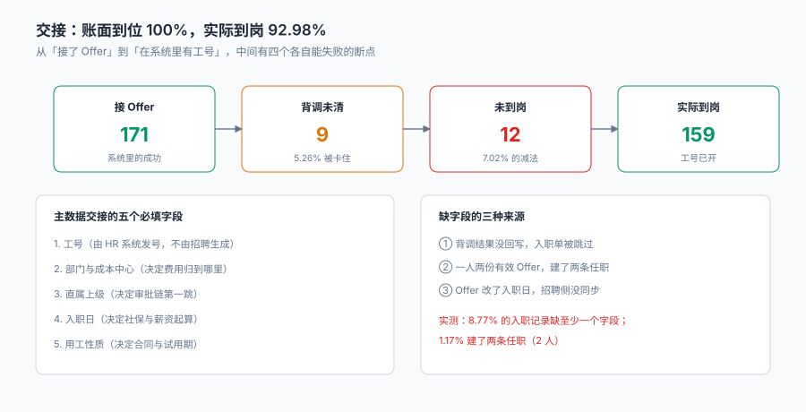

# 背调与入职交接

「人已经答应了，下周一来」——这句话在系统里通常对应一个状态：`hired`。

**但实际情况是：171 个人答应了，159 个人来了。** 差的 12 个人里，9 个是到点没来（爽约），3 个是背调没过。这 12 个人在系统里曾经都是「已录用」，在 HC 上曾经都占着一个坑，在报表上曾经都是「已到岗」——**因为「接受」和「到岗」被写成了同一个状态**。

::: tip 一句话理解
入职不是「一条记录从 `offer.accepted` 变成 `employee`」，而是**一次三方交接**：招聘交人、HR 交资料、用人部门交岗位。三方都签了，才算「到岗」；少一方，那个人就停在半路上。
:::

本页判据族 `TAH-A` ~ `TAH-H`，共 8 条。定义表在第八节「本页判据」。

## 一、四个断点，四次减法



| 断点 | 本机读数 | 形态 | 谁来发现 |
| --- | --- | --- | --- |
| 背调未清 | 9 人（5.26%） | 结论未回、材料待补 | 招聘（如果没人跟，就一直挂着） |
| 背调不通过 | 其中 3 人 | 结论为「不建议录用」 | HR |
| 爽约 | 9 人（5.26%） | 到点没来、联系不上 | 用人部门（他们最清楚人没来） |
| 主数据缺字段 | 15 份（8.77%） | 工号/部门/上级/入离职缺一 | 薪酬（算不出第一个月工资） |

四项加起来是 12 个未到岗（171 → 159，7.02%）。**这个减法必须能在系统里做出来**，而不是在季度会上用 Excel 对出来。

## 二、背调：一个必须有时限的状态机

```text
not_started ─发起─▶ pending ─┬─通过─▶ clear ─▶ 可建入职单
                             ├─不通过─▶ adverse ─▶ 终止流程 + 通知
                             └─超时─▶ expired ─▶ 需重新发起（或转人工判断）
```

四个状态里，**`expired` 是最容易被漏掉的一个**。背调机构承诺 5 个工作日，实际经常 10 天没回；系统里那条记录就一直是 `pending`，入职日到了，人来了，入职单建不出来——于是有人会在系统里手工把状态改成 `clear`。

| 背调项目 | 时效性 | 是否可以「先入职后补」 |
| --- | --- | --- |
| 身份与学历核验 | 高（当天可查） | 不建议 |
| 前雇主工作经历 | 中（3–5 天） | 视岗位，需书面同意 |
| 犯罪记录 | 高 | 不建议 |
| 竞业限制 | 高 | 不建议（法律风险） |
| 金融行业从业资格 | 高 | 不建议 |

**「先入职后补」这件事必须由制度定，不能由系统默认放行。** 系统能做的是：把「未清项」列出来，让做决定的人知道自己在决定什么。

::: danger 三件事必须做，不能靠「入职那天再看」
1. **背调状态要与入职单解耦但可查**：入职单可以先建（`draft`），但 `state` 不能变成 `effective`，直到所有必检项为 `clear`。用触发器把这条钉住。
2. **必检项要按岗位配置**：财务岗必检犯罪记录、技术岗必检竞业，不能"一刀切全检"（成本）也不能"全不检"（风险）。
3. **超时要有人接**：`pending` 超过 SLA 自动升级为一个待办，落到具体人头上。**没有主人的待办等于没有待办。**
:::

## 三、爽约：不是「不来了」，是三种不同的不来

| 类型 | 表现 | 根因 | 能不能救 |
| --- | --- | --- | --- |
| 明确放弃 | 提前告知「我接了别家」 | 竞争 Offer、家庭原因 | 不能，但要记录原因 |
| 失联 | 入职前一天起联系不上 | 反悔但不愿说、或已入职别家 | 很难 |
| 到点不来 | 当天没出现，之后回复「忘了」 | 沟通断层（入职提醒没发到位） | 能，靠入职前 3 天确认 |

本机 9 人爽约（5.26%）。这三种类型如果混成一个 `no_show`，就永远不知道该改哪一环——**第一种要改的是报价与岗位吸引力，第三种要改的是入职前的触达**。

```sql
-- 爽约归因：入职日已过、状态仍为 accepted 的，按「最后一次联系结果」分类
select o.offer_id, o.onboard_date, c.last_contact_result
from offer o join candidate c using(candidate_id)
where o.state = 'accepted' and date(o.onboard_date) < date('now')
  and not exists (select 1 from onboarding b where b.offer_id = o.offer_id and b.state = 'effective');
```

## 四、主数据交接：五个字段，一个都不能少

入职单不是「一张表」，它是**招聘系统向 HR 主数据系统的一次交接**。五个字段决定了这个人能不能被正确对待：

| 字段 | 缺了会怎样 | 谁负责填 |
| --- | --- | --- |
| 工号 `employee_no` | 无法建任职记录、无法发薪 | HR 系统自动发号 |
| 部门与成本中心 | 费用归错地方、审批链错人 | 用人部门确认 |
| 直属上级 | 审批链第一跳缺失 | 用人部门确认 |
| 入职日 | 社保、薪资起算日错 | 候选人 + HR 协商 |
| 用工性质 | 合同类型、试用期长度错 | HR |

本机 171 份入职单里有 **15 份（8.77%）** 至少缺一个字段。缺字段的三种来源：

1. **背调结果没回写**：入职单建了，但 `bg_status` 为空。
2. **一人两份有效 Offer**：建了两条任职（本机 2 人，1.17%）。
3. **Offer 改了入职日，招聘侧没同步**：入职单上的日期还是旧的。

第 3 种最隐蔽，因为它不产生任何异常：两个系统各自有一个「入职日」，谁也不知道哪个对。

::: danger 三件事必须做，不能靠「入职当天核对」
1. **入职日只能有一个来源**：以 `offer.onboard_date` 为准，入职单引用它而不是复制它。复制就会分叉。
2. **工号必须由 HR 系统发号**，招聘不得自行生成。两个系统各自发号，就会出现「同一个人两个工号」。
3. **建任职前要查重**：`employee_no` 之外还要按「证件号 + 生效日」查一次，防止同一个人被建两条任职（本机 1.17%）。
:::

## 五、与「组织与任职」的边界

入职之后的事属于另一个专题，本册只到「工号已开、任职已建」为止。两边最容易打架的是三个字段：

| 字段 | 招聘侧的含义 | 组织侧的含义 | 谁说了算 |
| --- | --- | --- | --- |
| 入职日 | 约定的到岗日 | 任职生效日 | 招聘（约定），组织（生效） |
| 部门 | 岗位所属团队 | 组织树上的节点 | 组织（树变了要跟着变） |
| 直属上级 | 面试时的用人经理 | 汇报关系 | 组织（可能有调整） |

三个字段的规则是：**招聘提供初始值，组织维护后续值，变更以组织为准**。这条边界不写清楚，会出现「招聘改部门、组织也改部门，最后两边不一样」。

```sql
-- 入职单与任职记录的对照：入职日不等即为分叉
select b.employee_no, b.onboard_date, p.effective_from
from onboarding b join position p using(employee_no)
where b.state = 'effective' and date(b.onboard_date) <> date(p.effective_from);
```

## 六、入职前 7 天的四件事

到岗率能不能从 92.98% 提到 96%，取决于入职前的四件事有没有做：

| 时点 | 动作 | 目的 |
| --- | --- | --- |
| T−7 天 | 确认入职日、发入职指引 | 排除「忘了」型爽约 |
| T−3 天 | 背调结论必须已回 | 避免当天才发现不过 |
| T−1 天 | 通知用人部门、准备工位与设备 | 第一天有地方坐 |
| T+0 | 建入职单、发工号、建任职 | 当天能登录系统 |

四件事里，**T−3 的背调结论最容易被忽略**：本机 9 人背调未清，其中 3 人最终没过——如果这 3 个人的结论在 T−3 就回来了，用人部门就不会白等两周。

## 七、入职当天的验收

入职当天能验收的，不是「人来了」，是五条：

1. 工号已生成，且能在 HR 系统查到。
2. 任职记录已建，`effective_from` = 入职日。
3. 部门、成本中心、直属上级三个字段非空。
4. 用工性质与合同类型匹配（正式/实习/外包）。
5. 背调所有必检项为 `clear`。

五条全部通过，入职单才能从 `draft` 走到 `effective`。**任何一条不通过，都不该由「先建了再说」来绕过**——因为绕过之后，问题会以「第一个月工资算错」的形式在薪酬侧爆出来。

## 八、本页判据

| 判据 | 断言 | 验证方式 |
| --- | --- | --- |
| `TAH-A` | 接受与到岗是两个状态 | `offer.state` 与 `onboarding.state` 分别可查且不等价 |
| `TAH-B` | 背调有四个状态且含超时 | `background_check.state` 含 pending / clear / adverse / expired |
| `TAH-C` | 必检项未清不能生效 | 触发器拦截 `onboarding.state='effective'` 且存在非 clear 的必检项 |
| `TAH-D` | 入职日单一来源 | 入职单的日期来自 `offer.onboard_date`（外键或视图），非独立列 |
| `TAH-E` | 工号由 HR 系统发号 | `employee_no` 非招聘侧生成（无自增或序列） |
| `TAH-F` | 建任职前查重 | 同证件号 + 同生效日的任职行数 ≤ 1 |
| `TAH-G` | 五个必填字段非空 | 生效入职单中五个字段空值行数为 0 |
| `TAH-H` | 爽约有归因分类 | `onboarding.fail_reason` 区分 no_show / bg_fail / withdraw |

## 验证方式

```shell
# 1. 未清背调不能生效（期望被触发器拦住）
sqlite3 ta.db "update onboarding set state='effective' where onboarding_id=1;"
# 若该单存在 pending 的必检项，期望：NOT_CLEARED

# 2. 五个必填字段（期望 0）
sqlite3 ta.db "select count(*) from onboarding where state='effective'
               and (employee_no is null or dept_code is null or manager_id is null
                    or onboard_date is null or employ_type is null);"

# 3. 入职日分叉（期望 0）
sqlite3 ta.db "select count(*) from onboarding b join position p using(employee_no)
               where b.state='effective' and date(b.onboard_date) <> date(p.effective_from);"

# 4. 账面与实际的差（这是本页存在的理由）
python3 -c "print(171-159, round((171-159)/171*100,2), round(159/171*100,2))"
# 期望：12 7.02 92.98
```

第 4 步的三个数就是「账面到位 100%、实际 92.98%」的全部来源：**12 个人在半路上消失了，而系统里他们的状态曾经都是「已录用」**。

## 参考资料

- 《中华人民共和国劳动合同法》第七条：用人单位自用工之日起即与劳动者建立劳动关系。
- 《中华人民共和国劳动合同法》第十条：已建立劳动关系，未同时订立书面劳动合同的，应当自用工之日起一个月内订立书面劳动合同。
- 《中华人民共和国社会保险法》第五十八条：用人单位应当自用工之日起三十日内为其职工向社会保险经办机构申请办理社会保险登记。
- 《中华人民共和国个人信息保护法》第十三条、第十七条：背景调查属于处理个人信息，应取得单独同意并告知范围；调查范围应限于与劳动合同直接相关的内容。
- 与本页相邻：[Offer 与录用审批](../Offer/index.md)、[组织与任职](../../OrgPeople/Overview/index.md)、[薪酬核算](../../Payroll/Overview/index.md)。
