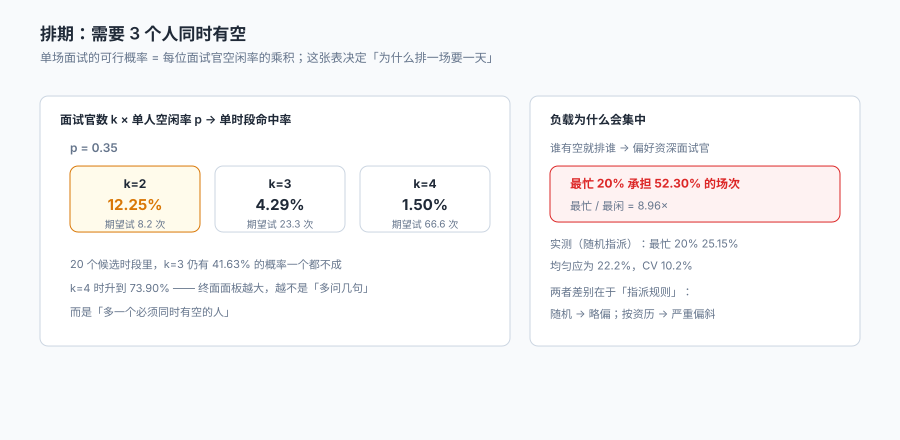

# 面试排期与日历

一次终面要三个人同时在场：用人经理、跨部门负责人、HR。三个人都点头的时段，才是「可以约」的时段。

**这件事的难度不在人，在乘法。** 每位面试官一天有 4 个可用时段，被占用一半之后，单人空闲率约 0.35；三个人同时空闲的概率是 `0.35³ = 4.29%`。也就是说，随机试一个时段有 95.7% 的概率不成——**平均要试 23 次，才能凑出一场终面**。

::: tip 一句话理解
排期的本质不是「找一个空档」，是**在三个人的日历交集里找一个三方都还没有承诺的时间**，并且这个时间一旦定下就要被锁住。锁不住，就会出现「同一时段两场面试」——本机 2.79% 的场次就是这样来的。
:::

本页判据族 `TAI-A` ~ `TAI-H`，共 8 条。定义表在第八节「本页判据」。

## 一、交集概率：为什么排一场要一天



| 面板人数 k | 单时段命中率（p=0.35） | 期望尝试次数 | 20 个候选时段里全不中的概率 |
| --- | --- | --- | --- |
| 2 | 12.25% | 8.2 | 7.33% |
| 3 | 4.29% | 23.3 | **41.63%** |
| 4 | 1.50% | 66.6 | **73.90%** |

这张表解释了三件日常现象：

1. **「约了三轮才定下来」是常态**：k=3 时，即使给 20 个候选时段，也有 41.63% 的概率一个都成。
2. **终面总在往后拖**：k=4 时（加一位 VP）命中率掉到 1.50%，期望试 67 次——如果每次尝试要发一封邮件等回复，这就是「一周过去了」。
3. **「先占个坑再说」的冲动**：因为难约，人会自动倾向于「先定下来」，于是把还没确认的时段写进日历——**这正是冲突的来源**。

```text
# 错的排期方式：先写库，再通知
insert into interview_round(...) values(...);   -- 冲突检测缺位
send_invite(...);                               -- 面试官才发现撞了

# 对的排期方式：先占位（带唯一约束），再通知
insert into interview_round(round_id, interviewer_id, slot_start, slot_end)
values(...);                                    -- 唯一约束挡住重复占位
-- 影响行数 = 0 时，说明该时段已被占，换下一个候选时段
```

## 二、冲突的两种形状

本机 1,543 场面试里有 **43 场（2.79%）** 与另一场冲突。冲突有两种，处置完全不同：

| 形状 | 表现 | 根因 | 堵在哪一层 |
| --- | --- | --- | --- |
| 同一面试官同一时段两场 | 日历上两个会议重叠 | 排期时未检查已有占用 | `unique(interviewer_id, slot_start)` |
| 同一候选人两轮同一天 | 上午终面、下午初面 | 轮次间隔未设最小间隔 | 应用层约束（`min gap ≥ 1 day`） |

第一种用**数据库唯一约束**就能根治；第二种必须写在应用层，因为它不是「重复」，而是「顺序不合理」。

```sql
-- 一条唯一索引解决「同一面试官同一时段只能有一场」
create unique index uq_iv_slot on interview_round(interviewer_id, slot_start)
  where state in ('scheduled','confirmed');
```

注意 `where` 子句：**取消的场次不该占位**。如果把取消的也锁住，面试官那个时段就永远排不了第二场。

## 三、面试官负载：谁有空就排谁，会排出一个极端

本机 18 位面试官承担 1,543 场，人均 85.7 场，标准差 8.8，**变异系数 10.2%**——这是「随机指派」的结果，看起来还算均匀。但真实场景不是随机指派，而是「找资深的人把关」：

| 指派规则 | 最忙 20% 承担的场次 | 最忙 / 最闲 |
| --- | --- | --- |
| 随机指派（本机） | 25.15% | 1.4× |
| 「谁有空就排谁」+ 偏好资深 | **52.30%** | **8.96×** |

差别的来源不是算法，是**默认偏好**。而负载过度集中的后果不是「资深的人累」，是三个具体问题：

1. **排期周期变长**：最忙的人日历最满，命中率最低，于是所有候选人都要等他的时段。
2. **评分质量下降**：一天面 5 场的人，第 5 场的分数会明显趋中（这是「评分者疲劳」，不是「评分者不认真」）。
3. **单点依赖**：这个人一休假，整条链路停摆。

::: danger 三件事必须做，不能靠「排期的人心里有数」
1. **负载要可见**：每个面试官的本周已排场次、下周已排场次要能在排期界面上看到，而不只是「日历上有没有空」。**「有空」与「排得下」是两件事。**
2. **每位候选人至少 2 位面试官**：本机 135 人（18.12%）只被一位面试官评过——这些人的分数带着「谁评的」这个隐藏维度，无法校正（见[评估](../Evaluation/index.md)）。
3. **轮次之间要有最小间隔**：同一候选人两轮排在同一天，第二轮会受第一轮结论影响（面试官之间会交流），这等于把两次独立评估变成一次。
:::

## 四、取消与重排：一个必须被计数的动作

面试的取消率在真实场景里很高（候选人拿到别家 Offer、面试官临时出差、业务方要看数据），本册没有单独统计取消率，但**取消这件事必须在模型里有位置**：

| 状态 | 含义 | 是否占位 | 是否计入「已排期」 |
| --- | --- | --- | --- |
| `scheduled` | 已排，未确认 | 占 | 是 |
| `confirmed` | 双方确认 | 占 | 是 |
| `cancelled_by_candidate` | 候选人取消 | 不占 | 否，但要计数 |
| `cancelled_by_company` | 我方取消 | 不占 | 否，要计数 |
| `no_show` | 到点没来 | 不占 | 否，要计数 |
| `completed` | 已完成 | 不占 | 是 |

五个「不占位」的状态里，**`no_show` 最贵**：它占用了面试官一小时，没有产生任何评估，而且如果系统把它记成 `cancelled`，就永远发现不了「这个候选人的意愿有问题」。

## 五、时区与夏令时

跨时区面试不是「加 8 小时」这么简单。三种情况会让「同一个时间」变成两个时间：

| 情况 | 表现 | 处置 |
| --- | --- | --- |
| 夏令时切换 | 纽约 3 月某日 02:30 不存在 | 落库用 UTC，展示用本地时区 |
| 时区缩写歧义 | CST 可以是中美澳三个时区 | 只存 IANA 时区名（`Asia/Shanghai`） |
| 候选人跨国 | 「明天下午」在两边不是同一天 | 邀约里必须同时给两个时区的时间 |

**唯一可靠的做法是：数据库只存 UTC 时间戳 + IANA 时区名，不存「本地时间字符串」。** 一旦把 `2026-03-08 02:30` 这样的本地时间存进库，夏令时那天它就是一个不存在的时间点，而数据库不会报错。

## 六、面试轮次怎么定

轮次不是越多越好。每一轮都在消耗两样东西：候选人的耐心（本机 74 天的周期里，首面到 Offer 占 10 天）和面试官的时间（1,543 场 / 171 人 ≈ 9 场/人）。

| 轮次结构 | 场次/人 | 决策质量 | 适用 |
| --- | --- | --- | --- |
| 1 轮（用人经理） | 1 | 低（单人偏见无法校正） | 实习、外包 |
| 2 轮（专业 + HR） | 2 | 中 | 大多数社招岗位 |
| 3 轮（专业 + 交叉 + HRBP） | 3 | 高 | 关键岗位、管理岗 |
| 4 轮以上 | ≥4 | 边际收益低，流失率高 | 仅高管 |

本机 745 人产生 1,543 场，平均 **2.07 场/人**，落在「2 轮为主、关键岗位 3 轮」的结构上。这个结构的关键不是轮数，是**每一轮问的东西不重叠**：专业轮问「会不会」，交叉轮问「合不合」，HR 轮问「来不来」。三轮问同一件事，等于一轮问了三遍。

## 七、邀约与确认

邀约不是「发一封邮件」，是一次**需要对方确认的承诺**。三个要素缺一不可：

1. **明确的时间与时长**（含时区）：`2026-11-10 14:00–15:00 (Asia/Shanghai)`。
2. **明确的参与人**：候选人要知道见谁、什么角色。
3. **明确的变更方式**：怎么改期、提前多久、找谁。

缺第三项的邀约最容易变成 `no_show`：候选人想改期但不知道找谁，于是干脆不来。

## 八、本页判据

| 判据 | 断言 | 验证方式 |
| --- | --- | --- |
| `TAI-A` | 同一面试官同一时段只有一场 | 唯一索引存在，重复插入影响行数为 0 |
| `TAI-B` | 取消的场次不占位 | 唯一索引带 `where state in ('scheduled','confirmed')` |
| `TAI-C` | 同一候选人两轮不同日 | 同一 `application_id` 的相邻轮次日期差 ≥1 天 |
| `TAI-D` | 每位候选人至少 2 位面试官 | 只有 1 位评分人的比例可统计且低于阈值 |
| `TAI-E` | 时段以 UTC 存储 | 表中无「本地时间字符串」列，或该列不与 UTC 混用 |
| `TAI-F` | 时区用 IANA 名 | `timezone` 列取值形如 `Asia/Shanghai` |
| `TAI-G` | 取消有分类 | `state` 区分 candidate / company / no_show |
| `TAI-H` | 面试官负载可查 | 存在按面试官聚合的周场次视图 |

## 验证方式

```shell
# 1. 冲突拦截（第二次插入应失败，期望输出 0 行受影响）
sqlite3 ta.db "insert into interview_round(round_id, application_id, interviewer_id, slot_start, state)
               values (9999, 1, 'iv00', '2026-11-10T06:00:00Z', 'scheduled');"
sqlite3 ta.db "insert into interview_round(round_id, application_id, interviewer_id, slot_start, state)
               values (10000, 2, 'iv00', '2026-11-10T06:00:00Z', 'scheduled');"
# 第二条期望：UNIQUE constraint failed

# 2. 同一候选人两轮同日（期望 0）
sqlite3 ta.db "select count(*) from interview_round a join interview_round b
               on a.application_id=b.application_id and a.round_no<b.round_no
               where date(a.slot_start)=date(b.slot_start);"

# 3. 面试官负载（期望 18 行，含周场次）
sqlite3 ta.db "select interviewer_id, count(*) c from interview_round
               where state in ('scheduled','confirmed','completed')
               group by 1 order by c desc limit 5;"

# 4. 交集概率手算（验证文中那张表）
python3 -c "print([round(0.35**k*100,2) for k in (2,3,4)], [round(1/0.35**k,1) for k in (2,3,4)])"
# 期望：[12.25, 4.29, 1.5] [8.2, 23.3, 66.6]
```

第 1 步是本页的核心：**冲突不是靠"排期的人小心"避免的，是靠一条唯一索引避免的**。第二条插入报错，就是这个约束在工作。

## 参考资料

- 《中华人民共和国劳动法》第三十六条、第四十一条：工作时间与延长工作时间的限制——面试若占用候选人工作时间，需考虑其可行性。
- IANA 时区数据库（tz database）：本册要求时区以 IANA 名称存储，避免 `CST` 这类多义缩写。
- RFC 5545《Internet Calendars (iCalendar)》3.8.2.2：`DTEND` 为非包含式（non-inclusive），即事件在 `DTEND` 时刻结束但不包含该时刻——面试时段 `14:00–15:00` 在日历语义里是 60 分钟，不是 61 分钟。
- 与本页相邻：[简历解析与筛选](../Screening/index.md)、[评估、评分卡与校准](../Evaluation/index.md)、[预约与资源档期](../../AppointmentBooking/Overview/index.md)。
