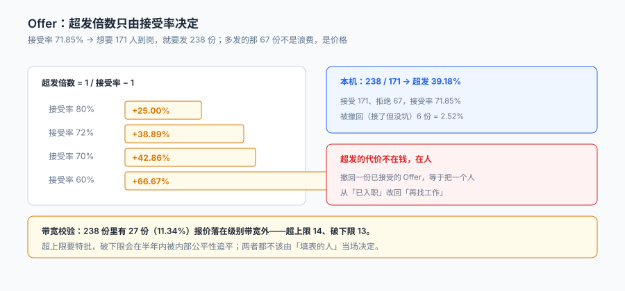

# Offer 与录用审批

「要招 3 个人，那就发 3 份 Offer」——这句话在每个季度都会被验证一次是错的。

本机 238 份 Offer 对应的 HC 是 171 个，**超发 39.18%**。这个比例不是拍脑袋定的，它由一个数决定：接受率 71.85%。`1 / 0.7185 − 1 = 39.19%`——**想要 171 人到岗，就必须发 238 份**。

::: tip 一句话理解
Offer 不是「通知」，是**一份有期限、可撤回、需要双方签字的有价承诺**。它有三个必须落库的数字：发了多少份、接受多少份、撤回多少份。三个数凑不齐，超发就变成了赌博。
:::

本页判据族 `TAF-A` ~ `TAF-H`，共 8 条。定义表在第八节「本页判据」。

## 一、超发：一个由接受率决定的数



| 接受率 | 需要的超发倍数 | 想招 100 人要发 |
| --- | --- | --- |
| 80% | +25.00% | 125 份 |
| 72% | +38.89% | 139 份 |
| 70% | +42.86% | 143 份 |
| 60% | +66.67% | 167 份 |

这张表的用法是**反过来**：先算出「我需要 171 个人」，再用历史接受率反推「我该发多少份」。本机 238 / 171 = 1.39，与 71.85% 的接受率完全对得上——**这不是巧合，是同一条公式**。

但超发不是免费的。本机 238 份里有 **6 份（2.52%）在候选人接受之后被撤回**，因为坑已被别人填上。

| 超发的代价 | 形态 | 有多贵 |
| --- | --- | --- |
| 撤回已接受的 Offer | 候选人已辞职、已拒掉别家 | **最贵**：一次毁约 + 一次口碑损失 |
| 延迟入职 | 让候选人「等一个坑」 | 中：等的人大概率不来了 |
| 转岗 | 塞到另一个 HC | 低：但要看是否真有空缺 |

::: danger 三件事必须做，不能靠「HR 盯着点」
1. **坑位数必须由数据库拦，不由人盯**：发 Offer 时 `update requisition set hc_inflight = hc_inflight + 1 where hc_filled + hc_inflight < hc_total`，影响行数 0 就拒绝。本机 6 份被撤回的 Offer，全部是「先发了再说」的结果。
2. **接受与到岗必须是两个状态**：`accepted` 之后还有 `signed`（签回）与 `onboarded`（到岗）。合成一个 `hired`，就永远算不出爽约率。
3. **撤回必须留原因**：`offer.revoke_reason`（HC 已满 / 预算冻结 / 背调不过）。没有原因，撤回这件事在报表上就消失了。
:::

## 二、状态机：九个状态、四次不可逆

```text
draft ─提交─▶ pending ─批─▶ approved ─发─▶ sent ─┬─接受─▶ accepted ─签─▶ signed ─到岗─▶ onboarded
  │             │                                ├─拒绝─▶ declined
  │             └─拒─▶ rejected                  ├─过期─▶ expired
  └─废弃─▶ void                                  └─撤回─▶ revoked（仅 HC 已满/预算冻结）
```

四次不可逆的迁移：`sent → accepted`、`sent → declined`、`sent → expired`、`accepted → revoked`。前三者是候选人的决定，最后一个是**我方的决定**——它必须走审批，不能由招聘一个人点。

| 状态 | 是否占 HC | 是否可改 | 谁可以改 |
| --- | --- | --- | --- |
| `draft` | 否 | 是 | 招聘 |
| `pending` | 否 | 撤回重提 | 招聘 |
| `approved` | **是**（占 inflight） | 是（需重新审批） | 招聘 + 审批人 |
| `sent` | 是 | 只能改有效期（需审批） | 招聘 |
| `accepted` | 是 | 否（只能撤回） | 审批人 |
| `signed` | 是 | 否 | — |
| `onboarded` | 转 filled | 否 | — |
| `declined` / `expired` / `revoked` | 释放 | 否（需新建） | — |

`approved` 就占 HC 这一点很重要：**很多人以为「发出去才占坑」，实际上是「批了就该占」**。否则同一天批 5 份、发 3 份、还有 2 份在走流程时，那 2 份的坑会被重复分配。

## 三、审批：3 天中位，8 天 P90

本机 238 份 Offer 的审批时长中位 **3 天**、P90 **8 天**，其中 **76 份（31.93%）超过 5 天**。

审批慢的代价不是「HR 等着」，是**候选人在这 5 天里接了别家**：

| 审批时长 | 大概率的后果 |
| --- | --- |
| ≤2 天 | 候选人还在决策期，接受率高 |
| 3–5 天 | 开始有竞争 Offer 介入 |
| >5 天 | 候选人已在别处进入终面或已接受 |

本机从「发出」到「接受」的中位是 9 天，其中包含了审批后的等待。**审批每多一天，接受率就往下降一点**——这也是为什么很多公司把「Offer 审批 SLA」定成 48 小时，而 SLA 的对象不是 HR，是审批人。

```sql
-- 审批超时：超过 SLA 仍未完成的，按审批人聚合（问题通常集中在某几个人）
select approver_id, count(*) as pending, min(created_at) as oldest
from approval
where node = 'offer_release' and state = 'pending'
  and julianday('now') - julianday(created_at) > 2
group by approver_id order by pending desc;
```

## 四、带宽校验：27 份越线

本机 238 份里有 **27 份（11.34%）** 报价落在级别带宽外：超上限 14 份、破下限 13 份。

| 越线方向 | 为什么会发生 | 后果 |
| --- | --- | --- |
| 超上限 | 稀缺技能、急招、候选人手握多个 Offer | 内部公平性受损，同级别老员工倒挂 |
| 破下限 | 候选人期望低、压低成本、试用期打折 | 半年内被追平，或入职即离职 |

两类越线都**不能靠「审批人看一眼」**。可行的做法是把它变成一次显式的判定：

```sql
-- 越线必须挂特批单，且特批单要写理由
select o.offer_id, o.base_pay, r.band_min, r.band_max,
       (select count(*) from approval a
         where a.offer_id = o.offer_id and a.node = 'band_exception' and a.state = 'approved') as has_exception
from offer o join requisition r using(req_id)
where o.base_pay not between r.band_min and r.band_max
having has_exception = 0;
```

这条 SQL 返回非空，就说明有报价越过了带宽却没有特批单。

::: warning 「破下限」在本册里被判为比「超上限」更危险
超上限只是内部不公平，破下限还会触发两个硬约束：**试用期工资不得低于本单位相同岗位最低档工资的 80%，且不得低于当地最低工资标准**（《劳动合同法》第二十条）。这两个条件在报价阶段就该校验，而不是等到发薪时才发现。
:::

## 五、有效期与失效

Offer 必须有有效期，且有效期不是一个「提醒字段」，是一个**状态迁移的触发条件**：

| 有效期设置 | 好处 | 风险 |
| --- | --- | --- |
| 3 天 | 逼候选人快速决定 | 候选人反感，接受率下降 |
| 7 天 | 常见做法 | 与竞品 Offer 的窗口重叠 |
| 15 天 | 对在职候选人友好 | 岗位空置时间长，HC 被占 |

不管设几天，**必须有 `expire_at`，且到期要有一个批量任务把它改成 `expired` 并释放 HC**。没有这一步，一个「已过期但状态还是 sent」的 Offer 会一直占着坑，而所有人都以为它还有效。

```sql
-- 过期扫描：到点自动失效并释放 HC（必须在同一事务里）
update offer set state = 'expired', closed_at = datetime('now')
where state = 'sent' and expire_at < datetime('now');

update requisition set hc_inflight = hc_inflight - 1
where req_id in (select req_id from offer where state = 'expired' and closed_at = datetime('now'));
```

两句话必须在同一个事务里。**只改 Offer 不改编制，等于坑永远被占着；只改编制不改 Offer，等于候选人还能接受一份已失效的 Offer。**

## 六、一人两份有效 Offer

本机 238 份里有 **6 份** 属于「同一候选人同时持有两份有效 Offer」（2.52%）。这在小公司里几乎不会发生，在多事业部或集团化招聘里很常见——两个 HR 各自不知道对方发了 Offer。

处置口径要提前定，三种都可以，但必须选一种：

| 口径 | 做法 | 问题 |
| --- | --- | --- |
| 全局唯一 | 一人只能有一份 `sent/accepted` 的 Offer | 跨主体（不同法人）时误拦 |
| 主体内唯一 | 同一法人内唯一 | 需要 `legal_entity` 字段 |
| 不拦，靠人协调 | 无约束 | 本机就会出现 6 份 |

本册取第二种：**同一 `legal_entity` 内一人只能有一份有效 Offer**，用部分唯一索引实现。

```sql
create unique index uq_offer_active on offer(candidate_id, legal_entity)
  where state in ('approved','sent','accepted','signed');
```

## 七、Offer 的四个「时间」

| 时间 | 含义 | 本机读数 | 谁关心 |
| --- | --- | --- | --- |
| `approved_at` | 审批通过 | 中位 3 天（从提交起） | 招聘 |
| `sent_at` | 发出 | 审批后 ≤1 天 | 候选人 |
| `expire_at` | 失效 | 通常 sent + 7 天 | 双方 |
| `accept_at` | 接受 | 中位 9 天（从 sent 起） | 招聘 |
| `onboard_date` | 入职 | 中位 33 天（从 accept 起） | 业务 |

五个时间里，只有 `onboard_date` 是可以谈判的（候选人要等离职交接），其余四个都应当被系统算出来，而不是被填进去。

## 八、本页判据

| 判据 | 断言 | 验证方式 |
| --- | --- | --- |
| `TAF-A` | 超发倍数可复算 | `发出份数 / HC` 与 `1 / 接受率` 一致（误差 <1%） |
| `TAF-B` | 编制在批准时即占用 | `approved` 状态的 Offer 数 ≤ `hc_inflight` |
| `TAF-C` | 接受与到岗是两个状态 | 存在 `accepted` 与 `onboarded` 两个状态值 |
| `TAF-D` | 撤回必须有原因 | `state='revoked'` 中 `revoke_reason` 为空的行数为 0 |
| `TAF-E` | 带宽越线必须有特批 | 越线行数 = 有 `band_exception` 审批的行数 |
| `TAF-F` | 过期会自动释放 HC | 存在到期扫描任务，且 `expired` 后 `hc_inflight` 相应减少 |
| `TAF-G` | 主体内一人一份有效 Offer | 部分唯一索引存在，重复插入影响行数为 0 |
| `TAF-H` | 五个时间戳齐全 | `approved_at` / `sent_at` / `expire_at` / `accept_at` / `onboard_date` 均可查 |

## 验证方式

```shell
# 1. 超发倍数与接受率一致（期望两数接近）
sqlite3 ta.db "select round(1.0*count(*)/(select sum(hc_total) from requisition),4) as oversend,
                      round(1.0/(1.0*sum(case when state in ('accepted','signed','onboarded') then 1 else 0 end)/count(*)),4) as implied
               from offer;"
# 期望：1.3918 与 1.3918

# 2. 撤回必须有原因（期望 0）
sqlite3 ta.db "select count(*) from offer where state='revoked' and coalesce(revoke_reason,'')='';"

# 3. 主体内一人一份有效 Offer（第二次插入应失败）
sqlite3 ta.db "insert into offer(candidate_id, legal_entity, state) values (1,'CN01','sent');"
sqlite3 ta.db "insert into offer(candidate_id, legal_entity, state) values (1,'CN01','accepted');"
# 第二条期望：UNIQUE constraint failed

# 4. 到期扫描后编制要释放（期望 inflight 减少的条数 = 过期条数）
sqlite3 ta.db "select (select count(*) from offer where state='expired'),
                      (select count(*) from offer where state='expired' and released=1);"
```

第 1 步是本页的核心：**超发倍数与接受率是同一个数的两种写法**。两者对不上，就说明有一批 Offer 既没被接受也没被拒绝——那批就是「悬着」的单子。

## 参考资料

- 《中华人民共和国劳动合同法》第十九条、第二十条、第二十一条：试用期期限、试用期工资下限、试用期解除条件。
- 《中华人民共和国劳动合同法》第十条：建立劳动关系，应当订立书面劳动合同；已建立劳动关系，未同时订立书面劳动合同的，应当自用工之日起一个月内订立。
- 《中华人民共和国民法典》第四百七十二条、第四百七十六条：要约的内容、要约的撤销限制——Offer 在法律意义上是要约，有效期与撤回条件必须明确。
- 与本页相邻：[评估、评分卡与校准](../Evaluation/index.md)、[背调与入职交接](../Handoff/index.md)、[薪酬核算](../../Payroll/Overview/index.md)。
