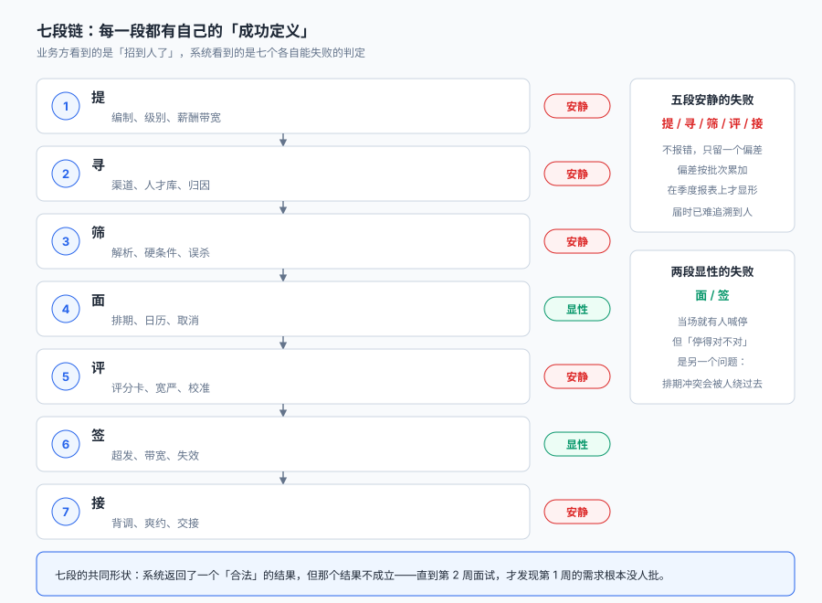
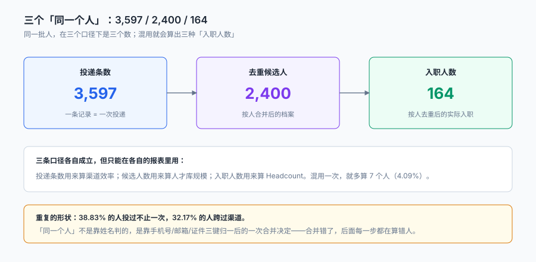
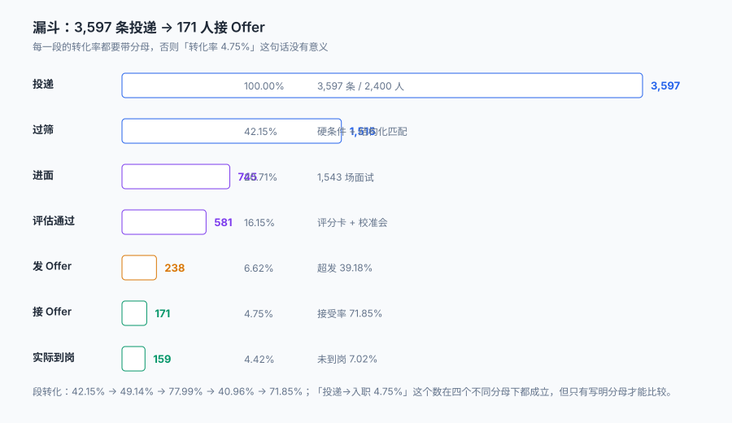

# 总览：七段链与三个「同一个人」

一张 Offer 上只有五行字：岗位、级别、月薪、入职日、有效期。签字回传，整个流程就算完成了。

**但那五行的背后没有一个字提到：这个编制是什么时候批的、这个人来过几次、那 238 份 Offer 里有几份发给了同一个人、答应的 171 人里为什么只到了 159 个。** 四个问题分别对应四种失败——编制被绕过、重复计数、评估不可比、承诺没兑现——而它们都不会让系统报错。

::: tip 一句话理解
招聘系统不是「简历库 + 面试安排 + 发 Offer」，而是**一条能追到人的链路**：每一次状态变化都要能回答「是谁、凭什么、在哪一刻」。链路断在哪一段，那一段的数字就只能是「看起来对」。
:::

本页判据族 `TAO-A` ~ `TAO-H`，共 8 条。定义表在第九节「本页判据」。

## 一、七段链：每一段都有自己的「成功定义」

| 段 | 业务方以为的成功 | 系统实际判断的成功 | 差在哪 |
| --- | --- | --- | --- |
| ① 提 | 岗位批了 | 编制冻结、级别与带宽一致、JD 已审 | 编制是「剩余可招数」不是状态位 |
| ② 寻 | 收到简历了 | 人已归并、渠道已归因、来源可追 | 一条简历可能属于三个人 |
| ③ 筛 | 筛完了 | 规则可解释、误杀可复核、敏感字段未参与 | 「不符合」没有理由就等于没筛过 |
| ④ 面 | 面完了 | 每位面试官独立落分、时段不冲突 | 冲突会被「私下换时间」绕过去 |
| ⑤ 评 | 分出来了 | 同岗位同尺子、宽严可校正、边界人已校准 | 换一种加法就换一个人 |
| ⑥ 签 | Offer 发了 | 在带宽内、审批留痕、超发有账 | 超发是决策，不是失误 |
| ⑦ 接 | 人来了 | 背调已清、入职日确定、主数据齐全 | 「接受」不等于「到岗」 |



五段「安静」的失败有一个共同形状：**它不产生异常，只产生一个偏差**。偏差会随着批次累加，最后以「这个部门总是招不满」「这个渠道总是很贵」「这批人试用期走了一半」的形式出现在季度复盘上，而那时已经无法追溯到具体是哪一条投递出了问题。

## 二、三个「同一个人」

这是本册最容易被忽略、也最容易算错的一件事。同一个词「人」，在招聘链路里有三种身份：

| 身份 | 主键 | 什么时候产生 | 数量级 |
| --- | --- | --- | --- |
| 投递 | `application_id` | 投一次产生一条 | 3,597 |
| 候选人 | `candidate_id` | 三键归一后合并 | 2,400 |
| 员工 | `employee_no` | 入职建号后产生 | 164 |



本机实测的三组数：人岗比 **1.50**（3,597 / 2,400）；投过不止一次的人 **932（38.83%）**；跨过渠道的人 **772（32.17%）**；按投递统计入职 171 条、按人统计 164 人，**重复计数 7 条（4.09%）**。

这三个数各自都对，但只要有一张报表把「投递数」当「人数」用，它算出来的所有率都会偏。举个最容易犯的例子：

```sql
-- 错：把「投递数」当「应聘人数」，转化率被摊薄 1.5 倍
select count(*) as applicants, sum(case when stage = 'hired' then 1 else 0 end) as hires
from application;

-- 对：先归并到人，再算
select count(distinct candidate_id) as candidates,
       count(distinct case when stage = 'hired' then candidate_id end) as hired_people
from application;
```

前一条在本机得 3,597 / 171 = 4.75%，后一条得 2,400 / 164 = 6.83%。**两个数都「算对了」，但回答的不是同一个问题**。

## 三、漏斗与它的四个分母

| 环节 | 条数 | 相对上一段 | 相对投递 | 分母是什么 |
| --- | --- | --- | --- | --- |
| 投递 | 3,597 | — | 100.00% | 所有进入系统的投递 |
| 过筛 | 1,516 | 42.15% | 42.15% | 同上 |
| 进面 | 745 | 49.14% | 20.71% | 过筛的人 |
| 评估通过 | 581 | 77.99% | 16.15% | 进面的人 |
| 发 Offer | 238 | 40.96% | 6.62% | 评估通过的人 |
| 接 Offer | 171 | 71.85% | 4.75% | 收到 Offer 的人 |
| 实际到岗 | 159 | 92.98% | 4.42% | 接了 Offer 的人 |



这张表如果只看最后一列，会得出「招聘转化率 4.42%，很低」的结论；只看「相对上一段」，会得出「每一段都还行」的结论。**两个结论都不算错，但都不能直接用来做决策**——真正要看的，是每段的**绝对损耗**与**损耗原因**：

- 过筛损耗 2,081 条，其中约 **333 条（外推）** 是误杀——这一段的损耗有一半是「规则」造成的，不是「人」不够。
- 评估损耗 164 人，其中 **135 人（18.12%）只被一位面试官评过**——这一段的损耗有一半是「尺子」造成的。
- 到岗损耗 12 人（171 → 159），其中 **9 人爽约、3 人背调结论不通过**（背调未清的共 9 人）——这一段的损耗与招聘能力无关，是流程衔接问题。

## 四、四个「必失点」

这四种失败在本库反复出现，每一种都能通过「流程完整」的检查：

| 失败 | 看起来对在哪 | 实际错在哪 | 本机读数 |
| --- | --- | --- | --- |
| 编制外招聘 | 岗位已发布、有投递 | HC 冻结或已满，JD 还挂在渠道上 | 5 个冻结需求仍收 **422** 条投递 |
| 重复计数 | 每个渠道各有一份入职数 | 同一个人被两个渠道各记一次 | 首末触点不一致 **38 人（1.58%）** |
| 不可比的评分 | 每个人都有一个总分 | 分数带了「谁评的」这个隐藏维度 | 偏移 SD 3.14 分 → 名次变 **98.66%** |
| 承诺未兑现 | 「已接受 Offer」 | 接了没来、背调没过、入职日改期 | 账面 100% vs 实际 **92.98%** |

::: danger 三件事必须写进数据模型，不能留给「报表里处理」
1. **编制要落成「剩余可招数」而不是状态位**：`requisition.hc_total` 与 `hc_filled` 两个数，加上一条「`hc_filled <= hc_total`」的约束，才能拦住「冻结后还在发 Offer」。只存 `status='open'` 时，冻结与招满是同一个值。
2. **渠道归因要落「触点表」而不是「应用表上的一个字段」**：一个人可能有三个触点，末次触点与首次触点会给出不同的渠道结论（本机 1.58% 不一致）。只存一个 `channel` 字段，等于永久放弃了另一种口径。
3. **Offer 的「接受」与「到岗」必须是两个状态、两个时间戳**：合成一个 `hired` 状态，就永远算不出爽约率，也永远发现不了「账面 100%、实际 92.98%」这个差。
:::

## 五、一条最小可复核链路

把上面所有东西压成一条链路，只需要六张核心表：

```text
requisition（编制 / 级别 / 带宽 / 状态）
  └─ application（人 × 岗位 × 渠道 / 部分唯一）
       ├─ screening（结构化字段 / 判定 / 理由）
       ├─ interview_round（轮次 / 面试官 / 时段）
       │    └─ score（维度 / 原始分 / 评者）
       └─ offer（版本 / 报价 / 状态机）
            └─ onboarding（入职日 / 背调 / 工号 / 部门）
candidate（三键归一后的人）
```

再补三张从属表（`channel_touch`、`background_check`、`approval`）与一张日志表（`stage_log`），就是[实战](../Practice/index.md)里的 10 张表。

## 六、三种「率」的写法

本册出现的每一个率都必须带分母，因为招聘里最少有四种分母在同时使用：

| 率的写法 | 分母 | 本机读数 | 什么时候用 |
| --- | --- | --- | --- |
| 过筛率 | 投递数 | 42.15% | 判断「渠道质量」与「规则松紧」 |
| 面试到场率 | 已排期场次 | 未单列（见面试页） | 判断「候选人的真实意愿」 |
| Offer 接受率 | 发出份数 | 71.85% | 决定「要发多少份」 |
| 到岗率 | 接受份数 | 92.98% | 决定「HC 能不能真的填上」 |

::: warning 「招聘完成率」是最容易被写坏的一个数
很多系统里它写成 `到岗人数 / HC`。这个式子在「HC 年初定、年中调整」的公司里算不出真话：HC 从 171 调到 200 时，分子没变、分母变大，完成率从 92.98% 掉到 79.50%，而实际干活的人一个没少。**正确写法是 `hc_filled / hc_total`，且两个数都取自同一时点的 requisition 快照。**
:::

## 七、读这一册的三种方式

| 你是 | 建议路径 | 重点看 |
| --- | --- | --- |
| 要建系统的人 | 提 → 寻 → 筛 → 面 → 评 → 签 → 接 → 实战 | 每页的「判据」表与 DDL |
| 要管招聘的人 | 总览 → 需求 → 渠道 → Offer | 每页的「本机读数」与失败形状 |
| 要答候选人投诉的人 | 筛选 → 评估 → 交接 | 每页的「怎么举证」小节 |

## 八、一页纸的取舍

本册刻意**不讲**四件事，因为相邻专题已经讲透：入职后的组织与任职（见[组织与任职](../../OrgPeople/Overview/index.md)）、算薪与个税（见[薪酬核算](../../Payroll/Overview/index.md)）、排班与工时（见[考勤排班](../../TimeAttendance/Overview/index.md)）、培养与认证（见[培训与资格](../../TrainingQualification/Overview/index.md)）。本册**只讲到「入职单落库、工号已开」为止**，再往后就是另一个专题的主场。

## 九、本页判据

| 判据 | 断言 | 验证方式 |
| --- | --- | --- |
| `TAO-A` | 七段中每一段都有独立的产物表 | 表清单里能找到 7 段对应的表，且无一段共用同一张表 |
| `TAO-B` | 「人」「投递」「员工」是三个主键 | 能查到 `candidate_id` / `application_id` / `employee_no` 三列且不同源 |
| `TAO-C` | 每个率都能说出分母 | 报表定义里每个率都有 `denominator` 字段 |
| `TAO-D` | 编制是「可招数」不是状态位 | `requisition` 含 `hc_total` 与 `hc_filled` 两列 |
| `TAO-E` | 渠道触点独立成表 | 存在 `channel_touch` 且一人在其中可有多行 |
| `TAO-F` | 「接受」与「到岗」是两个状态 | `offer.state` 与 `onboarding.onboard_date` 分别可查 |
| `TAO-G` | 每条被筛掉的投递都有理由 | `screening.reason_code` 非空行数 = 被筛掉行数 |
| `TAO-H` | 每条评分都能追到评者 | `score` 表主键含 `(round_id, interviewer_id, dim_code)` |

## 验证方式

```shell
# 1. 七段产物表齐全（在实战库上跑，期望 10）
sqlite3 ta.db "select count(*) from sqlite_master where type='table' and name not like 'sqlite_%';"

# 2. 三个主键各自存在且不同源（期望输出三行）
sqlite3 ta.db "select name from pragma_table_info('candidate') where name='candidate_id';
               select name from pragma_table_info('application') where name='application_id';
               select name from pragma_table_info('onboarding') where name='employee_no';"

# 3. 三个「同一个人」的数确实不同（不依赖数据库，直接算）
python3 -c "print(round(3597/2400,2), round(171/3597*100,2), round(164/2400*100,2))"
# 期望：1.5 4.75 6.83 —— 同一批数据，三个分母，三个结论
```

第 3 步不是凑数：它是本册所有「分母决定结论」论断的最小证明——同一批数据，换一个分母，结论就从「4.75%」变成「6.83%」。

## 参考资料

- 《中华人民共和国劳动合同法》第八条：招用劳动者时应如实告知工作内容、工作条件、地点、职业危害、报酬；用人单位有权了解与劳动合同直接相关的基本情况。
- 《中华人民共和国个人信息保护法》第十三条、第十七条：处理个人信息应取得同意并告知目的、方式、种类与保存期限。
- 《中华人民共和国就业促进法》第三条、第二十七条：劳动者享有平等就业和自主择业的权利，禁止就业歧视。
- GB/T 7408—2005《数据元和交换格式 信息交换 日期和时间表示法》：本册所有「日期」字段均按此标准表示，且「入职日」与「面试时段」分别按日期、日期时间两种粒度落库。
- 与本页相邻：[招聘需求与编制](../Requisition/index.md)、[渠道、人才库与归因](../Sourcing/index.md)、[实战](../Practice/index.md)。
