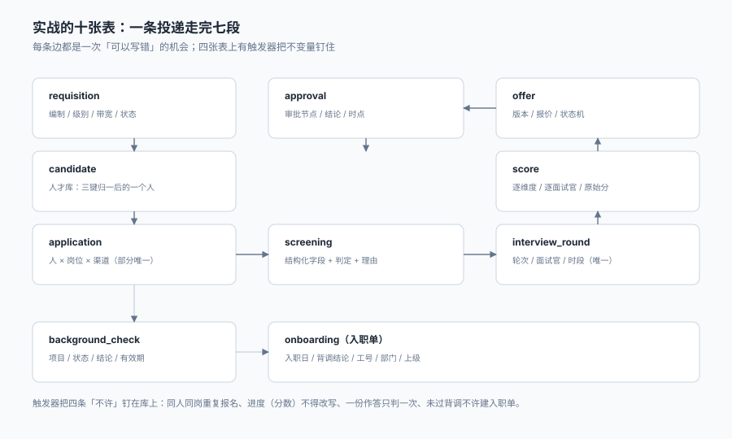

# 实战：10 表、4 触发器、22 条断言

前面七页讲的都是「应该怎样」。这一页只做一件事：**把那些「应该」写成数据库能自己执行的约束，然后跑一遍，看它拦不拦得住。**

之所以要写成约束而不是「接口里校验一下」，是因为接口会有人绕过——后台脚本、批量导入、另一个服务、一次紧急修数。**能被绕过的约束不叫约束，叫约定。**

::: tip 一句话理解
一个招聘系统的好坏，不看它能不能走通流程，看它**拦不拦得住七种「看起来合法」的写入**：重复投递、阶段回退、时段撞车、改写评分、超编发 Offer、背调未清就入职、拒绝不写理由。
:::

本页判据族 `TAX-A` ~ `TAX-H`，共 8 条。定义表在第六节「本页判据」。

## 一、十张表与它们的关系



| 表 | 一行是什么 | 关键约束 |
| --- | --- | --- |
| `requisition` | 一条有编制的招聘需求 | `hc_filled + hc_inflight <= hc_total` |
| `candidate` | 三键归一后的一个人 | `phone` 唯一 |
| `application` | 一个人投一个岗位的一次尝试 | `(candidate_id, req_id)` 部分唯一 |
| `screening` | 一次筛选的判定与理由 | `passed` 与 `reason_code` 同时有值 |
| `interview_round` | 一场面试（轮次 + 面试官 + 时段） | `(interviewer_id, slot_start)` 部分唯一 |
| `score` | 一份逐维度的原始评分 | 主键含面试官，且不许 UPDATE |
| `approval` | 一次审批（Offer 释放 / 带宽特批） | `node` 决定用途 |
| `offer` | 一份有期限的录用承诺 | 主体内一人一份有效 |
| `background_check` | 一项背调的结论 | `required=1` 且非 `clear` 即阻塞 |
| `onboarding` | 一张入职单 | 背调未清不得 `effective` |

十张表里，**四张表上有触发器**（`application` / `offer` / `score` / `onboarding`），三张表上有**部分唯一索引**（`application` / `offer` / `interview_round`）。这两种手段分工明确：

- **部分唯一索引**管「不许有第二条」——重复投递、两个有效 Offer、同一时段两场面试。
- **触发器**管「不许这样变」——阶段回退、改写评分、超编发 Offer、背调未清生效。

## 二、完整 DDL

```sql
pragma foreign_keys = on;

create table requisition (
  req_id      integer primary key,
  job_code    text not null,
  level       text not null check (level in ('L3','L4','L5','L6')),
  hc_total    integer not null check (hc_total > 0),
  hc_filled   integer not null default 0 check (hc_filled >= 0),
  hc_inflight integer not null default 0 check (hc_inflight >= 0),
  band_min    integer not null,
  band_max    integer not null,
  state       text not null default 'open' check (state in ('open','frozen','closed')),
  check (band_min <= band_max),
  check (hc_filled + hc_inflight <= hc_total)
);

create table candidate (
  candidate_id integer primary key,
  phone        text unique,
  email        text,
  name_norm    text not null
);

create table application (
  application_id integer primary key,
  candidate_id   integer not null references candidate(candidate_id),
  req_id         integer not null references requisition(req_id),
  channel_code   text not null,
  stage          text not null default 'applied'
                 check (stage in ('applied','screened','interview','evaluated',
                                  'offered','hired','rejected','withdrawn')),
  reason_code    text,
  created_at     text not null default (datetime('now')),
  check (stage <> 'rejected' or reason_code is not null)
);

create table screening (
  screening_id   integer primary key,
  application_id integer not null references application(application_id),
  passed         integer not null check (passed in (0,1)),
  reason_code    text,
  detail         text
);

create table interview_round (
  round_id       integer primary key,
  application_id integer not null references application(application_id),
  round_no       integer not null,
  interviewer_id text    not null,
  slot_start     text    not null,
  slot_end       text    not null,
  state          text    not null default 'scheduled'
                 check (state in ('scheduled','confirmed','cancelled_by_candidate',
                                  'cancelled_by_company','no_show','completed')),
  unique (application_id, round_no)
);

create table score (
  round_id       integer not null references interview_round(round_id),
  interviewer_id text    not null,
  dim_code       text    not null,
  raw_score      integer not null check (raw_score between 0 and 100),
  primary key (round_id, interviewer_id, dim_code)
);

create table approval (
  approval_id integer primary key,
  offer_id    integer not null,
  node        text    not null,
  approver_id text    not null,
  state       text    not null default 'pending' check (state in ('pending','approved','rejected')),
  created_at  text    not null default (datetime('now'))
);

create table offer (
  offer_id      integer primary key,
  candidate_id  integer not null references candidate(candidate_id),
  req_id        integer not null references requisition(req_id),
  legal_entity  text    not null,
  base_pay      integer not null,
  state         text    not null default 'draft'
                check (state in ('draft','pending','approved','sent','accepted','signed',
                                 'onboarded','declined','expired','revoked','rejected','void')),
  onboard_date  text,
  revoke_reason text,
  check (state <> 'revoked' or revoke_reason is not null)
);

create table background_check (
  bgc_id       integer primary key,
  candidate_id integer not null references candidate(candidate_id),
  item_code    text    not null,
  required     integer not null default 1,
  state        text    not null default 'pending'
               check (state in ('not_started','pending','clear','adverse','expired')),
  valid_until  text
);

create table onboarding (
  onboarding_id integer primary key,
  offer_id      integer not null unique references offer(offer_id),
  employee_no   text unique,
  dept_code     text,
  manager_id    text,
  onboard_date  text,
  employ_type   text check (employ_type in ('full_time','intern','contractor')),
  state         text not null default 'draft' check (state in ('draft','effective','cancelled')),
  fail_reason   text
);
```

三个部分唯一索引，把「不许有第二条」交给数据库：

```sql
-- 同一个人对同一个岗位，只能有一条「还在流程里」的投递
create unique index uq_app_active on application(candidate_id, req_id)
  where stage not in ('rejected','withdrawn');

-- 同一法人主体内，一个人只能有一份有效 Offer
create unique index uq_offer_active on offer(candidate_id, legal_entity)
  where state in ('approved','sent','accepted','signed','onboarded');

-- 同一位面试官同一时段，只能有一场面试（取消的不算）
create unique index uq_iv_slot on interview_round(interviewer_id, slot_start)
  where state in ('scheduled','confirmed');
```

::: danger 三条索引的 `where` 子句不能省
1. **`uq_app_active` 若去掉 `where`**：候选人被拒一次就永远不能再投这个岗位——这会把「重新应聘」这条路彻底堵死，而它恰恰是招聘里最常见的好事。
2. **`uq_offer_active` 若去掉 `where`**：`declined` 与 `expired` 的 Offer 也会占位，一个人拒了一次之后就再也发不出第二份。
3. **`uq_iv_slot` 若去掉 `where`**：面试取消后，那个时段永远排不了别人——**取消本来是释放资源，去掉 `where` 就变成了永久占用**。
:::

四个触发器，把「不许这样变」交给数据库：

```sql
-- T1 阶段只能前进（rejected / withdrawn 是终点，不再比较顺序）
create trigger trg_stage_no_back
before update of stage on application
when (case new.stage when 'applied' then 0 when 'screened' then 1 when 'interview' then 2
      when 'evaluated' then 3 when 'offered' then 4 when 'hired' then 5
      when 'rejected' then 6 when 'withdrawn' then 6 end)
   < (case old.stage when 'applied' then 0 when 'screened' then 1 when 'interview' then 2
      when 'evaluated' then 3 when 'offered' then 4 when 'hired' then 5
      when 'rejected' then 6 when 'withdrawn' then 6 end)
begin
  select raise(abort, 'STAGE_BACKWARD');
end;

-- T2 编制已满不许再发 Offer（approved 起就算占编）
create trigger trg_offer_hc_guard
before insert on offer
when new.state in ('approved','sent','accepted','signed','onboarded')
begin
  select case
    when (select hc_filled + hc_inflight from requisition where req_id = new.req_id)
         >= (select hc_total from requisition where req_id = new.req_id)
    then raise(abort, 'HC_EXCEEDED') end;
end;

-- T3 已提交的评分不许改写（要改只能追加一条新维度或走更正流程）
create trigger trg_score_immutable
before update on score
begin
  select raise(abort, 'SCORE_IMMUTABLE');
end;

-- T4 背调没清不许把入职单改成 effective
create trigger trg_onboard_requires_clear
before update of state on onboarding
when new.state = 'effective'
begin
  select case
    when exists (
      select 1 from background_check b
      join offer o on o.candidate_id = b.candidate_id
      where o.offer_id = new.offer_id and b.required = 1 and b.state <> 'clear'
    ) then raise(abort, 'BGC_NOT_CLEAR') end;
end;
```

## 三、22 条断言与实测输出

断言分三组：**11 条正向**（结构对不对）、**8 条负向**（拦不拦得住）、**3 条不变量**（数据里有没有违例）。

```text
== 结构与约束 ==
PASS C1 表数量 = 10（期望 10）
PASS C2 触发器 = 4（期望 4）
PASS C3 部分唯一索引 = 3（期望 3）

== 负向用例 ==
PASS N1 同人同岗重复投递: UNIQUE constraint failed: application.candidate_id, application.req_id
PASS N2 阶段回退: STAGE_BACKWARD
PASS N3 同一面试官同一时段: UNIQUE constraint failed: interview_round.interviewer_id, interview_round.slot_start
PASS N4 改写已提交评分: SCORE_IMMUTABLE
PASS N5 同一主体一人两份有效 Offer: UNIQUE constraint failed: offer.candidate_id, offer.legal_entity
PASS N6 编制已满仍发 Offer: HC_EXCEEDED
PASS N7 背调未清就生效: BGC_NOT_CLEAR
PASS N8 拒绝但不写理由: CHECK constraint failed: stage <> 'rejected' or reason_code is not null

== 正向用例 ==
PASS C4 背调清后入职单生效 = effective
PASS C5 换岗位可再次投递 = 2 条
PASS C6 带宽外报价 = 0（期望 0）
PASS C7 hc_inflight = 0（触发器在插入时拦，未累加）
PASS C8 追加维度评分可用 = 2 条
PASS C9 阶段前进 = interview
PASS C10 foreign_keys = 1
PASS C11 integrity_check = ok

== 不变量清单 ==
PASS 有效投递唯一：违例 0 条
PASS 一人一份有效 Offer：违例 0 条
PASS 面试时段不冲突：违例 0 条

22/22 PASS
```

`EXIT=0`。建库（10 表 + 3 索引 + 4 触发器）中位 **0.94 ms**（`:memory:`，50 次平均，最小 0.90 / 最大 1.41）。

::: warning 负向用例才是验收
正向用例只能证明「能写进去」——**任何一张没有约束的表都能让正向用例全绿**。真正证明设计成立的是那 8 条 `PASS N*`：每一条都对应一个「如果没有约束，业务上一定会发生」的写入。
:::

## 四、三个刻意的让步

一张约束表如果每条都「越严越好」，它会挡住合法操作。本页有三处故意放松：

| 让步 | 怎么写 | 如果不放松 |
| --- | --- | --- |
| 被拒后可再投 | 索引带 `where stage not in ('rejected','withdrawn')` | 拒一次就永久拉黑 |
| 取消的面试不占时段 | 索引带 `where state in ('scheduled','confirmed')` | 取消变成永久占用 |
| `rejected` 之外的状态不强制理由 | `check` 只约束 `rejected` | 每个状态都要填理由，没人填得完 |

三处的共同逻辑：**约束要对准「真正的错误」，不是对准「所有相似形状」**。把「再投一次」判成「重复投递」，把「取消」判成「占位」，都会让系统在合法路径上拦住人，然后被人用「改数据」绕过——那比没有约束更糟。

## 五、这套设计覆盖不到的

诚实地列出四个缺口：

1. **并发下的超发**：T2 是 `before insert` 的单行判断，两个事务同时插入仍可能都通过（SQLite 串行写，不会；PostgreSQL 的默认隔离级别下则会）。生产上要把判断放进条件更新：`update requisition set hc_inflight = hc_inflight + 1 where ... and hc_filled + hc_inflight < hc_total`，看影响行数。
2. **跨主体的重复候选人**：`uq_offer_active` 按 `legal_entity` 分开，集团内两家子公司可以同时发——这是刻意的，但需要一条「集团视图」来发现。
3. **背调项目的按岗位配置**：T4 只查 `required = 1`，而「哪些项目是必检」需要另一张配置表，本页没建。
4. **薪资带宽的历史版本**：报价校验用的是当前带宽，如果带宽中途调整，历史 Offer 会「追溯性越线」。本页没有做版本，只在[招聘需求与编制](../Requisition/index.md)里提了 `req_change`。

## 六、本页判据

| 判据 | 断言 | 验证方式 |
| --- | --- | --- |
| `TAX-A` | 十张表齐全且职责不重叠 | `sqlite_master` 中表数 = 10 |
| `TAX-B` | 三条部分唯一索引都带 `where` | `sql` 列中包含 `WHERE` |
| `TAX-C` | 四个触发器各有唯一错误码 | 四个 `RAISE` 标签互不相同 |
| `TAX-D` | 八条负向用例全部被拒 | 输出中 `PASS N1`~`PASS N8` 齐全 |
| `TAX-E` | 三条不变量违例为 0 | 三条 `select count(*)` 均为 0 |
| `TAX-F` | 背调阻塞能被解除 | 改 `clear` 后同一入职单可生效 |
| `TAX-G` | 阶段可前进不可回退 | 前进成功、回退报 `STAGE_BACKWARD` |
| `TAX-H` | 评分可追加不可改写 | `insert` 成功、`update` 报 `SCORE_IMMUTABLE` |

## 验证方式

```shell
# 1. 建库并跑全部断言（期望末行 22/22 PASS、退出码 0）
python3 ta_practice.py; echo "EXIT=$?"

# 2. 结构与约束计数（期望 10 / 4 / 3）
sqlite3 ta.db "select type, count(*) from sqlite_master
               where name not like 'sqlite_%' group by type order by type;"

# 3. 三条不变量（期望三个 0）
sqlite3 ta.db "select
  (select count(*) from (select candidate_id,req_id,count(*) c from application
     where stage not in ('rejected','withdrawn') group by 1,2 having c>1)) as dup_app,
  (select count(*) from (select candidate_id,legal_entity,count(*) c from offer
     where state in ('approved','sent','accepted','signed','onboarded') group by 1,2 having c>1)) as dup_offer,
  (select count(*) from (select interviewer_id,slot_start,count(*) c from interview_round
     where state in ('scheduled','confirmed') group by 1,2 having c>1)) as dup_slot;"

# 4. 触发器确实在工作（期望报 STAGE_BACKWARD）
sqlite3 ta.db "update application set stage='applied' where application_id=1;"
```

第 4 步是本页的核心：**一条 `update` 被拒绝，比十条文档更能说明「阶段不会回退」**。文档会被跳过，约束不会。

## 参考资料

- SQLite 官方文档《Partial Indexes》：部分唯一索引的语义与适用条件，本页三个 `uq_*` 索引均依赖此特性。
- SQLite 官方文档《CREATE TRIGGER》与 `RAISE()` 函数：`before update of <col>` 的触发时机与 `raise(abort, msg)` 的行为。
- PostgreSQL 官方文档《Transaction Isolation》：本页第五节「并发下的超发」在 `read committed` 下需要用条件更新而非触发器。
- 《中华人民共和国劳动合同法》第八条、第十条、第十九条：招用告知义务、书面合同期限、试用期约定——对应本页 `offer` 与 `onboarding` 两张表的字段设计。
- 与本页相邻：[总览](../Overview/index.md)、[Offer 与录用审批](../Offer/index.md)、[背调与入职交接](../Handoff/index.md)。
