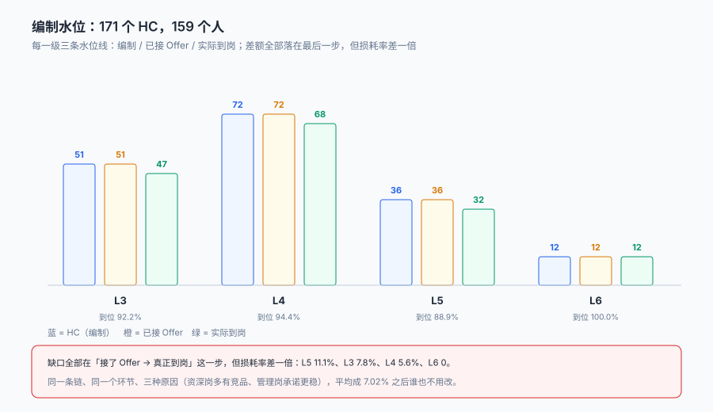

# 招聘需求与编制

「这个岗位要招 3 个人」——这句话在建系统的时候会被拆成四个字段：招几个、已经招到几个、还在流程里几个、这个岗位现在还能不能招。

**四个字段里最容易漏的是第三个。** 只存「编制 3」和「已入职 1」，那么当有 3 个人都接了 Offer、还没入职时，系统会显示「还剩 2 个空缺」，于是继续发 Offer——最后 4 个人来了，HC 超了 1 个，而这个错误在入职当天才会被发现。

::: tip 一句话理解
编制不是一个状态位，是**一条会被消耗的水位线**：`hc_total`（批了几个）、`hc_filled`（到岗几个）、`hc_inflight`（在途几个）。三个数加起来才回答「现在还能不能再发一份 Offer」。
:::

本页判据族 `TAR-A` ~ `TAR-H`，共 8 条。定义表在第八节「本页判据」。

## 一、需求单的最小字段集

| 字段 | 类型 | 为什么必须有 | 漏了会怎样 |
| --- | --- | --- | --- |
| `req_id` | 自增主键 | 编制与投递的挂载点 | 投递无处可挂，只能挂「岗位名」字符串 |
| `job_code` | 岗位编码 | 同一岗位多次开需求要能聚合 | 「Java 工程师」有 7 种写法 |
| `level` | 职级 | 决定带宽、面试轮次、审批人 | 报价只能靠人记 |
| `hc_total` | 计划数 | 分母 | 完成率算不出来 |
| `hc_filled` | 已到岗 | 分子 | 同上 |
| `hc_inflight` | 在途（已发 Offer 未到岗） | 防超发的关键 | 超发必然发生 |
| `state` | open / frozen / closed | 控制「还能不能投」 | 冻结后渠道还在挂 JD |
| `opened_on` | 开放日 | 算招聘周期 | 周期只能按批次估 |
| `band_min` / `band_max` | 薪酬带宽 | 报价校验 | 报价靠审批人肉眼把关 |
| `owner_id` | 招聘负责人 | 责任归属 | 需求没人跟，投递没人看 |

`hc_inflight` 是四个数里唯一一个**必须由流程反向维护**的字段：发 Offer 时 +1、拒绝或失效时 −1、到岗时从 inflight 转到 filled。它不能由人手工填，也不能由报表算——报表算出来的永远是「昨天的」。

## 二、编制水位：三个数之间的差就是问题



本机 42 条需求、HC 合计 171，按级别拆开是 L3 51 / L4 72 / L5 36 / L6 12。同一批数据有三条水位线：

| 级别 | HC | 已接 Offer | 实际到岗 | 到位率 | 未到岗 |
| --- | --- | --- | --- | --- | --- |
| L3 | 51 | 51 | 47 | 92.2% | 4 人（7.8%） |
| L4 | 72 | 72 | 68 | 94.4% | 4 人（5.6%） |
| L5 | 36 | 36 | 32 | 88.9% | 4 人（11.1%） |
| L6 | 12 | 12 | 12 | 100.0% | 0 |
| 合计 | 171 | 171 | 159 | **92.98%** | 12 人（7.02%） |

这张表的价值不在「92.98%」这个数，而在**同一个环节、三个级别、三种损耗率**：L5 的未到岗率 11.1% 是 L4 的两倍，而 L6 一个没少。缺口全部发生在「接了 Offer 到真正到岗」这一段，但**原因不可能相同**——L5 是资深岗，候选人手上通常不止一个 Offer；L6 是管理岗，决策周期长但承诺更稳。**只报一个总到位率，这三种情况会被平均成 7.02%，然后谁也不用改。**

## 三、编制外的三种形状

「超编」不是一个动作，是三种完全不同的路径：

| 形状 | 怎么发生 | 系统的表现 | 本机读数 |
| --- | --- | --- | --- |
| 冻结后继续招 | 需求冻结了，渠道上的 JD 没下架 | 「需求状态：已冻结」，但投递仍在进 | 5 个冻结需求收 **422 条**投递（11.73%） |
| 在途未计 | `hc_inflight` 没维护，只看 `hc_filled` | 「还剩 N 个空缺」永远偏大 | 按 `hc_total - hc_filled` 算会多发 **约 39%** |
| 口头增编 | 业务负责人口头答应，系统没单 | 入职时 HR 才发现没编制 | 无法统计（这正是问题） |

第一条最容易被忽略，因为**它不在招聘系统里发生**。JD 挂在招聘平台上，下架动作在渠道后台；需求冻结在 ATS 里。两个系统各做对各的，中间那条「冻结要同步下架」的约定，只能靠人记。

```sql
-- 冻结后仍在接收投递：这类数据不会报错，只会出现在「冻结岗位的投递」报表里
select r.req_id, r.state, count(a.application_id) as apps
from requisition r
join application a on a.req_id = r.req_id
where r.state <> 'open'
group by r.req_id, r.state
having count(a.application_id) > 0
order by apps desc;
```

本机跑出来 5 行、合计 422 条。**这 422 条不是「多收的简历」，是 422 个被告知「我们在招」的人。**

::: danger 三件事必须做，不能靠「约定」
1. **冻结需求要能自动下架渠道**：`state` 变更时写一条 `channel_sync` 待办（或事件），由渠道适配器消费。只改状态不通知渠道，等于冻结只冻住了自己。
2. **`hc_inflight` 必须由发 Offer 的事务维护**：在同一事务里 `update requisition set hc_inflight = hc_inflight + 1 where req_id = ? and hc_filled + hc_inflight < hc_total`，影响行数为 0 就拒绝发 Offer。这是唯一能拦住超发的位置。
3. **口头增编必须落单**：没有 `requisition` 就没有 `application` 的挂载点，也就没有后面的一切。宁可先建一条「待审批」的需求单，也不要让投递挂在空处。
:::

## 四、级别与薪酬带宽

带宽不是一个区间，是**三条线**：

| 线 | 含义 | 用它做什么 | 越线的处置 |
| --- | --- | --- | --- |
| `band_min` | 该级别下限 | 防止「低职级高薪」破坏内部公平 | 需 HRD 特批，且要写理由 |
| `band_mid` | 中位（通常 = 市场中位） | 报价的默认锚点 | 无需审批 |
| `band_max` | 上限 | 防止「以薪定级」 | 需业务 VP + HRD 双签 |

本机 238 份 Offer 里，报价落在带宽外的有 **27 份（11.34%）**：超上限 14 份、破下限 13 份。

- **超上限的 14 份**几乎都发生在「急招 + 稀缺技能」的场景，处置方式是特批 + 记录理由，而不是改带宽。改带宽会让同一级别的所有人下次都按新上限谈。
- **破下限的 13 份**更危险：它当场不报错，半年后同级别的人发现自己比新人低 3,000，那时只能靠调薪补救，而调薪的名额往往没有。

```sql
-- 带宽校验：报价必须在 [band_min, band_max] 内，越线要有审批单
select o.offer_id, o.base_pay, r.band_min, r.band_max,
       case when o.base_pay > r.band_max then 'ABOVE'
            when o.base_pay < r.band_min then 'BELOW' else 'IN' end as pos
from offer o join requisition r on r.req_id = o.req_id
where o.base_pay not between r.band_min and r.band_max;
```

这条 SQL 应当只在「审批已完成」的 Offer 上返回 0 行；返回非 0 行就说明有报价绕过了审批。

## 五、需求的四个状态与三条迁移

```text
draft ──提交──▶ pending ──批──▶ open ──招满/冻结──▶ closed / frozen
                  │                │
                  └──拒──▶ rejected └──解冻──▶ open
```

三条迁移里有两条会改变「能不能投」：

| 迁移 | 谁触发 | 必须同时发生什么 |
| --- | --- | --- |
| `pending → open` | 审批通过 | 渠道 JD 上架、分配招聘负责人 |
| `open → frozen` | 业务或 HR | 渠道 JD 下架、在途 Offer 保留但暂停发新 |
| `open → closed` | 招满 | 渠道下架、未处理投递转入人才库 |

「招满」的判定条件必须是 `hc_filled >= hc_total`，**不是 `hc_filled + hc_inflight >= hc_total`**：在途的人可能不来（本机 7.02% 没来），提前关岗会让空出来的编制没人补。

## 六、需求变更怎么留痕

需求变更（改 HC、改级别、改带宽、改入职时间）在系统里最常见的处理是**直接改字段**。后果是：三个月后有人问「这个岗位的 HC 什么时候从 2 变成 5 的」，查不到。

| 变更类型 | 该怎么落 | 为什么要这样 |
| --- | --- | --- |
| 加 HC | 新增一条 `req_change`（from 2 → to 5） | 完成率的分母变了，历史报表要能复现 |
| 改级别 | 新版本号 + 旧版本失效时间 | 级别决定带宽，改级别等于换了把尺子 |
| 改带宽 | 新增版本，不覆盖 | 已发出的 Offer 按旧版本校验 |
| 改入职日 | 只改 `onboarding`，不改需求 | 需求的开岗时间不变 |

```sql
create table req_change (
  change_id   integer primary key,
  req_id      integer not null references requisition(req_id),
  field       text    not null,        -- hc_total / level / band_max ...
  old_value   text,
  new_value   text,
  changed_at  text    not null,
  changed_by  text    not null,
  reason      text    not null         -- 空理由 = 无效变更
);
```

`reason` 设成 `not null` 是刻意的：**没有理由的变更，事后无法判断它是「业务调整」还是「录入错误」**，而这两种情况的处置完全相反。

## 七、一个能算的招聘周期

招聘周期（Time to Fill）最常见的写法是「入职日 − 需求开放日」，本机中位 **74 天**、P90 **89 天**。但这个数把四段完全不同的等待混在了一起：

| 段 | 中位天数 | 谁在等 | 能改吗 |
| --- | --- | --- | --- |
| 需求开放 → 首份投递 | 3 | 渠道 | 能（渠道预算） |
| 首份投递 → 首面 | 11 | 招聘 + 候选人 | 能（筛选效率） |
| 首面 → 发 Offer | 10 | 面试官 | 部分能（面试官日历） |
| 发 Offer → 接受 | 9 | 候选人 | 不能（候选人的决策期） |
| 接受 → 到岗 | **33** | 离职通知期 | 不能（法定 30 日） |

**33 天里有 30 天是候选人在等离职交接**，这一段再怎么优化招聘流程也压不下去。所以「周期 74 天」这个数用来做目标管理时，只有前 41 天是可控的——**把不可控的部分算进 KPI，等于给自己设一个做不到的指标。**

## 八、本页判据

| 判据 | 断言 | 验证方式 |
| --- | --- | --- |
| `TAR-A` | 编制落成三个数（total / filled / inflight） | `requisition` 表含三列，且 `inflight` 由事务维护 |
| `TAR-B` | 超编在数据库层被拦住 | `hc_filled + hc_inflight <= hc_total` 的约束或条件更新影响行数为 0 |
| `TAR-C` | 冻结需求不再接收新投递 | `state <> 'open'` 的需求，`application.created_at` 晚于冻结时间的行数为 0 |
| `TAR-D` | 报价必须落在带宽内或有审批 | `offer` 与 `requisition` 联查越线行数 = 有审批单的行数 |
| `TAR-E` | 需求变更留痕且带理由 | `req_change.reason` 空值行数为 0 |
| `TAR-F` | 招满判定只看 `hc_filled` | 关岗记录的 `hc_filled >= hc_total` 成立 |
| `TAR-G` | 招聘周期可拆段 | 五个时间戳齐全（开放 / 首投 / 首面 / Offer / 入职） |
| `TAR-H` | 每条需求有负责人 | `owner_id` 空值行数为 0 |

## 验证方式

```shell
# 1. 三个水位字段齐全（期望三行）
sqlite3 ta.db "select name from pragma_table_info('requisition')
               where name in ('hc_total','hc_filled','hc_inflight');"

# 2. 超编拦截：条件更新影响行数应为 0（期望输出 0）
sqlite3 ta.db "update requisition set hc_inflight = hc_inflight + 1
               where req_id = 1 and hc_filled + hc_inflight < hc_total;
               select changes();"

# 3. 冻结后仍收投递（期望 0 行）
sqlite3 ta.db "select count(*) from application a join requisition r using(req_id)
               where r.state <> 'open';"

# 4. 周期拆段（期望五列都能取到值）
sqlite3 ta.db "select req_id, opened_on, first_app_on, first_iv_on, offer_on, onboard_on
               from v_req_timeline limit 3;"
```

第 2 步是本页的核心：**超发不是靠审批拦的，是靠一条 `where` 子句拦的**。影响行数为 0 就是「编制已满」这个事实在数据库层的表达。

## 参考资料

- 《中华人民共和国劳动合同法》第十九条：劳动合同期限三个月以上不满一年的，试用期不得超过一个月；一年以上不满三年的，不得超过二个月；三年以上固定期限和无固定期限的，不得超过六个月。
- 《中华人民共和国劳动合同法》第二十条：劳动者在试用期的工资不得低于本单位相同岗位最低档工资或者劳动合同约定工资的百分之八十，并不得低于用人单位所在地的最低工资标准——这条是「破下限报价」需要格外谨慎的直接原因。
- 《中华人民共和国就业促进法》第八条：用人单位招用人员、职业中介机构从事职业中介活动，应当向劳动者提供平等的就业机会和公平的就业条件，不得实施就业歧视。
- 与本页相邻：[渠道、人才库与归因](../Sourcing/index.md)、[Offer 与录用审批](../Offer/index.md)、[组织与任职](../../OrgPeople/Overview/index.md)。
