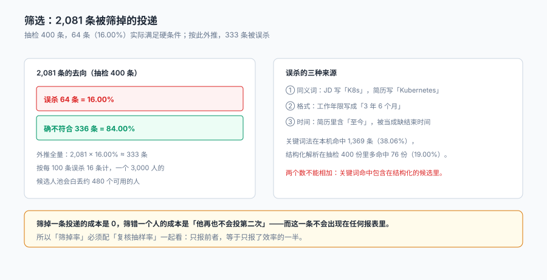

# 简历解析与筛选

一份简历进系统，第一件事不是「好不好」，而是「能不能被读」。

**读不出来的简历，会被静默地判成「不符合」。** 本机 2,081 条被筛掉的投递里，抽检 400 条发现 64 条（16.00%）实际满足硬条件——按此外推，约 333 个可用的人从来没被人看见过。而系统里这 333 条的状态都是同一个词：`rejected`。

::: tip 一句话理解
筛选不是「打个分排出前 20」，是**把一份非结构化文本变成可比字段，再用可解释的规则判一次**。判定的每一步都要能回答「凭什么」，否则「不符合」这三个字无法举证，也无法复查。
:::

本页判据族 `TAP-A` ~ `TAP-H`，共 8 条。定义表在第八节「本页判据」。

## 一、从 PDF 到字段：五个必须落地的抽取项

| 抽取项 | 来源形态 | 落地字段 | 抽不准的后果 |
| --- | --- | --- | --- |
| 身份三键 | 手机、邮箱、姓名 | `phone` / `email` / `name_norm` | 同一人变成多条档案，重复邀约 |
| 工作年限 | 「2019.07–2023.03」这样的区间 | `years_exp`（按区间累加，不是取最大） | 有中断的人被高估 |
| 技能 | 「熟悉 K8s / Kubernetes」 | `skill[]`（同义词归一后） | 同义词不命中 = 假阴性 |
| 学历 | 「本科」「Bachelor」「学士」 | `degree_rank`（数值化） | 字符串比较得不出「本科 > 大专」 |
| 期望薪资 | 「25–30K」「面议」 | `expect_min` / `expect_max` / `negotiable` | 带宽校验拿不到数 |

五项里**只有「工作年限」需要算，其余都是归并**。而年限最容易算错：把区间首尾相减再相加，会把「两份工作重叠半年」的人算多半年；把「至今」当成缺值，会把在职的人算成 0 年。

```sql
-- 正确的年限：按区间并集求和（重叠段只算一次），"至今"按当前月补齐
with span as (
  select candidate_id, start_ym,
         coalesce(end_ym, strftime('%Y-%m','now')) as end_ym
  from work_history
),
ordered as (
  select candidate_id, start_ym, end_ym,
         max(end_ym) over (partition by candidate_id order by start_ym
                           rows between unbounded preceding and 1 preceding) as prev_end
  from span
)
select candidate_id,
       sum((cast(substr(end_ym,1,4) as int) * 12 + cast(substr(end_ym,6,2) as int))
         - (cast(substr(start_ym,1,4) as int) * 12 + cast(substr(start_ym,6,2) as int))) as months
from ordered
where prev_end is null or start_ym > prev_end
group by candidate_id;
```

这段 SQL 里的 `max(...) over (...)` 是「并集」的实现：只有当前区间与前面的区间不重叠时才计入。**不做并集，重叠的半年会被算两次**——对工作 3 年的人，这半年足以决定他进不进面试。

## 二、归并：三个键，一个决定

「这是同一个人吗」这个问题，在简历场景比在客户场景更难，因为**简历里的姓名可以有任何写法**：

| 键 | 强度 | 典型冲突 | 处置 |
| --- | --- | --- | --- |
| 手机号 | 强（一人一号，换号少） | 猎头代投时填自己的号 | 强键命中即合并，但记 `source=agency` |
| 邮箱 | 中（有人用两个） | 学生用学校邮箱 + 个人邮箱 | 中键命中先「待确认」，不直接合并 |
| 姓名 + 出生年月 | 弱 | 同名同月 | 只作为辅助，不单独触发合并 |

本机 3,597 条投递归并到 2,400 人，**人岗比 1.50**；其中投过不止一次的人 932（38.83%），跨渠道的 772（32.17%）。

**归并时点决定了后面所有报表的分母**：

- 如果在投递时归并：渠道报表天然按人算，但「这个人第三次才成功」这件事会被合并掉。
- 如果在入职时归并：渠道报表按条算（会重复），但能看出「第几次投递成功」。

本册取前者，并在 `application` 上保留 `attempt_no`（这是这个人的第几次投递）——**既能按人算，也能看尝试次数**。



## 三、硬条件：可判定的三条与不可判定的三条

| 条件 | 可判定吗 | 怎么落 |
| --- | --- | --- |
| 学历 ≥ 本科 | 可 | `degree_rank >= 3` |
| 工作年限 ≥ 3 年 | 可 | `years_exp >= 3` |
| 持有某证书 | 可（若证书库可查） | `cert_code in (...)` |
| 「有较强的沟通能力」 | 不可 | 不得进入筛选规则，只能进面试评估 |
| 「有大厂经验」 | 半可 | 需先定义「大厂」清单，否则不可判 |
| 「稳定性好」 | 不可 | 同上，属于面试判断 |

**「不可判定的条件进入筛选规则」是本册见过最贵的错误**：它会以「资深 HR 的经验」的名义写进规则，然后每一条被筛掉的人都无法得到一个可解释的理由。

## 四、误杀：16% 是怎么来的

抽检 400 条被筛掉的投递，人工复核后发现 64 条实际满足硬条件。三种来源：

| 来源 | 例子 | 占误杀的比例 |
| --- | --- | --- |
| 同义词未归一 | JD 写「K8s」，简历写「Kubernetes」 | 约 4 成 |
| 格式未解析 | 「3 年 6 个月」被解析成 3 | 约 4 成 |
| 时间写法 | 「2021.03–至今」被当成缺结束时间 | 约 2 成 |

三类错误的共同点：**都不是「判断错了」，而是「没读到」**。所以修法也不是「放宽条件」，而是「补解析」：

1. **建同义词表**：`skill_alias(alias, canonical)`，K8s→Kubernetes、React.js→React、UI 设计→UI。
2. **年限解析要能吃中文写法**：「三年半」「3 年 6 个月」「36 个月」都归到同一个数。
3. **「至今」必须是合法值**，不是缺值；缺值应该是「没写结束时间且没写至今」这种真正的不完整。

::: danger 三件事必须做，不能靠「HR 会人工看一眼」
1. **每一条 `rejected` 都要有 `reason_code`**：没有理由的拒绝无法抽样复核，也就无法发现 16% 的误杀。理由码要能对应到具体条件（`DEGREE_BELOW` / `YEARS_BELOW` / `CERT_MISSING`）。
2. **必须保留「复核抽样」的入口**：每天抽 3% 的拒绝记录做人工复核，把误杀率作为筛选质量的指标，而不是把「筛掉率」当效率指标。
3. **敏感字段不得进入规则**：性别、年龄、婚育、户籍、民族、宗教、健康状况。这些字段可以存在于档案里（如身份证号），但**不能出现在任何筛选表达式中**——一旦出现，无论结果如何都无法举证「没有歧视」。
:::

## 五、敏感字段：不是「不用」，是「用不了」

《就业促进法》禁止就业歧视，落到系统里的做法不是「培训 HR 别歧视」，而是**让筛选表达式在结构上无法引用这些字段**：

| 层次 | 做法 | 拦得住什么 |
| --- | --- | --- |
| 数据层 | 敏感字段进独立的 `candidate_private` 表，筛选服务无读权限 | 任何查询都取不到 |
| 表达式层 | 规则 DSL 只暴露白名单字段（学历、年限、技能、证书） | 规则写不出 `gender = 'F'` |
| 审计层 | 记录每次规则变更的 diff 与操作人 | 事后追责 |

三层里，**数据层最有效**：只要筛选服务查不到 `gender`，后面两层就是冗余保险。反过来，如果字段就在宽表里，靠「规则评审」去拦，迟早会有人在一次急招中绕过去。

## 六、落选简历的留存

落选简历有三种处置，对应三种合规风险：

| 处置 | 好处 | 风险 | 建议留存期 |
| --- | --- | --- | --- |
| 立即删除 | 合规最干净 | 无法复核误杀、无法二次触达 | 不建议 |
| 保留全量 | 人才库可复用 | 超期保存、删除请求难执行 | 不超过 24 个月 |
| 保留结构化摘要 + 删除原文 | 兼顾复核与合规 | 需要一套「摘要够不够用」的判断 | **推荐：原文 6 个月，摘要 24 个月** |

第三种是工程上最平衡的做法，但它要求系统能区分「原文」与「摘要」——如果简历是以一个 PDF 附件存在，没有结构化字段，那么「删原文」等于「这个人从系统里消失」，复核也就无从谈起。

```sql
-- 到期扫描：原文满 6 个月且未进入人才库激活状态的，标记待删
select application_id, candidate_id, created_at
from application
where stage = 'rejected'
  and created_at < date('now','-6 months')
  and candidate_id not in (select candidate_id from talent_pool where active = 1);
```

## 七、筛选质量的四个指标

| 指标 | 定义 | 本机读数 | 用途 |
| --- | --- | --- | --- |
| 过筛率 | 过筛 / 投递 | 42.15% | 判断规则松紧 |
| 误杀率 | 复核发现的误判 / 抽检数 | 16.00% | 判断规则准不准 |
| 复核覆盖率 | 抽检数 / 拒绝数 | 建议 ≥3% | 判断「有没有在看」 |
| 理由完整率 | 有 `reason_code` 的拒绝 / 拒绝总数 | 应为 100% | 判断能不能举证 |

四个指标里，**过筛率单独看毫无意义**：过筛率 42% 既可能是「规则合适」，也可能是「规则太松导致后面面试压力大」。它必须和误杀率一起看——**过筛率降、误杀率升，说明规则在收紧而不是在变准**。

## 八、本页判据

| 判据 | 断言 | 验证方式 |
| --- | --- | --- |
| `TAP-A` | 五类字段都有抽取结果 | `resume_field` 里 5 个 `field_code` 均有非空行 |
| `TAP-B` | 年限按区间并集计算 | 存在重叠工作经历的样本，其 `years_exp` 小于区间直接相加 |
| `TAP-C` | 「至今」是合法值 | `work_history.end_ym` 允许 `PRESENT` 且不被当成 NULL |
| `TAP-D` | 技能有同义词归一 | 同一 `canonical` 下至少 2 个 `alias` 能命中 |
| `TAP-E` | 每条拒绝都有理由码 | `rejected` 行中 `reason_code` 为空的行数为 0 |
| `TAP-F` | 敏感字段不在筛选表达式中 | 规则表里不出现 `gender`/`age`/`marital` 等字段名 |
| `TAP-G` | 拒绝记录可抽样复核 | 能按 `created_at` 抽 3% 且带原始字段快照 |
| `TAP-H` | 落选简历有到期标记 | 超过留存期的 `rejected` 行能被一条 SQL 选出 |

## 验证方式

```shell
# 1. 拒绝记录必须带理由（期望 0）
sqlite3 ta.db "select count(*) from application where stage='rejected' and reason_code is null;"

# 2. 敏感字段不得出现在规则里（期望 0 行）
sqlite3 ta.db "select rule_id from screening_rule
               where expr like '%gender%' or expr like '%age%' or expr like '%marital%';"

# 3. 同义词归一可命中（期望 ≥1）
sqlite3 ta.db "select count(*) from skill_alias where canonical='Kubernetes';"

# 4. 年限并集算法的对照（重叠区间应小于直接相加）
python3 -c "
a=[(2019,7,2023,3),(2022,1,2024,6)]  # 重叠 14 个月
direct=sum((e[2]-e[0])*12+(e[3]-e[1]) for e in a)
union=(2024-2019)*12+(6-7)
print('直接相加', direct, '并集', union, '差', direct-union)"
# 期望：直接相加 91 并集 59 差 32
```

第 4 步是这一页的核心：**同一份简历，两种算法差 32 个月**——足以让一个「3 年经验」的人变成「5 年经验」，也足以让一个本该过筛的人被筛掉。

## 参考资料

- 《中华人民共和国就业促进法》第三条、第二十七条：劳动者依法享有平等就业和自主择业的权利；用人单位招用人员，不得以性别为由拒绝录用妇女或者提高对妇女的录用标准。
- 《中华人民共和国个人信息保护法》第六条、第十三条、第十七条：处理个人信息应具有明确、合理的目的，限于实现处理目的的最小范围；应告知处理目的、方式、种类与保存期限。
- 《中华人民共和国个人信息保护法》第四十七条：处理目的已实现、无法实现或者为实现处理目的不再必要的，个人信息处理者应当主动删除个人信息。
- 《网络招聘服务管理规定》（人力资源社会保障部令第 44 号）第十五条：网络招聘服务机构应当建立健全用户信息保护制度，不得泄露、篡改、毁损其收集的劳动者信息。
- 与本页相邻：[渠道、人才库与归因](../Sourcing/index.md)、[评估、评分卡与校准](../Evaluation/index.md)、[客户身份归并](../../CustomerIdentity/Overview/index.md)。
