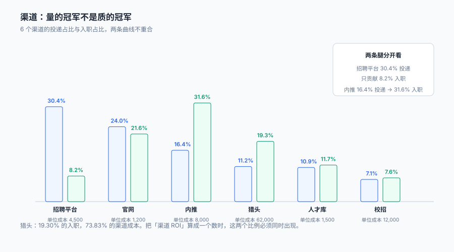

# 渠道、人才库与归因

一个候选人可能是这样进来的：三个月前在招聘平台投过一次没回音，上周被朋友内推，今天又自己从官网投了一次。

**三条投递，三个渠道，一次入职。** 这笔入职该记给谁？市场部会说是平台投放的功劳（人是从平台上认识的），内推奖金该发给朋友（人是朋友推来的），招聘官网的转化率也想加一（人最后是从官网投的）。三张报表各自成立，加起来却是 300% 的入职。

::: tip 一句话理解
渠道不是一个字段，是**一串带时间戳的触点**。有了触点表，「首次触点」「末次触点」「多触点分摊」三种口径都能算；只有一个 `channel` 字段，等于永久选定了其中一种，而且事后无法改变。
:::

本页判据族 `TAS-A` ~ `TAS-H`，共 8 条。定义表在第八节「本页判据」。

## 一、六个渠道的量与质

| 渠道 | 投递 | 入职 | 转化率 | 单位成本（元/人） | 成本小计（元） |
| --- | --- | --- | --- | --- | --- |
| 内推 | 591 | 54 | **9.14%** | 8,000（奖金） | 432,000 |
| 猎头 | 404 | 33 | 8.17% | 62,000（费率） | 2,046,000 |
| 校招 | 255 | 13 | 5.10% | 12,000 | 156,000 |
| 人才库二次触达 | 393 | 20 | 5.09% | 1,500 | 30,000 |
| 官网 | 862 | 37 | 4.29% | 1,200 | 44,400 |
| 招聘平台 | 1,092 | 14 | **1.28%** | 4,500 | 63,000 |
| 合计 | 3,597 | 171 | 4.75% | 16,207（加权） | 2,771,400 |



这张表最重要的读法是**两列并排看**：

- 招聘平台贡献了 **30.36%** 的投递，只贡献 **8.19%** 的入职；内推贡献 **16.43%** 的投递，却贡献 **31.58%** 的入职。两者的转化率差 **7.1 倍**（9.14% / 1.28%）。
- 猎头贡献 **19.30%** 的入职，却吃掉 **73.83%** 的渠道成本（2,046,000 / 2,771,400）。

**只报「哪个渠道来的人多」，结论是「加大平台投放」；只报「哪个渠道便宜」，结论是「全靠官网」。两个结论都会把预算带到沟里。** 正确的读法是「每人成本 × 入职占比」的四象限：

| | 单位成本低 | 单位成本高 |
| --- | --- | --- |
| **转化率高** | 内推（8,000 / 9.14%） | 猎头（62,000 / 8.17%） |
| **转化率低** | 官网、平台、人才库 | 校招（12,000 / 5.10%，但看长期留存） |

::: danger 三件事必须写进数据模型，不能留给「报表里按 channel 分组」
1. **渠道要有独立的触点表**：`channel_touch(application_id, channel_code, touched_at, touch_type)`。一人在一岗可以有多个触点，触点表就自然支持三种归因口径。
2. **归因口径必须是报表参数，不是字段值**：报表里写 `attribution = 'first' | 'last' | 'even'`，三种都能跑；把口径写死在 `application.channel` 里，等于只有一种。
3. **成本要按「成功入职」计，不按「投递」计**：猎头的费率是对成功入职收的，平台的年费是分摊的。两种成本混在一个「每投递成本」指标里，会得出「猎头比平台便宜」这种荒谬结论。
:::

## 二、归因的三种口径

同一条数据，三种口径三个答案：

| 口径 | 规则 | 本机结果 | 适用场景 |
| --- | --- | --- | --- |
| 首次触点 | 记给最早的那次投递 | 内推的占比更高（早期人脉先行） | 判断「品牌与渠道的长期效果」 |
| 末次触点 | 记给最后一次投递 | 官网与平台的占比更高（临门一脚） | 判断「转化环节的效率」 |
| 均分 | 一条入职按触点数量均摊 | 猎头与内推的占比同时下降 | 预算分摊、避免重复计功 |

本机实测：**首次触点与末次触点不一致的有 38 人（1.58%）**。这个比例不大，但它意味着**两张报表会差 38 个入职归属**——在 171 人的盘子里，这足以让某个渠道的 ROI 从「划算」变成「不划算」。

```sql
-- 三种口径各自算一遍（同一份数据，三个答案）
with t as (
  select a.application_id, a.candidate_id, t.channel_code, t.touched_at,
         row_number() over (partition by a.candidate_id order by t.touched_at) as rn_first,
         row_number() over (partition by a.candidate_id order by t.touched_at desc) as rn_last
  from application a join channel_touch t using(application_id)
  where a.stage = 'hired'
)
select 'first' as basis, channel_code, count(*) from t where rn_first = 1 group by 2
union all
select 'last', channel_code, count(*) from t where rn_last = 1 group by 2;
```

这段 SQL 的产出就是「两张表」，而它们都对。**能不能同时给出，取决于你当初有没有存触点。**

## 三、内推为什么便宜

内推的单位成本 8,000 元，是猎头的 **12.9%**，转化率却是猎头的 1.12 倍。这个差距不是「内推更准」这么简单，它由三件事叠加：

| 因素 | 内推 | 平台/猎头 |
| --- | --- | --- |
| 信息对称 | 推荐人知道团队真实情况，候选人预期准 | 靠 JD 想象，落差大 |
| 自我筛选 | 推荐人不愿意推「明显不合适」的人（影响自己的信誉） | 无成本海投 |
| 决策速度 | 已有心理准备，接受 Offer 快 | 往往同时在谈多家 |

三件事里，**只有第一件能被系统影响**（把团队真实信息放进 JD）。所以本册不建议做「内推奖励加倍」这类动作——它提的是「量」，而内推的优势在「质」，加钱反而会拉进更多不合适的人。

::: warning 内推奖励的「归属期」要写清楚
如果 A 推荐了某人，某人三个月后自己从官网投了简历并入职，奖金该不该发？本册的口径是：**归属期为 180 天，且以「首次触点」为准**。这条规则必须写在系统里（`referral.valid_until`），否则每一次都会变成一次人工争论。
:::

## 四、人才库：一个只有成本没有产出的池子

人才库二次触达在本机的表现很好：393 条投递、20 人入职、5.09% 转化，单位成本仅 1,500 元——**这是全表里最便宜的一条渠道**。

但它有一个前提：**池子里的人得还记得你**。人才库的失效不是「数据过期」，是三种具体的退化：

| 退化 | 表现 | 系统怎么发现 |
| --- | --- | --- |
| 联系方式失效 | 邮件退信、短信未达 | 触达回执状态（退信率） |
| 意愿变化 | 已在别处入职 | 触达后无响应 + 后续再投间隔 |
| 数据陈旧 | 技能与年限已过时 | `profile_updated_at` 距今时长 |

**人才库的运营指标不是「存量多少人」，是「本轮触达的响应率」**。存量 10 万但响应率 1% 的池子，比存量 1 万响应率 15% 的池子差得多——前者会让「人才库」变成一份只增不减的负债（还要付存储、合规、删除的成本）。

## 五、渠道的重复计数

一人多渠道会带来两件麻烦事：

1. **入职数被重复计**：本机跨渠道 772 人（32.17%），若不按人归并，各渠道的入职数之和会大于实际入职数。
2. **推荐奖金被重复发**：两个推荐人各推了一次，都主张奖金。

```sql
-- 检出一条入职被多个渠道认领的情况
select candidate_id, count(distinct channel_code) as channels
from channel_touch ct
join application a using(application_id)
where a.stage = 'hired'
group by candidate_id
having count(distinct channel_code) > 1;
```

处置口径要提前定，不能事后议：**多推荐人共享一份奖金（按推荐时间排序，首位 70%、次位 30%）**，这一条写进内推规则页，比写进系统更重要——因为它是「人」的规则，系统只负责记录谁先谁后。

## 六、渠道预算怎么分

渠道预算不该按「去年各渠道花了多少」分，也不该按「哪个渠道人多」分。一个可执行的口径是**边际成本**：

| 渠道 | 当前入职 | 单位成本 | 加投 20% 预算的预期增量 | 边际成本 |
| --- | --- | --- | --- | --- |
| 内推 | 54 | 8,000 | +8 ~ 11 人（推荐人池有限） | 约 12,000 |
| 人才库 | 20 | 1,500 | +6 ~ 9 人（响应率随触达次数衰减） | 约 3,000 |
| 官网 | 37 | 1,200 | +2 ~ 3 人（受品牌流量限制） | 约 9,000 |
| 平台 | 14 | 4,500 | +4 ~ 6 人（量大但转化低） | 约 11,000 |
| 猎头 | 33 | 62,000 | +6 ~ 7 人（费率不变） | 62,000 |

这张表里的「边际成本」是估计值而非实测值（本机没有做预算弹性实验），**但它说明了一件事：平均成本会骗人**。内推的平均成本 8,000，边际成本 12,000；人才库平均 1,500，边际 3,000。按平均成本分预算，会把钱投到已经饱和的渠道上。

## 七、渠道数据的三条纪律

1. **渠道编码要有主数据**：`referral` / `内推` / `员工推荐` 是三个字符串、一个渠道。没有编码表，所有渠道报表都会在半年后变成一张「同义词表」。
2. **渠道成本按月落账，不按年摊**：年度框架合同的费用要按月摊到当月入职上，否则 12 月的 ROI 会突然失真。
3. **渠道效果要按「岗位族」分组**：同一渠道招研发与招销售的效果可以差 3 倍，全公司一个转化率没有决策价值。

## 八、本页判据

| 判据 | 断言 | 验证方式 |
| --- | --- | --- |
| `TAS-A` | 渠道触点独立成表且一人可多行 | `channel_touch` 行数 ≥ `application` 行数，且存在同一 `candidate_id` 多行 |
| `TAS-B` | 渠道编码来自主数据 | 所有 `channel_code` 都能在 `channel` 表查到 |
| `TAS-C` | 归因口径是报表参数 | 同一份数据能跑出 first/last/even 三种结果 |
| `TAS-D` | 入职数按人去重 | `count(distinct candidate_id)` ≤ `count(*)` 且差额可解释 |
| `TAS-E` | 成本按成功入职计 | 每个渠道的 `cost_per_hire` 有明确分母（入职数） |
| `TAS-F` | 内推归属期有截止时间 | `referral.valid_until` 非空 |
| `TAS-G` | 多推荐人有分摊规则 | 同一候选人多个 `referral` 时奖金合计 = 单人奖金 |
| `TAS-H` | 人才库触达有回执状态 | `touch_log.status` 含 delivered / bounced / no_response |

## 验证方式

```shell
# 1. 触点表比投递表更"多"（一投多触点）
sqlite3 ta.db "select (select count(*) from channel_touch), (select count(*) from application);"
# 期望：前者 ≥ 后者

# 2. 渠道编码无孤儿（期望 0）
sqlite3 ta.db "select count(*) from application a
               left join channel c on c.code = a.channel_code where c.code is null;"

# 3. 三种归因口径能同时产出（期望三行）
sqlite3 ta.db "select basis, count(*) from v_hire_attribution group by basis;"

# 4. 入职数按人去重后小于按投递计（期望两数不等）
sqlite3 ta.db "select count(*) as by_app, count(distinct candidate_id) as by_person
               from application where stage='hired';"
```

第 4 步的两个数在本机是 171 与 164——差 7 条。**这个差就是「渠道报表加起来不等于总入职数」的全部原因。**

## 参考资料

- 《中华人民共和国劳动合同法》第九条：用人单位招用劳动者，不得扣押劳动者的居民身份证和其他证件，不得要求劳动者提供担保或者以其他名义向劳动者收取财物。
- 《中华人民共和国个人信息保护法》第二十三条、第二十四条：向第三方提供个人信息应告知并取得单独同意；通过自动化决策方式推送商业信息的，应同时提供不针对个人特征的选项——内推与人才库触达均属此类。
- 《网络招聘服务管理规定》（人力资源社会保障部令第 44 号，2020 年）：从事网络招聘服务应取得人力资源服务许可证，并核验用人单位资质、审核招聘信息真实性。
- 与本页相邻：[招聘需求与编制](../Requisition/index.md)、[简历解析与筛选](../Screening/index.md)、[客户身份归并](../../CustomerIdentity/Overview/index.md)。
